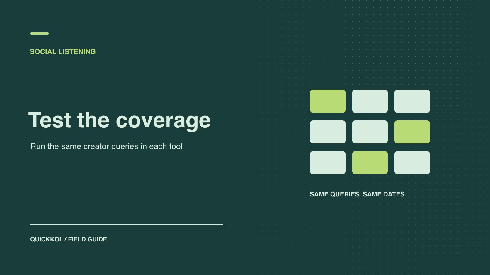

# 社交聆听工具怎么选？先用真实合作样本测试

状态：本地审阅稿；正式发布日期待确认。

用已知作品、达人账号和可复核的原帖，对比工具能否支持选人或验收。

QuickKOL 编辑图形；不呈现真实账号指标或平台界面。

社交聆听工具值不值得买，取决于它能不能完成团队实际需要的达人任务。先选一个，例如在指定话题里发现候选人，或找回签约达人的上线内容。准备人工确认的样本，在同样的账户范围、平台和日期下测试找回、误报、等待时间和导出。用工具能找到且团队能复核的证据作采购决定。

## 只选一个必须做好的人工作业

先选发现候选人、追踪活动发布、监控品牌问题或复盘中的一个主任务。每个任务需要的输入不同。发现工作可能看公开帖及垂类表达，交付工作需要已知达人和指定链接，舆情需要时间和分派记录。为主任务写明谁每天使用结果、想看到什么对象、超过多长时间就失去价值。比如品牌想知道 20 位签约达人发布后，有没有出现需要客户支持回复的产品问题。先问能监测哪类可见评论，未签约账号和私密评论不纳入试点的可比目标。

给试点设两项必需条件和一项加分条件。比如找回大部分已知帖子、导出含可访问原帖链接是必需；报告图表样式是加分项。研究[社媒聆听查询样本验证](https://www.quickkol.com/zh/blog/social-listening-query-sample-validation/#answer)，可以先确定词典和样本规则。写清楚负责人每周拿到报告以后要采取什么行动，以免把「返回结果多」误当成「活动能用」。

## 先比对象和权限，再比平台名称

工具页面显示支持 Instagram，不代表它能收集每条帖子和评论。[Brandwatch 的聆听来源说明](https://social-media-management-help.brandwatch.com/en/articles/17449910-sources-for-listen-social-listening-mentions)按来源描述不同可见范围和获取条件。[Sprout Social 的聆听数据范围说明](https://support.sproutsocial.com/hc/en-us/articles/360056024132-Social-Listening-data-availability-and-limitations)区分了公开 Instagram 标签帖、已连接业务账号的可用数据，以及 YouTube 视频说明与不包含的评论。把这些差异写成试点假设，并让供应商用实际帐号和权限演示。购买前要问是公开抓取、已授权数据、合作方来源还是部分回填，以及断开连接是否停止后续收集。

做一张平台、对象、权限、回填、刷新频率、交接的矩阵。平台只是一列；对象写「公开帖子描述」「连接账号拥有的帖子下的评论」或其他实际承诺。把查不到某类内容标成不在范围，与某个样本本应抓到却没抓到分开。在合同里记录连接所有者、退出条件及可导出的历史范围。不要为试点给第三方超过必要的发布或管理权限。

## 用人工标注样本测找回

从签约达人、同行话题和正常噪声各取样。保存原帖 URL、时间、账号、语言、平台、对象类型和纳入原因。将其中一部分留作盲查，先不给供应商看。别用任何一家的导出作「完整事实」。试点仅测对已核验样本的表现。为每个账号至少准备常用手柄、品牌名写法、地区语言和几种常见变体。测试至少覆盖一个试点前样本和一个试点开始后才出现的样本，以区分历史回填与正在采集。

用相同词义建立等价查询，允许根据工具语法调整。把细节留在查询日志，例如引号、排除词、语言筛选和日期。公开样本的链接在结束时再次查验，若转私密、删帖或修改标签，把这部分单列。遇到供应商说「查不到属于平台限制」，检查文档与试点权限。可判断没有覆盖时把它归为范围缺口，原因不清时标为未解释漏抓。

## 分别记录找回率与结果相关性

设一组 40 条符合约定范围、仍可访问的目标样本。工具 A 找回 32 条，样本找回率为 80%。工具 B 找回 36 条，为 90%。另抽两个工具各自返回的 50 条进行人工标注，A 有 42 条符合业务条件，B 有 33 条。这样可以看出 B 在试点找到更多已知样本，A 的抽样人工筛查负担较轻。两者结论都限定在试点范围，不能套到整个平台。把小样本的分母、抽样方式和排除规则写在数字旁边。

再问具体漏掉哪类对象。假设 B 主要多抓到新闻转载，而 A 少抓的是品牌必须回访的合作达人评论。品牌可以优先补评论覆盖，也可能把评论监测交给原生后台。将结果按对象、市场和语种分组。不要为把各工具塞进同一总分而把对象差异抹掉。

## 测到首次可用和实际处理时间

记录发布时间、工具首次可见时间、通知时间、团队第一次能复核链接的时间。按活动重要性设观察窗口，不用供应商承诺代替实际检测。例：发帖后 6 小时出现在报表、8 小时触发通知，客服次日才能访问原帖。若主任务是快速回应，真正耗时包括权限、路由和人工确认。截一轮周末与非工作时段，避免只测白天的理想流程。定时采集导致某些较长等待时，也区分已看到但尚未刷新和没有权限查看。

再算每周负担：一个人复查 100 条结果，平均每条 40 秒，约 67 分钟。再加去重、补源和交接，才是内部成本。两位标注者意见不同的地方，用排除或纳入规则解释。整理出团队能持续执行的采样率，以及紧急问题从哪个渠道升级。

## 用可导出的行验证交接

要求供应商现场交付一份真实试点导出。每行需要可访问的原帖 URL、时间、账号、平台、对象类型、匹配词、语言和证据状态。数据说明写清楚哪个字段可以因授权终止而消失。让第二位人员拿导出复查几个案例，确保他可以发现重复、确认作者，或者知道为什么页面已无权限。测试导出是否需要额外套餐，离开工具还能否保留已许可的汇总数据。

对照[达人活动衡量框架](https://www.quickkol.com/zh/blog/creator-campaign-measurement/#answer)，划清聆听、原生表现和转化来源。聆听匹配只能说明工具发现了多少符合查询的提及，不能直接代替总触达或带货。把合适的列交给发布检查、客服和研究三类负责人，每类使用自己的过滤条件。一次工具采购只有在交接字段能持续使用时，才能减少重复工作。

## 用失败样本做一次复测

首轮结束后，从漏抓和误报各选几条，核对改查询前后有什么变化。品牌别名如果和一种普通产品相同，加入达人手柄或垂类短语可能减少噪声，也可能漏掉未标记达人的讨论。给关键词误报、连接状态、对象不支持和历史回填不足分别标记。允许每家工具同等时间修正配置，再对同样样本复测，同时保留第一次结果。只要改了时间范围或样本定义，就写为第二个测试，别直接覆盖初始分数。

加入一个故障演练。比如品牌停掉试点连接，观察已采集的数据是否仍可导出、实时采集何时停止、谁会收到通知。测试账号只给必要权限，工作结束后由账号所有者回收。在产品价值需要靠长期维护时，明确谁负责核对连接有效性、谁能替换负责人。工具能识别一条内容并不保证它能稳定进入客服或报告流程。复测完成后，用每种失败的处理方案更新采购表。暂时没有替代流程的必需对象，就是缩小范围或不签约的依据。

## 给两个不同的团队设不同的采购门槛

假设代理用同一批已核实的帖子比较两款工具。一款找到更多行业评论，却漏掉品牌委托的两条视频。另一款能找回签约达人的正式帖子，但推荐名单里有较多转载账号。选角负责人看能核验身份和作品的新增候选人，交付负责人看应上线的资产是否可查。这两个采购结论可以不同。

将每个漏掉的帖子归到具体后果。错过一个可替代的发现线索，可由人工补搜。漏掉一条应验收的作品，需要回到创作者提供的正式 URL，并记录工具无法覆盖的条件。采购建议写清团队用哪个工具做哪项工作，谁负责最后核实，以及未来什么样的失败会触发重新测试。 让审阅人从导出表打开一条赞助帖，再核对是否能还原账号、资产和发布时间。

## 聆听工具试点字段

| 指标 | 测试方式 | 决策用途 |
| --- | --- | --- |
| 范围 | 按平台与内容对象列出 | 明确必需缺口 |
| 找回 | 命中已核验样本 ÷ 合格样本 | 比较相同样本 |
| 相关性 | 抽样相关行 ÷ 审阅行 | 估算人工成本 |
| 交接 | 导出后由第二人查原帖 | 检验可执行性 |

例子用于比较同一试点，不是通用行业阈值。

## 购买前验收清单

试点时保留原始样本和各工具查询。

- [ ] 指定一个主任务和最晚发现时间。
- [ ] 按平台、对象和权限确认范围。
- [ ] 分别核对找回、相关性和延迟。
- [ ] 让第二人复查导出并确认退出条件。

## 研究日期与使用边界

资料核验于 2026 年 11 月 9 日。文中方法、表格和决策规则为编辑建议，标为假设的示例不是实际客户结果或行业基准。外部资料的适用地区与时期按各段说明；本稿处于独立本地审阅阶段，正式发布日期待确认。

## 用清楚的任务开始达人研究

用 QuickKOL 理解 Brief、发现相关达人并研究作品与联系路径；数据、合作条件和结果仍需核验。

[了解 QuickKOL](https://www.quickkol.com/#capabilities)

## 来源

- [Brandwatch 的聆听来源说明](https://social-media-management-help.brandwatch.com/en/articles/17449910-sources-for-listen-social-listening-mentions)
- [Sprout Social 的聆听数据范围说明](https://support.sproutsocial.com/hc/en-us/articles/360056024132-Social-Listening-data-availability-and-limitations)
