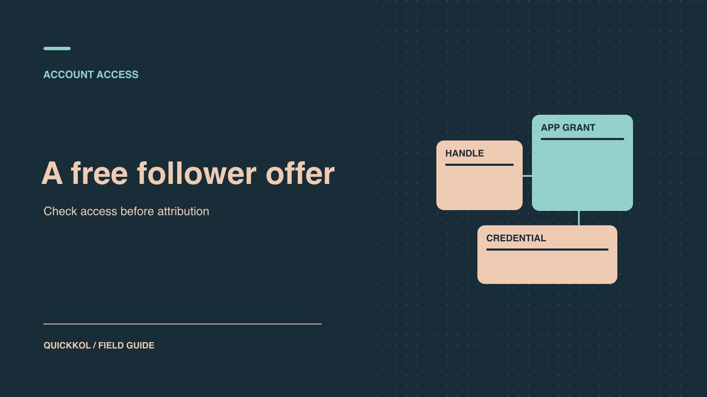

# Naizop Free TikTok Followers: Risks for Sponsors

Status: local review draft; confirm the publication date before release.

Review a free-follower pitch against account access, campaign records and the terms of a TikTok sponsorship.

QuickKOL editorial graphic; not actual account metrics or a platform interface.

A free-follower offer matters to a TikTok sponsor when someone connected an account or when the disputed number entered a campaign report. If the lead came from a search for Naizop free TikTok followers, record the offer and ask the contracted creator what action anyone actually took. Have the account owner verify access, then reconcile audience changes with publication and authorized media delivery. Review video acceptance, audience-based bonuses and account security against their own evidence. The agreement determines which payment line, if any, needs a closer look.

## Record the offer and what anyone actually did

Ask who saw the offer, when, through which channel, and what they did after seeing it. Log each action separately: viewed a page, entered a public handle, accepted an in-app authorization, typed a credential into an unfamiliar form, or passed along a verification code. Keep the account owner’s statement in its original scope. An account manager saying “I think someone tried it” is a lead, even when they heard it from a colleague with publishing access. Store the offer text, discovery time and the name used by the sender. Exclude passwords, verification codes, session URLs and unredacted account screenshots from shared evidence.

[TikTok’s deceptive behaviour explainer](https://newsroom.tiktok.com/how-tiktok-counters-deceptive-behaviour?lang=en-150) describes selling followers and marketing services that artificially inflate engagement as examples of fake engagement. That is a statement about behavior categories. It does not identify the conduct of any provider mentioned in a search query. A review note can accurately say “an offer advertised free followers” and “whether and how the offer was fulfilled remains open.” If a campaign supplier promises a set number of new followers, ask them to document the delivery method, evidence source and any access they need. Identify who would revoke it when the work ends. Preserve the original proposal alongside the supplier’s answer so the review does not blur a marketing promise into an executed action.

## Separate public details, platform access and credentials

A handle identifies a public account. If the team only supplied a handle, the confirmed fact is that the recipient learned which account was involved. To determine whether access was granted, have the account owner inspect the platform’s own authorization records. [TikTok’s scopes documentation](https://developers.tiktok.com/docs/en/scopes-overview) explains how particular grants allow access to specified data or actions, and how users can deny or revoke authorization. Record the app name, the permissions shown and the approval time when that information is available. Keep official advertising access in a separate row. A [TikTok ad authorization lifecycle](https://www.quickkol.com/blog/tiktok-spark-ads-authorization-lifecycle/#answer) record helps identify legitimate creator content and expiry windows before an unfamiliar grant is investigated.

Treat credentials, verification codes and session tokens separately from app permissions. Entering one into an unfamiliar form is sufficient reason for the security owner to start exposure response, even when follower counts stayed steady. An empty connected-app list cannot rule out a phishing event. The owner can identify unfamiliar sign-ins without giving a marketing coordinator control over the account. Record the permission state as granted, revoked, unknown or not observed in the reviewed interface, with a timestamp and the reviewer’s role. That level of detail gives the brand a way to follow up while keeping the decision with the person who has appropriate access.

## Compare followers and delivery events in one time zone

Put public observations, native follower changes, publication times and paid delivery on a common timeline. For each row, record when the data was collected, the reporting time zone and the dates the report covers. Two public snapshots establish a span in which a change was observed. An abbreviated profile count cannot establish an exact daily increment. Where native data provides the breakdown, track gains, losses and net change separately. Preserve the original units and mark periods whose reporting is still settling.

Then test explanations against that same window. Did the brand start an ad using creator content? Did a livestream, a recommended clip or a reshare from another creator drive viewers to the profile? Check paid delivery records and creative IDs alongside content reach, profile visits, substantive comments and later engagement. Those metrics can arrive at different times and describe different populations. Matching them by date, asset and event type prevents a false contradiction from taking over the review. Use a consistent [creator engagement reading method](https://www.quickkol.com/blog/read-creator-engagement-data/#answer) to establish a comparable baseline. Three recent posts in the same format by the same creator may give the team more useful questions than an average from unrelated accounts. The comparison is a starting point for explanation; it cannot individually certify followers.

## Give signals and conclusions separate fields

Suppose a creator sees 2,100 net new followers on Tuesday. The paid team verifies that an ad went live that day, and the creator supplies a new video URL. The ad’s delivery window overlaps part of the rise. Those are verifiable events. Attributing the whole change to them is still an interpretation. Ask for the organic and paid delivery scopes, definitions of profile visits and follows, and details of other promotion. If the available screenshot covers Monday through Wednesday as one total, label attribution unresolved. Specify the missing breakdown, its owner and when it can be supplied.

Repeated sharp increases, stable profile visits despite a large reported gain, generic repeated comments, or a revised export that no longer matches its original can all be worth examining. Each has plausible alternatives. Referrals from outside the platform may go unrecorded. A regional event can concentrate search demand. An agency could merge the wrong report windows or pick up a prior export by mistake. Confirmed findings cite their own source. A verified invoice or message may establish a purchase, while delivery, the amount affected and the specific accounts involved need separate support. Put the threshold for expanding access, increasing fees or making any public statement above the threshold for requesting routine clarification.

## Contain access before negotiating the report

Have the creator or designated administrator respond from a trusted device. [TikTok’s Security Checkup guide](https://newsroom.tiktok.com/introducing-tiktok-security-checkup?lang=en) covers recovery methods, two-step verification, unfamiliar devices and unusual activity. Based on what the owner finds, inspect app grants, revoke an unknown connection, remove unfamiliar devices and use the platform’s official process to change credentials if exposure is suspected. If the owner cannot sign in, use the official recovery route. Check for unexpected posts, messages, links or advertising. Preserve the approvals, order references and creative IDs the campaign still needs, and restrict access to incident evidence.

The handoff could read: “The creator confirmed removal of one unfamiliar device. We have no basis yet to tie that device to follower activity. The security owner will report containment on Wednesday; the analyst will provide a native report on Friday.” This lets containment proceed while attribution is open. If a known campaign grant is accidentally removed, the authorized advertising owner can decide whether to request it again and document its term. Confirm that access was restored only to the approved party and only for the agreed work. A private handoff with named owners is more practical than a general demand that everyone prove the account is safe.

## Turn the incident into a better sponsorship brief

Suppose a brand commissions two TikTok demonstrations and adds a follower growth bonus. Before settlement, an agency forwards a free-follower pitch and points to growth in the weekly report. The campaign owner can still verify that both videos went live, that sponsorship disclosure is visible and that the agreed usage permission is on file. If those items pass, the production deliverables can be accepted. Keep the growth bonus open with the original report, the week’s promotion timeline and the exact native evidence requested. The account owner separately checks whether anyone actually granted access.

For the next sponsorship, name the creator account, measurement window, eligible growth sources, reporting split between organic and paid, who may access the account and what evidence unlocks the bonus. If the real objective is for relevant viewers to understand a product demonstration, the brand can commission that work and measure eligible viewing or destination visits instead. A creator can then prove delivery directly, and an unresolved growth figure affects only the part of the agreement that depends on it.

## Use the contract deliverables to decide settlement

Check whether any part of payment actually depends on follower growth. Video production, publication, usage rights and delivery of a tracking link often have their own acceptance evidence. Review those items against the agreed requirements. For a follower-based bonus whose period, definition or origin is disputed, retain the original report and route that line to the person authorized to apply the contract. A handoff with three columns works well: verified deliverables, unattributed growth and access issues still in response. Avoid carrying a provisional label into a public creator record.

In the U.S., [the FTC’s consumer reviews rule Q&A](https://www.ftc.gov/business-guidance/resources/consumer-reviews-testimonials-rule-questions-answers) describes specific conditions for misuse of fake social influence indicators under the U.S. rule, including commercial purpose and what a party knew or should have known. Applying a rule or contract to particular facts belongs with the relevant compliance or contractual owner. The campaign team can immediately make future quoting more reliable by requiring native evidence where available, separating organic and paid scope, defining eligible delivery before launch and requiring account-owner approval for third-party access. Close the current review with a next check date and a named owner for each open item. If evidence remains incomplete, preserve that limit when deciding whether to expand the next brief or pay a performance component.

## Free follower offer review sheet

| Record | What it establishes | Next action |
| --- | --- | --- |
| Public handle | The target account was identifiable | Have the owner check separate grants |
| Platform authorization | An app received specific scope at a time | Verify current status, purpose and expiry |
| Paid delivery and growth | Events overlapped in time | Align native evidence, windows and assets |
| Supplier purchase record | The recorded purchase took place | Verify fulfillment and affected accounts |

Review public counts, native reports and permissions as distinct evidence.

## Security and campaign handoff checklist

Have the account owner and settlement owner acknowledge their respective items.

- [ ] Preserve the offer and action record with sensitive fields removed.
- [ ] Have an authorized administrator review grants, devices and recovery methods.
- [ ] Align growth, content and paid delivery dates, time zones and definitions.
- [ ] Record verified delivery, unresolved attribution and the next review date.

## Research date and limitations

Sources reviewed November 9, 2026. Methods, tables and decision rules are editorial recommendations. Hypothetical examples are not actual client results or industry benchmarks. Source geography and periods are specified where relevant. This draft is in independent local review; confirm its publication date before release.

## Build a TikTok growth plan you can audit

Make the next partnership a measurable content test with profile visits and follow-up participation.

[See the TikTok organic learning plan](https://www.quickkol.com/blog/free-tiktok-followers-organic-learning-plan/)

## Sources

- [TikTok’s deceptive behaviour explainer](https://newsroom.tiktok.com/how-tiktok-counters-deceptive-behaviour?lang=en-150)
- [TikTok’s scopes documentation](https://developers.tiktok.com/docs/en/scopes-overview)
- [TikTok’s Security Checkup guide](https://newsroom.tiktok.com/introducing-tiktok-security-checkup?lang=en)
- [the FTC’s consumer reviews rule Q&A](https://www.ftc.gov/business-guidance/resources/consumer-reviews-testimonials-rule-questions-answers)
