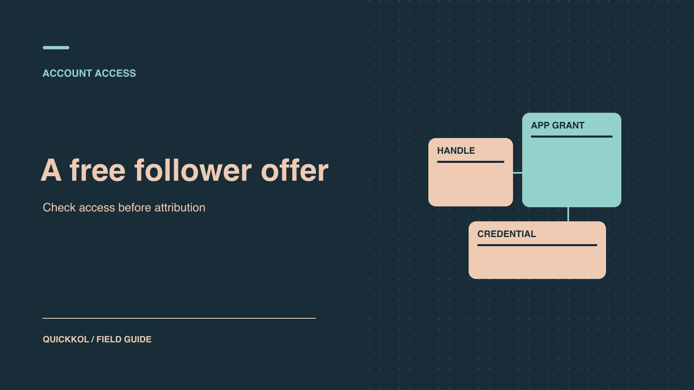

# Naizop 免费 TikTok 粉丝邀约如何影响赞助合作

状态：本地审阅稿；正式发布日期待确认。

品牌如何在收到免费涨粉邀约后复核账号权限、合作数据和应付费用。

QuickKOL 编辑图形；不呈现真实账号指标或平台界面。

品牌看到「Naizop free TikTok followers」邀约时，可以先和签约达人确认两件事：是否有人实际授权，以及异常数字是否进入了合作报告。邀约名称只是一条线索。由账号所有者核对操作，由品牌将粉丝变化与内容发布、正常投放和报告时间对齐。视频交付、受众绩效和安全事件各用自己的证据处理。哪一笔费用会受影响，取决于双方原来约定的验收和奖金条件。

## 先记录邀约和实际操作

询问是谁、在何时、从哪里看到邀约，以及做了什么。把「浏览过页面」「提交公开用户名」「批准官方授权」「在陌生页面输入凭证」「提供登录验证码」分成不同记录。只写当事人确认的动作，不凭活动简报的转述补空白。保存发现时间、服务名称和当时看到的文字，不在共享表里存密码、验证码、会话链接或完整后台截图。若达人只看到名称，没有填写任何资料，先记录事实，等待独立的数据检查。

[TikTok 反欺骗行为说明](https://newsroom.tiktok.com/how-tiktok-counters-deceptive-behaviour?lang=en-150)列举了出售粉丝和推广人为放大互动的服务。平台在这里解释行为类型，并没有判定某个搜索结果是否属于这种行为。品牌复盘可以同时写明「服务以免费涨粉宣传」和「尚未确定该服务是否交付或以何种方式交付」。如果合作方把保证新增粉丝写进来，要求它交代方法和来源、是否请求授权及谁承担撤销工作。把邀约本身与履约证据分开。

## 区分公开资料、平台授权和登录凭证

用户名用于识别公开账号。只输入用户名，能够确认的是对方获知了要指向哪个账号。除此之外是否有授权，要由账号所有者看平台授权记录。[TikTok 授权范围文档](https://developers.tiktok.com/docs/en/scopes-overview)说明，不同授权范围可以读取特定资料或允许执行特定动作，使用者可以同意、拒绝或撤销授权。看到授权页面时，应记下应用名称、具体权限和同意时间。品牌的原生广告授权也应单独登记，并核对 [TikTok 广告授权生命周期](https://www.quickkol.com/zh/blog/tiktok-spark-ads-authorization-lifecycle/#answer)里的素材和有效期，避免把正规投放与陌生工具混为一谈。

密码、验证码或会话令牌另行处理。只要有人在陌生表单提交其中一项，安全负责人就可按暴露流程接手，即使粉丝曲线平稳。原生应用里看不到陌生连接，也无法排除凭证被钓鱼。遇到无权查看的信息时，让账号所有者或经授权的管理员核实。品牌能从负责人那里得到带时间的确认即可，不需要收集完整的账号权限面板。

## 用同一时区对照粉丝和投放事件

在同一时间轴上列出公开数字、平台后台增减量、发布和投放时间。每行注明截图或导出生成时间、报告时区和覆盖日期。公开页两次采集之间出现变化，只能把变化定位到那段区间。带小数的缩写数字不适合倒推某日净增。后台数据可获取时，再区分新增、取关和净增。不同口径的数字放在独立列，保留尚未成熟的数据状态。

下一步找同窗的解释。品牌是否在当晚开了创作者素材广告？是否有直播、新片段被推荐或另一位达人转发？查广告账单和送达窗口，同时看内容触达、主页访问、内容相关评论和后续参与。指标可能滞后，也可能覆盖不同人群。要判断增长是否与活动有关，把日期、素材 ID 和事件类型先对齐。参考[达人互动数据阅读方法](https://www.quickkol.com/zh/blog/read-creator-engagement-data/#answer)建立同格式基线；同一位达人的最近可比活动通常比陌生行业平均值更能帮助提问。

## 把可疑信号与结论分栏

假设一个达人在周二看到 2,100 个净新增。付费团队确认同一天开启了广告，达人还给了新视频 URL。广告窗口与上涨时间部分重合，数据源记录是可以验证的。粉丝变化来自这两个事件则仍是解释。品牌应请求看自然和付费送达范围、主页访问与关注的口径，以及有无其他推广。若截图只覆盖周一至周三，就把归因写成待核实，并记录缺哪一行、谁补、何时补。

持续复核的信号包括多次陡增、内容触达与访问未同步、泛化评论重复、报表导出有删改痕迹。这些线索也可能有普通解释。例如引流发生在外站、当地活动让搜索集中、营销报表被错误合并，或后台统计窗口不同。证实事实要有来源，安全事件另要有权限或登录记录。若发现聊天记录明确确认服务被购买，可记为「采购行为已确认」，仍要分别确认交付、异常量和涉及账号。品牌在扩大权限、提高费率或公开表态之前，应保存更高证据标准。

## 权限已暴露时先控制影响

由达人或正式管理员从可信设备处理。[TikTok 安全检查指南](https://newsroom.tiktok.com/introducing-tiktok-security-checkup?lang=en)说明如何复核恢复方式、开启两步验证、查看陌生设备和异常活动。按实际情况检查应用授权、撤销未知连接、移除陌生设备，并在怀疑凭证泄露时通过平台官方流程更改密码。账号无法登录时使用官方找回入口。核查是否出现非预期帖子、私信、链接或投放。优先保留活动所需的订单、批准和素材记录；证据存放在有限访问的目录。

给合作方的交接可以写成「达人确认已移除一个陌生设备。尚无足够信息说明设备与粉丝变化有关。周三更新控制状态，周五补原生报表」。这个句式让安全控制不被归因争议拖延。若误撤了经批准的广告授权，由正式负责人评估是否需要重授权并记录有效期。避免让任何人把单次验证码转发到群里，或在品牌临时表格里重填密码。

## 把一次异常变成下一份合作条款

假设品牌买了两条 TikTok 演示视频，另设粉丝增长奖金。结算前，代理转来免费涨粉邀约的截图，报表也显示该周粉丝增加。团队先核对两条视频是否上线、披露是否可见、素材使用权是否齐全。只要这三项证据完整，基础交付可以继续验收。增长奖金那一行保留待核实，记录原报告、当周活动和待补的原生数据。账号所有者再独立确认有没有真的授权。

下次签约时，在交付表中写清活动账号、观察期、可接受的增长来源、付费与自然口径、谁可以接触账号，以及哪些证据才会触发奖励。若品牌只需要相关受众看清演示，可以取消粉丝奖金，把表现观察改成约定窗口的有效观看或落地访问。这样达人知道怎样证明交付，品牌也能在证据不全时只搁置有争议的项目。

## 用合同交付决定能否结算

先确认付款是否取决于粉丝增长。视频制作、发布、使用权和跟踪链接交付往往可以按原验收要求逐项判断。任何基于新增粉丝的奖励，在定义、期间或来源存在争议时，单独列出、保留原报表，交由有权负责人按照约定处理。需要对外解释时，采用「可核对的交付」「未能归因的增长」「处理中的权限事件」三列。不要让推测性的标签跟随达人进入公开档案。

[FTC 消费者评论规则问答](https://www.ftc.gov/business-guidance/resources/consumer-reviews-testimonials-rule-questions-answers)说明，美国规则对虚假社交影响力指标有特定适用条件，包括商业目的与知道或应当知道等问题。其他地区、合同及具体事实可能需要相应的合规判断。品牌能立即做的是统一后续报价的证据标准，要求原生数据、记录自然与投放范围、预先定义认可的交付，并明确第三方权限申请必须由账号所有者批准。为本轮评估设定一个复查点；没有补齐的信息继续标为未知，下一轮再按足以支持的证据决策。

## 免费涨粉邀约复核表

| 记录 | 能证明的事 | 后续动作 |
| --- | --- | --- |
| 公开用户名 | 目标账号可识别 | 由所有者查是否另有授权 |
| 平台授权记录 | 某应用在某时间取得指定范围 | 核对当前状态、用途和到期日 |
| 同期投放和数据上涨 | 存在时间上的重合 | 对齐原生数据、报告窗口和素材 |
| 第三方采购凭证 | 凭证所述采购发生 | 另查交付及涉及账号 |

公开数字、平台报表和账号权限各自独立复核。

## 安全与营销交接清单

交给账号所有者和品牌结算负责人分别签收。

- [ ] 保存邀约和动作记录，遮住敏感信息。
- [ ] 由正式管理员复核授权、设备和恢复方式。
- [ ] 对齐增长、内容和广告的日期、时区与口径。
- [ ] 标注可验证的交付、待核实的归因和复查日期。

## 研究日期与使用边界

资料核验于 2026 年 11 月 9 日。文中方法、表格和决策规则为编辑建议，标为假设的示例不是实际客户结果或行业基准。外部资料的适用地区与时期按各段说明；本稿处于独立本地审阅阶段，正式发布日期待确认。

## 建立可核对的 TikTok 增长计划

把下一轮合作的注意力放在可观察的内容测试、主页访问和后续参与上。

[查看 TikTok 自然增长测试](https://www.quickkol.com/zh/blog/free-tiktok-followers-organic-learning-plan/)

## 来源

- [TikTok 反欺骗行为说明](https://newsroom.tiktok.com/how-tiktok-counters-deceptive-behaviour?lang=en-150)
- [TikTok 授权范围文档](https://developers.tiktok.com/docs/en/scopes-overview)
- [TikTok 安全检查指南](https://newsroom.tiktok.com/introducing-tiktok-security-checkup?lang=en)
- [FTC 消费者评论规则问答](https://www.ftc.gov/business-guidance/resources/consumer-reviews-testimonials-rule-questions-answers)
