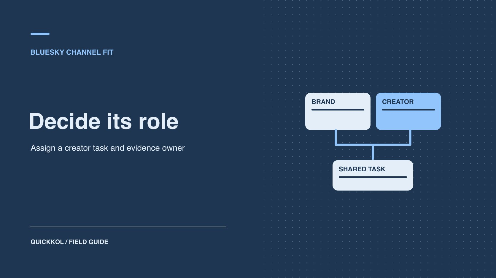

# What Is Bluesky? When It Fits a Brand Partnership

Status: local review draft; confirm the publication date before release.

Decide whether Bluesky is suitable for a creator Q&A, referrals to longer work or research only.

QuickKOL editorial graphic; not actual account metrics or a platform interface.

Bluesky is a social app built on the AT Protocol. For a creator partnership, check whether the intended audience already discusses the subject there. Give it a practical role such as public Q&A, referrals to a longer piece or sourcing research. Assign who publishes, replies and checks the next action in a small trial. Where you have discovery evidence alone, keep Bluesky as a research channel and commission the main work where the creator already serves the intended audience.

## Judge the channel by the creator’s actual work

[Bluesky’s company FAQ](https://www.bsky.social/about/faq) explains the relationship between the app and the AT Protocol. When choosing a channel for a creator partnership, check the public work and replies on the actual account, whether the audience can open the campaign route and what the creator can report. The protocol’s interoperability provides context for identity and public data. The campaign still needs evidence from the account and people involved. For the technical background, see a [Bluesky and AT Protocol brand primer](https://www.quickkol.com/blog/what-is-bluesky-at-protocol-brand-context/#answer).

For example, an engineering creator may regularly answer installation questions on Bluesky and publish complete demonstrations on a video channel. Verify the original posts, recent audience questions and a workable response window, then ask the creator to quote a Q&A and a demonstration separately. An account with no observable participation from the intended audience can still be useful in sourcing research. The brand can first test the main work on the creator’s established channel. Record the original work, public conversation and available reporting behind the decision.

## Evaluate the channel against one primary job

Choose one job, such as having a specialist answer product questions, guiding readers from a short post to a full explanation, or collecting questions from public discussions. Give it an owner, response rules and a result another reviewer can verify. If the campaign needs a short-term purchase at scale, establish destination, distribution and measurement first. Public conversation volume is not advertising inventory. A sustained relationship with experts might instead prioritize relevant questions and replies. Ask whether the creator wants to post and respond in this channel. Having an account elsewhere does not show they will use the same format here.

Suppose an equipment brand plans a one-hour session with an audio creator. A pilot can start with one specific public question and a time for the creator to answer selected replies. The brand handles product support. The creator describes their workflow. Link to a full explanation after the discussion. Give each owner their own acceptance criteria. If viewers primarily need video, retain Bluesky for conversation and publish the demonstration where the audience can access that format comfortably.

## Separate feed discovery from repeatable distribution

[Bluesky’s custom feeds announcement](https://bsky.social/about/blog/7-27-2023-custom-feeds) describes different ways of selecting a feed. A subject-specific feed can surface creators and ongoing discussions. It cannot guarantee a sponsored post will appear in the same place or reach everyone relevant. Record the feed, observation date, visible inclusion rules and original posts. Check whether the creator recently contributed explanations or replies instead of relying on where one post appeared. Use a [Bluesky public conversation guide](https://www.quickkol.com/blog/bluesky-social-brand-public-conversation/#answer) to keep the source of the lead and verify identity independently.

Suppose a brand finds an engineering creator through a custom feed. The creator has a relevant public discussion but rarely posts there. Offer a scoped Q&A and let them publish a longer demo where they already work comfortably. Appearance in one curated entry point does not justify a requirement to publish frequently. First check whether the brand can respond as agreed, whether the destination opens and whether people ask questions relevant to the brief. Preserve the discovery rule and sample scope. A result visible in one feed should not be reported as a comprehensive platform statistic.

## Plan sponsor disclosure and public replies

[Bluesky’s community guidelines](https://bsky.social/about/support/community-guidelines) require the commercial nature of sponsored material or advertising to be clear. Have the brand and creator put that relationship where the audience can see it and check any applicable market requirements. A reader can enter a thread at a later post. Review the opener, recommendation and destination in their own contexts. Put editing authority, response ownership and the support escalation route in the brief. The creator should not be responsible for resolving the brand’s account, refund or compliance issues.

When asking for experience, collect relevant public feedback without asking people to post personal information or order records in replies. Define the handoff. The brand answers product questions, the creator can explain their work, and the official support owner handles account issues and private details. If the team cannot support a broad discussion, limit the pilot period and subject. Keep a correction owner and review time. The people running the campaign can respond under their own roles without gaining unnecessary access to the creator’s account.

## Assign different channel roles within one partnership

A partnership can use several channels. Bluesky might carry a short Q&A, YouTube might host the demonstration and the brand site might handle specifications or registration. Use the same audience question, then assign a step to each channel. Avoid duplicating one message everywhere. For example, the creator posts a setup photo and a question, links to a full video and points viewers to the approved specification page. A person entering at any step should know what to do next. Do not fill a missing metric with a number from another channel.

Record the original post, full demonstration, destination, publisher and correction owner. Check advertising, quotation, editing, territory and term for any reuse. If the brand wants to put a screenshot of a public reply in an ad, confirm permission for that use. Public visibility does not establish consent. After the pilot, assess whether each channel performed its own role. A strong public conversation can help research even if visits are low. If the brief only needs bookings, use verified visits and bookings to decide whether to repeat it.

## Verify entry, replies and next actions in a small pilot

Suppose the pilot uses one original post, one follow-up reply and one tagged brand page. After release, record the live URL, publisher, time, disclosure and viewing path. Set a response window. Count questions that fit the brief, who answered them and what had to go to the brand. The destination report describes its own sessions or actions. Public reads, comments and link visits cannot be added to make total reach. Where a platform field is unavailable, use an agreed observable substitute and state the limitation. Define in advance what supports another pilot and what triggers a scope change.

Suppose 20 replies contain seven substantive product questions, brand reporting records nine tagged visits and two trial registrations. Present these by source. Do not claim the registrations came from particular public replies. Compare the intended action and staff response time with the campaign’s needs. If most discussion comes from peers, the channel may still be useful for research. If the next test aims at acquisition, change a defined element such as the public question or destination copy and retain a comparable observation period.

## Compare the cost of running the channel

Split pilot costs into planning, creator production, brand replies, destination work and reporting. Public interaction can reduce repeated explanations or take more staff time than expected. Log who answered, when, average handling time and how often support had to take over. If the brand schedules an evening Q&A, assign actual coverage. A high response count does not establish that the program can run without someone responsible for it. Compare existing channels using the same unit of work and comparable audience questions.

Suppose a public Q&A helps ten people find useful material and takes two staff hours to sort replies. In the next round, put recurring questions in a public guide and ask the creator to handle questions that benefit from their expertise. Where support has an approved route, use it for issues that should be handled privately. The campaign owner can compare relevant questions, staffing time, verifiable visits and the disclosure burden before expanding. Preserve the cost inputs so another team can reproduce the budget and estimate whether they can sustain the workflow.

## Choose where the creator should do the main work

Suppose an audio equipment company finds a creator who answers technical questions on Bluesky and publishes tutorials on YouTube. Commission a disclosed question on Bluesky to identify common setup problems, then let the creator demonstrate the relevant steps in a YouTube video. The brand owns the specification page and support replies. Give both assets their own publisher, reporting source and approved uses.

If the pilot attracts peer replies but few relevant visits, decide whether the conversation helped research. Where the buyer needs qualified trials, use destination evidence before commissioning more distribution. Keep the live posts, corrections and approvals. The next agreement can purchase the work each channel supports without requiring the creator to duplicate the same asset everywhere.

## Decide whether to retain, narrow or end the test

Start the review with the job the pilot was meant to do. If it produced relevant expert discussion but no sales evidence, a next round may focus on research or education. If the brand could not respond promptly, narrow the conversation. If the team verified visits and can sustain the work, propose another specific collaboration. Keep accepted content, evidence, unknowns and the next review date. A decision about a channel should not be written as a general judgment of the creator’s ability. They may have delivered the agreed work under a channel scope that did not match the sponsor’s goal.

## Bluesky roles in a creator partnership

| Job | Evidence | Owner |
| --- | --- | --- |
| Public Q&A | Original post and relevant questions | Creator and brand support |
| Content referral | Destination path and tagged sessions | Publisher and analyst |
| Creator discovery | Feed, work and identity | Research owner |
| Next pilot | Accepted delivery, cost and action | Campaign owner |

Review each channel under its own measurement scope.

## Bluesky partnership pilot checklist

Assign the channel job before commissioning work.

- [ ] Define audience, format and primary action.
- [ ] Verify creator activity and contact.
- [ ] Approve disclosure, reply plan and destination.
- [ ] Review the actual scope before choosing the next round.

## Research date and limitations

Sources reviewed November 9, 2026. Methods, tables and decision rules are editorial recommendations. Hypothetical examples are not actual client results or industry benchmarks. Source geography and periods are specified where relevant. This draft is in independent local review; confirm its publication date before release.

## Start creator research with a clear task

Use QuickKOL to interpret a brief, discover relevant creators and research their work and contact routes. Verify data, commercial terms and outcomes at their source.

[Explore QuickKOL](https://www.quickkol.com/#capabilities)

## Sources

- [Bluesky’s company FAQ](https://www.bsky.social/about/faq)
- [Bluesky’s custom feeds announcement](https://bsky.social/about/blog/7-27-2023-custom-feeds)
- [Bluesky’s community guidelines](https://bsky.social/about/support/community-guidelines)
