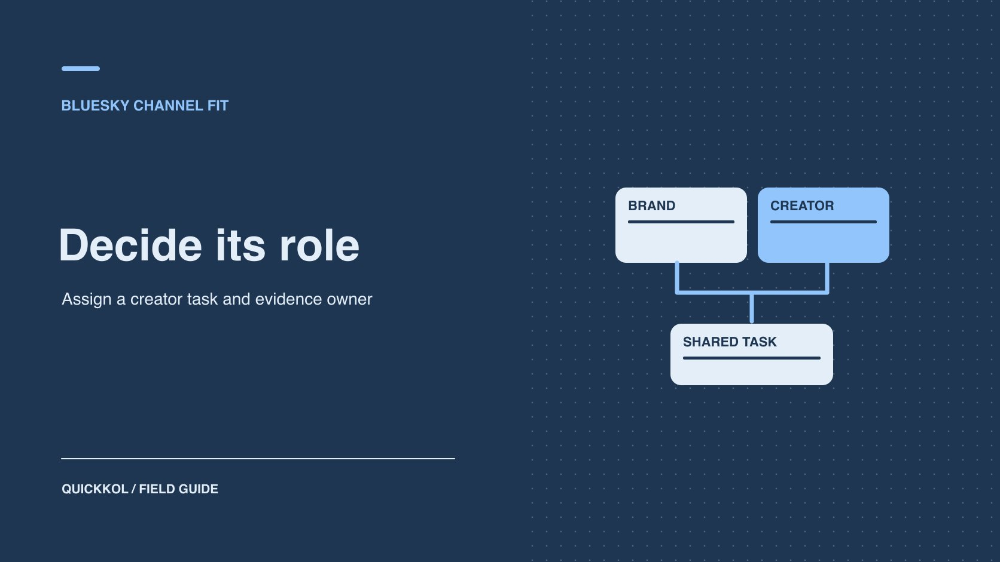

# Bluesky 是什么？品牌该用它做哪类合作

状态：本地审阅稿；正式发布日期待确认。

判断 Bluesky 适合承担创作者问答、内容引导还是候选研究。

QuickKOL 编辑图形；不呈现真实账号指标或平台界面。

Bluesky 是基于 AT Protocol 的社交应用。品牌与达人合作时，先判断目标观众是否已经在这里讨论相关问题，再决定是否让它承担公开问答、短内容引导或候选研究。为一次试点指定谁发帖、谁回复、谁查后续行动。若只有候选发现的证据，可以把 Bluesky 留给研究，把完整作品安排到达人已有的合适渠道。

## 从创作者的实际作品判断渠道

[Bluesky 公司问答](https://www.bsky.social/about/faq)解释了 Bluesky 应用与 AT Protocol 的关系。对品牌选渠道来说，先确认能从实际账号看到哪些公开作品与回复、受众能否打开活动入口，以及创作者能提供哪些报告。协议层的身份与公开数据互通，不能替代合作证据。关于应用和协议的技术背景，可以查 [Bluesky 与 AT Protocol 品牌背景](https://www.quickkol.com/zh/blog/what-is-bluesky-at-protocol-brand-context/#answer)。

例如，一位工程类达人在 Bluesky 上持续回答安装问题，完整演示却主要发在视频频道。品牌可先确认原帖作者、近期待回答的问题和适合公开的回复时段，再请达人为问答与演示分列报价。若账号虽然存在，却没有目标人群参与的迹象，可把平台作为研究入口并先在其主频道试做。这些判断都由作品、公开对话与双方约定的数据支持。

## 按一个主任务评估渠道适配

选择一个场景，例如邀请行业达人做产品问题解答、从公开视频引导到长篇说明，或收集公开讨论中的常见问题。为它指定负责人、答复规则和一个能复核的结果。若目标是短期大量购买，先验证落地页、触达能力和数据是否符合需求，不能把公开讨论规模等同于广告库存。若目标是与专家长期交流，可能更重视答复质量和主题相关性。问达人愿不愿在这里发帖或参与回复，不从在其他平台有账号就推断能复制。

假设一家器材品牌想和音频创作者做一小时问答。试点可先发一个明确问题，再请创作者在约定时间回答选出的公开问题。品牌负责产品支持，达人解释自己的工作流程。互动之后提供可访问的完整说明页。给两个角色分别验收，避免只看关注数。如果观众主要想看视频，保留 Bluesky 的讨论角色，将实际演示放在更适合该内容的渠道。

## 把信息流发现和稳定分发分开

[Bluesky 自定义信息流说明](https://bsky.social/about/blog/7-27-2023-custom-feeds)描述了不同的信息流选择。一个垂类入口可帮助找到达人和正在讨论的主题。它无法保证赞助帖进入同一位置或覆盖全部相关人。试点前记录所使用的信息流、观察日、选入规则与原始帖子。看创作者最近是否真实参与、是否有自己的解释和回应，而不是只看一条出现的位置。用 [Bluesky 品牌公开对话指南](https://www.quickkol.com/zh/blog/bluesky-social-brand-public-conversation/#answer)记录发现来源并独立复核身份。

例如品牌通过自定义信息流发现一位工程达人。其公开帖子与活动问题高度相关，但在该平台并不常发。可以邀请对方做一次明确的问答，另安排其愿意使用的渠道发布完整演示。不要根据其在一个策展入口被收录就要求持续发帖。先看品牌是否能按约定回答、能否打开活动链接，以及是否有用户提出与任务相符的问题。观察效果时保留入口规则和采样范围，不把一个工具的可见结果写成完整平台统计。

## 把赞助披露与公开回复纳入 Brief

[Bluesky 社区准则](https://bsky.social/about/support/community-guidelines)要求清楚标识商业内容、赞助或广告的性质。品牌和创作者应把实际关系用清楚文字放在受众能看到的地方，再核对所在市场的适用要求。若发成串帖，读者可能从后面的帖进入，审阅时分别看首帖、有关推荐和活动链接。把谁有权改帖、谁负责公开回应和什么问题需要转到支持渠道写进 Brief。创作者不应被迫代答品牌自己的售后或合规事项。

想收集体验时，只索取与活动相关的公开反馈，避免要求在回复里提交个人信息、订单或账户资料。制定交接路线：普通产品问题由品牌回复，内容方法由达人解释，隐私、退款或账号问题交正式支持。若问题超过处理能力，先限定试点时间和范围。给团队保留修订人和复查时点。活动对话可以有人负责，而不必扩大创作者账号权限。

## 把 Bluesky 和其他渠道分配成不同岗位

一次合作可以同时使用不同渠道。Bluesky 负责短文问答，YouTube 负责完整演示，品牌官网负责产品与报名。给每个渠道写同一个主要受众问题，再分配解决它的步骤。不要把同一内容原样复制所有入口。举例：达人发一段制作图和一句提问，完整演示放视频平台，品牌落地页给规格。受众在哪里进入，都应能找到一个明确的下一步。不要因为平台没有某个字段而用另一个渠道的数来填。

给合作表记原帖、完整演示、落地页、发布者和谁能纠正。复用时分别核对广告权、引述、编辑、地区和期限。如果品牌把某个公开回复截图做成广告，先核对是否有许可，不从公开可见推断同意。试点结束比较每个渠道是否完成了自己的角色。若公开对话有效但访问少，讨论仍可能支持研究；如果 Brief 只看预约，就按可验证的访问与预约判断是否继续。

## 在小试里验证入口、回答和后续行动

假设试点只有一条原帖、一个跟进答复和一个带活动标识的品牌页面。上线后记录正式 URL、发布者、时间、披露和浏览路径。给公开回应约定起止时间。看多少问题符合目标，谁回答，哪些需要转给品牌。品牌页面报表仅说明其记录的会话或行动。不能把公开阅读、评论和外链访问加成总触达。如果平台无法提供期望字段，使用可核验的替代项并注明。预先写好什么结果会支持继续，以及遇到哪种问题会调整目标。

例如二十条回复里有七条真实产品问题，品牌记录九次有标签的落地访问和两次试用报名。按来源分别报告，不断言两次报名对应哪条公开回复。用目标动作和人工答复时间评估运营成本。如果实际只有同行讨论，品牌可保留为研究用，不一定放入获取客户的渠道。下一轮只调整一个要素，比如问题范围或落地页说明，并设相同观察窗。

## 比较渠道的实际运营成本

把试点花费拆成策划、达人制作、品牌答复、落地页和复盘。公开互动可以减少一部分重复解释，也可能需要比预计更多的人工。跟踪谁在什么时段答复、每个问题平均处理多久、多少次需要交给支持。品牌如果安排下班后问答，先确认有人能及时回应。与现有渠道比较时，用相同的工作单位与同类问题。

例如一次问答让十个人找到帮助内容，但团队用了两小时分类回复。下轮可以将常见问题写成公开指南，给达人只保留需要专业解释的部分。已有客服入口的品牌可用公开链接引导需要私下处理的事项。下一轮是否扩大，由活动负责人同时看相关问题、员工时间、可验证访问和披露要求。分别留存策划、发布和复盘时间，方便另一位负责人重现预算。

## 决定该让达人在哪个渠道完成主要交付

假设一家录音设备品牌找到一位常在 Bluesky 回答技术问题、主要在 YouTube 拍教程的创作者。品牌可请其在 Bluesky 发一条有披露的提问，选出反复出现的设置难题，再把实际操作交给一条 YouTube 演示。品牌自己维护产品规格页和售后答复。两条作品在合同里各有发布者、数据来源与用途。

如果试点只有同行回复，但没有相关受众访问，先复盘问答对研究有无价值。若购买目标是合格试用，则用目的地证据判断是否继续采购分发。保留实际发帖、内容更正和批准权利。下次不必为同一个达人机械复制多个平台，只购买各渠道能完成的工作。

## 决定保留、缩小还是结束试点

复盘先问试点是否完成原任务。若能核实有相关专家讨论，但没有足够证据支持销售，把后续定位为研究或教育。若品牌无法按时回应，缩小对话范围。若受众有实际访问且流程可维护，再提出下一轮具体合作。将已确认内容、数据、未知项和下次观察时间留档。不要把是否采用渠道变成对创作者能力的整体评价。

## Bluesky 在 KOL 合作中的角色

| 任务 | 可核验证据 | 负责人 |
| --- | --- | --- |
| 公开问答 | 原帖和符合任务的问题 | 创作者与品牌支持 |
| 内容引导 | 目标页路径和已标记会话 | 发布者与分析 |
| 候选发现 | 信息流、作品与身份 | 研究员 |
| 续约 | 实际交付、成本与可验证行动 | 活动负责人 |

各渠道按各自数据范围复盘。

## Bluesky 合作试点检查

先设定渠道任务再安排合作。

- [ ] 确定受众、格式和主要动作。
- [ ] 核对创作者实际活动和联系方式。
- [ ] 批准披露、回复和目标页面。
- [ ] 按实际范围复盘并决定下一轮。

## 研究日期与使用边界

资料核验于 2026 年 11 月 9 日。文中方法、表格和决策规则为编辑建议，标为假设的示例不是实际客户结果或行业基准。外部资料的适用地区与时期按各段说明；本稿处于独立本地审阅阶段，正式发布日期待确认。

## 用清楚的任务开始达人研究

用 QuickKOL 理解 Brief、发现相关达人并研究作品与联系路径；数据、合作条件和结果仍需核验。

[了解 QuickKOL](https://www.quickkol.com/#capabilities)

## 来源

- [Bluesky 公司问答](https://www.bsky.social/about/faq)
- [Bluesky 自定义信息流说明](https://bsky.social/about/blog/7-27-2023-custom-feeds)
- [Bluesky 社区准则](https://bsky.social/about/support/community-guidelines)
