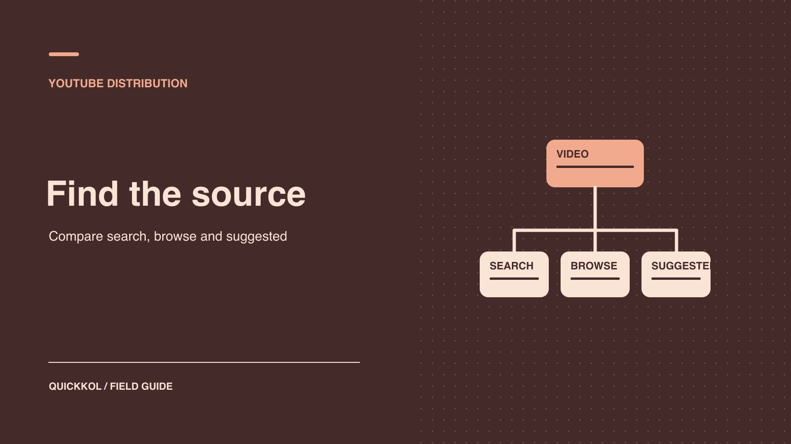

# YouTube Algorithm Explained: Diagnose a Sponsored Video

Status: local review draft; confirm the publication date before release.

Review a sponsored video’s traffic sources and retention to choose the next creative or partnership test.

QuickKOL editorial graphic; not actual account metrics or a platform interface.

YouTube Search, Home and Up next use different signals. When a sponsored video underperforms, agree with the creator on comparable work in the same format and observation window. Find the gap in discovery, clicks or viewing around the integration. Weak Search can prompt a review of topic fit. Early exits can prompt a check of the title promise, opening and sponsor placement. Record approved advertising, external references and audience changes separately. Use the evidence you can verify to choose the next brief or renewal scope.

## Agree on what the sponsor and creator need to verify

A sponsor commissioning a filter tutorial from a repair creator might need to reach people searching for a specific model or help the creator’s existing viewers understand a product. Those jobs need different comparisons. Begin the review with the contracted asset, sponsor timestamp, intended viewers and decision the evidence will inform. Use [YouTube campaign audience cohorts](https://www.quickkol.com/blog/youtube-analytics-sponsored-content-cohorts/#answer) to record video, format, observation window and source. Give the creator a specific gap to investigate, such as fewer first-week Search views than recent comparable tutorials on the same channel.

Choose work from the same channel on similar topics at the same post age. Log paid delivery, referrals and seasonal activity separately. The creator can explain the questions viewers usually bring. The sponsor can confirm the product model and the actual media flight. When the integration and disclosure meet the brief, accept the published work. Use the distribution review to decide whether the next brief needs a different topic, thumbnail, opening or sponsor placement. Reconsider the partner when the evidence concerns fit for the job.

## Distinguish Home, Up next and Search

[YouTube’s recommendations guide](https://support.google.com/youtube/answer/16089387?hl=en) says surfaces emphasize different signals. For example, Home primarily uses watch history, while Up next uses the current video as a major signal. [YouTube’s Search guide](https://support.google.com/youtube/answer/16090438?hl=en) describes relevance, engagement and quality and notes that personal history can affect results. One person’s position on one device is not a universal rank. A keyword cannot guarantee recommendation. Product surfaces and report categories can differ as well. Browse can contain more than the homepage. Use the actual reporting label, then inspect any breakdown that is available.

If the brand commissions a long video about replacing a filter, it may care about searches for that problem and suggestions after comparable tutorials. For a new product introduction to an existing creator audience, compare the creator’s usual work and series context. A video can receive several sources at once. Avoid labeling all traffic as algorithmic recommendation in the sponsor report. Use each visible source to answer the relevant question and mark unavailable search terms, viewing conditions or report slices as unknown.

## Review impressions and click-through by source

[YouTube’s impressions and watch time guide](https://support.google.com/youtube/answer/9314486?hl=en) connects registered thumbnail impressions with subsequent views and watch time. Registered impressions do not include everyone who could have encountered a link. External traffic and notifications have their own scope. Check that the denominator is eligible impressions in the report. Dividing all views by those impressions would mix populations. Where breakdowns exist, review Search, Browse and Suggested separately. Different sources represent different intent and placement, and a changing traffic mix can move the overall click-through rate even if individual sources are stable.

For example, assume Search shows 2,000 eligible impressions and 160 corresponding views, while Browse shows 8,000 impressions and 240 corresponding views. The rates are 8% and 3% in their respective scopes. That does not establish a thumbnail problem in Browse. Review other comparable videos within the source and check whether the thumbnail promise matches the opening. If only the overall rate is available, describe the limitation and use available source views as context. Do not average the two rates without considering their denominators.

## Check whether the opening delivers on the click

[YouTube’s audience retention guide](https://support.google.com/youtube/answer/9314415?hl=en) describes how to inspect changes in viewing over a video. Match timecodes to the title and thumbnail promise, opening, sponsorship segment and first demonstration. Suppose the title promises a quick filter change, but the video begins with a long brand introduction. If viewers leave early, test whether showing an actual step sooner improves viewing. A retention chart identifies where to look. It does not establish why each person left. Advertising, length and audience mix can affect it. If retention is only available for the full audience, avoid writing a source-specific conclusion.

When buying an integration, record where it appears. If the whole video received 10,000 views, report that figure within its scope. It does not establish that 10,000 people watched the product segment. Use applicable segment evidence where available and describe the limitations. When that data is absent, use verified visits, questions or accepted delivery. Let the creator retain their editorial pacing and have the brand check its product wording and disclosure. A small creative test can evaluate placement without requiring a longer commercial segment.

## Test one change to title or thumbnail at a time

[YouTube’s performance FAQ](https://support.google.com/youtube/answer/141805?hl=en) discusses titles, thumbnails and performance. When a sponsor wants to learn what changed audience response, preserve each version, change time and the observation scope by source. Choose one variable and keep the others and windows as comparable as feasible. If a thumbnail change coincides with an ad flight or external reference, a before-and-after total cannot isolate its contribution. Use platform testing where available and report its scope. Review product wording before testing a version that adds a claim.

For example, a new thumbnail could show the actual tool more clearly while keeping the title, description and video stable. Compare matched periods where possible and record other references that appeared during the week. If Search changed while Suggested did not, report the sources separately. A later test could use a title closer to the audience’s question. Changing title and thumbnail together makes that lesson harder to isolate. Different time windows may include different audiences. If the conditions cannot be matched, label the result observational. Use a [creator publishing brief](https://www.quickkol.com/blog/write-a-useful-campaign-brief/#answer) to identify who can update the live version.

## Check whether paid or external sources explain a change

Have the brand and creator list dates, creative IDs, advertising and outside references. A video can receive paid, organic and off-platform traffic. Use the ad report in its own scope. Extra paid views do not establish organic recommendation growth. An embedded video or press link may lift viewing without comparable registered thumbnail impressions. Check timing and source before describing a change as a recommendation problem. If the report cannot separate activity, disclose the known events and unknown allocation.

For example, the sponsored video goes live Tuesday, advertising begins Thursday and a publication links to it Friday. Preserve those events and their actual times. Review first-week viewing and the ad record separately. If the team cannot determine how many viewers came from a reference, describe the overlap instead of assigning arbitrary shares. When the next brief needs a view of organic discovery, agree to delay paid delivery where feasible. Still log any organic events and deviations. A well-dated report can support a later explanation even when it cannot isolate every source.

## Use three observations to decide what to renew

Suppose a brand sponsors a filter replacement tutorial from a repair creator. First-week Search views trail recent comparable uploads, and the visible queries mostly refer to a different model. Browse click-through looks close to the channel’s earlier work, while retention drops before the sponsor segment. Each observation points to a different check. Ask whether the new topic matches the creator’s audience and watch where the promised step appears. The retention graph locates a drop. It does not explain each viewer’s decision. If only aggregate retention is available, leave the source of the drop open.

Accept the documented integration, disclosure and tracked link under the agreement. For renewal, ask the same creator to test a tutorial with a clearer model and question while keeping placement and paid distribution comparable. Observe Search and relevant questions. If the topic already fits but the demonstration comes after the sponsor segment, run a separate test with the demonstration earlier. Record the title, thumbnail, subject and placement so the next buyer knows what changed.

If the sponsor primarily needs usable paid footage, organic discovery is one input. Asset rights, how clearly the creator shows the step and media reporting matter to that purchase. Price another organic integration, licensed footage and a conditional follow-up as distinct options. That turns the distribution diagnosis into an actual partnership decision the creator can discuss.

## Send each distribution issue to its owner

Write each finding as verified observation, possible explanation and next action. Query mismatch can lead to a title discussion between creator and sponsor. A broken landing page belongs to the brand. A drop near the sponsor segment can prompt the creator to try an earlier demonstration or another integration. A missing window belongs with the analyst. A general complaint about the algorithm gives none of those people a useful task. For each planned change, record who approved it, when it goes live, which source to observe and when to review.

## Keep the original result for the next comparison

Hand over the video URL, version, format, source, window, paid delivery and known external events. Define a verifiable condition for the next comparison, such as improvement in source-matched click-through and watch time under comparable conditions. Avoid committing to a rank. Preserve the original evidence from unsuccessful tests. If source definitions differ, compare only what can be reproduced. Check whether the difference is a reporting issue or an observed change in viewer behavior before renewing or revising the creative.

## YouTube distribution diagnosis

| Source or step | Check first | Test |
| --- | --- | --- |
| Search | Demand, query fit and source-matched data | Clearer title |
| Browse and Suggested | Comparable work and report scope | Thumbnail or context |
| Retention | Opening, integration and timecode | Show the relevant action earlier |
| External and paid | Events, window and asset ID | Separate measurement |

Interpret each metric in its own object and window.

## Creator video distribution checklist

Turn one observation into a verifiable creative test.

- [ ] Define video, source, format and window.
- [ ] Check impressions, clicks, viewing and denominators.
- [ ] Separate organic, external and paid traffic.
- [ ] Record the change, owner and review date.

## Research date and limitations

Sources reviewed November 9, 2026. Methods, tables and decision rules are editorial recommendations. Hypothetical examples are not actual client results or industry benchmarks. Source geography and periods are specified where relevant. This draft is in independent local review; confirm its publication date before release.

## Start creator research with a clear task

Use QuickKOL to interpret a brief, discover relevant creators and research their work and contact routes. Verify data, commercial terms and outcomes at their source.

[Explore QuickKOL](https://www.quickkol.com/#capabilities)

## Sources

- [YouTube’s recommendations guide](https://support.google.com/youtube/answer/16089387?hl=en)
- [YouTube’s Search guide](https://support.google.com/youtube/answer/16090438?hl=en)
- [YouTube’s impressions and watch time guide](https://support.google.com/youtube/answer/9314486?hl=en)
- [YouTube’s audience retention guide](https://support.google.com/youtube/answer/9314415?hl=en)
- [YouTube’s performance FAQ](https://support.google.com/youtube/answer/141805?hl=en)
