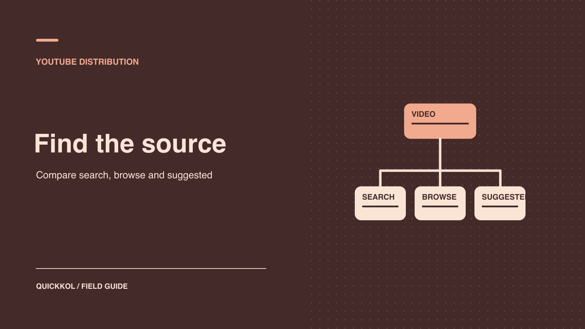

# YouTube 算法解读：赞助视频表现低于预期怎么查

状态：本地审阅稿；正式发布日期待确认。

用实际流量来源和植入段数据，决定下一轮该改选题、开头还是合作方式。

QuickKOL 编辑图形；不呈现真实账号指标或平台界面。

YouTube 搜索、首页和下一条推荐使用不同信号。赞助视频表现低于预期时，先和创作者对齐同格式、同观察期的可比作品，再看问题发生在被找到、点开还是看到植入。搜索偏弱，可以核对选题是否回答观众的问题。点击后很快流失，可以检查标题与开头、植入顺序是否一致。已批准投放、外部引用和频道受众变化需要单列，续约只依据能核实的证据。

## 先写清赞助商和创作者各自想验证什么

品牌赞助维修达人拍一条滤芯教程时，可能希望触达正在搜索特定机型的人，也可能想让原有观众看懂产品。两个目标需要不同对照。合作复盘先写下购买的交付、赞助段时点、预计受众和需要改变的决定。用 [YouTube 达人活动受众分组](https://www.quickkol.com/zh/blog/youtube-analytics-sponsored-content-cohorts/#answer)记录视频、格式、观察窗口和来源。结论从具体差距开始，例如「首周搜索观看低于该频道同类教程」，让创作者有一条可核对的反馈。

挑同一频道、相近主题和同样上线后时长的作品，再单列广告、站外引用与节庆。让达人确认常见受众问题，品牌负责提供准确的商品机型和实际投放记录。若交付和披露都符合 Brief，先验收作品。分发差距用于决定下一轮要改选题、封面、开头或赞助段位置，必要时再核对是否换合作对象。这样两边可以一起解决一个问题。

## 分开理解首页、下一条推荐和搜索

[YouTube 推荐机制说明](https://support.google.com/youtube/answer/16089387?hl=en)指出，不同界面使用的信号侧重不同，例如首页主要依赖观看历史，而下一条推荐会重点考虑当前观看的视频。[YouTube 搜索机制说明](https://support.google.com/youtube/answer/16090438?hl=en)将相关性、参与和质量列为主要因素，并可能考虑个人历史。不要拿一个人在某个设备搜到的位置代表所有人排序，也不要写某个关键词保证推荐。界面与报表分类也不一定一一对应；例如 Browse 可能覆盖首页以外的浏览入口。先按后台标签解释，再看实际可获取的细分。

品牌采购一支教消费者更换滤芯的长视频时，可关心具体问题查询和同类教程后的推荐。若 Brief 用意是让创作者的已有观众了解新品，更多关注常规内容和该系列的可比数据。一个视频可能同时出现多类流量。不要让买方在总表里给所有流量都贴「算法推荐」。把可见来源用于回答各自的问题。看不到的搜索词、观看条件或报告切片注明不可用。

## 按来源核对展示和点击

[YouTube 展示与观看时长说明](https://support.google.com/youtube/answer/9314486?hl=en)将有记录的缩略图展示与后续观看和时长关联。平台展示不等于所有看到链接的人；站外、通知等流量范围按报表解释。查看某条视频的展示和点击时，要确认分母是该报表的合格展示，不把全部观看除以它。若能按来源拆分，分别看搜索、浏览和推荐，不用总点击率推断某入口。不同来源的观看意图和展示位置不同，混合比例变化本身就能改变整体数据。

例如搜索有 2,000 个符合口径的展示、160 次对应观看，浏览有 8,000 展示、240 次对应观看。用同源数据分别计算 8% 与 3%。不能据此断定浏览封面有问题，因为位置和受众有差别。先找近期同类视频的同来源对照，再看该渠道的缩略图承诺是否和开头一致。若只有整体点击率，保留源限制，改用可获取的观看来源作为背景。不要把各渠道点击率直接求简单平均。

## 检查开头是否兑现点击承诺

[YouTube 观众留存说明](https://support.google.com/youtube/answer/9314415?hl=en)介绍了观看过程中保留和流失的观察。用视频时间码对照缩略图与标题、开场、植入和首次演示。假设视频标题承诺「两分钟换滤芯」，却在开头先播长品牌介绍。若早期流失集中，给下一轮一个可检验解释：更早展示实际步骤是否改善观看。图表指出需要检查的位置，不能单独证明观众为何离开。广告、内容时长和受众混合也可能影响。若留存只能取得整条，不写成特定来源的结论。

品牌购买植入时，要知道植入出现在什么时间。如果整条视频有 10,000 次观看，只能按报表说明，不能称为 10,000 次完整看到产品。查适用的片段留存或其他可用证据，给报告加范围。若拿不到单段数据，可以观察实际访问、问题或被接受的交付。创作者继续保留其内容节奏决定权；品牌确认自己的产品说法和披露。用小试而非强制增加广告时长验证是否有更合适的植入位置。

## 对标题和封面一次只改一个因素

[YouTube 频道表现问答](https://support.google.com/youtube/answer/141805?hl=en)解释标题、缩略图及表现的关系。品牌需要找哪项变化影响受众时，记录版本、改动时间和同一来源的观察范围。选一个变量，尽量保持其他因素和窗口接近。若换封面同时开始投放或被外站引用，不能从前后总数直接归因给封面。接受平台提供的实际测试方式和覆盖，结果不足时不做强结论。对高风险宣称，先审文案再开展创意测试。

例如新封面更准确地展示操作工具，保留原题、说明和视频，比较改动前后可比时段。另记录该周是否有人引用内容。若搜索有变化但推荐没有变化，按来源报告并保留范围。下一次也许该测试标题更贴近用户问题，而不将「标题和封面一起改」写成单一经验。不同窗口的观看人群未必相同，若无法保持对照条件，明确这是观察。使用[达人发布 Brief 方法](https://www.quickkol.com/zh/blog/write-a-useful-campaign-brief/#answer)约定谁能动线上版本。

## 检查付费和外部渠道是否解释波动

让品牌和达人分别列活动时间、素材 ID、广告和外站引用。视频数据可能有付费、自然和非 YouTube 来源。广告报告要按自己的范围解释，不能把额外播放记成推荐自然增长。外站嵌入或媒体报道可能推高视频观看而不会形成同样的缩略图展示。遇到异常先核对时间和来源，别随意给它贴「推荐故障」标签。如果报表无法分清，明确包含哪些活动与未知的分配。

例如品牌周二上线赞助视频，周四开始广告，周五有媒体报道。汇报时保留三种活动和实际时间。分别查看发布后七日观看和广告计划。若没有足够证据判定多少人来自某条引用，报告事件重合，不给每个来源强行分摊。下一轮若想观察自然发现，可以在合同内约定投放延后，仍记录所有自然事件和实际发生变化。

## 根据三个观察结果决定要不要续约

假设品牌和维修达人合作一条滤芯教程。首周搜索观看低于频道近期同类作品，搜索词却主要指向另一类机型。浏览入口的点击与历史接近，植入开始前的留存出现下滑。三条观察需要不同判断。先检查新选题是否回答该频道观众的真实问题，再打开视频看标题承诺的步骤何时出现。留存下降可以指出值得检查的时间段，无法告诉品牌每个观众为何离开。若报表只给整条留存，不能把它写成特定来源的原因。

品牌验收已上线的植入、披露与跟踪链接。续约前，可以请同一位创作者再做一条对机型和问题匹配更明确的教程，先保持投放与植入安排接近，观察搜索来源和相关问题。若原稿的主题与观众匹配，但第一次展示在植入之后，下一轮也可单独测试把演示提前。将标题、封面、选题和植入改动分别记录，选择最需要核实的一项。

如果品牌买的是付费可用素材，原帖自然发现只是一项背景，购买决定还要看素材可用性、观众理解和媒体报告。把「同一达人做第二条」「只买可授权素材」「待补数据再定」写成不同报价范围。这样复盘会改变实际采购，创作者也能针对明确证据回应。

## 把分发问题交给能处理的人

把发现写成「可核对事实、可能解释、下一步」。搜索词不匹配可以由创作者与品牌一起重写标题。访问率下降但落地页坏了，由品牌修复。片段开始时流失，由达人评估更早展示或改植入方式。若数据缺失，交给分析负责人核对窗口。避免用同一个「算法」要求所有人改内容。每项计划记谁批准、何时上线、观察哪个来源和什么时候复查。

## 为下一次对照保存原始结果

复盘提供视频 URL、版本、格式、数据源、观测期、已知投放及外部事件。给下一轮设置明确成功条件，例如「同来源点击率和观看时长在可比条件下有改进」，不承诺排名。保留失败样本的原始数据，不因下一期修复就覆盖。若来源不同，只比较可以复算的部分。先确认是报告问题还是观众行为变化，再确定是否续约或调整下一轮创意。

## YouTube 分发诊断表

| 来源或环节 | 先核对 | 可测试的改动 |
| --- | --- | --- |
| 搜索 | 主题需求、查询匹配和同源数据 | 更清楚的标题 |
| 浏览与推荐 | 可比内容与实际报告分类 | 封面或场景 |
| 观看留存 | 开头、植入和时间码 | 先展示观众要看的动作 |
| 外部与付费 | 事件、实际窗口和素材 ID | 分开测量 |

各指标按报告对象和区间解释。

## 达人视频分发复查清单

把观察转成一次可核验的创意测试。

- [ ] 确定视频、来源、格式和观察窗口。
- [ ] 核对展示、点击、观看与分母。
- [ ] 分开自然、外部和付费。
- [ ] 确认改动、负责人及下次复查。

## 研究日期与使用边界

资料核验于 2026 年 11 月 9 日。文中方法、表格和决策规则为编辑建议，标为假设的示例不是实际客户结果或行业基准。外部资料的适用地区与时期按各段说明；本稿处于独立本地审阅阶段，正式发布日期待确认。

## 用清楚的任务开始达人研究

用 QuickKOL 理解 Brief、发现相关达人并研究作品与联系路径；数据、合作条件和结果仍需核验。

[了解 QuickKOL](https://www.quickkol.com/#capabilities)

## 来源

- [YouTube 推荐机制说明](https://support.google.com/youtube/answer/16089387?hl=en)
- [YouTube 搜索机制说明](https://support.google.com/youtube/answer/16090438?hl=en)
- [YouTube 展示与观看时长说明](https://support.google.com/youtube/answer/9314486?hl=en)
- [YouTube 观众留存说明](https://support.google.com/youtube/answer/9314415?hl=en)
- [YouTube 频道表现问答](https://support.google.com/youtube/answer/141805?hl=en)
