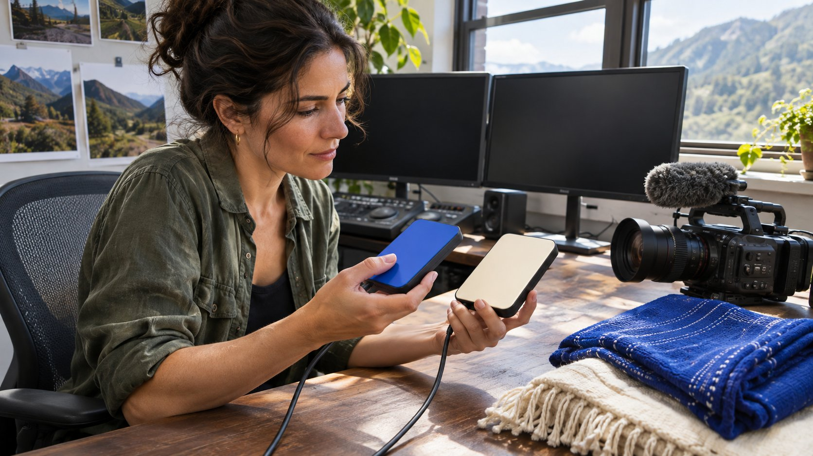

# How to Find the Creator Behind a YouTube Clip

Status: local review draft; confirm the publication date before release.

Trace a YouTube clip to its original publisher and identify the right contact for new work or footage permission.

When several YouTube channels show the same clip, start with the job the brand needs. The presenter may be available for new production, the original channel may handle distribution and another company may control footage rights. Record video and channel identifiers, dates and credits, then verify roles through original sources. The earliest upload you find is a lead. Ask separate questions about creating new work, publishing on the creator’s channel and licensing the existing clip.

## Define the deliverable before tracing the clip

Suppose an outdoor brand finds a gear review and wants the presenter to shoot a new video. The brand also hopes to use part of the earlier review in an ad. It needs the presenter’s availability for the new work and someone authorized to license the old footage. The same team may cover both requests, or the presenter’s agent and the producer may handle them separately. Break the job into new production, creator-channel publication, licensing existing footage and paid distribution. For each, list the candidate rights holder, supporting evidence and missing information. If the new shoot is the priority, the host may be the first contact. If the original clip is indispensable, lead with rights and scope.

At first inspection, mark the upload as a full video, a short excerpt, a compilation or a quotation. A channel description calling something “our show” is a clue to the publisher’s role. It does not identify every contributor’s role. Use a [YouTube channel identity verification](https://www.quickkol.com/blog/youtube-channels-identity-scope-handoff/#answer) record to retain the evidence behind each candidate. Verify a plausible connection to the required deliverable before sharing the commercial brief with another account.

## Attach the video and the channel to one record

Open the video page and save its full URL and video ID. From the channel page, save the canonical link, handle and any channel ID you can verify. [YouTube’s channel ID guide](https://support.google.com/youtube/answer/3250431?hl=en) explains the distinct user and channel IDs. [YouTube’s handle guide](https://support.google.com/youtube/answer/11585688?hl=en) distinguishes a handle from a display name. Use the handle in outreach and the channel ID, where available, as a stable reconciliation field. If the creator changes their display name, update that field and preserve the earlier video record.

If names and avatars are similar, look for a matching channel link from the creator’s site, a show page or a separately verified public profile. A viewing URL may include playlist or recommendation parameters. Retain the original observation and the video ID separately. Two different viewing URLs can point to one upload. Two distinct channels can also use the same thumbnail. Establish how many video objects and channel objects you have before saying there are several uploads. If a candidate has only a platform name and you cannot independently establish its relationship to the creator, leave the identity field open. It is still possible to note the clip as a discovery lead while confirming a contact route.

## Put the dates back in distribution order

Compare the public dates for a full episode, trailer, short and compilation. A short may precede the full release. A producer may publish elsewhere before uploading to YouTube. Dates can order the uploads you found. They cannot rule out older sources you did not find. Save the titles, visible dates and relevant timecodes. If a version became private or was deleted, mark it inaccessible. Do not infer an original release date from an unattributed caption in a repost.

Within publicly viewable material, look for evidence another reviewer can verify: production credits, the show’s recurring branding, a presenter introduction, description links and a named source. If a full version credits a production company and a short version contains the same footage, record “possible excerpt of this episode; publisher confirmation needed.” Add a contemporaneous official show page when available. A short could go live Monday and the full episode Wednesday, with the show’s Monday page describing the short as a preview. That combined evidence can explain the sequence more clearly than two video dates alone. Keep the open question if the underlying connection remains unverified.

## Distinguish authorized distribution, fan accounts and identity questions

Several channels may be authorized to distribute the same footage. A show, media partner and presenter can publish distinct versions. A fan channel may also identify itself clearly as a fan account. [YouTube’s impersonation policy](https://support.google.com/youtube/answer/2801947?hl=en) addresses misleading imitation and requirements for identifying fan channels. Record the actual labels and account links. Similar imagery alone is insufficient to describe someone as impersonating a creator. Check the likely redistribution relationship, publication permission and account ownership independently.

If a clip page supplies a private messaging contact or says it can sell ad rights on behalf of the original creator, confirm the claim through a contact independently associated with the creator or producer. Ask a verified general contact whether the representative can quote for this clip, market and use. Move into payment only when the party’s authority is established to the relevant scope. Without a reply, keep the clip as a discovery source and continue evaluating candidates. A high-performing repost does not resolve the rights chain. Preserve a copy of the proposed terms internally if that helps the authorized owner identify an offer, and limit what the sourcing team circulates.

## Check rights for the proposed use

[YouTube’s copyright guide](https://support.google.com/youtube/answer/2797466?hl=en) describes routes such as obtaining permission or using material under a suitable license. A publicly viewable clip is not evidence that the brand may download, edit, advertise with or repost it. Put the timecode, version, proposed ad surfaces, territory, term, budget, agency access and editing needs in one request. Ask the prospective licensor what they can grant and which elements need another permission. Music, graphics and guest footage can require separate review. Route the final decision to the appropriate brand owner for the market and intended use, especially where the content will carry significant paid distribution.

For a new shoot, say whether the brief expects the old intro, a recognizable set, a show character or archival footage. A creator’s willingness to shoot does not transfer rights from the production team. If the old clip remains unavailable, commissioning a separate original demonstration could meet the new content goal. Clear any third-party material used in that new production separately. Use a [creator rates and usage rights framework](https://www.quickkol.com/blog/creator-rates-usage-rights/#answer) to separate production and licensing. An itemized offer lets the next buyer see which use was priced and which still needs discussion.

## Keep clip performance with its publishing object

Track performance separately for uploads published by the creator, the producer and a third-party editor. A clip may change the title, order, running time, language or audience. Views on a popular repost cannot be reported as performance from the original channel. Adding different upload counts does not yield unique reach. Ask for comparable creator-channel content if the decision is about distribution. Use the clip as a sample of creative ability when that is the actual question.

Suppose a compilation clip has 700,000 public views while the full episode has 40,000. A sourcing note can state that the topic traveled on a separate publishing channel. It can then ask the presenter’s team for their own comparable performance or consider brand-owned distribution. If the older footage demonstrates that the presenter explains a product well, retain it as work evidence. It does not bring another channel’s audience into the quote. Before launch, record which asset will go live, which party publishes it and who will supply measurement. Those fields determine which numbers belong in the recap.

## Use the clip to scope a new commission

Suppose a software brand sees a presenter demonstrate a workflow in a conference highlights video. The event published the clip and the presenter’s own channel hosts a separate talk. Verify who appeared and who handles their commercial work, then ask whether they can film a new demonstration. If the brand also wants to use the conference excerpt in an ad, log the timecode, market, term and rights contact separately. The event page confirms the appearance. Permission to use that edit is a separate question.

Keep two shortlist statuses, such as available for a new commission and archive rights pending. If the footage owner has not answered by the production deadline, the buyer can still commission an original sample. Describe the explanatory skill the brief needs and accept the new script, footage and live link on their own evidence. Do not carry the highlight reel’s views into the distribution promise for the new work.

## Use a focused outreach message to confirm the missing role

Send a brief message that names the video, the timecode and the request. For example: “In the episode your team published, we saw the equipment demonstration at 2:14. We would like to invite the presenter to make a new video. Do you handle that presenter’s commercial work, or should we contact another team?” If you need an archive license, ask separately with the proposed time range and use. Do not describe a recipient as the rights holder before the relationship is confirmed.

When a reply arrives, record the statement, date, role, next contact and remaining authority to verify. An agent’s confirmation that they can discuss new work does not establish approval of production-company footage. Leave unresolved rights with the contract or licensing owner. You can hand over the identified candidates and samples while flagging any issues that affect payment and release timing. A second reviewer should be able to follow the URLs back to the public material and understand why the brand contacted that particular person.

## Example video provenance log

| Object | Record | Decision |
| --- | --- | --- |
| Full episode | Video and channel IDs, production credits | Confirm who handles rights |
| Excerpt | Publisher, timecode, possible source | Use as discovery and work evidence |
| On-camera creator | Identity, representative and work samples | Confirm new creative availability |
| Ad license | Media, duration, territory, editing | Obtain written confirmation from the authorized party |

The applicable license and partnership terms determine permitted uses.

## Before contacting a creator

Confirm the person, account, content and authority separately.

- [ ] Save video ID, channel identity and observation date.
- [ ] Check the relationship among full episode, preview and clips.
- [ ] Separate production, publication and footage licensing.
- [ ] Use a verified route to reach the relevant contact.

## Research date and limitations

Sources reviewed November 9, 2026. Methods, tables and decision rules are editorial recommendations. Hypothetical examples are not actual client results or industry benchmarks. Source geography and periods are specified where relevant. This draft is in independent local review; confirm its publication date before release.

## Start creator research with a clear task

Use QuickKOL to interpret a brief, discover relevant creators and research their work and contact routes. Verify data, commercial terms and outcomes at their source.

[Explore QuickKOL](https://www.quickkol.com/#capabilities)

## Sources

- [YouTube’s channel ID guide](https://support.google.com/youtube/answer/3250431?hl=en)
- [YouTube’s handle guide](https://support.google.com/youtube/answer/11585688?hl=en)
- [YouTube’s impersonation policy](https://support.google.com/youtube/answer/2801947?hl=en)
- [YouTube’s copyright guide](https://support.google.com/youtube/answer/2797466?hl=en)
