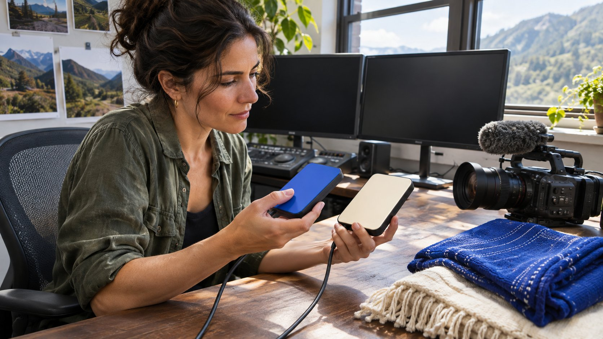

# 如何找到 YouTube 片段里的原作者

状态：本地审阅稿；正式发布日期待确认。

从热门剪辑回到原频道，核验出镜者、制作方和可以谈合作的人。

同一段 YouTube 视频出现在多个频道时，品牌先明确想邀请谁做什么。出镜者可以谈新拍摄，原频道可能负责分发，制作方或发行方才可能有权谈旧素材。记录各视频及频道的唯一标识、发布时间和署名，从公开的原始资料核对每个角色。最早发现的上传可作为线索。发商务邀约前，把创作、原账号发布和旧片授权分开问。

## 先把要买的交付写出来

假设一个户外品牌看到一段评测，想找其中的人制作新视频，同时希望在广告里使用旧片段。需要联系主持人确认能否拍新片，也要找到可以许可旧片的人。两者可能由同一团队管理，也可能分别在主持人经纪和制作公司。把合作请求分为新创作、达人渠道发布、旧片授权和二次投放。每项列出候选权利方、证据和缺口。下一步如果只有拍摄需求，可以先确认主持人；如果核心是使用旧片，先问版权和使用范围。

初看页面时，标注片段来源是完整上传、短切片、节目合集或引述。某频道在描述中写「我们的节目」，仍要问清楚谁在节目里有何角色。品牌要按 [YouTube 频道身份核验方法](https://www.quickkol.com/zh/blog/youtube-channels-identity-scope-handoff/#answer)保存候选人的归属依据。没有必要向每个转载账号发相同商业简报，先确认它是否对应要购买的交付。

## 把视频和频道绑定到同一条记录

先打开视频页，复制完整链接并记录视频 ID。进入频道页，保存正式链接、手柄和能取得的频道 ID。[YouTube 频道 ID 说明](https://support.google.com/youtube/answer/3250431?hl=en)介绍了频道与用户各有 ID，[YouTube 账号标识说明](https://support.google.com/youtube/answer/11585688?hl=en)解释手柄与频道名称的区别。把公开号的手柄用作联系标识，把可取得的频道 ID 用作较稳定的对账字段。改名之后可以更新名称栏，不需要重写旧视频的归属记录。

显示名称和头像很相近时，先从创作者官网、节目官网或可确认的其他公开主页看是否指向同一频道。若链接带有用于播放列表或推荐的参数，仍单独保留视频 ID 和原始查看 URL。两个不同 URL 可能指向同一视频，两个不同频道也可能使用完全相同的缩略图。记录有几个视频对象和几个频道对象，再判断是否真的出现了多个上传。若候选渠道只有平台内名称，没有外部身份支持，把该字段留在待确认状态。

## 把发布时间放回原来的发行顺序

比较完整节目、预告、短片和剪辑合集的公开日期。片段可能早于完整版，也可能是制作方在其他平台首发后上传。时间戳能排出已找到上传的次序，不能证明未发现的页面不存在。记录所见时区、标题和时间点。若某版本已转为私密或删除，记下无法访问。不要从转载帐号提供的日期猜一份原稿发布时间。

在允许观看的公开素材里找可复核的线索：片尾制作署名、节目固定栏目、主持人自我介绍、说明中的链接和所引用的作品。如果完整版本的简介指向制作方，短片只转贴同样的画面，可以把两者的可能关系写为「完整版和摘录，待发行方确认」。如果有官方频道同期发布的简介或新闻稿，补进去。举例，短视频于周一上线，完整版周三上线，主办方的周一节目页说明是预告。这个组合比只比较两个 YouTube 日期更能说明发行安排。

## 区分经授权分发、粉丝账号和身份问题

同一素材的多个渠道可能都经过授权。电视节目、媒体合作方和主持人可以各发不同版本。另一些频道会清楚标明是粉丝剪辑。[YouTube 冒充政策](https://support.google.com/youtube/answer/2801947?hl=en)说明平台限制误导性的身份模仿，并对粉丝频道标识有要求。审查时写下实际标记和账号链接，不要看到相似头像就称对方冒充。把可能的转载关系、是否存在发布许可和是否由本人管理分开查。

如果某剪辑页提供私人聊天账号，或者声称「代表原作者出售广告权」，回到创作者或制作方公开认可的渠道确认。向公司通用联系方式求证这位联系人能否为该视频和地区报价。只有明确授权时才进入付款流程。如果没有得到答复，保留剪辑为素材发现来源，继续寻找其他候选。不要让热门摘录的流量推着品牌接受无法交代权利来源的报价。

## 按用途核对素材权利

[YouTube 版权说明](https://support.google.com/youtube/answer/2797466?hl=en)列举了取得许可或使用适当授权内容等路径。视频公开可看，不代表品牌可以下载、重剪、投放或在别处发布。把拟用时间点、剪辑版本、广告渠道、地区、期限、预算、是否交给代理和是否允许改编写在同一份授权请求里。请被联系方说明其可授予的权利，以及需另行取得同意的部分。视频里的音乐、图形或嘉宾素材可能需要另查。品牌的审批负责人按市场和用途处理，特别是受众大或预算高的投放。

新制作也要写明是否可沿用旧节目片头、场景、角色或素材。创作者本人愿意拍摄，不等于制作团队交出旧片。若版权路径迟迟无法确认，可以另做一段原创演示，仍需单独处理新片里的第三方材料。用[达人报价和素材使用权框架](https://www.quickkol.com/zh/blog/creator-rates-usage-rights/#answer)把制作费和授权费用分开，避免未来看到一张总价单却无法知道购买了哪些用法。

## 避免把剪辑的表现算给原频道

候选表里把创作者实际发布、制作方发布和第三方剪辑各自的表现单列。剪辑可能改标题、顺序或时长，也可能面向不同语言和受众。不能把热门转载的观看数写成原频道单条视频表现。来源不同的观看指标也不能简单累加为去重触达。品牌应看可比内容，明确是否需要原频道的近期自然报告，还是只在评估创作能力。

比如一条剪辑有 70 万公开观看，完整版有 4 万。品牌可以写「剪辑显示话题有传播潜力，分发来自剪辑频道」，随后请求主持人提供自己账号的同类表现，或提供品牌账号单独投放的建议。假如旧视频表明主持人擅长演示，它仍可以做作品证据，不能把另一个频道的受众也装进同一报价。投放前记下素材、发布者和测量所有者。

## 有出镜证据就能邀约新作品吗

假设一家软件品牌在大会集锦里看到一位讲师演示工作流程。集锦由大会发布，主持人自己的频道也发了另一段演讲。品牌可以先核对哪位讲师出镜、谁负责其商务邀约，然后询问能否重新拍一段同类型演示。若同时想把大会片段剪进广告，另列时间码、投放地区、期限及素材权利联系人。大会页面能证实出镜，尚不足以证明讲师可以许可集锦。

候选表可以保留「新拍可联系」与「旧片授权待核」两个状态。若版权方在截稿前没有回复，采购仍可推进原创试拍。Brief 只描述希望复现的讲解方式，用新的演示素材、稿件与正式链接验收，不把热门剪辑的播放数字带进对下一条作品的承诺。

## 用一条精准邀约核实尚缺的角色

给候选联系人一条简短询问，写清视频、时间点和请求。比如「在您团队公开发布的节目里，我们看到第 2:14 的装备演示，想邀请主持人制作新视频。请问您负责该主持人的商务邀约，还是应联系其他团队？」另问旧片许可时，把拟用区间和用途放上。避免第一次发出时把未核实的签约方叫作权利人。

回复后，在记录里保留确认语句、确认日期、角色、下一位联系人和待核验的授权。经纪人确认能讨论新合作，不等于代表制作公司批准旧片。把尚未核验的交给合同或版权负责人。可以先交接已有的候选人和作品，保留哪些事项影响付款和发布时间。让第二位审阅人能够沿链接回到公开记录，独立判断你为什么找这个人。

## 视频溯源记录示例

| 对象 | 记录 | 决策 |
| --- | --- | --- |
| 完整节目 | 视频与频道 ID、制作署名 | 核对是否有授权方 |
| 剪辑 | 发布者、时间点、可能来源 | 用于发现和作品判断 |
| 出镜达人 | 身份、经纪联系和作品 | 核对新内容提案 |
| 广告许可 | 媒介、时间、地区、可编辑性 | 由权利方书面确认 |

使用范围由适用的许可和合作条款确定。

## 发送合作邀约前的检查

把人、账号、内容、授权分开确认。

- [ ] 保存视频 ID、频道身份和观察时间。
- [ ] 核对完整版、预告和剪辑的关系。
- [ ] 区分创作、发布和素材许可。
- [ ] 从已验证的路径联系能答复的人。

## 研究日期与使用边界

资料核验于 2026 年 11 月 9 日。文中方法、表格和决策规则为编辑建议，标为假设的示例不是实际客户结果或行业基准。外部资料的适用地区与时期按各段说明；本稿处于独立本地审阅阶段，正式发布日期待确认。

## 用清楚的任务开始达人研究

用 QuickKOL 理解 Brief、发现相关达人并研究作品与联系路径；数据、合作条件和结果仍需核验。

[了解 QuickKOL](https://www.quickkol.com/#capabilities)

## 来源

- [YouTube 频道 ID 说明](https://support.google.com/youtube/answer/3250431?hl=en)
- [YouTube 账号标识说明](https://support.google.com/youtube/answer/11585688?hl=en)
- [YouTube 冒充政策](https://support.google.com/youtube/answer/2801947?hl=en)
- [YouTube 版权说明](https://support.google.com/youtube/answer/2797466?hl=en)
