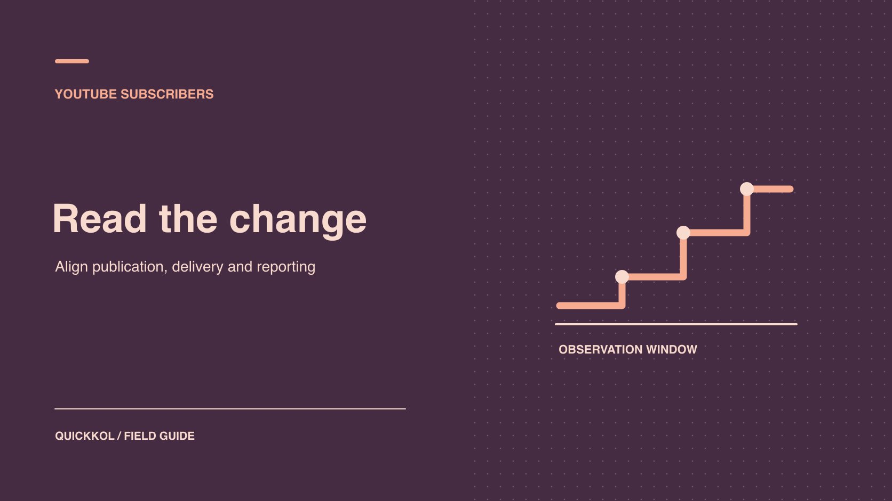

# Free YouTube Subscribers: What Sponsors Should Check

Status: local review draft; confirm the publication date before release.

Reconcile a subscriber spike with verified promotion and sponsored video delivery before approving payment.

QuickKOL editorial graphic; not actual account metrics or a platform interface.

An offer of free YouTube subscribers can expose a creator’s channel or distort a sponsor’s view of what a campaign delivered. Match the public observation to the native channel and dates, then check the sponsored video, authorized advertising and documented referrals. The creator handles any exposure of their account. The sponsor reviews publication and link delivery against the contract. If a bonus depends on attributable subscriptions, assign the disputed line to the settlement owner with a specific evidence request and a review date.

## Separate subscriber count from contracted delivery

Start with the brief and settlement clause. The sponsor might have purchased an integration in one video, a pinned comment, trackable visits or an increase in eligible subscriptions during a defined period. Publication has a URL and timestamp. Visits have an agreed measurement source. Channel-wide subscriber gains can support a performance clause only when the definitions and attribution window permit it. Put that distinction on the first page of the review. An impressive screenshot cannot replace the terms the creator and sponsor agreed to before launch.

[YouTube’s fake engagement policy](https://support.google.com/youtube/answer/3399767?hl=en) explains that artificial engagement is prohibited and that the methods of a hired promoter can affect a creator’s channel. A free trial, reciprocal subscription arrangement, fixed-quantity promise and request to connect an account are different proposals. For each, ask for the delivery method, permissions and reporting source. A sponsor can request the advertising account responsible, the audience settings, the delivery object and the metric unit when an agency says it ran official advertising. The phrase “growth service” cannot establish an artificial method. A guaranteed count also says little about what was actually delivered. Preserve the wording, then ask for evidence that describes the completed activity.

## Pin the channel and observation window

Preserve the sponsored video ID, canonical channel URL, observation time and reporting time zone. Two creators with the same display name can have different channels. The same creator can also publish a Shorts series from a separate channel. Confirm the report belongs to the contracted publisher. Two public observations collected by different people can sit several hours apart even when they appear on the same spreadsheet row. [YouTube’s subscriber count guide](https://support.google.com/youtube/answer/6051134?hl=en) explains public abbreviation at different account sizes and possible removal of closed or spam accounts. A visible change can justify a question without giving you a precise gain.

For example, suppose a page moves from 120K to 121K. It may have crossed a display threshold. There is no basis to subtract those labels and report exactly 1,000 acquisitions, much less divide that result by campaign spend. Obtain native gains and losses over a common window, then compute the net change for that report. Record the filter, extraction time and whether the report remains preliminary. Set a cutoff for the next refresh. Keep the old export alongside the refreshed one, so a later reviewer can reconstruct why the same case had two values.

## Put documented promotion and the spike on one timeline

Build a timeline of sponsored publication, Shorts extracts, mentions on other channels, livestreams, press coverage and paid start times. Let the brand and the creator verify their own activity. In the relevant [YouTube campaign audience cohorts](https://www.quickkol.com/blog/youtube-analytics-sponsored-content-cohorts/#answer), compare viewers, watch time, available traffic sources and subscriber changes. Add a direct link to a verified press mention. For a documented ad, keep its video ID, date and report scope. Sources across services may never reconcile person by person. Their timing and reporting boundaries still help determine which explanations fit.

Suppose the channel reports 780 subscriptions gained and 90 lost on the day a replay goes live. Comparable replays usually show only dozens of new subscriptions. The sponsor’s media record places paid delivery two days later. A second creator also linked to the replay on launch day. The reported changes, paid start date and reference link can be verified separately. The reference might account for some, all or none of the extra subscriptions. Logging it as a hypothesis protects the review from shifting from an unexplained count to an invented attribution. It also gives the creator a precise follow-up: provide the relevant traffic breakdown if it exists, without sharing viewer-level information.

## Give reporting and spam review a scheduled recheck

[YouTube’s fake engagement policy](https://support.google.com/youtube/answer/3399767?hl=en) says subscriber figures in Analytics can trail the channel display by around 48 hours for verification and spam checks. Treat that explanation as a reason to schedule a second look, not as a promised deadline for every report or metric. Record the settlement cutoff, the scheduled refresh and which snapshots must be retained. If a number changes after extraction, add a reconciliation row with the original value, revised value, source and any explanation the platform actually supplied.

[YouTube’s audience reports guide](https://support.google.com/youtube/answer/9314416?hl=en) defines monthly audience as unique viewers over the last 28 days. A subscription increase with little movement in viewing does not establish a purchased audience. The metrics cover different populations and can use different windows. Compare recent content in the same format, similar traffic sources and, where available, new viewers, return behavior and watch time. Use the distinction between [YouTube subscribers and active viewers](https://www.quickkol.com/blog/youtube-subscribers-count-and-active-viewers/#answer) to set the next campaign’s measurement. Leave unavailable fields marked unavailable. A missing geography slice or source row is not zero. Avoid adding channel audience totals across weeks, because the same viewers can appear in more than one window.

## Send access issues to the channel owner

Ask the channel owner whether anyone accepted a channel invitation, shared Google credentials or connected an external app. [YouTube’s channel permissions guide](https://support.google.com/youtube/answer/9481328?hl=en) explains how delegated channel roles can provide scoped access without sharing the underlying Google Account. A sponsor reviewing a campaign usually needs a limited export supplied by the owner. It does not need general channel control. Review delegated roles, app connections and unfamiliar sign-ins as separate records. Where access is unnecessary, have the owner remove it through the platform’s security workflow and log the effective time and affected campaign work.

Suppose a contractor asked to review reports but received a role that allows uploads. That mismatch is independently actionable. It does not establish that the contractor caused a subscriber spike. If the team finds an unexpected upload, a changed description link or a record of unusual access, refer it to the channel security owner and preserve the relevant history. Revisit publication timing once the owner can confirm which functions are safe to use. A collaboration sheet needs the access category, issue owner, impact on campaign deliverables and the next check date. Do not put login data or unnecessary personal material in the handoff.

## Verify that advertising delivered against the sponsored video

When an agency says it ran ads, ask for a specific campaign and creative row. The brand might have promoted a different video on the same channel. Sharing a channel does not justify assigning the entire media spend to delivery of the sponsored integration. Other common errors include using planned dates in place of actual delivery or adding a promotion report’s engagement count to a Studio metric with a different definition. Extract the object ID, actual delivery dates and counting rule. Label which values can be shown side by side and which can be summed.

If the creator ran the official promotion, the brand can accept an extract with spending or unrelated account identifiers redacted as long as the video, window and delivery are verifiable. If the advertising itself was outside the agreed authorization, record that as a separate contract issue. Whether delivery was authorized and whether the audience figures are reliable are different questions.

## Set the evidence request for a subscriber bonus

Suppose a contract buys a video integration and a tracked link, with an additional bonus for subscriptions attributable to the video in its first week. The integration and link are live, but the agency has supplied only a screenshot of channel-wide gains. Accept the two verifiable deliverables. Send the bonus line to the data owner with the specific video, actual observation window, metric definition and paid delivery records requested. Even an accurate channel number can include new viewers from other uploads, press coverage and advertising.

If channel-level evidence is all that exists, write that channel growth was observed and evidence meeting the bonus term is unavailable. If both parties later accept a substitute, record the revised definition and approval date. The sponsor can also structure its next brief around accepted work and relevant viewing, with subscriptions as context. This keeps the settlement tied to a particular contractual question and gives the creator a way to answer it without exposing unrelated channel information.

## Write a settlement decision another reviewer can reproduce

Give every deliverable its own source and disposition. If the video URL, integration timestamp and contracted availability are all verified, record that evidence. If the subscriber-based bonus lacks attributable data, isolate that line under the contract and set a deadline for the missing material. When evidence confirms artificial subscriptions, describe the specific finding and its limits. A supplier’s admission can support a finding about the method they used. It may not explain every change in the channel’s total. Route contractual and platform decisions to their designated owners.

For the next brief, define how a subscriber bonus is calculated, specify acceptable reporting, rule out artificial engagement and require owner approval for external access. Name the channel, date window and report time zone before launch. If the campaign is meant to generate video viewing or product visits, evaluate those outcomes alongside accepted creative delivery. Close the discussion with a request the creator can answer, such as “Please send the traffic breakdown for the sponsored video’s first week and confirm the report time zone.” That is more actionable than asking someone to prove every person behind a displayed number is genuine.

## Sponsor reconciliation worksheet

| Item | Usable evidence | Disposition |
| --- | --- | --- |
| Public count change | Channel URL and timestamps | Open review and request a matched native window |
| Ads and organic releases | Delivery and video records | Record and explain separately |
| Accepted integration | URL, integration time and agreement | Record acceptance separately |
| Excess channel access | Role verified by owner | Route to owner for access response |

The examples illustrate reconciliation and do not set an abuse threshold.

## Pre-settlement checklist

Assign each missing field to someone authorized to see its source.

- [ ] Pin the channel, video and reporting window.
- [ ] Preserve the public observations and native export versions.
- [ ] Reconcile authorized advertising, references and publication times.
- [ ] Separate acceptance, performance and access incident states.

## Research date and limitations

Sources reviewed November 9, 2026. Methods, tables and decision rules are editorial recommendations. Hypothetical examples are not actual client results or industry benchmarks. Source geography and periods are specified where relevant. This draft is in independent local review; confirm its publication date before release.

## Choose auditable metrics for the next sponsorship

Start with paid scope, data ownership and a review cadence.

[See the creator campaign measurement guide](https://www.quickkol.com/blog/creator-campaign-measurement/)

## Sources

- [YouTube’s fake engagement policy](https://support.google.com/youtube/answer/3399767?hl=en)
- [YouTube’s subscriber count guide](https://support.google.com/youtube/answer/6051134?hl=en)
- [YouTube’s audience reports guide](https://support.google.com/youtube/answer/9314416?hl=en)
- [YouTube’s channel permissions guide](https://support.google.com/youtube/answer/9481328?hl=en)
