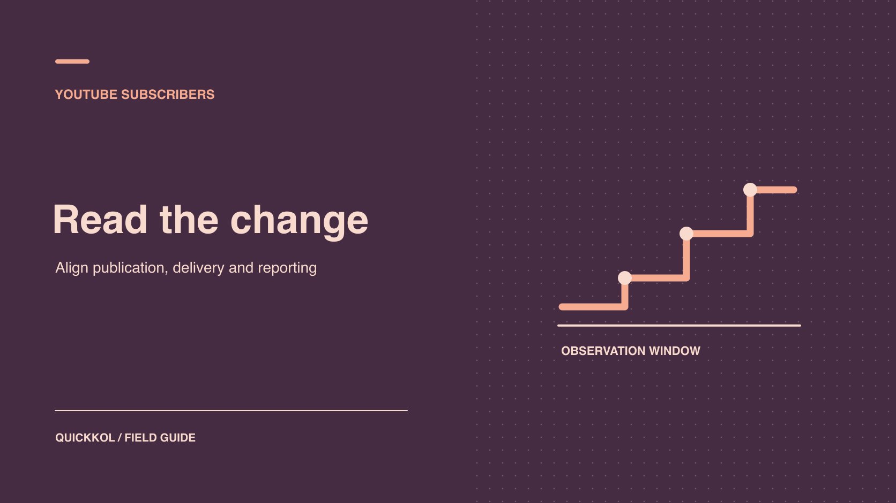

# 免费 YouTube 订阅会影响赞助结算吗

状态：本地审阅稿；正式发布日期待确认。

在赞助结算前核对订阅异常、真实推广与已经交付的视频内容。

QuickKOL 编辑图形；不呈现真实账号指标或平台界面。

一条免费订阅邀约可能影响 YouTube 合作的账号安全，也可能让赞助商把频道净增误记成活动成果。先确认原生报表和公开快照对应同一个频道与期间，再核对视频、已批准投放和能证实的外部引用。创作者本人负责处理账号暴露。品牌按合同验收视频与链接，只有订阅奖励真的依赖异常数字时，才把那部分交给结算负责人继续查。

## 把订阅数与交付定义分开

先读 Brief 和结算条件。品牌可能买的是一条植入、一条置顶评论、链接点击或某段时间内的自然订阅增量。植入是否发布可以看视频 URL 和时间戳，点击由约定的数据来源确认。渠道级新增订阅只能在口径和归因窗口明确时进入绩效条款。把这一点写在审查表第一页，防止某张大数字截图改变合同的验收规则。

[YouTube 虚假互动政策](https://support.google.com/youtube/answer/3399767?hl=en)说明，人为抬高互动受到限制；如果创作者雇用推广方，对方的方法也可能影响频道。免费试用、交换订阅、承诺固定数量和要求账号连接属于不同提议，都要问方法、权限和报告。品牌可以向供应商询问其使用的广告账户、交付对象、受众设置和统计单位。在没有证据的情况下，不能因对方用「增长服务」这个名字就归类为刷量，也不能因对方给出包量承诺就认定已交付。

## 固定频道与采集窗口

保留合作视频 ID、正式频道 URL、采集时间和报表的时区。不要把两位同名达人的截图或 Shorts 系列和主频道的报表合并。两个人独立记录的公开数字也可能有不同采集时点。[YouTube 订阅数说明](https://support.google.com/youtube/answer/6051134?hl=en)展示了不同规模频道公开数字的缩写方式，以及关闭账号和垃圾订阅可能移除。公开端变化可以启动询问，不能当作精确的新增人数。收到导出时，保存表头、日期筛选和导出时点，按同一频道核对。

举例来说，页面从 120K 变成 121K。它可能刚跨过显示档位，不代表两次检查之间恰好多了 1,000 人。先不要用差值除以广告花费。等团队取得相同区间的原生新增和流失数据，再计算净变动。记下是否显示完成、是否有平台调整。定义需要回看的截止时间，避免分析人员不断覆盖记录，最终无人知道报告是哪一版。

## 把合法推广与异常波动放进同一张时间轴

按顺序记录赞助视频上线、Shorts 片段、其他频道引用、直播、媒体报道和投放开启时间。品牌与创作者各负责核对自己的动作。对照适用的 [YouTube 分析活动受众分组](https://www.quickkol.com/zh/blog/youtube-analytics-sponsored-content-cohorts/#answer)，查看观看人数、观看时长、可用的流量来源和订阅变化。若某次媒体报道存在，给出真实链接；若是广告，保留视频 ID、日期和报告范围。不同渠道的数据不一定能逐个对应，但可以辨认是否有一个来源与变化同窗。

假设直播回放发布的当天后台显示新增 780、流失 90。过去同类回放通常只有几十个新增，这值得问原因。品牌提交广告记录显示实际送达在两天后，而另一位达人当天引用了回放。已确认的事实包括报表数字、广告起日和引用链接。引用是否驱动全部新增仍未确认。不要把后续广告先填作解释，也不要因为自然曝光记录不完整就给账号加上刷量标签。

## 给审核延迟留出复查节点

[YouTube 虚假互动政策](https://support.google.com/youtube/answer/3399767?hl=en)提到，订阅人数在 Analytics 中可能落后频道显示约 48 小时，用于额外核实和垃圾活动检查。品牌可用这个说明理解早期不一致，不能把两天当作所有指标、所有账号的最终 SLA。交接时记录结算条款截止日、计划复查时点和需要保留的截图。导出后若数值修订，在报表留一行差异说明，带上平台提供的提示与其时间。

[YouTube 受众报告指南](https://support.google.com/youtube/answer/9314416?hl=en)把月度受众定义为最近 28 天的独立观看者。订阅人数上涨却没有明显增加观看，并不直接证明买量，因为同一受众可在多个日期观看，两种指标的对象和窗不同。拿近期同格式内容和类似来源作为背景，观察新观众、回访和观看时间。对照 [YouTube 订阅人数与活跃观看者](https://www.quickkol.com/zh/blog/youtube-subscribers-count-and-active-viewers/#answer)概念，帮助品牌设定下一次合作的评估指标。任何无法取得的数据记作「未取得」，不用 0 补齐。

## 发现权限请求时交由频道所有者处置

请频道所有者查是否接受权限邀请、分享 Google 凭证或通过第三方授权连接。[YouTube 频道权限说明](https://support.google.com/youtube/answer/9481328?hl=en)区分了委托频道角色与共享 Google 账号。品牌分析通常只需要达人提供范围明确的报表；没有必要为审查索要完整账号。权限授予、应用授权和可疑登录分别核对。确认权限与工作无关时，由所有者按照平台安全流程撤销，保留变更时间和受影响的活动。

若推广承包商把「查看报告」写进说明，但被授予了能上传内容的角色，记录授权层级超出工作范围。权限超范围是可以单独处理的事实。它与订阅增长没有自动的因果关系。若出现未知发布、视频描述被改或资料访问异常，先通知频道安全负责人并看变更记录，再调整合作排期。在协作表只写权限类型、负责人、受影响的交付和复查时间。保留最少的信息即可推动处理。

## 核对广告是否真的为这条视频送达

代理说「投放过」时，要求给具体活动和创意行。假设品牌广告的创意使用另一支视频，两支视频虽然同在一频道，但无法把整笔广告花费记成赞助片段的送达。另一个常见错位是把计划日期当成实际送达，或把推广平台统计的互动和 Studio 同口径相加。取出导出里的对象 ID、实际送达日期和计数定义，标明哪些数字能并排展示，哪些不能相加。

如果正好是合作达人自己投放，品牌可接受遮盖预算或账户标识的证明，只需保留足以确认视频、日期和送达的字段。若投放是授权之外的行为，也应单列为合同事项。授权范围的分歧与流量是否真实不是同一个判断。

## 给订阅奖金一个可验证的补件范围

假设合作合同约定一条视频植入、一个跟踪链接，以及发布后一周由该视频带来的订阅奖金。视频和链接按约上线，但代理只交了频道级新增截图。结算负责人可签收植入和链接，把奖金行交给数据所有者，请求指定视频、实际观察期、报告定义和任何投放记录。频道数字就算真实，也可能混入其他视频、节目报道和付费来源。

如果只有频道级材料，结论写「已观察到频道增长，未取得符合奖金条款的来源证据」。若品牌与达人后来确认可用另一种口径，把条件和批准日期写入更正记录。另一条路径是下一轮按接受的作品和相关观看采购，把订阅作为背景。这样结算争议对应一项明确的合同缺口，不必扩展成对创作者整个频道的判断。

## 把付款决定写成可交接的记录

给每项交付标出证据和处理状态。视频链接、植入位置和有效期都符合约定时，记录通过。订阅奖励若缺少可归属的数据，按合同将这一行单独标出并明确补件期限。确认发生人工订阅的场合，记明具体证据只支持哪件事，例如供应商承认使用某一机制，不默认它解释全部变化。需要进一步判断时，由合同和平台负责人处理。

下一份 Brief 可以先规定订阅奖励怎样计算，注明不接受人为互动和未经批准的访问，并要求用指定频道、区间和报告时区交付。对赞助目标是视频观看或产品访问的活动，用观看、合格点击和内容交付分别评价，避免订阅数字掩盖真正目标。向达人反馈时以可验证的问题收尾：「请补这条视频上线后一周的流量来源，以及报告时区」。给具体问题，比要求创作者证明所有关注者都是真人更可执行。

## 赞助合作复核对照表

| 项目 | 可用证据 | 处理 |
| --- | --- | --- |
| 公开号变化 | 频道 URL 与采集时间 | 打开复核，等同窗后台 |
| 广告与自然发布 | 送达与视频记录 | 分开记录和解释 |
| 已验收的植入 | URL、植入时间及约定 | 独立记录验收 |
| 权限超范围 | 所有者核实的角色记录 | 由所有者按权限处理 |

例子用于展示复核方法，不是刷量识别阈值。

## 结算前核对清单

把每个待补字段交给有权看到来源的人。

- [ ] 锁定频道、视频和报表窗口。
- [ ] 保留公开观察及原生导出版本。
- [ ] 核对授权广告、引用及发布时间。
- [ ] 拆开验收、绩效和权限事件的状态。

## 研究日期与使用边界

资料核验于 2026 年 11 月 9 日。文中方法、表格和决策规则为编辑建议，标为假设的示例不是实际客户结果或行业基准。外部资料的适用地区与时期按各段说明；本稿处于独立本地审阅阶段，正式发布日期待确认。

## 给下次合作确定可核对的指标

从付费范围、数据所有者和复查节奏入手。

[查看达人活动衡量框架](https://www.quickkol.com/zh/blog/creator-campaign-measurement/)

## 来源

- [YouTube 虚假互动政策](https://support.google.com/youtube/answer/3399767?hl=en)
- [YouTube 订阅数说明](https://support.google.com/youtube/answer/6051134?hl=en)
- [YouTube 受众报告指南](https://support.google.com/youtube/answer/9314416?hl=en)
- [YouTube 频道权限说明](https://support.google.com/youtube/answer/9481328?hl=en)
