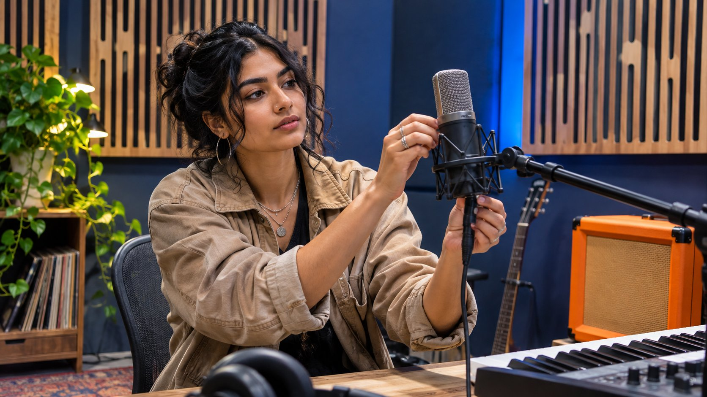

# What to Check Before Sponsoring a YouTube Music Channel

Status: local review draft; confirm the publication date before release.

Verify who publishes and who can approve music, appearances and advertising edits in an artist partnership.

Before sponsoring a YouTube music channel, separate artist participation, publication, new music production and any use of an existing recording. The official channel helps verify identity and work. Confirm publication with the artist team and check composition, recording and editing uses with the relevant rights owners. If ad rights remain open, commission the approved original deliverable and plan a cleared alternative for paid cutdowns.

## Choose the music creator role the brand needs

A music channel can be run by an artist, label, independent producer, commentary creator or catalog aggregator. Write down the purpose and purchase. A headphone brand may want a producer to show a mix and an artist to publish an interview on their own channel. Production, interview, publication and footage rights need separate terms. If the brand needs a music explainer for a particular audience, relevant work, language and audience questions may be more useful than a track’s view count. Use a [music creator listening process](https://www.quickkol.com/blog/follow-electronic-music-creators-brand-listening/#answer) to document the candidate’s public subject matter and market context, then verify target audience separately.

Assign evidence to each role. For artist participation, use relevant recent appearances and direct confirmation. For a producer, inspect work credits and the permissions they can grant. For a distributor, verify the managed channel and catalog. A person appearing in a video does not establish that they manage the channel or own a recording. In outreach, state the proposed deliverable, publisher and whether paid use is under discussion. Ask which role the recipient handles or who can confirm it. That lets the next conversation proceed with the person who owns the question.

## Distinguish artist, topic and distributor channels

[YouTube’s Official Artist Channel guide](https://support.google.com/youtube/answer/7336634?hl=en) describes a consolidated music presence for eligible artists or bands and how subscribers can be brought together from existing, topic and available Vevo channels. Record the official artist presence, related publishers, similarly named channels, video ID, credits and artist site. A topic channel may contain recordings delivered by a distribution partner. A similar name does not establish a common operator. Keep subscriber figures from before and after consolidation separate.

Imagine an artist profile and a label channel both carry the same music video. Confirm what each publisher, artist team and label can approve. Publication evidence from an artist channel does not establish that the label approved recording use. A distributor’s recording license also cannot commit the artist to publish on their personal account. Use a public site, agency or verified label contact to confirm the route before sending the full brief. The channel guidance explains why several entities can appear around one work. Verify how the current channel and video are actually managed before relying on that structure.

## Check composition and recording for each music segment

For U.S. copyright, [the U.S. Copyright Office’s musician guide](https://www.copyright.gov/engage/musicians/) distinguishes a musical work from a sound recording. They can have different owners and licenses. Give the rights reviewer the actual audio, version, segment time and planned uses. A title can refer to a studio master, live version, rerecording, cover or remix. Identify which one the edit uses. Have the rights owner determine whether composition, recording, synchronization or other permissions apply to the actual markets and media. A short excerpt still calls for an assessment of the intended use. There is no universal duration the brand can assume is cleared.

For example, a creator plans to perform another artist’s song and the team records the performance. That changes the recording being used, while the underlying composition still needs review for the proposed use. If the brand commissions original music, check whether the creator can grant the required rights and whether there are collaborators, samples or other material to clear. Obtain the scope from an authorized party. A comment recognizing a song is not evidence of ownership. A video playing on YouTube does not establish that its audio can run in off-platform advertising.

## Manage original videos, cutdowns and ads in an asset sheet

Give each deliverable a row: main video, creator teaser, brand edit, paid ad and event playback. Record timecodes, music version, appearances, platform, territory, term, editing permission and owner. [YouTube’s copyright guide](https://support.google.com/youtube/answer/2797466?hl=en) describes permission and other use pathways. Check the specific terms for a platform music tool or track available in one format. The availability of music there does not establish broad commercial reuse. Assign the reviewer in the brand, agency and artist handoff. Use a [creator rates and usage rights framework](https://www.quickkol.com/blog/creator-rates-usage-rights/#answer) to quote creation separately from reuse.

Suppose the main video is approved for organic release on the artist’s channel and the brand wants 15 seconds as an ad on another platform. Treat the 15-second audio and video as a distinct use. Verify paid media, market, permitted edits and advertising term with the authorized parties. If only organic sharing was approved, leave the ad pending and prepare a properly approved alternate version. After replacing a music bed, check audio, timing, captions and sponsorship disclosure again. Keep any temporary track out of the export package that goes to publishers.

## Check where music reporting ends and sponsor reporting starts

[YouTube’s Analytics for Artists guide](https://support.google.com/youtube/answer/18736729?hl=en) describes artist, song and content scopes. A track-level report can include different uploaders, versions or content using the work. If the sponsor buys one video, start from its actual video ID and release time and use available native viewing and audience evidence. Report song-level performance separately. Do not credit total track plays to the sponsored video. If the same period includes a new release, playlist placement or brand promotion, record the verifiable dates and sources for the recap.

Suppose a song shows 120,000 work-related views during the week and the sponsored interview shows 12,000 video views. The two observations can appear in separate report sections. If the scope of the larger number is unclear, ask the artist or data owner which metric and uploads it includes. Subtracting the values would not establish a clean non-sponsored count. The populations and measurement units may overlap or differ. If the sponsor wants product visits, use the approved tagged link and report the destination evidence within its own attribution window.

## Include disclosure and correction rights in approval

Have the creator, artist team and brand agree who approves the script, captions, labels and commercial disclosure. In the U.S., [the FTC’s influencer disclosure guide](https://www.ftc.gov/business-guidance/resources/disclosures-101-social-media-influencers) emphasizes clear disclosure near the endorsement. For videos or cutdowns with a material connection, check the actual image, spoken words and text as appropriate. Do not rely only on a line in the description. A performance excerpt used in an ad can also change the context or expected use of an appearance. Give each reviewer a specific version and approval location.

If a platform identifies or restricts the music, have the publisher keep the actual notice and affected version and contact the rights owner. Absence of a notice does not establish that all uses were licensed. The editing team can switch to a previously approved fallback or pause the affected distribution. Verify the new URL, ad asset and effective time. At settlement, record delivered videos, uses still pending and expiry independently. That gives the next team enough evidence to determine which audio was approved for which version.

## Separate music release, episode launch and ad start

The artist may release a new single on Monday, the sponsored episode may go live on Wednesday and brand advertising may begin Friday. Give each event a row in a common time zone. Recording permission can start at release or apply only during the ad flight. Ask each publisher to check the version and effective date they are relying on. If the episode moves earlier, look for permission or an embargo that is not yet active. Keep the date announced publicly alongside the time the content actually went live.

In the recap, separate the track release, organic sponsorship post and paid viewing. Describe the report window and source if overlapping activity cannot be split. When markets have different release dates, verify links and advertising permission in each region before comparing results. The brand can hold one affected placement until the evidence arrives while retaining the verified creator deliverables.

## Hand off the agreement alongside the evidence

Close with the production owner, publisher, cleared music segment, approved advertising version and reporting owner. Schedule a review before rights expire. If a later season wants to include the old program in a compilation, check the new music and appearance use before editing. Finishing one campaign does not activate every later use. Keep a concise worksheet linking the live video, asset version, owner and review date. If a replacement is needed, identify only the affected assets and placements. The handoff should let a new editor see which parts of the original project they can use without reconstructing the whole negotiation.

## Give the artist brief two distinct deliverables

Suppose a headphone brand hires a producer to publish a mixing demonstration on their YouTube channel. The producer can deliver the long video, and the recording owner permits that track only in this organic episode. The sponsor also wants a cross-platform ad. Give the long video and ad cutdown separate delivery records with audio, appearances, accounts, uses, territory and term. If paid permission is still open at editing time, ask the creator for a separately cleared equipment demonstration.

Accept the long video against its live URL and agreed native reporting. Record the exact approved paid file and rights separately. This preserves the music creator’s explanation as a completed deliverable and tells the media team which version can run. In the next negotiation, price the approved content and request additional music or advertising rights as their own line.

## Music creator rights worksheet

| Object | Verify | Owner |
| --- | --- | --- |
| Channel | Publisher, video ID and authority | Publisher and representative |
| Composition | Underlying work and proposed use | Relevant rights owner |
| Recording | Recording version, segment, term and territory | Licensor |
| Advertising | Approved edit, media, disclosure and expiry | Brand and rights owner |

Verify the actual use and jurisdiction. Channel identity does not establish a license.

## Music campaign release checklist

Match each publication method to a verified version.

- [ ] Verify artist, channel and publisher.
- [ ] Separate composition, recording and appearance use.
- [ ] Confirm cutdowns, advertising and disclosure separately.
- [ ] Retain live links, report scope and expiry.

## Research date and limitations

Sources reviewed November 9, 2026. Methods, tables and decision rules are editorial recommendations. Hypothetical examples are not actual client results or industry benchmarks. Source geography and periods are specified where relevant. This draft is in independent local review; confirm its publication date before release.

## Start creator research with a clear task

Use QuickKOL to interpret a brief, discover relevant creators and research their work and contact routes. Verify data, commercial terms and outcomes at their source.

[Explore QuickKOL](https://www.quickkol.com/#capabilities)

## Sources

- [YouTube’s Official Artist Channel guide](https://support.google.com/youtube/answer/7336634?hl=en)
- [the U.S. Copyright Office’s musician guide](https://www.copyright.gov/engage/musicians/)
- [YouTube’s copyright guide](https://support.google.com/youtube/answer/2797466?hl=en)
- [YouTube’s Analytics for Artists guide](https://support.google.com/youtube/answer/18736729?hl=en)
- [the FTC’s influencer disclosure guide](https://www.ftc.gov/business-guidance/resources/disclosures-101-social-media-influencers)
