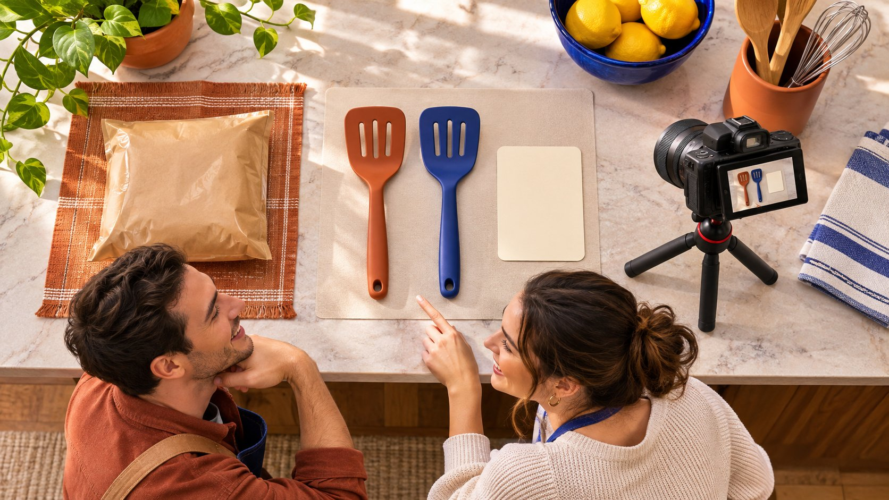

# Amazon Creator Connections 的活动费用怎么算

状态：本地审阅稿；正式发布日期待确认。

先算清商品、佣金、样品和交付条件，再决定是否启动创作者联盟活动。

Amazon Creator Connections 的采购判断应从商品与佣金活动出发。品牌先在当前账号确认资格、可用活动方式与条款，再核对商品编号、适用售价、库存、佣金和预算。创作者参加某项活动，不自动代表承诺一条固定制作、广告许可或正面评价。如果另购内容或寄样，把费用与义务分别确认。用实际活动报表观察符合条件的交易，用作品验收确认内容交付，不能把两个结果互相替代。

## 先核对账号能做哪一种活动

[Amazon 的 Creator Connections 活动说明](https://advertising.amazon.com/help/GMANECFAFD49W23Y)列出卖家或品牌需要核对的前提和设置项。具体资格、活动类型、预算与佣金条件以当前账号和官方条款为准。不要把某次教程截图当成所有地区、所有品牌都能使用的承诺。采购负责人先确认实际经营主体、商城、品牌权限及可用入口，再让执行团队设计活动。

为试点保留核验日期与适用账号说明。若由代理操作，明确谁有权创建、调整和停止活动，谁确认费用。一个能查看报表的人未必有权承诺预算。品牌也要把平台费用、佣金活动和另购内容的付款路径区分开。账号暂时没有入口时，先请求有权人员确认，不能为了跟上排期而使用不明账号或接受第三方保证开通。活动范围从实际可用条件开始，才方便评估后续成本。

## 用商品编号定义创作者要介绍什么

活动商品不能只写一个系列名。记录实际商品编号、型号、颜色、尺寸和当前购买入口，并说明哪些变体在本次范围内。创作者拿到样品与链接里的商品不一致时，先修正再拍。相似图片可能掩盖功能或包装差异，品牌要有人确认。访问目标页面时也核对适用市场，避免观众看到不能购买的版本。

[Amazon 的创作者入门指南](https://f.media-amazon.com/images/G/01/Associates/Marketing/CreatorConnections/Amazon_Creator_Connections_Getting_Started_Guide.pdf)展示按品牌、类别或商品等信息发现活动的路径。品牌可据此检查自己的描述是否足够清晰，但不能推断任何特定创作者一定会看到并参加。用读者任务解释产品，例如这款厨房工具解决什么操作问题、适用于什么使用条件。让创作者能够判断是否适合自己的节目，比把活动文案写成全部人都适用更容易得到可用作品。

## 把佣金情景与利润判断分开

建立一个按商品计算的内部情景。列适用售价、符合条件的计佣基础、活动佣金、商品成本和团队实际承担的其他费用。不同字段可能来自不同报表，先确认定义，再谈一单保留多少贡献。不要用总成交额直接乘一个百分比当作已确认平台账单，也不要忽略退款和其他会影响结算的条件。

假设商品售价 40 美元，仅用于内部演练的活动佣金假设为 15%。如果某个符合条件的计算基础确为 40 美元，佣金情景为 6 美元。实际结算还需要按平台定义与记录确认。再假设履约与商品成本合计 24 美元，则在其他费用之前剩余 10 美元，不能直接叫净利润。把样品、固定制作费和人工另列，让负责人看清扩大活动时哪些成本随交易增加，哪些来自内容采购。

## 把寄样与内容采购分别确认

寄样决定要看是否需要真实使用才能说明产品。可以先审查作品与选题，再决定数量、收件地区、成本和追踪方式。样品寄出不应自动被写成保证发布。若希望对方制作一条指定视频，单独确认内容、平台、日期、费用和未完成时的处理。不要用佣金活动的存在推断这些条款已被接受。

样品记录只保存履约需要的信息，并限制访问。创作者需要知道是赠品、借用品还是有其他条件，是否能真实表达不适用之处。品牌也要确认自己是否有权提供样品及其对应型号。用[达人报价与使用权框架](https://www.quickkol.com/zh/blog/creator-rates-usage-rights/#answer)分开制作、分发与后续广告。联盟佣金可以作为一种商业安排的一部分，但不能自动获得创作者肖像、原片或长期改编许可。所有采购应对应真实批准范围。

## 为创作者提供可以验证的产品说明

活动说明应包含目标使用问题、适用条件、不能承诺的效果和事实核对联系人。品牌可以要求商品编号正确、卖点有依据、关系披露清楚，但不应把所有人体验相同写成脚本。家居工具的示范可能需要具体材质或尺寸，创作者应先知道这种条件，避免拍完才发现样品不适用。

[FTC 的达人披露指南](https://www.ftc.gov/system/files/documents/plain-language/1001a-influencer-guide-508_1.pdf)在美国规则背景下解释利益关系。付费、样品及联盟安排都应按实际关系与适用要求核对披露。不要把商品链接本身当成对关系的充分解释。将最终文案和实际发布一起查看，防止审核只覆盖了脚本，却漏掉画面里的不准确说法。若另有广告使用计划，重新审查适用素材和语境，而不是从一个批准的自然帖直接扩大到所有用途。

## 用活动记录回答商业问题

复盘从平台实际提供的字段开始，记录活动、商品、窗口、佣金与结算状态。确认什么被计为符合条件的商业活动，什么仍可能调整。点击、订单、销售额和付款分别对应不同事件，不应互换。品牌的财务账与活动报表可能有不同更新时间，也需要按适当定义对齐。

假设内容上线后网站访问和活动销量都增加，不能把两类结果自动串成每个人的完整路径。若能按平台允许的报表查看活动表现，就按其范围报告。没有创作者级可用字段时，保持缺失，不用公开观看数分摊销售。下一轮预算可以基于已确认成本与实际可比观察调整，仍不宜把一期表现作未来保证。分析的用途是告诉负责人哪些商品与条件值得继续测试。用[达人活动衡量框架](https://www.quickkol.com/zh/blog/creator-campaign-measurement/#answer)保留每项商业观察的来源与窗口。

## 用原作品回答内容是否交付

如果另行购买内容，打开实际发布链接，检查作者、商品、版本、披露和批准范围。某段内容可能已经达到制作要求，但联盟交易尚无可判断结果；也可能活动有销售，但约定的特定作品仍未交付。按合同分别处理，不能用一项成功覆盖另一项缺口。品牌需要的是可解释的采购记录。

收集后续使用材料时，区分作品存在、可访问、获得许可和已交付文件。视频能公开观看，不代表品牌可以下载重剪。若计划推广有代表性的片段，核对画面里是否仍是正确商品和已确认体验。将素材编号、权利期限、允许渠道和审批记录交给广告团队。商品、创作者与平台条件变化后，让后续使用者知道哪些项目需要再确认。

## 从一次商品试点决定扩大范围

先选择能够解释且库存稳定的少量商品，明确预算负责人和暂停条件。若样品与购买页不一致，先修正商品；若佣金情景无法承受，调整商业范围；若作品缺少主要演示证据，修订 Brief。不要把不同问题都交给创作者补发内容。团队也应区分活动未被合适的人发现，与已经发布但产品不适合的情形。

试点交接包含核验账号、活动条款版本、商品表、成本假设、实际结算、已确认作品和未解决项。下一轮可以扩大商品或创作者范围，也可以先改善说明和履约。用同一窗口与定义比较，保留失败样本。扩大的依据是业务、内容和商品条件共同可执行，不是看到一个平台入口后就默认应把所有联盟预算搬过去。

## 用样品错配案例检查真正的损失

假设品牌寄出大号厨房工具，活动却指向小号商品。先记录实际样品、作品和购买页差异，再由产品负责人确认如何修正。不要让创作者把大号体验口头改成小号，也不要把一轮有问题的报表当成准确商品表现。可行处理可能包括更正目标商品、补拍真实样品，或按约定暂停该作品的商业使用。实际佣金和退款仍需用对应记录核对。

计算修正成本时，分别记录补寄、重新制作、人工与可能受影响的商业活动，不凭一个销售差额推断全部损失。如果作品主要演示不受尺寸影响的动作，也由有权审核的人确认保留范围。交接注明哪些文件可以继续用，哪些数字暂不进入案例。问题处理完再决定是否扩大，避免把一个可纠正的商品映射错误写成对创作者能力或平台效果的总评价。

## 商品活动的四类成本与证据

| 项目 | 核对 | 保留 |
| --- | --- | --- |
| 佣金 | 符合条件的基础与实际条款 | 活动与结算记录 |
| 样品 | 型号、履约与义务 | 接收与使用条件 |
| 制作 | 资产、修改与发布范围 | 实际作品与批准版本 |
| 使用权 | 渠道、时间和剪辑 | 权利人批准 |

40 美元与 15% 为假设情景输入，当前平台条款须在适用账号核对。

## Creator Connections 试点准备

启动前由商业、产品和内容负责人共同核对。

- [ ] 确认当前账号、市场和可用活动条款。
- [ ] 将实际商品编号与样品对齐。
- [ ] 分别计算佣金、寄样、制作和使用权。
- [ ] 分别验收作品、商业活动与结算。

## 研究日期与使用边界

资料核验于 2026 年 11 月 11 日。文中方法、表格和决策规则为编辑建议，标为假设的示例不是实际客户结果或行业基准。外部资料的适用地区与时期按各段说明；本稿处于独立本地审阅阶段，正式发布日期待确认。

## 用清楚的任务开始达人研究

用 QuickKOL 理解 Brief、发现相关达人并研究作品与联系路径；数据、合作条件和结果仍需核验。

[了解 QuickKOL](https://www.quickkol.com/#capabilities)

## 来源

- [Amazon 的 Creator Connections 活动说明](https://advertising.amazon.com/help/GMANECFAFD49W23Y)
- [Amazon 的创作者入门指南](https://f.media-amazon.com/images/G/01/Associates/Marketing/CreatorConnections/Amazon_Creator_Connections_Getting_Started_Guide.pdf)
- [FTC 的达人披露指南](https://www.ftc.gov/system/files/documents/plain-language/1001a-influencer-guide-508_1.pdf)
