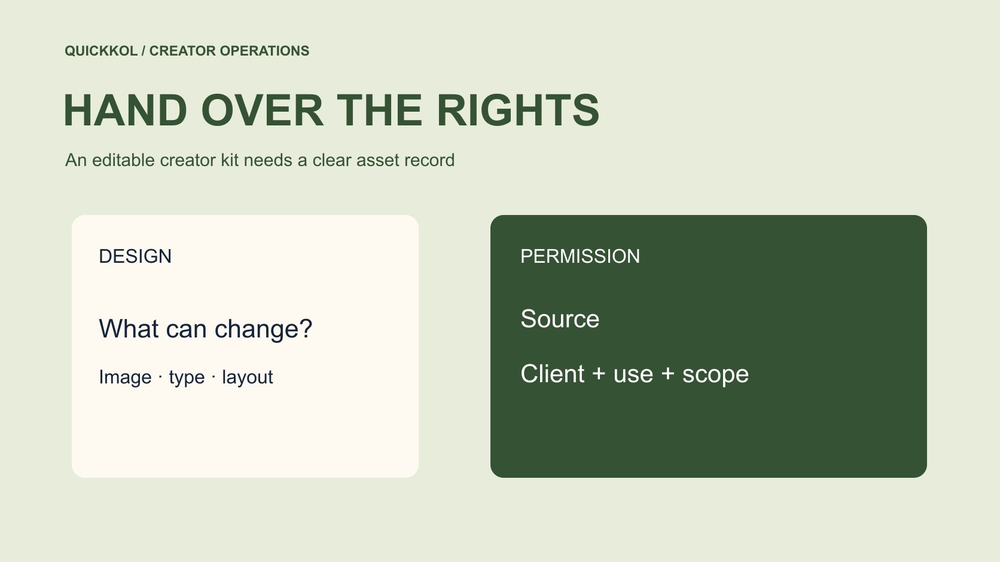

# Canva Instagram Templates: Build a Creator Asset Kit

Status: local review draft; confirm the publication date before release.

Build a sourced, editable and reviewable asset kit that lets different creators retain their own expression.

QuickKOL editorial graphic; not actual account metrics or a platform interface.

Canva Instagram templates can reduce repeated layout work when a brand supplies a kit with clear conditions. Distinguish brand assets, stock elements, creator recordings and the final design, then check the relevant permissions and editable areas. Provide controlled copies for different creators while keeping facts, disclosure and destinations consistent. An editable link does not establish every commercial usage right, and an exported file does not automatically include advertising permission. The kit should let another operator find the sources, approved version and responsible contact. Its value lies in making creator work easier to deliver accurately, rather than making every partner publish identical content.

## Define the kit from the partnership task

List what the creator will make and which facts the brand needs to keep consistent. A comparison carousel, event reminder and instruction sequence require different layouts. [Canva’s Instagram post template library](https://www.canva.com/instagram-posts/templates/) supplies starting points rather than the task itself. Sending every partner a large folder of unrelated advertising material creates avoidable selection work. Choose the layouts actually used and the checked product information needed for this assignment.

Put the kit’s production role in the [creator brief](https://www.quickkol.com/blog/write-a-useful-campaign-brief/#answer). The brand might supply the name and applicable conditions while the creator contributes the real setting and experience. Confirm files, publishing accounts and responsibility for native features. A template is not a reason to expand work without agreement. Turning a single-image purchase into a carousel or video still needs a scope discussion. A clear boundary lets the buyer assess whether the kit reduces work instead of shifting unplanned production onto the creator.

## Register four different asset types

Use four asset groups: brand-owned material, externally licensed elements, creator recordings and final designs. Record source, intended use, editable scope, duration and owner. Combining elements does not make every underlying right belong to the brand. A creator photograph should not become an unlimited stock library for all partners. The register should tell an operator when an authorized person needs to decide rather than requiring everyone to interpret law alone.

Inspect easily overlooked elements such as music, portraits, icons, fonts and old campaign screenshots. Keep an unexplained source pending before choosing replacement or evidence collection. Brand marks and product images need the current approved versions too. Put important conditions where users encounter the asset instead of in a private designer note. The next editor should be able to match the file with its source and permitted task. Without that connection, transferring a folder can look complete while leaving the next person unable to assess an ordinary reuse request.

## Check library content and client-design conditions

[Canva’s Content License Agreement](https://www.canva.com/policies/content-license-agreement/) distinguishes content categories, design use and conditions for client-design transfers. Review the elements and intended uses in this kit rather than inferring unlimited external use from a Pro subscription. For an agency handoff, identify the particular design and applicable written arrangement. Transfer of a design differs from distributing standalone stock elements. Multiple participating creators do not automatically make every element freely redistributable.

Have the appropriate owner confirm how the actual design may be shared and exported. Copying method, account conditions and licensing are related but different questions. For an uncertain element, consider a clearer source instead of blocking all production around one unresolved item. Record the reviewed terms, date and decision owner. Revisit scope when a new channel or paid use is added. The fact that an earlier project used an element cannot by itself authorize a new commercial purpose. The review should remain tied to the actual design and use.

## Handle music and creator material separately

[Canva’s Popular Music License](https://www.canva.com/policies/popular-music-license/) has separate terms from the general content agreement. For audio, identify category, source and permitted use. Being searchable or addable to a design does not establish permission for a commercial promotion. Review the platform, actual publication and later edit as well. One music choice in a template cannot automatically cover every partner’s organic and advertising versions.

Creator recordings, voice and likeness follow the actual arrangement with the relevant rights holder. Permission for one publication does not extend automatically to other partners or brand advertising. Use the [creator rates and usage rights framework](https://www.quickkol.com/blog/creator-rates-usage-rights/#answer) to discuss file delivery, distribution and adaptation separately. Describe a new purpose through the version, term and territory, then obtain the appropriate confirmation. A kit may contain several source types when each has a traceable responsibility path. Permission attached to one item should not silently expand into unrestricted use of everything in the package.

## Specify flexible areas and fixed facts

Name the product, checked conditions, disclosure and destination as essential information, then adapt expression to the creator’s work. Visual consistency should not require identical settings, feelings or judgments. Leave room for original backgrounds, sequence or photographs as long as the necessary facts remain clear. A new claim or a different product reopens review.

Use a short instruction page with specific examples. Changing a personal use observation into suitability for everyone changes meaning and needs confirmation. Correcting an extra space need not trigger the same review. The brand owns facts, the creator owns their experience and design owns implementation. Locate feedback by page, element and question rather than asking vaguely for a more premium result. These boundaries preserve accuracy while showing the creator which choices are genuinely theirs. A useful kit reduces recurring negotiation without replacing authentic work with a rigid script that never suited the partnership.

## Tie edits and approval to a specific copy

One creator should not accidentally modify another’s master. Set appropriate access in the actual tool, name copies clearly and attach approval to a specific version. Identify who exports, uploads and adds links or partnership labeling. An editable design does not establish completed native features. A button-shaped graphic in an export is not necessarily an interactive destination.

When product information changes, identify affected copies before notifying owners and revising them. Editing the master does not prove that existing exports changed. Have the operator identify the version in the publishing queue. Preserve old material for traceability while removing it from the release set. Naming can stay simple if another colleague can locate approval and actual work without the original designer narrating the history. That check matters especially when several partners use visually similar files. A small change should reach the right copies rather than become an assumption that the whole campaign updated itself.

## Review facts and disclosure on a phone

For U.S.-relevant partnerships, the [FTC’s influencer disclosure guide](https://www.ftc.gov/system/files/documents/plain-language/1001a-influencer-guide-508_1.pdf) helps review the clarity of the material connection. Inspect each final piece after copying. A disclosure in the master does not establish that every copy retains it. Check actual scale, crop, contrast and order, making sure text leaves the demonstration visible. Both the relationship and product conditions should be understandable instead of being reduced to an unreadable corner.

Ask a colleague outside the design process to explain the product, conditions and next step. If the answer differs from approval, locate the problem in text, imagery, sequence or destination. Decoration cannot repair a missing shot, and a font change cannot supply an absent fact. Keep the final export and review decision for the publisher. Phone preview tests actual presentation. It is not one universal certificate covering rights, product accuracy and publication. Those questions retain their own evidence and owners.

## Decide reusability through a handoff rehearsal

Suppose three creators work with one brand. One supplies production, another publishes on their account, and a third separately licenses advertising. Giving them the same master does not make their permitted uses identical. Ask a successor to trace sources, approvals and channels for each copy. Fill an evidence gap or limit the use instead of letting visual consistency conceal different agreements.

Review whether the kit reduced repeated explanations and whether model, price or disclosure errors occurred. Improve the next version around observed gaps. If everyone needs extensive rework, investigate whether the master serves an overly broad task before demanding that creators abandon their expression. The final handoff contains source relationships, appropriate editing access, approved exports and responsible people. Templates then support creator delivery instead of compressing different work and permissions into a folder with unclear boundaries. Reusability is established by the next operator’s ability to act correctly, not simply by a file being easy to duplicate.

## Use a client handoff to expose missing permissions

Suppose an agency inserts a creator’s trial photograph into a kit that four other creators will copy. The original permission covered one organic publication by the brand. An editable template and a downloadable image do not expand that permission to additional accounts or paid advertisements. Check the original license, then obtain an appropriate extension, use a suitable brand-owned alternative or remove the image. Sharing a page with a licensed Canva background does not give every element the same permissions.

A second question concerns transferring a client design rather than distributing individual assets. Check the applicable transfer conditions in Canva’s Content License Agreement and document which design belongs to which client arrangement. Give the next editor what is needed for the assignment instead of handing over an unrestricted library. Preserve sources and revision history when a conflict appears so the team can identify how the disputed element entered the file.

Ask a colleague who did not build the kit to find the final template, substitute an approved image, retain the disclosure area and export the intended version. If that person has to guess which photograph is permitted, the handoff is incomplete. Repairing the asset index is more useful than adding a vague page of general instructions. This practical test also reveals whether the design relies on the original author’s private knowledge rather than a reproducible creator workflow.

## Creator kit asset register

| Asset | Review material | Handoff condition |
| --- | --- | --- |
| Brand material | Approved version and supplier | Facts and intended use |
| Library element | Source and applicable license | Design, transfer and usage scope |
| Creator material | Originals and rights holder approval | Publication, edits and term |
| Final design | Approved version and export | Actual account and operator |

This is an editorial handoff method. Review actual licenses and agreements for the material and purpose.

## Template kit handoff checklist

Have a successor independently locate an asset and its permitted use.

- [ ] Distinguish brand, library, creator and final-design material.
- [ ] Check the actual license and client-handoff conditions.
- [ ] Identify fixed facts, flexible areas and review triggers.
- [ ] Review the final phone presentation and actual publication.

## Research date and limitations

Sources reviewed November 11, 2026. Methods, tables and decision rules are editorial recommendations. Hypothetical examples are not actual client results or industry benchmarks. Source geography and periods are specified where relevant. This draft is in independent local review; confirm its publication date before release.

## Start creator research with a clear task

Use QuickKOL to interpret a brief, discover relevant creators and research their work and contact routes. Verify data, commercial terms and outcomes at their source.

[Explore QuickKOL](https://www.quickkol.com/#capabilities)

## Sources

- [Canva’s Instagram post template library](https://www.canva.com/instagram-posts/templates/)
- [Canva’s Content License Agreement](https://www.canva.com/policies/content-license-agreement/)
- [Canva: Popular Music License Agreement](https://www.canva.com/policies/popular-music-license/)
- [the FTC’s influencer disclosure guide](https://www.ftc.gov/system/files/documents/plain-language/1001a-influencer-guide-508_1.pdf)
