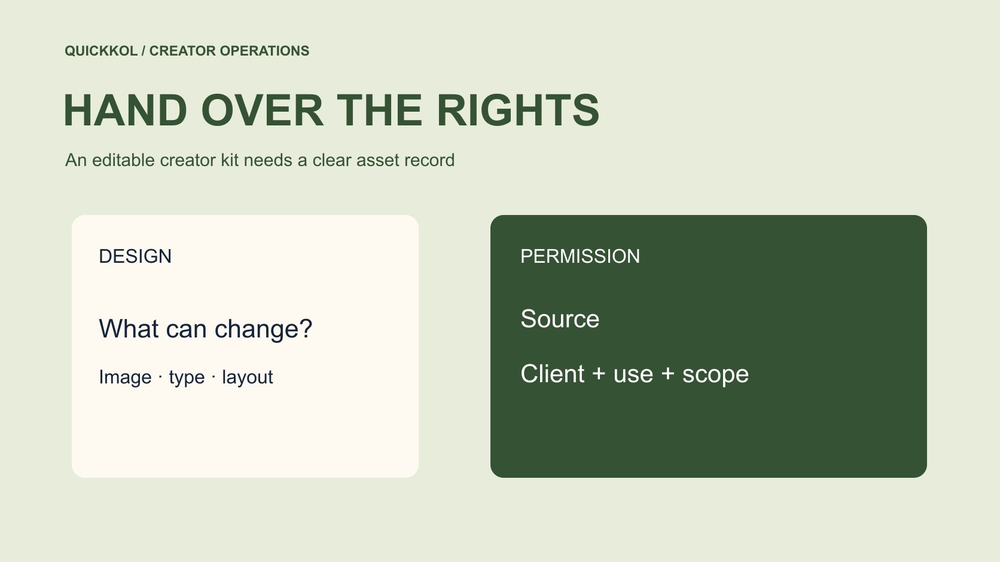

# Canva Instagram 模板如何交接给合作达人

状态：本地审阅稿；正式发布日期待确认。

把模板做成有来源、可编辑、可审核的合作素材包，让不同创作者保持自己的表达。

QuickKOL 编辑图形；不呈现真实账号指标或平台界面。

Canva Instagram templates 可以减少重复排版，但品牌需要交付一套有明确使用条件的素材包。先区分品牌资产、图库元素、创作者原片与最终设计，再确认各项许可和可编辑范围。为不同创作者准备受控副本，保留事实、披露和目标入口的一致性，同时允许自然表达。可编辑链接不等于完整商业使用权，下载文件也不自动包含后续广告许可。让下一位操作者能找到来源、批准版本和联系人，模板才真正支持达人营销交付。

## 从合作任务确定模板包内容

先列创作者要制作什么，以及品牌需要保持哪些事实一致。产品对比轮播、活动提醒与使用步骤，各需要不同版式。[Canva 的 Instagram 模板目录](https://www.canva.com/instagram-posts/templates/)提供起点，不能代替内容任务。品牌不应把一整套无关广告素材发给每个人，再要求创作者自行筛选。选出本次确实使用的版式和经过核对的商品信息，减少错误副本。

把任务写进[达人 Brief](https://www.quickkol.com/zh/blog/write-a-useful-campaign-brief/#answer)，说明素材包服务哪一段制作。比如品牌提供产品名称与适用条件，创作者提供实际场景和个人体验。最终交付包含哪些文件、哪些账号发布、谁添加原生功能，也在此确认。模板不是免费增加工作范围的理由。若本来采购一张图片，增加轮播或视频仍要按实际范围沟通。清楚的任务边界有助于判断模板是否真的减少工作。

## 把四类素材分开登记

资产清单可以分品牌自有素材、外部许可元素、创作者原片和最终设计。为每项写来源、用途、可修改范围、期限与负责人。最终设计包含多个元素，不意味着所有元素的权利都归品牌。也不要把创作者交来的照片当成可供全部合作人无限使用的库存。清单不是要每个人研究法律，而是让执行者知道何时应询问有权的人。

检查素材包里最容易被忽略的内容，例如背景音乐、人像、图标、字体与旧活动截图。无法说明来源的元素先留待核验，再决定替换或补证。品牌标志与商品图也要来自正式版本。对某个元素的使用受到限制时，把条件放在使用者能看到的位置，而不是藏在只有设计师知道的备注里。下一位编辑能够对应文件和来源，才算真正完成交接。

## 核对库素材与客户设计条件

[Canva 内容许可协议](https://www.canva.com/policies/content-license-agreement/)区分内容类别、设计使用和客户设计转移条件。实际素材包应按所含元素与用途查看相应条款，不能从一个 Pro 套餐推断所有外部使用都获准。若由代理向客户交接，确认具体设计及适用的书面安排；把设计转移与单独转发图库元素分开。多位创作者参与，也不意味着所有元素可以无条件再分发。

由适当负责人确认当前设计能以什么方式共享和导出。可用的复制方式、账号条件与许可是相关但不同的问题。对不确定元素，先使用来源更清楚的替代，不让一项未核验权利阻塞全部制作。记录采用的许可版本、核验日期和判断人。出现新的渠道或付费使用计划时，再检查范围，不以旧项目曾经使用作为新用途的充分批准。

## 给音乐与创作者素材独立处理

[Canva 的流行音乐许可](https://www.canva.com/policies/popular-music-license/)与一般内容许可采用不同条款。用到音频时，先确认类别、来源及允许的用途，不把可搜索或可加入设计等同于可用于商业推广。品牌也应查看平台、实际发布与后续剪辑安排。不能用一个模板里的音乐配置，默认覆盖每位创作者的自然发布和广告版本。

创作者原片、声音和肖像则按双方实际许可处理。作品可以用于本次账号发布，不自动适用于其他伙伴或品牌广告。用[达人报价与使用权框架](https://www.quickkol.com/zh/blog/creator-rates-usage-rights/#answer)将素材交付、分发与改编分开谈。遇到新增需求，给出具体用途、版本、期限与地区，由有权的人确认。模板包里可以保留多种来源，但每种的责任路径都要找得到，不能把一项授权扩成整包无条件使用。

## 设计可以改什么和必须保留什么

把产品名称、已核对条件、关系披露和目标入口列成必需内容，其余表达按创作者实际风格调整。不要为了视觉一致，要求所有人用同一个场景、感受或评价。模板应给真实作品留出空间，例如可以更换背景、调整叙述顺序或使用自己的照片，只要关键事实仍清楚。增加主张或更换产品则进入重新审核。

用一页说明给出具体例子。把「本次使用」改成「任何人都适合」改变了含义，应重新确认；修正多余空格不应触发同等流程。品牌负责事实，创作者负责体验，设计师负责版式实现。反馈用页面、元素与问题定位，不只写更高级或更像品牌。这样的限制既能保护事实，也能让创作者知道哪些选择确实由自己决定。

## 让修改与批准对应到具体副本

一位创作者不应误改另一人的母版。按实际工具设置适当访问，给副本清楚命名，并让最终批准指向具体版本。记录谁导出、谁上传以及谁添加链接或合作标记。可编辑设计不等于原生功能已经完成，导出画面里的按钮也不等于用户能点击的入口。

如果商品信息更新，先确认受影响副本，再由负责人通知和修订。只改母版不会自动证明已导出文件也跟着改变。让操作人确认队列使用的是哪一版。保留旧版作追溯，但从待发范围移开，避免后面误用。文件名可以简单，关键是让另一个同事能定位批准与实际作品，不需要依赖原设计师解释整个历史。

## 在手机中验收事实与披露

涉及美国消费者的合作，[FTC 的达人披露指南](https://www.ftc.gov/system/files/documents/plain-language/1001a-influencer-guide-508_1.pdf)可以帮助审核利益关系的清楚表达。模板复制后仍要看每个最终作品，不能因为母版有说明就默认所有副本都保留。查看实际尺寸、裁切、对比和观看顺序，确认文字没有遮挡演示。关系披露与商品条件都应容易理解，不能缩进看不清的角落。

让一位没参与设计的同事解释产品、适用条件和下一步。如果答案与批准内容不符，定位是文字、画面、顺序还是入口造成。需要重拍的问题不要用装饰解决，需要补事实的问题不要只改字体。保留最终导出与检查结论，下一位发布人据此操作。手机预览是对实际表达的检查，不是替代版权、产品事实或发布状态的统一合格证。

## 用交接演练决定模板是否可复用

假设同一品牌与三位创作者合作，其中一人只买制作，一人负责本人账号发布，第三人另有广告许可。把同一母版交给三人，并不能让使用范围变成相同。请接班同事从每个副本找到来源、批准和可用渠道。找不到的部分补材料或限制用途，不让一个看起来一致的模板包掩盖三份不同安排。

复盘模板是否减少了重复解释，是否发生错型号、旧价格或丢失披露。下一轮只针对实际缺口改进。若每个人都需要大量返工，先看母版任务是否太泛，而不是要求所有创作者放弃自己的表达。最终交接包含原素材关系、适当的编辑权限、已批准导出和责任人。模板由此成为支持达人交付的工具，而不是把不同作品和许可压成一个没有边界的文件夹。

## 一次客户转交怎样暴露模板缺口

假设代理把某创作者的试用照片放入套件，计划让另外四位创作者复制模板。最初照片许可只覆盖品牌的一次自然发布。模板能打开和图片能下载，不会自动扩大到其他账号或付费广告。先检查原许可，再决定补充授权、改用范围合适的品牌素材，或删除该图。不要因为它与一张已许可的 Canva 背景在同一页，就认为所有元素获得相同许可。

另一项问题是客户交付与素材单独转发。按 Canva 内容许可协议检查适用转交条件，并在内部交接说明哪些设计可用于哪个客户。向下一位编辑提供能完成任务的内容，而不是把完整素材库交出。发生冲突时保留来源和修改记录，避免后来无法判断问题元素由谁加入。

让一位未参与制作的同事试用套件：找最终模板、替换批准图片、保留披露位置、导出正确版本。若他需要猜哪张照片有权用，交付尚未完整。修正权限索引比加一页笼统的使用声明更有效。

## 合作模板包的资产登记

| 资产 | 核对材料 | 交接条件 |
| --- | --- | --- |
| 品牌素材 | 正式版本与提供人 | 本次事实与用途 |
| 图库元素 | 来源与适用许可 | 设计、转移与使用范围 |
| 创作者素材 | 原片与权利人批准 | 发布、改编与期限 |
| 最终设计 | 批准版本与导出 | 实际账号与操作人 |

此表为编辑交接建议，具体许可与合同应按实际素材和用途核对。

## 模板交接核对清单

让接班人独立定位一个素材和它的获准用途。

- [ ] 区分品牌、图库、创作者和最终设计。
- [ ] 核对具体许可与客户交接条件。
- [ ] 标出固定事实、可编辑部分与重审触发。
- [ ] 验收最终手机画面和实际发布。

## 研究日期与使用边界

资料核验于 2026 年 11 月 11 日。文中方法、表格和决策规则为编辑建议，标为假设的示例不是实际客户结果或行业基准。外部资料的适用地区与时期按各段说明；本稿处于独立本地审阅阶段，正式发布日期待确认。

## 用清楚的任务开始达人研究

用 QuickKOL 理解 Brief、发现相关达人并研究作品与联系路径；数据、合作条件和结果仍需核验。

[了解 QuickKOL](https://www.quickkol.com/#capabilities)

## 来源

- [Canva 的 Instagram 模板目录](https://www.canva.com/instagram-posts/templates/)
- [Canva 内容许可协议](https://www.canva.com/policies/content-license-agreement/)
- [Canva 的流行音乐许可](https://www.canva.com/policies/popular-music-license/)
- [FTC 的达人披露指南](https://www.ftc.gov/system/files/documents/plain-language/1001a-influencer-guide-508_1.pdf)
