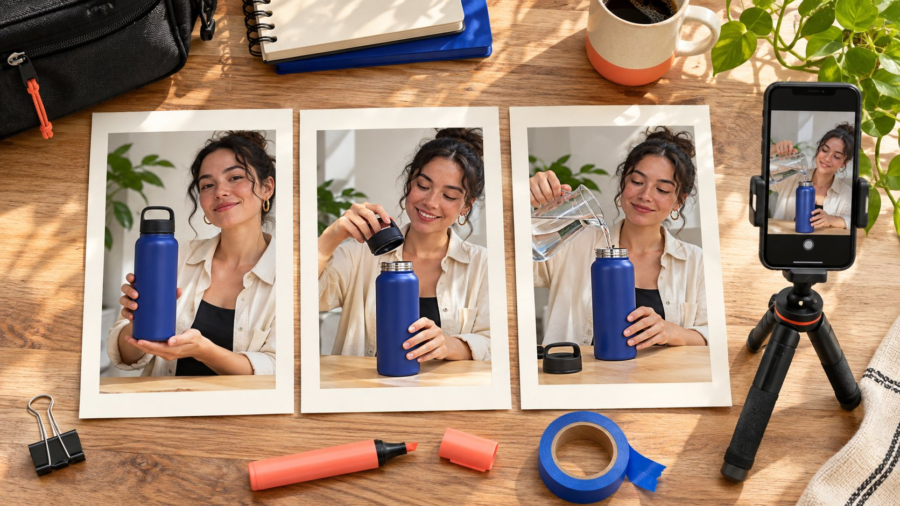

# Canva IG Story Templates for a Creator Demo

Status: local review draft; confirm the publication date before release.

Use Story templates to organize the question, demonstration and next step while keeping the creator’s real evidence visible.

Canva IG Story templates provide a layout starting point, but a creator campaign still needs a purpose for each frame. Organize a sequence around the audience question, real demonstration and next step, then adapt it to the creator’s work and the brand’s verified facts. Check the licenses of included elements rather than treating a template as blanket permission. Keep disclosure and essential information readable on the actual phone view. The handoff should identify editable parts, responsibility for native features and evidence that the approved sequence was actually published in order. A polished file is only one part of a usable creator assignment.

## Give each frame a job before choosing the design

Write the questions the audience needs answered before selecting a layout: what the item is, how it is used and where to check applicable conditions. [Canva’s Story template library](https://www.canva.com/instagram-stories/templates/) supplies editable starting designs. It does not decide what evidence the brand needs. If a product requires a visible action, give the footage enough space instead of letting the most attractive template dictate the script. Set the sequence length from the explanation rather than assigning every partnership an identical frame count.

Put the intended order in the [creator brief](https://www.quickkol.com/blog/write-a-useful-campaign-brief/#answer), distinguishing mandatory facts from the creator’s expression. A first frame might explain a use problem, a second show the actual step and a third provide the destination and checked conditions. If the task needs another prerequisite, an additional frame may work better than dense small text. The template should support an explanation without turning every creator into a presenter of the same static advertisement.

## Replace placeholder imagery with actual product evidence

A template photograph is part of a design, not evidence that the creator used the product. For demonstration work, agree the actual model, action, conditions and visible result. Once footage arrives, assess whether the action is clear before choosing crops, borders and text positions. Keep design examples distinct from the real item so viewers do not mistake a placeholder for the demonstrated product. A collage cannot create an experience that was never recorded.

Suppose the piece demonstrates opening a bottle lid for cleaning. One frame can explain the need, the next show the actual opening and relevant parts, and the last identify the applicable model and information destination. If a hand obscures the product, improve the recording first. Shrinking the footage to add decoration will not recover missing evidence. Link each frame to its source file and conditions. That also supports later checks of which material can be used in another channel under the agreed license.

## Review licenses at the element level

[Canva’s Content License Agreement](https://www.canva.com/policies/content-license-agreement/) distinguishes content categories, design uses and relevant transfer conditions. Review the actual photographs, graphics, fonts, audio and templates against the applicable terms. A subscription is not unlimited permission for every asset. Creator footage and brand-supplied material have their own rights sources too. Record those sources in an asset list so a subsequent editor knows what can be changed and used.

If a client or several creators will continue editing, check the license and transfer arrangement that applies. Do not extract a standalone stock element from a design and assume free redistribution. Some categories have additional conditions and need their own review. A stock portrait does not provide a named creator’s permission. Brand marks should also come from an authorized source. Start the pilot with clearly sourced material before expanding visual complexity. That is more executable than trying to reconstruct an unknown rights chain across an entire sequence just before publication.

## Give disclosure a readable place in the real frame

For U.S.-relevant work, use the [FTC’s influencer disclosure guide](https://www.ftc.gov/system/files/documents/plain-language/1001a-influencer-guide-508_1.pdf) to review the material connection and its clarity. Reserve space for required disclosure and essential information before decoration. Low-contrast small text on a busy background is a poor delivery choice. Do not assume a final frame automatically resolves every earlier viewing context. Review the actual sequence against applicable rules and the intended presentation.

Check headings, explanations and disclosure on a phone, not only in the design canvas. Text obscured by the interface, displayed too briefly to read or covering the product action affects the actual message. People may watch without sound or encounter one frame midway through. Preserve the necessary context where appropriate. The creator can retain their voice while the brand confirms facts and conditions. Review together rather than treating disclosure as a decorative label a designer adds at the end. The audience receives the final frame, not the team’s intention documented elsewhere.

## Assign exported design and native features separately

A design file can contain imagery and text, but native links, polls, product features or partnership labels need verification in the actual account and publishing tool. A button-like shape in an exported image is not evidence of a working link. Accept the visible invitation and real interaction separately, choosing a route the current configuration can deliver.

Name who exports, uploads, adds native features and confirms the destination. Being assigned to upload does not mean the creator knows which product variant a link should open. The brand needs to supply a checkable destination and conditions. If a feature is unavailable, change the invitation rather than leaving a nonfunctional imitation. Rehearse the path from phone preview to the actual destination. A complete-looking design should not become a claim that the publishing experience is ready. The handoff must specify the actions that remain after export so the final operator can finish the intended journey.

## Keep room for the creator’s own explanation

Fix essential brand facts without fixing every line of speech. The kit can preserve the product name, conditions and verified destination while adapting the layout and explanation to the creator’s work. The same sequence can use different locations and language. People may follow the creator for that person’s expression and judgment. Buying account distribution should not replace their work with an unrelated standardized advertisement.

Identify editable areas. Wording and background might be flexible while a changed technical claim requires confirmation. Use frame numbers and specific issues in review, rather than more on brand as the whole instruction. If an action does not suit the creator’s recording conditions, ask for an achievable alternative and assess whether it still answers the audience question. The clearer the essential facts, the easier it becomes to preserve natural expression without misrepresenting the product. The template then reduces coordination effort while allowing the piece to belong in the creator’s actual body of work.

## Check the whole sequence in one preview

Have another colleague watch from the first frame and explain what the item is, what the demonstration establishes and where to go next. If they remember only the colors, return to the script and evidence before adding decoration. Check consistent model, price and relationship wording across frames. If essential context existed only in a deleted frame, restore it. An old approval does not establish completeness of the final sequence.

Suppose the second frame demonstrates the correct cleaning step while the third links to another model. Correct the destination, then recheck visuals and text and record the final version. A phone preview also needs legible type, appropriate crops and visible hand movements. Assign a missing shot to production and a wrong destination to the business owner. The review should yield actionable tasks rather than a general complaint about the design software. A single complete preview is often where the team discovers that individually approved frames no longer explain one coherent journey.

## Deliver editable work and publication evidence

Hand over final exports, appropriately editable files, source relationships and license information. Set access for the actual assignment rather than giving every collaborator the complete brand library. After release, verify the account, sequence, disclosure and destination. Retain relevant publication evidence and observation time. A screenshot showing delivery of a design file cannot establish live publication.

Review viewing, relevant questions and available next-step activity according to the task. If per-frame data is unavailable, say so. First-frame performance does not show that everyone reached the final invitation. Use the [creator campaign measurement framework](https://www.quickkol.com/blog/creator-campaign-measurement/#answer) to separate production acceptance from observed outcomes. Improve the next template around a specific finding: text covering a demonstration, an unclear route or conditions arriving too late. Keep effective footage and authentic expression. Remove repeated design work that serves no explanatory purpose. This lets the next brief ask for a concrete change rather than another complete visual redesign without a defined reason.

## Distinguish sequence acceptance from its response

Suppose all three frames publish as approved, but the available final-frame observation is disappointing. Check the field and period, then review whether the earlier frames explain why someone would continue. One low value does not establish poor creator fit, and limited final-frame activity does not undo correctly completed production. The next test might show the product action sooner rather than demand unlimited additional free material.

An incorrect publication order is a different issue requiring review against the actual delivery agreement. Separate that mistake from an explanation that failed to engage people. A designer can revise layout, a creator can improve the demonstration, a business owner can correct a destination and an analyst can align definitions. Each task needs its evidence and owner. That gives the next template a concrete purpose instead of more decoration or a repeated script. Preserve the original and revised sequence, including why the change was chosen, so subsequent comparisons retain the conditions under which each observation was made. The result is a usable learning record alongside an independent decision about whether the commissioned work was delivered.

## Story sequence handoff fields

| Frame job | Required evidence | Live check |
| --- | --- | --- |
| Introduce question | Real use context | Context and relationship clear |
| Show operation | Actual item and action | Crop and text leave action visible |
| Explain conditions | Model and approved facts | Consistent sequence |
| Offer next step | Usable destination | Invitation matches interaction |

Set frame count from the task. A template library and license do not replace asset and account checks.

## Story template pilot checklist

Check the complete sequence on a phone, not only the design canvas.

- [ ] Give each frame a product-relevant job.
- [ ] Keep actual demonstration evidence and asset sources.
- [ ] Check disclosure, text, action and native features.
- [ ] Hand over the final version and verify actual publication.

## Research date and limitations

Sources reviewed November 11, 2026. Methods, tables and decision rules are editorial recommendations. Hypothetical examples are not actual client results or industry benchmarks. Source geography and periods are specified where relevant. This draft is in independent local review; confirm its publication date before release.

## Start creator research with a clear task

Use QuickKOL to interpret a brief, discover relevant creators and research their work and contact routes. Verify data, commercial terms and outcomes at their source.

[Explore QuickKOL](https://www.quickkol.com/#capabilities)

## Sources

- [Canva’s Story template library](https://www.canva.com/instagram-stories/templates/)
- [Canva’s Content License Agreement](https://www.canva.com/policies/content-license-agreement/)
- [the FTC’s influencer disclosure guide](https://www.ftc.gov/system/files/documents/plain-language/1001a-influencer-guide-508_1.pdf)
