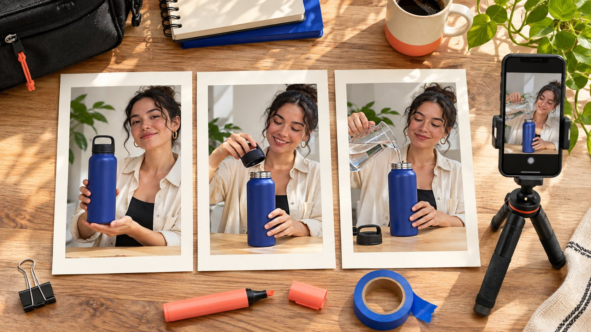

# Canva Story 模板怎样服务达人试用讲解

状态：本地审阅稿；正式发布日期待确认。

用 Story 模板组织问题、操作和下一步，让创作者的真实演示仍然是画面中心。

Canva IG Story templates 适合提供版式起点，达人活动仍要先确定每一帧解决的问题。可以用问题、真实演示、下一步组织序列，再按创作者作品与品牌事实调整。模板里的装饰、照片或音乐分别核对许可，利益关系说明与关键信息应在实际手机画面中可读。交付时明确哪些内容可编辑、由谁添加原生功能，以及怎么确认整组 Story 已按批准顺序发布。

## 先给每一帧分配一个作用

先写观众需要理解的三个问题，比如这是什么、如何使用、到哪里看适用条件，再寻找支持这些问题的版式。[Canva 的 Story 模板目录](https://www.canva.com/instagram-stories/templates/)提供可修改的设计起点，但不能替品牌判断需要什么证据。产品必须通过实际动作说明时，优先给画面足够空间，而不是让最漂亮的模板决定脚本。序列的长度由解释所需内容决定，不把所有合作机械固定成相同帧数。

把顺序写进[达人 Brief](https://www.quickkol.com/zh/blog/write-a-useful-campaign-brief/#answer)，让创作者知道哪些事实必需、哪些表达可以自己决定。例如第一帧由他解释使用困扰，第二帧展示真实步骤，第三帧说明品牌入口和已核对条件。若产品需要更多前提，增加一帧比把密集小字挤进同一画面更清楚。模板应服务解释，不能把每位创作者变成展示同一张广告海报的人。

## 用实际产品画面替代占位照片

模板照片只是设计的一部分，不证明创作者试用过产品。对演示型合作，约定真实型号、动作、条件和需要拍到的结果。素材到手后，先判断动作能否看清，再选择裁切、边框和文字位置。不要让设计里的样图与真实商品混在一起，使观众误认演示对象。创作者没有拍过的体验，也不能通过模板拼贴补成已发生事实。

假设要展示水瓶盖子的开合。第一帧可以说明清洁需求，第二帧实际拍到打开及相关部位，最后一帧提供适用型号和查询入口。若产品在画面里被手遮住，优先补拍。缩小原片再增加装饰，不能修复证据缺失。给每一帧标明来自哪个原文件与拍摄条件，也方便之后核对哪段素材获准继续用于其他渠道。

## 按设计元素核对许可

[Canva 内容许可协议](https://www.canva.com/policies/content-license-agreement/)区分内容类别、设计用途与有关转移条件。品牌要核对实际使用的照片、图形、字体、音频或模板的适用条款，不把拥有某个套餐当成所有素材的无限使用权。创作者原片和品牌提供素材也各有权利来源。把这些来源记录到资产清单，让下一位编辑知道哪些内容可以修改和使用。

如果交给客户或多位创作者继续编辑，核对实际许可及转移安排。不要把单独的图库元素从设计里抽出，误认为可以自由再分发。某些素材有额外条件，应按对应许可检查。模板里的人像不能替代具名创作者的同意，品牌标志也应来自有权提供的人。试点先选来源清楚的素材，再扩展视觉效果，比发布前追补一整组未知权利更可执行。

## 给关系披露留实际可读的位置

涉及美国消费者的合作，可以按 [FTC 的达人披露指南](https://www.ftc.gov/system/files/documents/plain-language/1001a-influencer-guide-508_1.pdf)核对利益关系及其清楚程度。排版时先给必要披露和主信息留空间，再放装饰。不要把浅色小字压在复杂背景上，也不要认为最后一帧出现说明就能替前面所有独立观看情境解决问题。具体要求按实际场景与适用规则确认，审核人员查看完整序列。

在手机中检查标题、正文和披露，而不仅是电脑上的设计文件。文字被界面遮住、出现在无法阅读的时长中，或与商品动作重叠，都影响实际表达。用户可能没有声音，也可能从中途看到某一帧，内容要尽量保持必要背景。创作者可以保留自己的语气，品牌负责确认事实和条件。两者一同审核，避免把披露当成设计师最后贴上的装饰。

## 明确导出文件与原生功能的分工

图形设计文件可以包含画面与文字，但原生链接、投票、商品功能或合作标记的具体实现，要在实际账号和工具中确认。不要在导出的静态图片里画一个看似按钮的形状，再当成用户能点的链接。把可见提示和真正交互分别验收，选择当前发布方式能完成的方案。

交接写清谁导出、谁上传、谁添加原生功能，以及谁最终确认目标。创作者只负责上传，不代表知道某个产品链接该指向哪个变体。品牌需要提供可确认的目标和适用条件。若某功能在当前配置不可用，修改邀请而不是留下无法操作的假入口。演练从手机预览到目标页面的路径，避免团队把设计上看起来完整当成发布体验已完成。

## 让模板保留创作者的表达空间

固定品牌必需元素，不固定所有口播。模板可以锁住商品名、关键条件和经核对的入口，其余布局与表达根据创作者实际作品调整。故事顺序相同，也可以用不同拍摄场景和语言解释。观众关注创作者，通常是为了他的表达与判断。不能只买一个账号，把内容全部替换成与其作品无关的统一广告。

把可编辑区域写清，例如可以改措辞和背景，但改变技术主张需再次确认。审核反馈使用具体帧号与问题，不用「更像品牌」代替指令。若创作者认为某个动作不适合自己的拍摄条件，让他提出真实可完成的替代。品牌判断替代是否仍满足任务。模板越清楚地限定必要事实，越能让双方在不误述产品的前提下保留自然表达。

## 用一次预览核对整组顺序

让另一位同事从第一帧完整看一次，回答产品是什么、演示证明什么，以及下一步在哪。若他只能记得漂亮颜色，回到脚本与画面，不急着加更多装饰。核对帧间型号、价格与关系表达是否一致。某个关键信息如果仅出现在被删的一帧里，需要补回，不能让旧版审核记录证明最终版仍完整。

假设第二帧展示了正确清洁步骤，第三帧却使用另一型号的链接。修正目标后，再确认画面与文字，记录最终版本。手机预览还要看字体、裁切、手部动作和图注是否清楚。需要补拍时把具体镜头交给创作者，需要改链接时交给业务负责人。一次整组预览应产生可执行的任务，而不是把所有问题都归给模板软件。

## 交付可编辑版与发布证据

给下一位操作人最终导出、适当的可编辑文件、原始素材关系和许可说明。工作文件的访问范围按授权设置，不把整个品牌素材库交给所有合作人。实际发布后核对账号、顺序、披露和目标是否正确。保存适用的发布证据与观察时间，不能只用设计文件交付截图替代已经上线的证明。

复盘根据任务看观看、真实问题和可用的下一步行为。无法看到每帧数据时，明确限制，不用第一帧的表现代表所有人都看到最后。用[达人活动衡量框架](https://www.quickkol.com/zh/blog/creator-campaign-measurement/#answer)区分制作验收与实际效果。下一次模板改进应对应具体发现，例如演示被字挡住、入口不清或产品条件太晚出现。保留有效的真实画面与创作者表达，减少没有任务价值的重复设计。

## 区分制作验收与序列效果

假设三帧都按批准版本上线，但到最后一帧的观察表现不理想。先确认可用数据的对象与窗口，再回看前两帧有没有解释观众为什么需要继续看。不能从一个低值推断创作者不适合，也不能用末帧访问少否认已正确完成的制作。品牌可以选择在下一次试点更早展示产品动作，而不是要求无条件增加免费素材。

若实际顺序发错，问题则是发布交付，应核对能否按真实约定修正。把错序与理解不足分开，才能让改善任务落到正确人员。设计师修版式，创作者补演示，业务人员更正目标，分析人员处理口径。每项记录自己的证据与负责人，下一轮的模板才会针对实际问题改进，而不是继续增加装饰或重复一套话术。

## Story 序列的交接字段

| 帧的作用 | 必需证据 | 发布后核对 |
| --- | --- | --- |
| 提出问题 | 真实使用情境 | 背景与关系清楚 |
| 展示步骤 | 实际商品与动作 | 裁切与文字不遮挡 |
| 解释条件 | 型号与已批准事实 | 整组信息一致 |
| 提供下一步 | 实际可用的目标 | 邀请与交互对得上 |

帧数由问题决定。模板目录和许可不能替代具体作品与账号验收。

## Story 模板试点清单

在手机上检查整组序列，而不只看设计画布。

- [ ] 给每帧一个与产品问题有关的作用。
- [ ] 保留实际演示和逐项素材来源。
- [ ] 确认披露、文字、动作与原生功能。
- [ ] 交付最终版本并核对真实发布。

## 研究日期与使用边界

资料核验于 2026 年 11 月 11 日。文中方法、表格和决策规则为编辑建议，标为假设的示例不是实际客户结果或行业基准。外部资料的适用地区与时期按各段说明；本稿处于独立本地审阅阶段，正式发布日期待确认。

## 用清楚的任务开始达人研究

用 QuickKOL 理解 Brief、发现相关达人并研究作品与联系路径；数据、合作条件和结果仍需核验。

[了解 QuickKOL](https://www.quickkol.com/#capabilities)

## 来源

- [Canva 的 Story 模板目录](https://www.canva.com/instagram-stories/templates/)
- [Canva 内容许可协议](https://www.canva.com/policies/content-license-agreement/)
- [FTC 的达人披露指南](https://www.ftc.gov/system/files/documents/plain-language/1001a-influencer-guide-508_1.pdf)
