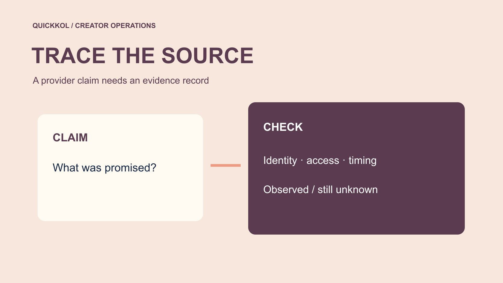

# Free Followers From Instagram: Check the Source Claim

Status: local review draft; confirm the publication date before release.

Check authorization, native evidence and timing without treating a source claim as an established fact.

QuickKOL editorial graphic; not actual account metrics or a platform interface.

When a service promises free followers from Instagram, a brand should first ask what from Instagram actually means. A provider’s wording does not establish platform authorization, genuine voluntary following or an audience relevant to the campaign. Have the account owner inspect permissions and available records through official routes. Preserve the claim, dates and supporting evidence. An unusual increase can justify a review without proving that a particular creator bought false followers. This educational guide concerns source verification and fair campaign decisions. It does not recommend growth services or explain how to obtain artificial engagement.

## Turn a source phrase into verifiable questions

Save the provider’s wording, page address and date before copying a claim into the brand report as fact. Ask whether it asserts platform authorization, organic recommendation, advertising exposure or voluntary following by other accounts. Those are different propositions requiring different evidence. Using Instagram does not mean being supplied by Instagram. Establish what the brand actually needs to know for this partnership decision.

State in the [creator brief](https://www.quickkol.com/blog/write-a-useful-campaign-brief/#answer) that the brand does not purchase false engagement or make follower growth the only acceptance criterion. If someone recommended a service to the creator, record the recommendation and procurement context instead of assuming the creator initiated it. Ask for clarification of available facts rather than proof that nothing unusual has ever happened. A narrower question protects the relationship and reduces unnecessary requests for private information. It also helps distinguish a marketing phrase from an account action that an authorized person can actually verify.

## Separate provider identity from account authorization

A provider having a company name does not establish platform authorization. An app appearing in a connected-account list does not prove that growth came from voluntary followers. Record the business identity, authorization method, scope and visible dates separately. The brand or agency should not request passwords, verification codes or recovery codes for research. The owner or an appropriately authorized operator should perform account checks.

[Meta’s clone site security explanation](https://about.fb.com/news/2022/07/how-meta-safeguards-people-against-clone-sites/) describes credential-sharing risks associated with offers such as follower growth. That provides general background, not a finding about the named service in this case. If a page asks for a login or expanded permission, pause the new connection and check whether the assignment needs it. Familiar visual styling or Instagram in a name does not replace verification through official routes. The record should identify what was requested and observed without reproducing secrets or turning an account-security task into access for unrelated campaign staff.

## Build a timeline before reaching a conclusion

Record the baseline, first exposure to the service, permission changes, growth window and other activity. Brand advertising, published work, media coverage and collaborations may also affect following. Separate verified times from a supplier’s claimed schedule. Their proximity does not establish causation. Public figures may be delayed or adjusted, so preserve the source and observation method.

Keep the request proportionate to the question. A creator may be able to provide a relevant aggregate or appropriately redacted screenshot without exposing private messages, personal contacts or recovery information. Missing historical records should remain unknown; do not ask someone to reconstruct logs that never existed. A timeline should produce the next specific question, such as whether a permission remains active, rather than a permanent label for an account. It also lets the reviewer identify which event is supported by direct evidence and which connection is still an interpretation that needs further checking.

## Separate suspicious signals from confirmed facts

A growth spike, language change or repeated comments may justify observation, but none alone establishes authenticity or responsibility. Use three columns: direct observation, possible explanation and required verification. Give the observation a source and window, retain reasonable alternatives in the explanation, and identify who can supply which evidence. Do not classify individual accounts as false merely from an avatar, nationality or language.

If an order, permission record or provider confirmation exists, state precisely what it establishes. An order might establish the purchase of a service while leaving actual delivery and the purchaser’s identity unresolved. One local record cannot prove that the entire account history is invalid. A brand review needs traceable reasoning rather than a confident-looking authenticity score. Pending clarification is a more accurate state where evidence remains incomplete. Keeping the categories separate also prevents later summaries from quoting a suspected cause as though it were the observed event itself.

## Use policy context without replacing fact review

[Meta’s inauthentic engagement enforcement note](https://about.fb.com/news/2019/04/preventing-inauthentic-behavior-on-instagram/) records historical action concerning false-engagement services. That gives a brand a reason to care about data integrity, not a basis to assign the historical case to any present account. Keep policy background separate from case evidence: one explains why review matters; the other determines what can currently be established.

Within the U.S. rule’s scope, the [FTC’s fake indicator FAQ](https://www.ftc.gov/business-guidance/resources/consumer-reviews-testimonials-rule-questions-answers) discusses knowledge qualifications and distinguishes genuine voluntary followers. That does not make every free promotion or irregular increase the same prohibited conduct. Specific legal questions require appropriate professional assessment of the territory and facts. The verification record proposed here is an editorial working method, not compliance certification or a perfect detection system. Preserve that limit when briefing a decision maker. Policy material can support a careful process without being used as a shortcut to a conclusion about an individual creator whom the sources never investigated.

## Prioritize access when permission is uncertain

If an unfamiliar connection or login appears, an authorized person should inspect it through official routes rather than asking unrelated colleagues to log in. [Meta’s account security guidance](https://about.fb.com/news/2021/07/keeping-instagram-safe-and-secure/) discusses login activity, recovery contacts and two-factor authentication. Current controls may differ from a historical announcement, so follow the official interface available now. Access repair and growth attribution are separate workstreams; the first need not wait for the second to be complete.

Preserve appropriate incident evidence without storing passwords or circulating reusable access material. After removing an unnecessary permission, check whether the legitimate publishing workflow was affected and assign an alternative to its operator. An access review still cannot explain every growth event. The brand may hold expanded permissions or new procurement, but should describe that as a risk-control decision rather than punishment for proven deception. That distinction lets the team protect an account promptly while keeping its factual conclusions within the evidence.

## Match the campaign decision to what is known

If the only established fact is unclear provider wording, the next step may be clarification. An unnecessary permission calls for access review. A report using affected figures calls for annotation and reassessment. Different evidence should not produce the same automatic rejection. Use the [creator campaign measurement framework](https://www.quickkol.com/blog/creator-campaign-measurement/#answer) to identify which results should remain outside budget comparisons and which deliverables can still be accepted.

Authentic production does not become worthless because a distribution question remains unresolved. Accept completed work under the agreement where appropriate while leaving the relevant reporting evidence pending. Payment, additional delivery or termination should follow the contract and proper process rather than an anomaly chart alone. Distinguishing tasks from evidentiary scope makes the action more proportionate. It also allows a later correction to update the affected decision without requiring the team to reverse an unsupported judgment about the creator’s whole body of work.

## Rehearse a conclusion that stays within the evidence

Suppose a brand sees an offer promising two thousand followers from Instagram and later observes account growth. The available record establishes the offer and the increase, not a connection between them. A defensible note says the wording and observation period were saved, the owner is checking permissions, and concurrent promotion remains unconfirmed. It should not say false-follower purchasing was established or promise that review will identify the source of every account.

If a purchase is later confirmed, add that fact and continue checking identity, service and delivery. Do not rewrite the original observation as though the team already knew the later finding. Dated steps let the owner understand how the assessment changed. These hypothetical numbers illustrate a process, not a client result or a finding about a named provider. A sound provenance record permits revision and may still end with unresolved questions. Its value is an explainable decision, not certainty that the available evidence cannot supply.

## When a service claim overlaps with legitimate promotion

Suppose an account joins a brand collaboration, receives media coverage and encounters a free-follower sales pitch in the same week. Observing growth does not let the researcher select one of those events as the cause. First establish whether the pitch was accepted, then record the visible collaboration and media publication. Without purchase or authorization evidence, the provider’s presence is background, not proof that a service was connected.

When asking the creator, identify the observed period and invite known promotional context rather than demanding an explanation for every new follower. Add legitimate activity records to the timeline while retaining what they cannot establish. The internal report should say which explanations have support and which remain to be checked. That may be longer than an authenticity label, but it better supports a decision to continue, seek evidence or hold a particular purchase.

The next owner needs to distinguish the original claim from later records instead of receiving only the phrase unusual growth. Give the question a scope and review date. This reduces the chance that an unresolved lead circulates as a proven accusation. It also means the brand can update one interpretation when new evidence arrives without erasing the original observations or pretending that the first review established more than it did.

## Source-claim verification record

| Layer | Record | Does not establish |
| --- | --- | --- |
| Provider claim | Wording, URL and date | Platform authorization |
| Direct observation | Growth window and field | Purchase or responsibility |
| Account record | Owner-verified permissions | Every follower’s origin |
| Action | Scope, owner and missing evidence | A permanent authenticity label |

Record signals, hypotheses and facts separately; do not promise perfect detection.

## Brand provenance review checklist

For partnership risk education, not obtaining free followers.

- [ ] Save the original claim without adopting it as fact.
- [ ] Have the owner review permissions and timing.
- [ ] Retain reasonable alternative explanations.
- [ ] Match the action to the evidence scope.

## Research date and limitations

Sources reviewed November 11, 2026. Methods, tables and decision rules are editorial recommendations. Hypothetical examples are not actual client results or industry benchmarks. Source geography and periods are specified where relevant. This draft is in independent local review; confirm its publication date before release.

## Start creator research with a clear task

Use QuickKOL to interpret a brief, discover relevant creators and research their work and contact routes. Verify data, commercial terms and outcomes at their source.

[Explore QuickKOL](https://www.quickkol.com/#capabilities)

## Sources

- [Meta’s clone site security explanation](https://about.fb.com/news/2022/07/how-meta-safeguards-people-against-clone-sites/)
- [Meta’s inauthentic engagement enforcement note](https://about.fb.com/news/2019/04/preventing-inauthentic-behavior-on-instagram/)
- [the FTC’s fake indicator FAQ](https://www.ftc.gov/business-guidance/resources/consumer-reviews-testimonials-rule-questions-answers)
- [Meta’s account security guidance](https://about.fb.com/news/2021/07/keeping-instagram-safe-and-secure/)
