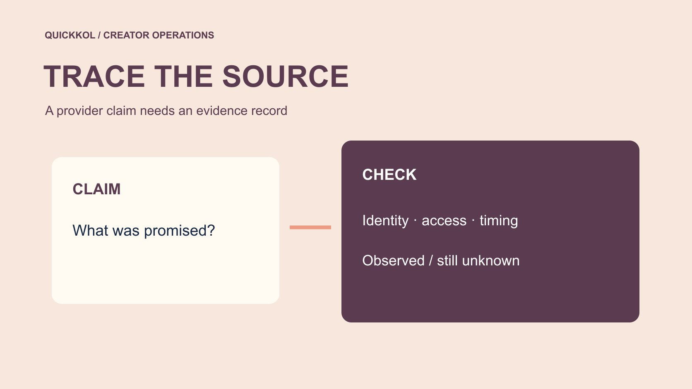

# 声称粉丝来自 Instagram，品牌该怎样复核

状态：本地审阅稿；正式发布日期待确认。

不把来源声明当成已证实事实，逐项核对品牌可见的授权、原生数据和变化时间。

QuickKOL 编辑图形；不呈现真实账号指标或平台界面。

搜索 free followers from Instagram 时，品牌首先要核对“来自 Instagram”到底指什么。它可能只是供应商的营销表述，不能自动证明平台授权、真实自愿关注或适合品牌的受众。请账号所有者通过官方入口核对授权与变化记录，保留服务声明、时间和可用证据。异常增长可以触发复核，不能单独证明某位创作者购买虚假粉丝。本文不推荐免费涨粉网站，也不提供使用步骤。

## 把一句来源表述拆成可核对的问题

先保存服务原文、页面地址和日期，不要立即把声明抄成品牌报告的事实。问它声称平台授权、自然推荐、广告触达，还是其他账号自愿关注。这些是不同命题，需要不同证据。“使用 Instagram”并不等于“由 Instagram 提供”。品牌要确认的是本次合作决策需要知道什么。

在[达人 Brief](https://www.quickkol.com/zh/blog/write-a-useful-campaign-brief/#answer) 中写清品牌不采购虚假互动，也不把粉丝增长作为唯一验收。若有人向创作者推荐服务，先记录推荐人和采购背景，不能默认创作者主动购买。核验的语气应是请求澄清可用事实，而不是要求对方证明自己从未发生任何异常。把问题缩小，有助于保护合作关系并减少不必要的私人资料请求。

## 分别核对服务身份与账号授权

服务有公司名称，不证明它获得平台授权；账号出现一个已连接应用，也不证明增长来自自愿关注。分别保存服务主体、授权方式、范围与可见日期。不要让品牌或代理索取密码、验证码和恢复码来完成研究，账号检查应由所有者或适当授权人员进行。

[Meta 的仿冒网站风险说明](https://about.fb.com/news/2022/07/how-meta-safeguards-people-against-clone-sites/)讨论了以涨粉等承诺诱导凭证分享的风险。它提供一般风险背景，不是对本次具名服务的调查结论。若页面要求登录或扩大权限，先暂停新连接并核对任务需要。界面看起来熟悉和名称包含 Instagram，都不能替代官方入口与实际权限的确认。

## 建立变化时间线，而不是先写结论

记录基线、首次看到服务、授权变化、增长窗口和其他活动。品牌广告、创作者公开作品、媒体事件或合作发布也可能影响关注。能核实的时间与供应商声称的时间分开，不能因为两者接近就推断因果。公开数字可能有延迟或调整，因此保留来源与观察方式。

请求的资料应与本次问题相称。创作者可以提供适用窗口的汇总或经适当遮挡的截图，不必交出私信、个人联系人或恢复资料。缺少历史记录就写未知，不要求对方重造不存在的日志。时间线帮助提出下一条具体问题，例如某次授权是否仍存在，而不是自动给账号贴上永久标签。

## 把异常信号与确认事实分栏

大量增长、语言变化或重复评论可以成为观察信号，单独都不能证明真假或责任人。报告可用三栏：直接观察、可能解释、需要验证。直接观察写来源和窗口，解释同时保留合理替代，验证说明谁能提供什么。不要用头像、国籍或语言直接判定个人账号是假粉。

若确有订单、授权或供应商确认，再描述它证明的范围。订单可能证明购买某项服务，仍需核对服务实际交付与买方身份。不能从一份局部证据推导全部历史数据失真。品牌复核需要可追溯的理由，不是一个看起来果断的真假分数。对尚未确认的部分，使用待澄清比指控更准确。

## 用政策说明边界，不代替事实调查

[Meta 的虚假互动执法说明](https://about.fb.com/news/2019/04/preventing-inauthentic-behavior-on-instagram/)记录了针对虚假互动服务的历史行动。这说明品牌有理由重视数据完整性，但不能把历史案件套到任一当前账号。政策背景与本次事实应在报告中分开：前者解释为什么复核，后者决定目前能够确认什么。

[FTC 的社媒虚假指标问答](https://www.ftc.gov/business-guidance/resources/consumer-reviews-testimonials-rule-questions-answers)在美国规则范围内讨论了知情等条件，也区分真实自愿关注。它不意味着每一次免费推广或不规律增长都构成同类违法行为。品牌如果面临具体法律问题，应由适当专业人员结合地区与事实判断。本文建议的核验表是编辑工作方法，不是合规认证或百分百识别工具。

## 在权限有疑问时先处理访问

若存在不认识的连接或异常登录，由有权人员通过官方路径核对，而不是让无关同事登录代查。[Meta 的账号安全说明](https://about.fb.com/news/2021/07/keeping-instagram-safe-and-secure/)提供登录活动、恢复联系方式和双重验证等背景。具体操作入口可能改变，应以当前官方界面为准。安全修复与增长归因是两条工作线，前者不必等后者全部完成。

保留适当的事件证据，同时避免保存密码或传播可复用访问资料。解除某项访问后，重新核对必要的发布流程是否受影响，给合法操作人安排替代方案。权限检查结果也不能自动解释所有增长来源。品牌可以暂缓扩大权限或新增采购，但应明确这是风险控制决定，不是已经证明某人造假的惩罚。

## 让合作决定与已知范围对应

如果唯一已知事实是供应商宣传语不清，下一步可能只是要求说明；若有不必要权限，先处理访问；若效果报告已使用受影响数字，就标记并复核。不同证据不应产生同一种自动拒绝。用[达人活动衡量框架](https://www.quickkol.com/zh/blog/creator-campaign-measurement/#answer)说明哪些结果暂时不宜用于预算比较，哪些交付仍可验收。

创作者已完成真实拍摄，并不因一个未解决的数据问题自动变成没有价值。可以按约确认制作，同时保留分发证据待补。对付款、补交或终止，应依据合同和适当流程，不由一张异常图表决定。品牌越能区分具体任务与证据范围，越容易作出公平且可解释的行动。

## 演练一条不越界的核验结论

假设品牌看到某服务承诺来自 Instagram 的两千粉丝，随后账号增长。现有资料只证明出现宣传语和增长，不证明二者有关。报告可以写：已保存声明与观察窗口；账号所有者正在核对授权；同期推广仍待确认。不要写已查实购买假粉，也不要承诺核验后能找出每个账号来源。

若后来确认有人下单，新增订单事实并继续核对身份、服务与交付。原观察不需要被改写成当时已经知道的结论。保留每一步日期有助于负责人理解判断怎样变化。假设数字只演示工作流程，不描述真实客户或任何具名服务。好的来源记录允许结论更新，也允许最后仍有无法确认的部分。

## 当服务与正常推广发生在同一周

假设账号在同一周参加品牌联名、获得媒体转发，也收到免费粉丝服务的推销。研究员看到上涨后，不能从三件同期事件中任意选择一个作为原因。先确认推销是否被接受，再记录联名和媒体的可见发布。没有订单或授权证据时，供应商存在只是背景，不等于实际接入。

向创作者询问时，可以说明已观察到的时间窗口并请其补充已知推广，不要求解释每位新关注者。若对方提供正常活动记录，加入时间线并保留还不能确定的部分。品牌内部报告应写资料支持哪些解释、哪些仍待核对。这样的结论可能没有真假标签简短，却更能支持继续合作、补证或暂停特定采购的决定。

下一位负责人应看到原声明与后续记录的区别，不能只收到“有异常”三个字。给问题一个范围和截止复核时间，有助于避免未解决的线索在团队中传播成已经证实的指控。

## 来源声明核验表

| 层次 | 记录 | 不能推出 |
| --- | --- | --- |
| 服务声明 | 原文、地址与日期 | 平台授权 |
| 直接观察 | 增长窗口与字段 | 购买与责任人 |
| 账号记录 | 有权人员核对的授权 | 每位粉丝来源 |
| 行动 | 范围、负责人及待补证据 | 永久真假标签 |

可疑信号、假设和事实分别记录，不承诺百分百识别。

## 品牌来源复核清单

用于合作风险教育，不用于获取免费粉丝。

- [ ] 保存原声明，不复述成事实。
- [ ] 由所有者核对授权与时间线。
- [ ] 保留合理替代解释。
- [ ] 让行动与证据范围对应。

## 研究日期与使用边界

资料核验于 2026 年 11 月 11 日。文中方法、表格和决策规则为编辑建议，标为假设的示例不是实际客户结果或行业基准。外部资料的适用地区与时期按各段说明；本稿处于独立本地审阅阶段，正式发布日期待确认。

## 用清楚的任务开始达人研究

用 QuickKOL 理解 Brief、发现相关达人并研究作品与联系路径；数据、合作条件和结果仍需核验。

[了解 QuickKOL](https://www.quickkol.com/#capabilities)

## 来源

- [Meta 的仿冒网站风险说明](https://about.fb.com/news/2022/07/how-meta-safeguards-people-against-clone-sites/)
- [Meta 的虚假互动执法说明](https://about.fb.com/news/2019/04/preventing-inauthentic-behavior-on-instagram/)
- [FTC 的社媒虚假指标问答](https://www.ftc.gov/business-guidance/resources/consumer-reviews-testimonials-rule-questions-answers)
- [Meta 的账号安全说明](https://about.fb.com/news/2021/07/keeping-instagram-safe-and-secure/)
