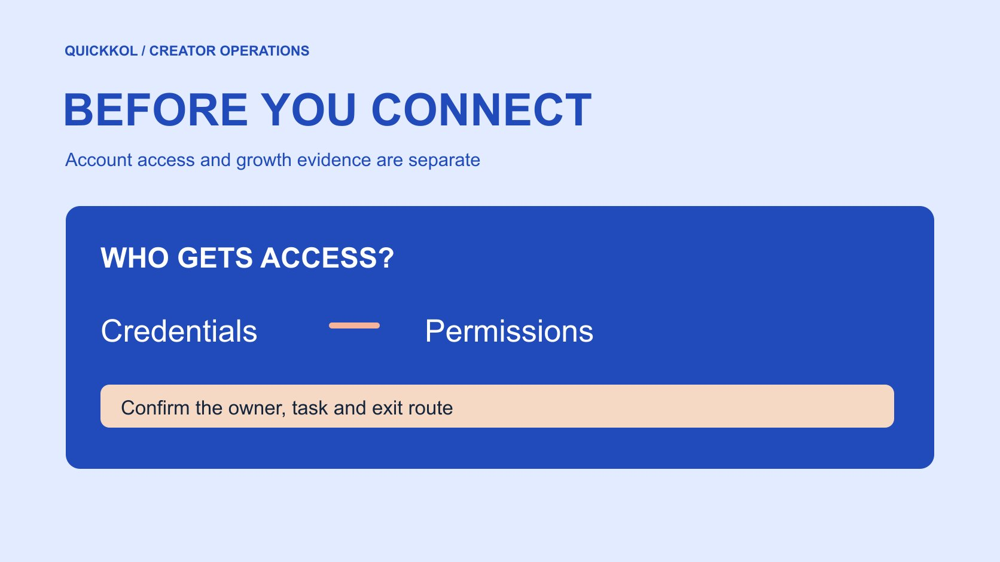

# Free Instagram Followers Websites: An Access Review

Status: local review draft; confirm the publication date before release.

Review requested access and evidence before a free follower offer enters a creator campaign.

QuickKOL editorial graphic; not actual account metrics or a platform interface.

Treat a free Instagram followers website as an outside service requiring review before it touches a creator campaign. Separate provider identity, authentication, requested permissions and evidence of audience growth. Do not give an outside page passwords, verification codes or recovery information. A site that asks for no password can still produce unsuitable or unverified activity. An unusual public growth pattern is a reason to investigate, not proof that a creator bought followers. The brand’s immediate decision is whether the service and evidence meet the campaign’s access and measurement requirements. This guide makes no finding about a named provider.

## Ask what the website contributes to the partnership

Separate the word free from the job the campaign needs done. The brand may need suitable creators, a better understanding of content fit or relevant people visiting a service destination. Increasing a public counter does not by itself complete any of those tasks. Ask the proposer what the website does, which accounts participate, what actions produce a follow and how the brand could verify the process. If the answer is only a promised quantity, record it as an unverified count claim.

Distinguish the merchant’s account from the creator’s account. Authority to manage one does not include permission to authorize another. A shared handle is not consent to third-party operations. Name the account owner, intended action, access scope and termination condition on one page. Without that information, keep the website pending and continue the normal [creator research workflow](https://www.quickkol.com/blog/creator-shortlist-workflow/#answer). A small campaign should not acquire unrelated following, messaging or administration permissions merely because they appear in a bundled offer.

## Check the login destination and the requested access

[Meta’s clone site security explanation](https://about.fb.com/news/2022/07/how-meta-safeguards-people-against-clone-sites/) describes how offers of free likes or followers can obtain access through credentials supplied by users. Review the concrete authentication action. A familiar logo, a padlock or a claim of official status does not establish who receives a password. Do not supply recovery codes, one-time verification codes, session information or anything else that can stand in for account access. Asking a creator to send a screenshot of a secret is not an authorization process.

Distinguish native sign-in, an authorized connection and a direct password request. Even when a familiar identity service is involved, check the application name, recipient, scope and revocation route. Reading performance should not automatically require publication or business administration access. Have the account owner inspect and approve the actual request. Keep a non-secret record of the application, scope and date. A sound access decision still does not validate growth. It establishes who can act on the account and under which permissions.

## Do not confuse a connection with platform endorsement

A successful connection may show that an authorization step completed. It does not establish platform approval of every marketing promise. Ask what partner, official source and guaranteed real mean in the proposal. Request public evidence and identify its scope. A badge image or an undated customer screenshot should remain unverified until it can be traced. Similarity between a service name and a platform brand is not proof of a shared identity.

Use separate columns for provider identity, access mechanism and performance. A privacy statement can document the provider’s own description of data handling without independently validating results. An account owner observing more follows can establish a count at a time without explaining each follow’s origin. Keep conclusions at the level their evidence supports. If a purchasing deck compresses those columns into one verified label, restore the actual object being verified. Otherwise the next operator may mistake one completed check for approval of the entire service.

## Distinguish voluntary response from manufactured indicators

The [FTC’s fake indicator FAQ](https://www.ftc.gov/business-guidance/resources/consumer-reviews-testimonials-rule-questions-answers) distinguishes genuine voluntary following from fake indicators in the context of U.S. rules and explains qualifications for liability. A brand can ask an appropriate creator to introduce an account to interested people. It should not present manufactured activity as genuine influence. The distinction depends on the underlying activity, not whether a follow was free or arrived quickly.

Ask whether the offer requires reciprocal engagement, rented accounts, credential sharing or automated actions by someone else. When the mechanism cannot be checked, record it as unknown rather than real. Do not classify an individual as fake from an avatar, language or a quiet observation window. Spam removal, wider distribution of a successful post and ordinary publicity can change counts. The brand needs defensible claims and purchasing decisions while giving the creator an opportunity to explain legitimate events. This review cannot deliver a universal fraud score from a single public signal.

## Save a proportionate baseline before publication

Before any trial, record the account, time zone, public follower snapshot, planned publications and known advertising. If the creator voluntarily supplies an appropriate native report, note field definitions and dates. Full dashboard access is usually unnecessary for that question. Choose a baseline suited to the partnership, such as comparable video performance and relevant audience questions, rather than collecting follower identities indiscriminately.

Suppose the public count is 12,000 before a campaign and 13,200 a week later. The observed net change is 1,200. Those snapshots do not separate new follows, unfollows and platform corrections, and do not establish 1,200 real customers generated by the website. Log creator releases, giveaways, publicity and paid activity on a timeline. If sources have no distinguishable entry points, preserve that measurement limitation. The purpose of a baseline is to make a later question reviewable, not to manufacture precise attribution from an incomplete observation.

## Escalate an anomaly through evidence

First check for an account mismatch, different windows or confusion between a public count and another native field. Review known events and available owner-held reports. If a discrepancy remains, ask the creator a specific question, such as whether other promotion ran during the period. Do not frame a request for evidence as a demand to admit buying followers. Preserve the reply, independently checkable material and unresolved questions.

[Meta’s inauthentic engagement enforcement note](https://about.fb.com/news/2019/04/preventing-inauthentic-behavior-on-instagram/) documents historical action. It cannot establish wrongdoing by the service or creator currently under review. Write observations, possible explanations, confirmed facts and next actions separately. If a commercial claim lacks evidence, pause that use of the number and assess other completed production against its own acceptance terms. Assign payment interpretation, evidence requests and security response to their proper owners. An analyst should not resolve a contractual dispute from a chart alone or bypass access controls to complete an incomplete report.

## Involve the account owner if access was exposed

If someone supplied a password or verification code, have the account owner follow the native security process. [Meta’s account security guidance](https://about.fb.com/news/2021/07/keeping-instagram-safe-and-secure/) discusses login activity, recovery contacts and two-factor authentication. The brand or agency should not ask for another code to help, or direct the creator to a paid third-party recovery offer. Give the responsible security person the known timing, categories of exposed information and active connections without circulating secrets in a group.

Restoring access and validating campaign quality are separate jobs. After credentials or permissions change, assess whether publications, reports or contact records need correction. Do not erase relevant incident evidence, and do not keep unknown access active merely to investigate a marketing claim. Qualified security staff should determine the recovery steps. The campaign owner pauses work that depends on the affected connection and tells the creator which non-sensitive records are needed. A restored login does not automatically validate a disputed audience-growth result.

## Make the purchasing conclusion reviewable

Use approval, evidence pending or access declined as distinct outcomes, each with a reason. Approval should cover the reviewed account and job. Additional publishing or messaging permissions trigger another review. When evidence is incomplete, a manual [creator audience quality review](https://www.quickkol.com/blog/audit-creator-audience-quality/#answer) can still inform the partnership, with unresolved findings intact. Declining a website does not establish misconduct by the creator. It may simply reflect a mismatch between the service mechanism and the brand’s requirements.

Hand over the provider name, checked sources, requested scope, account owner’s decision, campaign dates and permitted uses of reported figures. Keep unsupported numbers out of a promotional case study while accepting independently verifiable assets and performance. A later buyer should be able to understand why access was allowed, why a growth figure was excluded and what evidence would permit reconsideration. The conclusion should guide an actual campaign decision rather than imply perfect detection of follower authenticity.

## Practice an access decision with one review sheet

Suppose an agency presents three options. A offers public content research without an account connection. B requests reporting access with publication also selected. C promises a follower quantity without explaining its origin. Assess the task and scope for each. A still needs source-quality review. B needs to justify publication before that additional permission is accepted. C’s figure should remain outside verified performance material until the mechanism and evidence can be reviewed.

Give the options separate outcomes instead of one safety score. The operator should know what is allowed, the owner should know how it ends, and procurement should know what evidence is missing. After a trial starts, check that actual operations remain within approval. Changed permissions or a different mechanism require another look at the affected scope rather than automatic continuation of an old conclusion. Record the follow-up date as well as the decision. Otherwise a temporary exception can become a permanent connection that nobody remembers approving. This hypothetical exercise illustrates a review process and makes no finding about a real website or creator. It also preserves useful public research while keeping unrelated account actions pending.

## Review layers for a free follower offer

| Layer | What to verify | What it cannot establish |
| --- | --- | --- |
| Identity | Provider, entity and traceable sources | Authentic growth |
| Access | Actual owner-approved permissions | Platform endorsement |
| Change | Matched counts and known events | An individual’s purchase of fake followers |
| Decision | Evidence, limits and owner | Perfect detection |

A single anomaly is a review signal. Keep conclusions within the evidence.

## Five checks before connection

Review with the brand and account owner. Keep credentials out of the record.

- [ ] Explain its role in the actual partnership task.
- [ ] Check the authentication recipient and each requested scope.
- [ ] Save a proportionate baseline and concurrent promotion.
- [ ] Separate anomalies, possible explanations and verified facts.
- [ ] Name the exit route, evidence requirement and decision owner.

## Research date and limitations

Sources reviewed November 11, 2026. Methods, tables and decision rules are editorial recommendations. Hypothetical examples are not actual client results or industry benchmarks. Source geography and periods are specified where relevant. This draft is in independent local review; confirm its publication date before release.

## Start creator research with a clear task

Use QuickKOL to interpret a brief, discover relevant creators and research their work and contact routes. Verify data, commercial terms and outcomes at their source.

[Explore QuickKOL](https://www.quickkol.com/#capabilities)

## Sources

- [Meta’s clone site security explanation](https://about.fb.com/news/2022/07/how-meta-safeguards-people-against-clone-sites/)
- [the FTC’s fake indicator FAQ](https://www.ftc.gov/business-guidance/resources/consumer-reviews-testimonials-rule-questions-answers)
- [Meta’s inauthentic engagement enforcement note](https://about.fb.com/news/2019/04/preventing-inauthentic-behavior-on-instagram/)
- [Meta’s account security guidance](https://about.fb.com/news/2021/07/keeping-instagram-safe-and-secure/)
