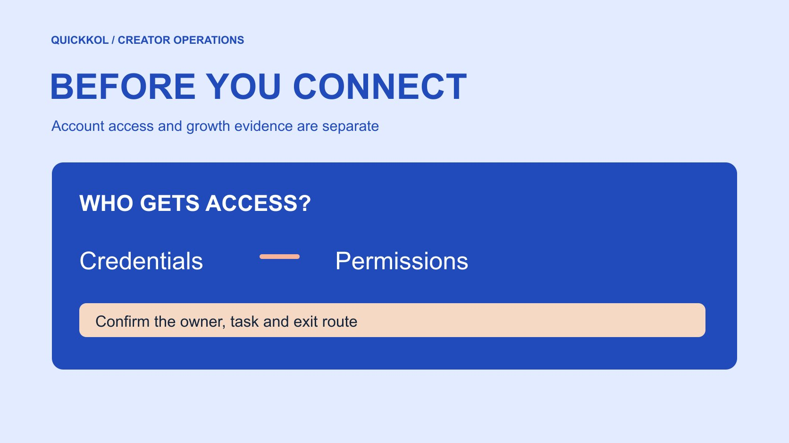

# 免费 Instagram 粉丝网站的账号授权风险

状态：本地审阅稿；正式发布日期待确认。

免费涨粉邀约进入合作流程前，先核对它要求的访问权限和能够证明的结果。

QuickKOL 编辑图形；不呈现真实账号指标或平台界面。

免费 Instagram 粉丝网站应先被当作需要审查的外部服务，而不是已证明有效的达人营销方案。品牌要分开核对服务身份、登录方式、权限和增长来源，不向外部页面交出密码、验证码或恢复信息。公开增长异常只能触发复核，不能证明某位达人买粉。即使没有索取密码，虚假互动也可能污染合作比较。本文提供上线前的权限检查方法，不对任何具名服务的行为作未经证实的认定。

## 先问网站与合作任务有什么关系

先把邀约中的「免费」和要完成的任务分开。品牌可能需要找到合适创作者、了解内容契合度，或把真实观众带到服务入口。增加一项公开计数，并不能直接完成这些任务。要求提案人说明网站做什么、哪些账号参与、通过什么行为带来关注，以及品牌将如何复核。若答案只有一定数量的新增粉丝，把结论限制为一个未经验证的计数承诺。

采购人员还要区分品牌账号和创作者账号。给品牌安排可接受的访问，不代表可以替创作者授权。对方发送账号名，也不等于允许第三方操作。将账号所有者、目标动作、访问范围和结束条件写成一页说明。没有这些信息，先继续正常的[达人研究流程](https://www.quickkol.com/zh/blog/creator-shortlist-workflow/#answer)，把网站作为待核验选项保留。不要为了参加一次小活动，顺便接受与发现或发布任务无关的自动关注、私信或管理能力。

## 核对登录入口与权限请求

[Meta 的仿冒网站风险说明](https://about.fb.com/news/2022/07/how-meta-safeguards-people-against-clone-sites/)解释过，声称提供免费赞或粉丝的网站可能通过用户交出的凭证接触账号。这里需要核对的是具体登录与授权行为。网页上的图标、颜色、锁形标识和自称官方，都不足以说明由谁接收密码。不要把恢复码、一次性验证码、会话信息或其他可代替登录的资料交给服务方，也不要请达人发截图代替授权流程。

把原生登录、第三方授权与直接索要密码分开。即使使用熟悉的身份平台，也要检查授权方、应用名称、实际权限和撤销方式。工具需要读取公开表现，不意味着需要发布内容或管理业务资产。让账号所有者自己查看权限，并保留不含秘密的核验记录，例如应用名称、批准范围和日期。安全的访问决定仍不能证明增长真实，它只解决谁能对账号做什么。

## 不要把平台登录当成增长背书

连接成功说明一次权限流程可能完成，不能推出平台认可该网站的全部营销承诺。检查提案中的「合作伙伴」「官方来源」和「保证真人」分别指什么。让服务方提供能公开核对的依据及其适用范围。若只有一张徽章或没有日期的客户截图，把这项保持为未核验。不要把网站名字与平台品牌接近，当成身份相同的理由。

把证据分成服务身份、访问机制和效果三列。一份隐私声明可以说明服务方如何自述数据处理，不能独立证明实际效果。账号所有者看到新增关注，能证明某时点计数发生变化，仍不能解释每一个关注来自哪里。品牌审查只应作相应范围的结论。采购会议若有人把三列压成一个「已验证」标记，要求写回具体对象，避免下一位执行人员误以为所有风险都已解决。

## 把受众行为与虚假指标分开

[FTC 的社媒虚假指标问答](https://www.ftc.gov/business-guidance/resources/consumer-reviews-testimonials-rule-questions-answers)在美国规则背景下区分真实个人自愿关注与虚假指标，并解释相关责任条件。品牌可以请合适的达人向感兴趣的读者介绍账号，但不能把来自机器或被劫持账号的指标包装成真实影响力。这个区分依赖实际来源与行为，而不是关注者是否花钱、是否在短时间增长，或服务名称里有没有免费。

在邀约中问清是否要求参与者交换关注、出租账号、共享凭证，或由第三方自动执行动作。看不到机制时，记录不能确认，而不是填写真人。也不要仅凭头像、语言或一次安静的互动窗口判断个人为虚假。平台处理垃圾互动、热门内容扩散和活动宣传都可能改变计数。品牌需要保护自己的陈述与采购决定，同时给创作者提供说明正常活动的机会。

## 上线前保存最小必要的比较依据

在允许任何活动前，记录账号、时间、时区、公开关注数、计划发布的内容和已知广告。若创作者自愿提供适用报表，注明字段定义与窗口，不需要整个后台权限。选择对合作任务有用的基线，例如同形式作品的观看与真实问题，而不是无差别采集关注者名单。品牌只应保留能够支持复核的最小材料。

假设活动开始前公开数为 12,000，一周后为 13,200。可以报告观察到的净变化为 1,200，但不知道其中新增、退出与平台清理各占多少。不能把净变化全部写成网站带来的真实客户。把同期创作者发布、抽奖、媒体提及和广告列成事件线。如果各来源没有可区分的入口，保留这个测量限制。基线的用途是让后续问题可复查，而不是预先制造一个看起来精确的归因结果。

## 当异常出现时按证据升级

先核对是否拿错账号、比较了不同窗口，或把公开数与后台另一字段混用。再检查已知事件和原生报表。若仍有明显不一致，向创作者提出具体问题，例如「这段时间是否安排过其他推广」，而不是要求承认买粉。保留对方答复及能够独立核对的资料，把未知列清楚。对于没有授权读取的数据，不使用抓取或绕过登录的方式填补。

[Meta 的虚假互动执法说明](https://about.fb.com/news/2019/04/preventing-inauthentic-behavior-on-instagram/)证明平台曾对相关行为采取行动，但不能用于指认本次服务或某位达人。最终报告分别写观察、可能解释、已核实事实和待办。需要暂停商业陈述时，暂停的是缺少证据的数字用途；其他已完成且能验收的拍摄工作仍可单独处理。把付款、补件和安全事件分给相应负责人，不让分析人员仅凭曲线决定合同争议。

## 出现凭证暴露时先找账号所有者

如果有人已经提交密码或验证码，先交给账号所有者按原生安全流程处理。[Meta 的账号安全说明](https://about.fb.com/news/2021/07/keeping-instagram-safe-and-secure/)涉及登录活动、恢复联系方式和双重验证等检查。品牌或代理不应索取新的验证码来帮忙，也不要要求对方在第三方恢复网站付款。把已知时间、输入过哪些类型的信息、有哪些活动权限交给负责安全的人，避免在公共群传播秘密。

恢复访问与证明活动质量是两项工作。完成密码或权限调整后，仍要判断受影响的发布、报表与联系记录是否需要更正。不要在保留必要证据前把所有异常记录清空，也不要为调查继续给未知服务权限。适用的安全人员决定具体恢复步骤，活动负责人负责暂缓依赖该连接的工作，并告诉创作者当前需要什么非敏感材料。

## 把采购决定写成可复查的结论

可以采用批准、补充证据、拒绝接入三种结果，每种都写对应理由。批准只覆盖已审查账号和任务；供应商增加发布或消息权限时，重新检查。证据不足可继续使用手工的[达人受众质量复核](https://www.quickkol.com/zh/blog/audit-creator-audience-quality/#answer)来决定合作，但不要把保留意见抹成正常。拒绝网站不应自动转成对创作者的指控，它可能只是服务机制与品牌要求不相符。

最终交接包含服务名称、核对的来源、请求权限、账号所有者决定、活动窗口和哪些数字能用于报告。把缺失证据的数字从案例宣传中留出，交付仍可验证的素材与表现。后续回看时，采购同事应能理解为什么允许某项访问、为什么某个增长数字未采用，以及再次评估需要补哪一项证据。

## 用一张审查表练习准许与拒绝

假设代理提交三个选项。A 只提供公开内容研究，不连接账号；B 请求报表读取，但同时勾选发布；C 只承诺新增数量，无法解释来源。品牌分别判断任务与权限。A 仍需检查来源质量，不能因为无连接就免审。B 先说明为何需要发布，未批准前不接受额外范围。C 的计数暂不进入正式成效材料，等待能够复核的机制与证据。

把三项写成不同处理，不用一个「安全」总分替代。审查人员应知道当前允许什么，账号所有者应知道如何结束，采购人员应知道还缺什么。试点开始后再检查实际行为是否与批准一致。若供应商改变权限或操作方式，重新核对受影响部分，不让旧结论自动延续。这个假设案例用于练习复核决策，并不描述任何现有网站或真实创作者。

## 免费涨粉服务的复核层次

| 层次 | 可以核对 | 不能由此推断 |
| --- | --- | --- |
| 身份 | 服务名称、主体与可追溯来源 | 真实增长 |
| 访问 | 账号所有者批准的实际权限 | 平台背书 |
| 变化 | 同窗口计数与已知事件 | 个人买粉事实 |
| 决定 | 证据、限制和负责人 | 百分百识别 |

单一异常只是复核信号，结论与证据范围一致。

## 接入前五项确认

由品牌和账号所有者共同确认，记录中不保存凭证。

- [ ] 说明网站对实际合作任务有什么帮助。
- [ ] 核对登录接收方与每项请求权限。
- [ ] 保存适当基线并记录同期推广。
- [ ] 把异常、推测和已证实事实分开。
- [ ] 指定退出方式、证据要求和最终决定人。

## 研究日期与使用边界

资料核验于 2026 年 11 月 11 日。文中方法、表格和决策规则为编辑建议，标为假设的示例不是实际客户结果或行业基准。外部资料的适用地区与时期按各段说明；本稿处于独立本地审阅阶段，正式发布日期待确认。

## 用清楚的任务开始达人研究

用 QuickKOL 理解 Brief、发现相关达人并研究作品与联系路径；数据、合作条件和结果仍需核验。

[了解 QuickKOL](https://www.quickkol.com/#capabilities)

## 来源

- [Meta 的仿冒网站风险说明](https://about.fb.com/news/2022/07/how-meta-safeguards-people-against-clone-sites/)
- [FTC 的社媒虚假指标问答](https://www.ftc.gov/business-guidance/resources/consumer-reviews-testimonials-rule-questions-answers)
- [Meta 的虚假互动执法说明](https://about.fb.com/news/2019/04/preventing-inauthentic-behavior-on-instagram/)
- [Meta 的账号安全说明](https://about.fb.com/news/2021/07/keeping-instagram-safe-and-secure/)
