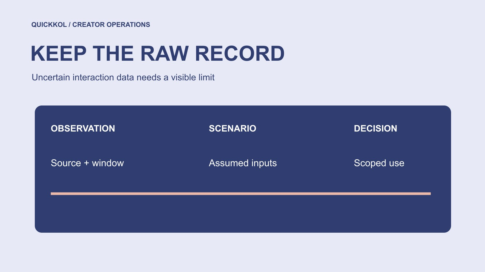

# Free Instagram Likes and Contaminated Campaign Metrics

Status: local review draft; confirm the publication date before release.

Mark affected data, preserve original records and compare creator work fairly when the origin of likes is uncertain.

QuickKOL editorial graphic; not actual account metrics or a platform interface.

When free likes Instagram raises a concern, first ask whether the affected metric can support the current decision. Preserve the original count and window, flag uncertain-origin interactions and check the denominator, promotion and concurrent activity. One ratio cannot identify every false interaction. Subtracting an unsupported estimate does not produce a verified genuine total either. This educational guide focuses on reporting integrity and fair creator comparison. It does not recommend artificial engagement services. The objective is a useful decision with visible limits, while keeping the question of what happened separate from any unproven claim about who caused it.

## Identify the decision affected by the metric

Likes may support content learning, budget ranking or contractual settlement. Those uses need different responses. Save the original report and identify the particular cell and decision that depend on it. An uncertain interaction field should not automatically invalidate every asset, order or production acceptance. A specific problem is easier to repair proportionately.

Use the [creator campaign measurement framework](https://www.quickkol.com/blog/creator-campaign-measurement/#answer) to distinguish delivery, observation and commercial outcomes. An original post can establish publication. Orders need appropriate transaction evidence. Likes describe an interaction event. If the team originally treated likes as proof of sales, correct the interpretation instead of merely changing the count. The review reconnects evidence with purpose; it is not a search for a new formula that preserves the old conclusion. This framing also lets the owner explain why one comparison is on hold while other acceptance work can continue on evidence that was not affected by the same concern.

## Preserve raw records and source states

For each piece, retain the original post, observation time, metric source, window, known promotion and current question. Do not overwrite an original export with a revised number. Corrections need a new version and reason so the change can be traced to its owner. Where historical screenshots are missing, record the gap rather than using a later count to pretend the earlier state was reconstructed.

[Meta’s inauthentic engagement enforcement note](https://about.fb.com/news/2019/04/preventing-inauthentic-behavior-on-instagram/) provides historical context showing platform concern about these services. It does not establish the cause of this observation. Separate a service claim, direct observation and interpretation into different fields so that a reporting footnote cannot quietly become a finding of deception. The record need not collect every interacting person’s private information. Focus on what the decision requires. Clear source states also help an analyst distinguish a platform-observed total from a provider promise and from an internal estimate that has no independent validation.

## Correct definitions before interpreting an anomaly

Check whether the numerator means likes, all interactions or unique interacting people, and whether the denominator means followers, reach, views or impressions. Different definitions should not be ranked under one engagement-rate label. Match observation periods and distinguish paid-supported results from organic publication. Definition mismatches may explain part of an apparent anomaly before authenticity is considered.

[Meta’s Reels watch time explanation](https://about.fb.com/news/2023/04/instagram-reels-trending-audio-and-gifts-updates/) notes that total watch time includes replays, illustrating why fields have specific meanings. Do not mix duration, viewing events and people before combining them with likes into a supposed genuine engagement rate. If the report uses a custom ratio, state its formula, unit and scope. A familiar metric name must not conceal incompatible inputs. Correcting this issue may change a comparison without providing any evidence for or against the suspected service. Keep that definitional correction separate from the unresolved question of interaction origin.

## Show ranking effects with hypothetical arithmetic

Suppose piece A has one thousand likes and ten thousand reach, while B has six hundred likes and eight thousand reach using the same definitions. Their likes-to-reach ratios are ten percent and seven and a half percent. If A has an origin question, that does not prove B is better. Guessing that four hundred likes are false and reporting six percent would invent a correction. Without evidence, A’s comparison remains pending review.

A clearly labeled sensitivity exercise can instead assume zero, two hundred or four hundred affected interactions and test whether the budget decision changes. These are assumptions about decision sensitivity, not estimates of established false engagement. Keep the original observations, scenarios and limitations together. Prevent an illustrative scenario from being copied into a formal authenticity finding. The exercise is valuable when it shows that a decision is fragile under plausible uncertainty, or that a different, independently supported piece of evidence should carry more weight.

## Choose annotation, a hold or exclusion

If the question concerns likes in one window, hold that comparison while retaining the work and other independent evidence. An exclusion needs a rule, reason and scope; do not remove only observations unfavorable to the brand. Keep old and revised reports and explain why a ranking or budget recommendation changed.

Within its U.S. scope, the [FTC’s fake indicator FAQ](https://www.ftc.gov/business-guidance/resources/consumer-reviews-testimonials-rule-questions-answers) discusses knowledge conditions rather than treating every free interaction as the same violation. Internal evidence handling differs from a legal conclusion. If settlement terms depend on the affected metric, an authorized owner should apply the arrangement rather than an editor inventing a deduction. A transparent hold is more defensible than an unsupported repair labeled the true number. It also gives the creator a specific evidence question to answer. They can challenge the input or supply context without having to defend a broad accusation about all of their activity.

## Give the creator an answerable review request

State the observed field, period, source and intended use, then request applicable native records and concurrent promotional context. Do not demand proof that every person liking the post is genuine or ask for full account access. Permit unrelated information to be redacted. Agree on a response date and how unavailable fields will be handled. Unknown is neither zero nor guilt.

The brand also needs to check its own advertisements, giveaways and agency arrangements rather than assigning every explanatory task to the creator. Record supplied material and missing items so colleagues do not repeat requests. If new evidence explains a definition mismatch, update the report. If origin remains uncertain, retain the limitation. The review asks whether this metric can serve the present use, not how to force a predetermined answer. A fair request should therefore identify what additional evidence would change the decision and avoid seeking data that cannot affect it.

## Make the next measurement plan more resilient

Do not make one easily disrupted interaction field the entire definition of success next time. Collect work evidence, appropriate viewing measures, relevant audience questions and traceable commercial events according to the content task. Retain each definition. More metrics do not automatically mean more truth; they should answer different questions through appropriate sources. Do not add every event into one total value.

Use the [creator brief](https://www.quickkol.com/blog/write-a-useful-campaign-brief/#answer) to agree on observation windows, who supplies which fields, whether paid activity is included and how data questions will be discussed. That reduces improvised requests after publication. Separating production acceptance from performance learning also protects creators who completed real work. The next plan can be clearer without promising that anomalies will never occur. Assign a reporting owner before launch so a concern does not disappear between campaign staff, the media buyer and finance merely because each sees a different part of the activity.

## Write the revision as a handover decision

The final note should identify the original number, concern, changed use, approving owner and remaining gap. Do not hand over only a cleaner replacement chart. If a comparison is held, explain what evidence would permit reuse. If it cannot be restored, preserve the reason and choose another appropriate basis for the decision.

A brand can honestly conclude that one likes comparison cannot currently support budget ranking while recognizing that the commissioned work was completed. That is more operationally useful than declaring an account genuine or false. It preserves facts, limits and next actions so the owner can continue the partnership process without exaggerating detection capability. The free likes Instagram topic then serves data education and brand decisions rather than advice on obtaining artificial activity. Keep the revision date and notify people using the earlier report, especially if a copied ranking or budget slide would otherwise continue circulating without the new limitation.

## Correct a ranking that has already been copied

Suppose an analyst sends a likes ranking to procurement, which copies it into a quarterly proposal. A later origin question affects one row. Editing the analyst’s sheet alone does not ensure the decision has been updated. Add a version note identifying the row and affected use, then notify actual recipients. Do not delete the creator’s entire record without evidence or describe the revision as proof of deception.

If procurement has not decided, hold that comparison. If a decision already exists, assess which other grounds remain valid and whether discussion needs to reopen. A reporting question does not automatically invalidate a contract. Preserve the owner’s action confirmation so the next colleague knows where the revision reached and which old copies might still be used.

A reporting correction has completion conditions: the original observation remains traceable, the present limit is explicit, affected users are informed and the next review has an owner. It does not require identifying every interacting account. It requires preventing a known limitation from disappearing as evidence moves downstream. This distinction matters when a concise executive slide would otherwise continue to present an uncertain ranking as settled fact, even though the detailed source workbook has already been corrected.

Confirm that recipients of the old report have seen the limitation; editing only the source worksheet does not complete the correction.

## Handling hypothetical observations

| Object | Original observation | Appropriate state |
| --- | --- | --- |
| A | 1,000 likes / 10,000 reach | Comparison pending if origin is questioned |
| B | 600 likes / 8,000 reach | Does not establish superiority over A |
| Sensitivity scenarios | Assume 0, 200 or 400 affected interactions | Tests decisions, not verified counts |

All numbers are arithmetic examples, not real accounts or benchmarks.

## Interaction-data revision checklist

Preserve raw observations before revising their use.

- [ ] Identify the affected decision and field.
- [ ] Align denominator, period and promotion scope.
- [ ] Separate observations, assumptions and facts.
- [ ] Retain version, approver and recipients.

## Research date and limitations

Sources reviewed November 11, 2026. Methods, tables and decision rules are editorial recommendations. Hypothetical examples are not actual client results or industry benchmarks. Source geography and periods are specified where relevant. This draft is in independent local review; confirm its publication date before release.

## Start creator research with a clear task

Use QuickKOL to interpret a brief, discover relevant creators and research their work and contact routes. Verify data, commercial terms and outcomes at their source.

[Explore QuickKOL](https://www.quickkol.com/#capabilities)

## Sources

- [Meta’s inauthentic engagement enforcement note](https://about.fb.com/news/2019/04/preventing-inauthentic-behavior-on-instagram/)
- [Meta’s Reels watch time explanation](https://about.fb.com/news/2023/04/instagram-reels-trending-audio-and-gifts-updates/)
- [the FTC’s fake indicator FAQ](https://www.ftc.gov/business-guidance/resources/consumer-reviews-testimonials-rule-questions-answers)
