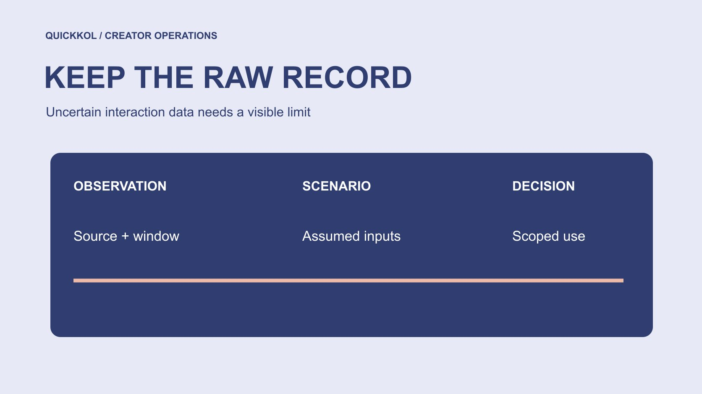

# 免费 Instagram 点赞如何影响合作数据比较

状态：本地审阅稿；正式发布日期待确认。

发现点赞来源存在疑问时，如何标记受影响数据、保护原始记录并公平比较合作作品。

QuickKOL 编辑图形；不呈现真实账号指标或平台界面。

品牌遇到 free likes Instagram 相关疑问时，先处理数据能否用于当前决定，不要急于给创作者下结论。保存原始点赞数与观察窗口，将来源不明的指标标注为待复核，并核对分母、付费推广和同期活动。不能凭一个比例识别全部虚假互动，也不能随意扣除一个估计数量后宣称得到真实值。本文提供教育向报告方法，不推荐刷量服务。

## 先说明受影响的是哪个决定

点赞可能被用于内容学习、预算排序或合同结算，三种用途的处理不同。先保存原报告版本，标明哪个单元格和哪个决定依赖它。不要因为一项来源不明的互动，把所有素材、订单或制作验收一并判为无效。问题越具体，修正越可控。

用[达人活动衡量框架](https://www.quickkol.com/zh/blog/creator-campaign-measurement/#answer)列出交付、观察和商业结果。作品存在与否可看原帖，订单需要适当交易资料，点赞只描述某种互动事件。团队如果原来把点赞当成销售证明，现在应修正解释，而不只是换数字。复核是让证据与用途重新对应，不是寻找一个能保留原结论的新算法。

## 保留原始记录与来源状态

为每条作品记录原帖、观察时间、指标来源、窗口、已知推广和当前疑问。不要用修订数字覆盖原始导出。更正应有新版本与原因，能够追溯谁作出调整。若缺少历史截图，写明缺口，不用后来的数值假装还原当时表现。

[Meta 的虚假互动执法说明](https://about.fb.com/news/2019/04/preventing-inauthentic-behavior-on-instagram/)提供历史背景，说明这类服务确实是平台重视的问题。它并不证明本次观察由此造成。将服务声明、直接观察与解释放在不同字段，可以防止报告的脚注被简化成造假结论。记录不必包含每位互动者个人信息，聚焦完成本次判断所需的范围即可。

## 先修正口径，再讨论异常

确认分子是点赞、全部互动还是独立互动者，分母是关注、触达、观看还是展示。不同口径不能用同一个互动率名称直接排名。观察窗口也要一致，包含广告的数字与自然发布不同。先找定义差异，可能就能解释一部分看似异常的比较。

[Meta 的 Reels 观看时长说明](https://about.fb.com/news/2023/04/instagram-reels-trending-audio-and-gifts-updates/)提示总观看时长包含重播，说明平台字段各有具体含义。不能把观看时长、观看次数和人数混为一谈，再与点赞拼成“真实互动率”。报告如采用自定义比例，写公式、单位和范围，而不要让一个熟悉术语掩盖不一致的输入。

## 用假设算术展示污染怎样影响排名

假设甲作品有一千点赞和一万次同口径触达，乙有六百点赞和八千触达，对应点赞／触达分别为百分之十和百分之七点五。若甲有来源疑问，不能直接认定乙更好，也不能猜四百为假后得到百分之六。缺少证据时，正确状态是甲的该项比较待复核。

可以做明确标注的敏感性情景，例如分别假设甲有零、二百或四百条受影响互动，看看预算决定是否改变。情景是理解决定对假设的依赖，不是估计已经确认的假互动。保存原数、情景与限制，不让读者把演练值抄进正式真实性结论。

## 决定标注、暂缓还是排除

若问题只影响一个窗口的点赞，可在该比较中暂缓使用，而保留作品与其他独立证据。排除应有规则、理由和适用范围，不能只排不利于品牌的样本。将旧报告与新版本并存，说明排名或预算建议为什么改变。

[FTC 的社媒虚假指标问答](https://www.ftc.gov/business-guidance/resources/consumer-reviews-testimonials-rule-questions-answers)在美国规则下讨论知情等条件，不把任一免费互动都等同于违规。报告处置是内部证据判断，与法律结论不同。若结算条款与受影响指标有关，交给有权负责人按约处理，不由编辑随意扣款。一个透明的暂缓结论，比没有证据的真值修复更可靠。

## 给创作者可回答的复核请求

说明已观察到的字段、时间、来源与用途，再请求适用原生记录和同期推广说明。不要要求对方证明每个点赞者真实，或发送完整账号访问。允许遮挡无关信息，约定回复时间和对未提供字段的处理方式。未知不等于零，也不等于有罪。

品牌自己管理的广告、抽奖和代理安排也要核对，不能把所有解释责任交给创作者。把已提供资料和待补项记录下来，避免不同同事重复索取。若新资料能解释口径差异，就更新报告；若仍不能确定来源，保留限制。复核的目标是决定当前指标能否使用，不是强迫得到预设答案。

## 让下一轮衡量更有韧性

下次不要把一个易受干扰的互动字段作为全部成功定义。按内容任务收集作品证据、适当观看、相关问题和可追溯商业事件，各自保留口径。更多指标不是自动更真实，关键是它们回答不同问题并有适当来源。不要把所有事件相加成总价值。

在[达人 Brief](https://www.quickkol.com/zh/blog/write-a-useful-campaign-brief/#answer) 中约定观察窗口、谁提供什么、是否包括付费推广，以及出现数据疑问时怎样沟通。减少事后临时索取。制作验收与效果学习分开，也能保护真实完成工作的创作者。下一轮测量可以更明确，但不能承诺永远不会出现异常。

## 把报告修正写成可交接的决定

最终说明原数是什么、疑问是什么、修改哪项用途、谁批准以及仍缺什么。不要只给一个更漂亮的新表。若暂缓某项比较，也说明恢复使用需要什么证据；若无法恢复，保留原因并选择其他适当依据。

品牌能够诚实地说某项点赞比较目前不能支持预算排序，同时仍认可作品已完成。这样的报告比简单宣布账号真假更有操作价值。它保留事实、限制与下一步，让负责人可以继续处理合作而不夸大检测能力。Free likes Instagram 主题由此服务数据教育与品牌决策，而不是为刷量提供建议。

## 一个被复制的排名怎样同步更正

假设分析人员已把点赞排名发给采购，采购又放进季度方案。后来一项来源疑问影响其中一行，只改分析表并不能确保决策同步更新。给原报告加版本说明，明确受影响的行与用途，再通知实际接收人。不要在没有证据时删除创作者全部记录，也不要把修订原因写成已证明造假。

如果采购还没作决定，可以暂缓该项比较；如果已经决定，评估哪些依据仍有效、是否需要重新讨论。不能把一次数据疑问自动变成合同无效。保留负责人对行动的确认，让接手同事知道修订已传播到哪里，还有哪些旧副本可能继续使用。

报告修正也有完成条件：原数可追溯、当前限制明确、受影响使用者收到通知、下一次复核有责任人。它不要求团队找出全部互动者身份，而是要求不让已知限制从上游消失。

交接时也要确认旧版报告的实际接收人已看到限制，不能只在源表中修改。

## 假设数据的处理方式

| 对象 | 原始观察 | 适当状态 |
| --- | --- | --- |
| 甲 | 1000 点赞／10000 触达 | 有来源疑问则比较待复核 |
| 乙 | 600 点赞／8000 触达 | 不能据此证明优于甲 |
| 敏感性情景 | 假设 0、200、400 受影响互动 | 只测试决定，不证明真值 |

全部数字为算术演练，不是真实账号或行业基准。

## 互动数据修正清单

修正用途之前保留原始记录。

- [ ] 明确受影响的决定和字段。
- [ ] 统一分母、窗口与推广范围。
- [ ] 分开观察、假设和事实。
- [ ] 保存版本、批准人和通知对象。

## 研究日期与使用边界

资料核验于 2026 年 11 月 11 日。文中方法、表格和决策规则为编辑建议，标为假设的示例不是实际客户结果或行业基准。外部资料的适用地区与时期按各段说明；本稿处于独立本地审阅阶段，正式发布日期待确认。

## 用清楚的任务开始达人研究

用 QuickKOL 理解 Brief、发现相关达人并研究作品与联系路径；数据、合作条件和结果仍需核验。

[了解 QuickKOL](https://www.quickkol.com/#capabilities)

## 来源

- [Meta 的虚假互动执法说明](https://about.fb.com/news/2019/04/preventing-inauthentic-behavior-on-instagram/)
- [Meta 的 Reels 观看时长说明](https://about.fb.com/news/2023/04/instagram-reels-trending-audio-and-gifts-updates/)
- [FTC 的社媒虚假指标问答](https://www.ftc.gov/business-guidance/resources/consumer-reviews-testimonials-rule-questions-answers)
