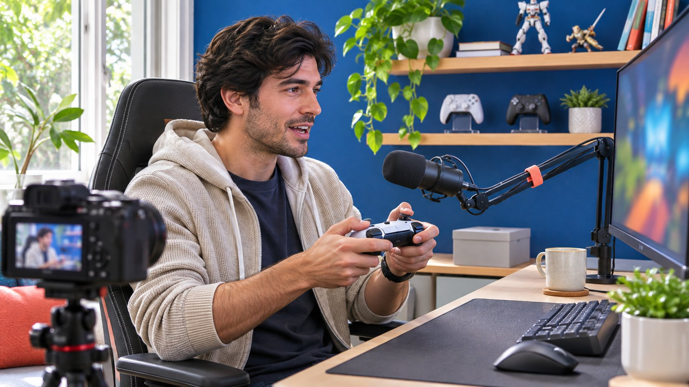
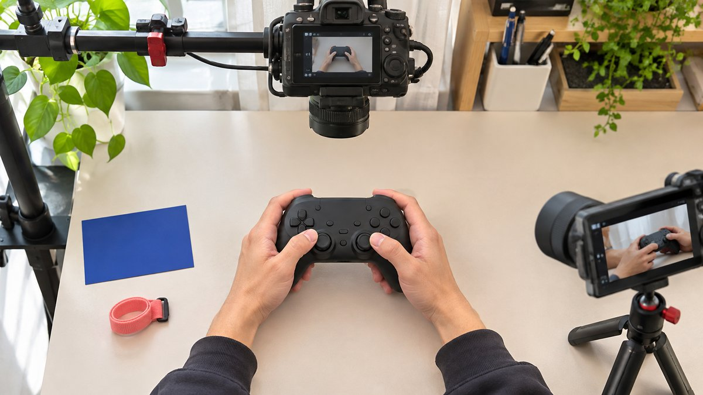

# How to Choose a Gaming Creator for a Product Demo

Status: local review draft; confirm the publication date before release.

Turn a vague gamer persona into a demonstration role that can be assessed from actual work.

A phrase such as gamers guy is a starting label, not a casting brief. A product brand should define the gaming task, platform, audience question and demonstration it needs. Review recent complete work to see whether a creator can explain the task while showing what actually happens. Then verify appropriate audience evidence, sponsorship treatment and asset rights. A paid demonstration does not purchase competitive skill, a favorable opinion or technical certification. Commission a pilot with visible steps and acceptance criteria. That lets the selection depend on the product, audience and explanation rather than a generic gamer identity or a large public count.

## Rewrite the persona as a demonstration task

Start with the situation in which a viewer needs the product. Controllers, headsets, desk accessories and games require different evidence. A remapping demonstration calls for someone who can explain settings and show the resulting operation. Desk organization may not require competitive expertise. State an action and visible result instead of making a male gamer label the entire selection rule. Gender is not evidence of explanation skill, technical scope or audience suitability.

The brief needs a platform, game category, product model, audience question and format. For example, ask for a demonstration of saving two button profiles for a particular controller on PC. That assignment is easier to assess and quote than a request for someone who knows gaming. Judge work against the task. Popularity, appearance and expensive equipment do not establish that a creator can explain a setup. Define the capability first, then decide whether the purchase includes publication or production only.

## Review complete demonstrations rather than highlights

Choose a recent complete demonstration, a piece with a commercial relationship and a segment where the creator responds to questions. Check whether they explain prerequisites, show the action, handle failure and separate personal experience from a general conclusion. A highlight edit can establish pacing without showing an ability to explain a complicated setting. An apparently seamless result may also require clarification about the test conditions.

Record the URL, timecode and relevance to the brief. If a clip shows the menu path but not the resulting operation, ask the paid pilot to supply that missing frame. Avoid requiring a complete unpaid commercial production as a screening exercise. Use public work first, then purchase a bounded test when needed. Keep the reasoning in the [creator shortlist workflow](https://www.quickkol.com/blog/creator-shortlist-workflow/#answer) so a second buyer can understand the choice and identify facts still needing the product team’s confirmation. The evidence should support a specific role rather than a general impression of expertise.

Record the operation and hand movement clearly, then check whether they support the commissioned demonstration.

## Check audience relevance to the product platform

Do not infer platform fit from a channel name. Review whether recent work concerns PC, console or mobile use, and inspect the questions people ask about it. A large mobile-settings audience may be a poor fit for hardware supporting a different platform. Check language and geography against the service territory rather than the creator’s nationality. Explain shipping limits before discussing campaign volume.

[YouTube’s audience reporting guide](https://support.google.com/youtube/answer/9314416?hl=en) describes available reporting and notes that some data is limited. Ask for relevant windows and fields through the creator’s actual permissions, retaining unknowns rather than bypassing privacy restrictions. Channel-level watch geography is not the geography of purchasers from one sponsored video. Use public work for initial selection and request additional evidence only when the commercial decision needs it. For production-only work, equipment competence and explanation may matter more than account distribution. The evidence standard should follow what the buyer is actually commissioning.

## Separate an observable demo from a technical claim

Ask product staff for the conditions under which each proposed benefit can be shown. A creator can demonstrate pairing, switching or wearing an item. One recording usually cannot establish a universal latency, durability or win-rate claim. If the brand wants a technical number, verify its method, unit, model and source before deciding whether it belongs in the content. A comfortable personal experience should not become a general promise of better competitive performance.

Use a storyboard with observation, conditions and permitted wording. If the footage shows a profile saved successfully, say that the setup worked in the demonstrated conditions. Keep a personal assessment within its subjective scope. If the result differs, check the model, firmware and steps, then revise the claim where necessary. Removing a failed take does not establish an otherwise unsupported benefit. Preserve the conditions and approved language for later users so an advertising edit cannot expand a sentence beyond its evidence.

## Review footage rights and sponsorship separately

Game footage, music, creator recordings and product materials may have different rights holders. [YouTube’s copyright guide](https://support.google.com/youtube/answer/2797466?hl=en) provides basic context, but the buyer still needs to check the particular publisher’s terms and commercial-use conditions. A creator’s ability to publish ordinary gameplay does not automatically grant a brand advertising rights. List original publication, reposting, paid use, editing, territory and duration separately, then seek approval from the party with authority.

[YouTube’s paid promotion guide](https://support.google.com/youtube/answer/154235?hl=en) explains its platform treatment of commercial relationships. For U.S.-relevant endorsements, also consider the [FTC’s influencer disclosure guide](https://www.ftc.gov/system/files/documents/plain-language/1001a-influencer-guide-508_1.pdf) and other applicable requirements. Review platform labeling alongside appropriate spoken or visible disclosure. A discount code alone should not carry the whole explanation. Accept the relationship disclosure separately from the honest experience. The brand can require an accurate connection while respecting the creator’s actual assessment. Rights, disclosure and product judgment solve different questions and should each have a named approval.

## Test the collaboration with a bounded pilot

Suppose a brand promotes a controller that can store two profiles. Purchase a short pilot showing the model, setup and actual operation after switching. Product staff provide applicable conditions. The creator decides how to explain them to the audience, and production preserves footage that can be reviewed. Avoid bundling a live stream, edited short, several publications and long-term advertising rights into the same small test. Otherwise a price difference becomes difficult to explain.

At acceptance, clear footage with little relevant account distribution may justify production only. A creator strong at live questions but less suited to a polished short may fit a timed live explanation instead. If the footage cannot establish the main benefit, repair the technical setup or storyboard before expanding. The pilot reduces uncertainty about a particular collaboration. It does not guarantee that every user will obtain the same result. Give each failed acceptance item and proposed next step to the person able to address it.

## Negotiate around the role being purchased

Separate production, publication, live questions, revision rounds and usage into quotable items. If the brand only needs an instructional asset, a subscriber count should not automatically turn the purchase into a full sponsored placement. Equally, willingness to produce does not imply permission for long-term advertising under the creator’s name. Use the [creator rates and usage rights framework](https://www.quickkol.com/blog/creator-rates-usage-rights/#answer) to define the scope and limits of technical review.

Compare quotes for equivalent tasks. An edited video and a live explanation should not be ranked solely by a viewing price. First decide which format answers the audience question, then compare total fees and conditions. Include foreseeable disruptions such as an incorrect sample, a delayed service release or a game update affecting the demonstration. Actual treatment of those events belongs in the agreement. An editorial suggestion cannot determine what either party has promised. A clear commercial structure makes the later acceptance discussion considerably more specific.

## Return the findings to the next demo brief

Keep the live URL, actual model, approved claims, disclosure, license and observation dates together. Begin the recap with whether the audience could understand the operation, then review available visits, inquiries or sales evidence. A lively discussion does not necessarily show correct product understanding. Total views do not establish that people watched the crucial step. When segment data is absent, explain that limit through the visible content and relevant questions instead of inventing a precise sponsor audience.

If pairing questions recur, add failure conditions to the next explanation. If viewers understand setup but miss compatibility, improve the opening prerequisites. Renewal should return to the role the creator can reliably perform. Gaming creators need not all satisfy the same assignment, and one unsuitable piece need not invalidate every capability. Use the evidence to support the next specific purchase. That is how a vague search label becomes a practical creator partnership rather than a demographic stereotype.

## Interpret two pilots as different creator roles

Suppose creator A records a clear profile-switching demonstration but rarely answers audience questions. Creator B handles detailed live questions well but supplies no clean edited asset suitable for the intended advertising use. The buyer need not declare one overall winner. It could purchase production from A and a defined question session from B. Verify rights, publication and reporting separately. A’s license does not apply to B, and B’s live audience cannot be assigned to A.

Coordinate the sample and approved facts across those roles. Both should use the applicable model and verified conditions while keeping their own expression. If the budget supports only one person, decide whether the priority is a clearer explanation or suitable distribution, then narrow the assignment. The pilot should inform the next purchase rather than permanently rank people. Give procurement the role, supporting evidence and remaining gaps. That makes it possible to explain why money went to different tasks and which steps need retesting after a product update. Keep coordination time in the quoted scope, because combining two strong specialists still requires someone to make their deliverables work together.

## Gaming demonstration acceptance objects

| Object | Visible evidence | Owner |
| --- | --- | --- |
| Platform and model | Matches the actual sample | Product team |
| Demonstration skill | Complete steps and observable result | Production and creator |
| Audience fit | Relevant work and scoped reporting | Partnership lead |
| Commercial use | Disclosure and actual permissions | Brand and rights holder |

The hypothetical pilot is not a technical test of a named product or a performance forecast.

## Gaming creator pilot checklist

Compare both candidates and quotes against the same demonstration task.

- [ ] Replace the persona label with a platform, question and action.
- [ ] Check explanation and operation in complete work.
- [ ] Separate personal experience, technical claims and permissions.
- [ ] Accept production, publication, questions and usage within their own scopes.

## Research date and limitations

Sources reviewed November 11, 2026. Methods, tables and decision rules are editorial recommendations. Hypothetical examples are not actual client results or industry benchmarks. Source geography and periods are specified where relevant. This draft is in independent local review; confirm its publication date before release.

## Start creator research with a clear task

Use QuickKOL to interpret a brief, discover relevant creators and research their work and contact routes. Verify data, commercial terms and outcomes at their source.

[Explore QuickKOL](https://www.quickkol.com/#capabilities)

## Sources

- [YouTube’s audience reporting guide](https://support.google.com/youtube/answer/9314416?hl=en)
- [YouTube’s copyright guide](https://support.google.com/youtube/answer/2797466?hl=en)
- [YouTube’s paid promotion guide](https://support.google.com/youtube/answer/154235?hl=en)
- [the FTC’s influencer disclosure guide](https://www.ftc.gov/system/files/documents/plain-language/1001a-influencer-guide-508_1.pdf)
