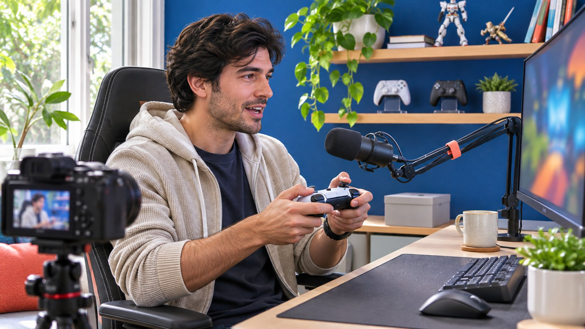
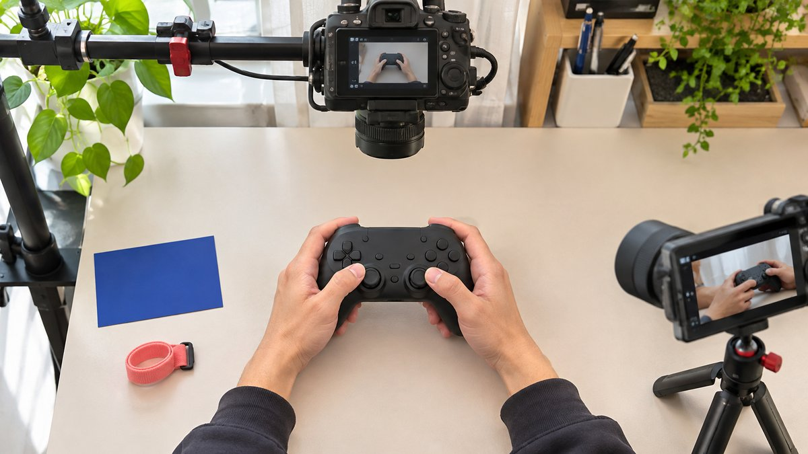

# 如何找到适合产品演示的游戏创作者

状态：本地审阅稿；正式发布日期待确认。

把模糊的游戏达人画像，改成可以用作品验证的演示角色与合作条件。

gamers guy 这样的搜索标签不足以决定合作对象。品牌应把它改成具体任务，例如让一位擅长控制器教学的成年创作者，向使用相应平台的观众展示某项设置。先看近期完整作品、实际讲解与操作，再核对受众证据、赞助披露和素材权限。购买演示不等于购买竞技成绩或技术认证。试点要约定能看见的步骤与可验收证据，让最终选择依赖产品与表达契合度。

## 把画像标签写成一个演示任务

先说明观众在什么情况下需要产品。控制器、耳麦、桌面配件与游戏本体需要不同证明。品牌想演示按键重映射，就找能解释设置与实际操作的人；想介绍桌面收纳，就未必需要竞技高手。把任务写成一个动作及其可见结果，避免让「男性游戏达人」成为唯一筛选条件。性别标签也不能替代对表达、专业范围与目标受众的判断。

Brief 至少说明平台、游戏类型、产品型号、待回答的问题和交付形式。比如「用 PC 上的实际操作展示这个型号如何保存两套按键配置」。这句话比「找一个懂游戏的男人」更容易核对，也让报价具备一致范围。候选作品的判断应对应任务。人气、外观和设备昂贵都不直接证明他能把设置讲清。先确定需要哪种能力，再决定是否需要账号发布或只采购制作。

## 看完整操作，不只看高光片段

从近期作品选一条完整演示、一条有商业关系的内容和一段实时回应问题的片段。分别检查创作者能否说明前提、展示操作、解释失败，以及把个人体验与通用结论分开。精彩剪辑能证明节奏与选材，未必能证明其会解释复杂设置。剪辑中看似连续的效果，也可能需要补问实际测试条件。提出具体问题比给出笼统「不专业」评价更有效。

记录作品 URL、时间点和与 Brief 的关系。例如某段清楚展示菜单路径，却没有拍到操作后的结果，那么下一步是要求试点补这一帧。不要要求候选人免费制作完整商业视频来证明能力。可以先看公开作品，再按明确范围采购短测试。研究人员用[候选名单工作流](https://www.quickkol.com/zh/blog/creator-shortlist-workflow/#answer)保存依据，让另一个采购同事能理解为什么选中这位创作者，以及尚需由产品团队核实什么。

将实际操作与手部动作分别拍清，再核对它们是否支持约定的演示。

## 确认观众与产品平台有交集

平台与游戏内容不能仅靠频道名称判断。看近期作品涉及 PC、主机还是移动端，以及相应观众的问题。面向手机设置的创作者，即使粉丝多，也未必适合推广仅支持另一平台的设备。地域与语言也应根据目标服务范围核对，不能从创作者国籍推断观众所在地。若品牌只寄送某些地区，先说明限制再谈活动量。

[YouTube 的受众报表说明](https://support.google.com/youtube/answer/9314416?hl=en)列出可用受众信息并提示部分数据可能受限。让候选人按实际权限提供适用窗口与字段，保留未知，不要要求绕过隐私限制。频道级观看地域也不等同于某条赞助视频的购买者地域。用公开内容作初步筛选，只有商业决定确实需要时，再请求相应证据。对制作型合作，设备和讲解能力可能比账号分发更重要，采购标准也应随购买内容调整。

## 把产品演示与技术断言分开

让产品团队为每个卖点提供可以展示的条件。创作者可以证明自己如何配对、切换或佩戴，但单次录制通常不能支持全面的延迟、耐用度或胜率结论。若品牌希望使用具体技术数字，应核对测试方法、单位、适用型号和来源，再决定是否适合放进达人内容。不要把个人觉得顺手改写成普遍提升竞技能力。

分镜可以列观察、条件和允许表达三列。镜头展示按钮配置保存成功，旁白就说明本次设置完成；镜头是个人使用感受，保留主观范围。拍摄出现不同结果时，先核对型号、固件与步骤，必要时修改承诺。删掉失败镜头也不能让原本不成立的卖点变成事实。对未来使用的素材，保留测试环境与批准表达，避免广告团队截取一句话后扩大含义。

## 审核游戏画面与赞助关系

游戏画面、音乐、创作者原片和产品素材可能分别由不同权利人控制。[YouTube 的版权说明](https://support.google.com/youtube/answer/2797466?hl=en)提供版权基础信息，品牌仍应对具体游戏发行商的内容使用条款及商业用途要求进行核对。创作者能发布日常游戏内容，不自动代表品牌可以买下片段作广告。采购时列明原账号发布、品牌转载、付费投放、剪辑、地区和期限，并让有权授权的人确认。

[YouTube 的付费推广说明](https://support.google.com/youtube/answer/154235?hl=en)解释平台的推广标记。针对美国消费者的推荐，还应考虑 [FTC 的达人披露指南](https://www.ftc.gov/system/files/documents/plain-language/1001a-influencer-guide-508_1.pdf)等适用要求。平台标记与清楚的口播或文字说明需要按场景一并审阅。不要让屏幕上的折扣码成为唯一的关系说明。披露与内容体验分开验收，品牌可以要求准确展示合作关系，也要让创作者保留真实评价。使用权、披露和对产品的判断，不能互相替代。

## 用小试拍检验合作分工

假设品牌推广一款可以保存两套配置的控制器。先采购一段短演示，要求看见产品型号、设置步骤和切换后的实际动作。品牌提供适用条件，创作者决定如何向自己的观众解释，制作方保留能够复核的镜头。不要在试点里同时要求直播、短视频、跨平台发布和长期广告许可，否则无法知道报价差异来自何处。

验收时，若画面清楚但对方近期没有相关发布记录，品牌可以考虑只买制作。若对方擅长实时问答，却不适合精修短片，可能改买有明确时段的直播讲解。若结果无法证明主要卖点，先修正技术或分镜，再决定是否扩大。试点是缩小不确定性的一次采购，不是要求创作者保证所有用户都获得同样结果。把未通过项目和下一步留给相应负责人。

## 按实际购买的角色谈费用

先把制作、发布、问答、追加修改和使用权分成可报价的项目。品牌如果只需要设备说明素材，就不应因频道订阅量自动按完整赞助发布买单。相反，创作者愿意卖制作，不代表愿意让品牌借其名字做长期广告。用[达人报价与使用权框架](https://www.quickkol.com/zh/blog/creator-rates-usage-rights/#answer)写清范围，技术审阅轮次和允许修改的内容也要明确。

报价比较应使用同一任务。A 提供一条精修视频，B 提供一场实时演示，两者不能只按观看单价判断。先看哪种形式更能解决观众问题，再比较包括人员与素材条件的总费用。失败预案也要进入协商，比如样品型号不对、服务上线延期或游戏更新影响演示。费用如何处理依实际合同确认，文章中的编辑建议不能替代双方真实约定。

## 让结果回到下一份演示 Brief

交付清单保存作品 URL、实际型号、批准卖点、披露、许可和观察窗口。复盘先看观众是否理解操作，再看适用的访问、咨询或销售资料。热门讨论不一定证明产品被正确理解，观看总数也不说明用户看到了关键步骤。缺少片段级数据时，用可见内容与相关问题解释边界，不制造精确的赞助曝光人数。

下一轮若发现大量配对疑问，就把配对失败条件加入说明；若读者已懂设置但不知道兼容平台，就改进前提展示。选择续约对象时，回到创作者能稳定完成的角色。品牌不必把所有游戏创作者塞进同一个标准，也不必因为一条作品不合适就否定其全部能力。让证据支持下一次具体采购，才使模糊搜索标签最终变成有用的达人合作。

## 用两个角色解释不同的试点结果

假设 A 的录制清楚展示两套设置切换，但很少回答观众提问；B 的直播回应具体，却没有适合后续广告的干净成片。品牌不必选一个综合冠军，可以把制作交给 A，把约定时段的问答交给 B。分别确认权利、发布和报告条件，不能把 A 的素材许可套给 B，也不能把 B 的直播观众归给 A。

这项分工需要协调产品样品与说法。两人应使用同一适用型号和经过核实的事实，但保留各自表达。若报价只支持单人，先决定核心缺口究竟是解释不清还是缺少适用分发，再缩小范围。试点结论对应下一份采购，而非给创作者永久排名。将角色、证据与未完成项交给采购同事，他就能解释为什么预算投向不同工作，也能在产品更新后知道需要重验哪些步骤。

## 游戏产品演示的验收对象

| 对象 | 要看见的证据 | 确认人 |
| --- | --- | --- |
| 平台与型号 | 与实际样品一致 | 产品团队 |
| 操作能力 | 完整步骤与可见结果 | 制作与创作者 |
| 观众契合 | 相关作品和适用报表 | 合作负责人 |
| 商业使用 | 披露与实际许可 | 品牌及权利人 |

试点案例为假设，不是某款产品的技术测试或增长预测。

## 游戏创作者试点清单

选人和报价都按同一演示任务比较。

- [ ] 把玩家标签改成平台、问题和动作。
- [ ] 用完整作品核对讲解与实际操作。
- [ ] 将个人体验、技术结论与许可分开。
- [ ] 按制作、发布、问答与使用范围验收。

## 研究日期与使用边界

资料核验于 2026 年 11 月 11 日。文中方法、表格和决策规则为编辑建议，标为假设的示例不是实际客户结果或行业基准。外部资料的适用地区与时期按各段说明；本稿处于独立本地审阅阶段，正式发布日期待确认。

## 用清楚的任务开始达人研究

用 QuickKOL 理解 Brief、发现相关达人并研究作品与联系路径；数据、合作条件和结果仍需核验。

[了解 QuickKOL](https://www.quickkol.com/#capabilities)

## 来源

- [YouTube 的受众报表说明](https://support.google.com/youtube/answer/9314416?hl=en)
- [YouTube 的版权说明](https://support.google.com/youtube/answer/2797466?hl=en)
- [YouTube 的付费推广说明](https://support.google.com/youtube/answer/154235?hl=en)
- [FTC 的达人披露指南](https://www.ftc.gov/system/files/documents/plain-language/1001a-influencer-guide-508_1.pdf)
