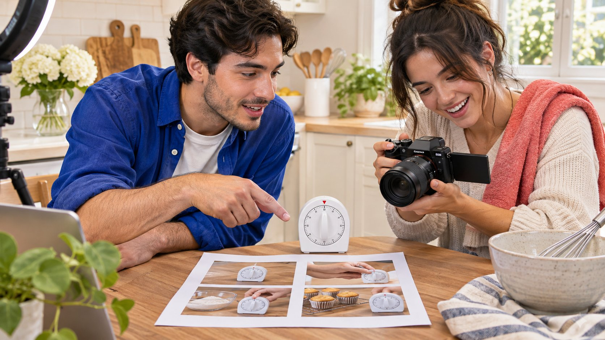

# 把免费点赞要求改成可执行的达人 Brief

状态：本地审阅稿；正式发布日期待确认。

把免费点赞目标改写成创作者能完成、品牌能验收、读者能理解的真实内容任务。

如果团队提出 get free Instagram likes，先问它真正想解决什么：作品没人看、产品解释不清，还是需要内部汇报数字。把目标改成观众问题、具体演示和可以验收的交付，不采购虚假互动，也不要求创作者保证不可控的点赞数。用真实自愿的互动作为观察之一，并区分制作、分发和商业结果。本文是品牌教育与 Brief 改写方法，不推荐刷量服务。

## 先听清楚点赞要求背后的问题

品牌同事可能用点赞表达被看见、被喜欢或有成交，但这些不是同一目标。请他说明哪项业务决定需要改变。如果担心产品使用误解，就需要更清楚的演示；如果担心分发不足，就讨论相关受众与适当渠道。先诊断再给创作者任务，不把所有问题都转化为点赞数量。

用[达人 Brief](https://www.quickkol.com/zh/blog/write-a-useful-campaign-brief/#answer) 写出一句观众需要理解或完成的事，并保留品牌原问题。这样后续复盘能判断改写是否有效。不要直接把原目标换成另一个同样空泛的数字。能帮助读者理解一项操作的作品，具有可讨论的内容价值；一个没有来源的互动总数，不能单独证明它完成了任务。

## 解释为什么不采购人工制造的反应

[Meta 的虚假互动执法说明](https://about.fb.com/news/2019/04/preventing-inauthentic-behavior-on-instagram/)提供相关服务的历史背景。它不证明某个当前供应商或创作者的行为，但提醒品牌不能把购买反应当成观众理解。即使计数上涨，原来的产品、受众和内容问题也可能完全未变。

[FTC 的社媒虚假指标问答](https://www.ftc.gov/business-guidance/resources/consumer-reviews-testimonials-rule-questions-answers)在美国规则内讨论知情等条件，并区分真实自愿关注。不要把一切免费推广都说成违法，也不把政策用作恐吓创作者的工具。团队只需明确本次不采购虚假互动，预算用于真实制作与适当分发。把这个边界写进采购和 Brief，比事后怀疑每一条评论更有效。

## 把抽象目标改为一个观众问题

例如厨房计时器品牌不必要求大家点赞，而可以解释湿手操作时怎样看清剩余时间。先核对产品确实支持的场景，再邀请创作者设计真实演示。不要为了制作有趣内容，加入没有验证的防水或安全保证。问题需要具体，答案也要符合实物与适用条件。

观众问题可以来自适当汇总的客服、真实评论或产品资料，不需要复制个人信息。品牌确认事实，创作者提供表达方式。把题材与其已有作品联系起来，说明为什么适合这个人完成。这样的任务能让双方讨论镜头与判断依据，而不是互相猜测多少点赞才算满意。

## 把拍摄要求写成可观察的动作

Brief 可以写出展示对象、需要看清的动作、适用限制与必须保留的商业说明。审稿者能指出哪个镜头完成要求，而不只评价好不好看。保留创作者对开头、语气和节奏的建议空间，不要把真实体验改成未经使用的赞美词。

[FTC 的达人披露指南](https://www.ftc.gov/system/files/documents/plain-language/1001a-influencer-guide-508_1.pdf)为美国相关内容提供利益关系说明背景。披露应随最终作品检查，不在复制或重剪时丢失。平台标记、画面和文字需要结合实际安排核对。清楚的拍摄要求既减少无依据夸大，也让创作者知道哪些是事实边界、哪些是可以发挥的表达选择。

## 让读者邀请与内容本身相关

可以邀请读者提出仍不清楚的操作问题，或分享自己需要解决的场景。不要把点赞、关注或转发强行当成获得真实答案的条件。问题应自然衔接作品，不要求读者提供敏感信息，也不承诺回应每一条内容以换取互动。

品牌与创作者约定谁回答产品事实、谁处理订单或客服问题。回复真实问题需要时间，列入工作范围。评论多不一定代表内容成功，也可能表示解释不清。将问题主题与作品目的联系起来，比只统计总数更有助于下一轮制作。读者是沟通对象，不是为内部报表提供反应的原料。

## 按交付、观察与结果分别衡量

交付看批准版本是否完成，观察看读者是否出现适当观看与相关问题，商业结果看有定义的访问或订单。用[达人活动衡量框架](https://www.quickkol.com/zh/blog/creator-campaign-measurement/#answer)记录来源与窗口，不把互动自动改名为购买意愿。若没有适当归因，就如实说明可观察到哪一步。

为制作设验收条件，为表现设学习问题，两者不要混成强迫保量。品牌可以讨论目标，但创作者不能保证每个读者的反应。多种指标也不能随意相加成一个综合回报。选择能支持下一步行动的少量证据，例如哪段解释需要修改、是否值得测试另一个开头、购买入口是否准确。

## 给内部负责人一段可直接使用的说明

可以这样说明：原要求是增加点赞，我们把它改成解释一个产品操作；本次验收包括真实演示、批准文字、披露和原帖；表现另看同窗观看及相关问题，不承诺免费反应数量。这段话让预算负责人知道目标没有消失，而是变得可执行。

若负责人仍坚持只看点赞，请他确认这个数字会影响什么决定，以及来源不明时怎样处理。不要替他保证百分百真实互动。将分歧写清，必要时缩小任务范围。创作者不应在拍摄完成后才得知内部另有未说出的保量标准。清楚沟通是 Brief 的一部分，而不是交付后的解释工作。

## 用假设验收单检查改写是否完整

假设原 Brief 写三天内得到一千免费点赞。改写后，创作者交付一条计时器真实使用演示和一版明确的合作说明；品牌确认产品事实与入口；发布后三天按原定窗口回收可用观察。没有把一千转成另一个隐性保证，也没有虚构成功结果。

如果上线后相关问题集中在按键功能，团队可决定增加解释或下一轮调整镜头。若没人提问，也不能据此断言没有人理解。每种观察都有范围。假设案例演示任务设计，不是实际客户数据。改写后的验收单应让另一位同事知道拍什么、谁确认、看什么以及何时需要升级处理。

## 让复盘回到真实的观众任务

复盘先看作品是否回答原问题，再看分发和可观察反应。保留初始目标与改写理由，避免报告又退回只排点赞。若学习需要额外制作，按新范围讨论，不把一次表现不足自动变成免费重拍。

Get free Instagram likes 可以被转化为一次有价值的团队教育：真实内容、恰当授权和透明衡量更有助于长期合作。品牌要找的是能完成具体任务的创作者，而不是承诺提供不可核实数字的人。用同样清楚的标准进入下一轮，才是本次 Brief 改写留下的可复用成果。再次采购前，也请创作者反馈哪些要求有用、哪些不清楚。制作经验能改善任务，不等于对观众反应作保证。把约定修改记录下来，不默认学习都应转为同费增量。

## 从点赞要求到内容任务

| 旧要求 | 改写 | 核验对象 |
| --- | --- | --- |
| 增加免费点赞 | 解释一个真实使用问题 | 作品中可观察的动作 |
| 反应越多越好 | 收集与产品相关的问题 | 主题与来源 |
| 保证数字 | 分开验收与表现学习 | 批准范围与观察窗口 |

任务示例是编辑建议，不构成效果保证。

## 教育向 Brief 改写清单

把原要求转成能完成的工作。

- [ ] 找到真实观众问题。
- [ ] 写出可见动作与事实边界。
- [ ] 保留披露、范围和回复责任。
- [ ] 分开交付验收与表现学习。

## 研究日期与使用边界

资料核验于 2026 年 11 月 11 日。文中方法、表格和决策规则为编辑建议，标为假设的示例不是实际客户结果或行业基准。外部资料的适用地区与时期按各段说明；本稿处于独立本地审阅阶段，正式发布日期待确认。

## 用清楚的任务开始达人研究

用 QuickKOL 理解 Brief、发现相关达人并研究作品与联系路径；数据、合作条件和结果仍需核验。

[了解 QuickKOL](https://www.quickkol.com/#capabilities)

## 来源

- [Meta 的虚假互动执法说明](https://about.fb.com/news/2019/04/preventing-inauthentic-behavior-on-instagram/)
- [FTC 的社媒虚假指标问答](https://www.ftc.gov/business-guidance/resources/consumer-reviews-testimonials-rule-questions-answers)
- [FTC 的达人披露指南](https://www.ftc.gov/system/files/documents/plain-language/1001a-influencer-guide-508_1.pdf)
