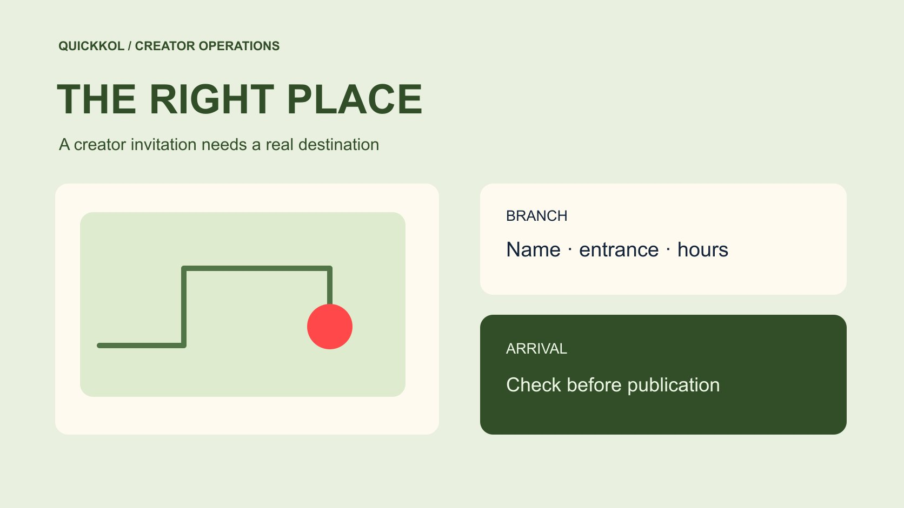

# Google Business Profile for Local Creator Campaigns

Status: local review draft; confirm the publication date before release.

Align the local listing, real arrival route and creator invitation before publication.

QuickKOL editorial graphic; not actual account metrics or a platform interface.

A Google Business Profile helps a potential visitor find and evaluate a local business after seeing creator content. Prepare it by verifying the exact branch, arrival information, service hours and approved offer before the creator publishes. Keep paid creator coverage separate from Google Maps reviews. Google prohibits incentives for reviews, including free goods or services. Treat direction requests, calls and website clicks as profile interactions with their own definitions. They do not establish store visits or creator-attributed sales. The practical goal is a reliable journey from the recommendation to the right place and a useful action the business can actually fulfill.

## Start with the branch the creator will promote

The search phrase google busines profile usually refers to Google Business Profile. For a local creator campaign, the first decision is which physical branch the recommendation concerns. Record the official branch name, public address, map destination, operating contact and service area. A chain needs particular care with similarly named branches, old premises, temporary locations and a head office that does not serve visitors.

Put the branch identity into the [local creator campaign brief](https://www.quickkol.com/blog/write-a-useful-campaign-brief/#answer). Ask the creator to describe the destination naturally, then have someone who works there check it. Verify parking, transit, floor and entrance details against actual conditions. A map pin can identify a building without explaining how to reach the service inside. If the location requires a reservation or has temporary limits, place those conditions near the invitation. The paid recommendation needs a destination that can fulfill it. A viewer should not have to resolve a branch mismatch after setting out.

## Verify hours and offer conditions for the release date

Give the readiness check a date. Opening arrangements during the creator’s preview may differ from those on release day. Have the location manager check normal hours, holiday changes, last service times, offer expiry and reservation capacity. Compare the listing, business website and approved captions. Opening hours and the last time someone can place an order may differ. An offer available only on Tuesdays should not sound unconditional in a recommendation released on Saturday.

Define what triggers a fresh check. If weather delays a creator’s visit by three days, who reconfirms stock, capacity and opening information? Tie the confirmation to the final asset version. Moving the calendar event without updating a caption can preserve an obsolete date. Keep the change with the publishing owner rather than across several private chats. Even without a special discount, verify that the ordinary experience is still available. Accurate timing is part of the promised local recommendation and therefore part of what the brand should accept.

## Separate creator coverage from Maps reviews

[Google’s fake engagement policy](https://support.google.com/business/answer/7400114?hl=en) prohibits incentivized reviews, including reviews exchanged for payment, discounts or free goods and services. A brand may commission appropriately disclosed creator content, but a compensated Google Maps review should not become another item on the same delivery list. Do not make a benefit conditional on a five-star review. An actual visit does not remove the platform’s restriction on incentives.

Name the purchased platform, production and publication in the brief. If an agency template requires a Maps review screenshot, remove that requirement and have the owner check the review rules. A business can seek genuine feedback without incentives while following the current policy. Handle negative reviews through ordinary support and applicable reporting routes. Do not mobilize a creator’s audience against another business. A removed review is not evidence that the creator fabricated an experience. The reason for platform action needs its own documentation and should remain separate from assessment of the commissioned content.

## Use the creator’s visit to improve arrival information

A preview visit can reveal where a first-time customer becomes confused. Ask the creator to follow the actual arrival route and note whether the entrance is identifiable, a reservation needs to be mentioned and the menu or service conditions are easy to find. Resolve those information gaps before asking for the explanation that will best suit the audience. For accessibility, allergens or service-specific conditions, obtain confirmation from the responsible person. A camera view alone cannot establish them.

Use the [local experience delivery checklist](https://www.quickkol.com/blog/creator-campaign-measurement/#answer) to name evidence that matters, such as the recognizable exterior, reservation route and product actually demonstrated. Arrange filming permission and the appropriate treatment of bystanders and employees. Images visible on a business listing are not automatically licensed for a paid recut. Assign a location owner to verify arrival corrections and update the relevant channels. That turns the creator’s feedback into a durable improvement while preserving the truth of what they experienced. Editorial approval should not erase practical limitations for the sake of tidy copy.

## Read profile performance within its stated scope

[Google’s Business Profile performance guide](https://support.google.com/business/answer/9918094?hl=en) explains that relevant profile activity can include organic search and Google Ads, and that available metrics vary by business. Direction requests describe a navigation-related action. Calls measure clicks on the call button. Website clicks have their own definition. These events cannot simply be relabeled visits, connected calls or purchases. Start the recap with the profile, reporting dates, field definition and other promotion during the period.

Suppose direction requests rise from 60 to 90 during the week a creator publishes. The observed increase is 30 requests. It does not establish 30 incremental customers from that creator. Weather, hours, advertising and other recommendations could contribute. If the merchant has bookings or voluntarily supplied source information, report them separately with overlap and omissions. Do not add different channel events into one customer total. Missing attribution can coexist with a useful operational finding about whether the destination information and reception process worked.

## Create a readiness gate that can pause publication

The publishing owner needs a specific reason to pause an asset, not a checklist that is always marked complete. Required conditions might include the correct branch, usable destination, valid offer period, appropriate disclosure and service capacity. Keep optional presentation improvements separate. An incorrect address or an unavailable service should be fixed before release. If the campaign team lacks profile access, the location owner can make the update. A creator does not need broad business administration rights to flag an address error.

[Google’s Business Profile restrictions guide](https://support.google.com/business/answer/14114287?hl=en) describes potential consequences of fake engagement. Readiness therefore includes checking the agency plan for review incentives, alongside the quality of the visual assets. Record who approved which version and when. Reconfirm affected conditions after a postponement or operational change. This gives the creator usable information and lets procurement distinguish finished creative from a destination that is not yet ready to receive the audience.

## Turn the recap into the next local partnership brief

Keep the final publication URL, business listing, verification date, offer version and location owner in the handoff. Summarize audience questions anonymously under arrival, booking, product and support. Repeated confusion about the entrance suggests a clearer arrival shot. Repeated questions about an offer may call for simpler conditions. Assess whether the creator accurately explained an experience the business could deliver before judging local suitability from total engagement.

Set the next purchase scope around the work that needs improvement. The brand may need a creator who explains access well, or it may need to repair a booking destination before commissioning more content. Put that reason into candidate research instead of asking generally for a larger following. Listing readiness, the creator’s explanation and reception at the business have different owners. A useful recap assigns each fix accordingly and preserves genuine feedback that can shape a better invitation next time.

## Rehearse a pause for an incorrect entrance

Suppose a studio commissions a local creator to introduce a trial class. The footage shows the shopping center’s main door, but students must use a side entrance and check in. The address and map pin can both be correct while the arrival instruction remains incomplete. Have on-site staff walk the route and confirm what can be shared. Then decide whether an extra short shot or a caption change resolves the problem. Completed filming is not a reason to leave first-time visitors to discover the route after publication.

If temporary access affects evening classes only, describe that period rather than imposing an all-day restriction. Retain the confirmer, revised version and dates. The example does not require blaming the creator. It shows how staff familiar with the venue and first-time visitors possess different information. The business supplies fulfillable operational facts. The creator communicates them within the approved scope. Release the asset on the agreed or revised schedule after correction. This pause has a concrete cause and remedy, making additional work easier to explain and price fairly.

## Keep other location changes in a period comparison

If the business compares periods, choose reasonably similar calendar windows and record closures, discounts, advertising, menu changes and nearby events. Avoid selecting the weakest week merely to create a favorable baseline. Do not assign all higher sales to a creator who happened to publish at the same time. List profile interactions, bookings and trading outcomes with their own sources, noting which can be read within matched dates. Where capacity is limited, flat booking volume may reflect no available appointments.

An observational recap can provide clues without estimating incrementality. A stronger effectiveness question needs an appropriate comparison design and permissions, planned separately rather than assembled afterward from incompatible fields. For the current purchase, the buyer can still establish whether the creator directed people accurately, published on time and surfaced useful information gaps. Name the observation and the person responsible for the next change. The recap can then shape scheduling and candidate selection without pretending to possess complete attribution. Keeping the limitation visible also prevents a later buyer from treating an operational improvement as a measured sales lift.

## Evidence before a local campaign goes live

| Check | Evidence | Confirmation owner |
| --- | --- | --- |
| Branch identity | Name, address and real entrance | Location lead |
| Invitation | Dates, capacity and booking conditions | Business owner |
| Publication | Approved version and material connection | Brand and creator |
| Performance | Metric scope, dates and other promotion | Measurement lead |

Maps reviews follow their own platform rules and must not become incentivized deliverables.

## Arrival journey checklist

Have the location and publishing owners confirm these before releasing the final asset.

- [ ] Confirm the target branch and actual arrival route.
- [ ] Recheck hours and offer conditions for release day.
- [ ] Exclude incentivized Maps reviews from the delivery list.
- [ ] Record profile interactions, bookings and verified outcomes separately.

## Research date and limitations

Sources reviewed November 11, 2026. Methods, tables and decision rules are editorial recommendations. Hypothetical examples are not actual client results or industry benchmarks. Source geography and periods are specified where relevant. This draft is in independent local review; confirm its publication date before release.

## Start creator research with a clear task

Use QuickKOL to interpret a brief, discover relevant creators and research their work and contact routes. Verify data, commercial terms and outcomes at their source.

[Explore QuickKOL](https://www.quickkol.com/#capabilities)

## Sources

- [Google’s fake engagement policy](https://support.google.com/business/answer/7400114?hl=en)
- [Google’s Business Profile performance guide](https://support.google.com/business/answer/9918094?hl=en)
- [Google’s Business Profile restrictions guide](https://support.google.com/business/answer/14114287?hl=en)
