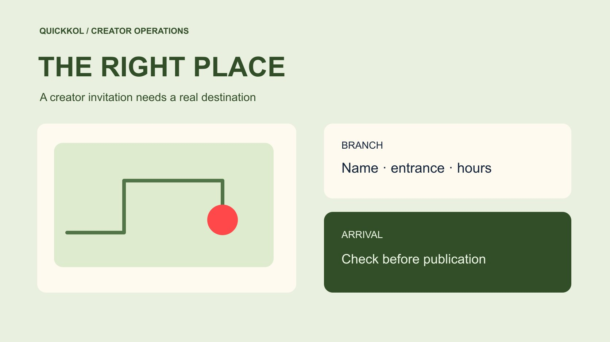

# Google Business Profile 如何承接本地达人推广

状态：本地审阅稿；正式发布日期待确认。

本地创作者发布前，先让门店资料、实际到访路线和活动邀请对得上。

QuickKOL 编辑图形；不呈现真实账号指标或平台界面。

Google Business Profile 是用户从本地达人内容走向门店时可能使用的信息入口。品牌应在发布前核对目标门店、名称、地图位置、营业安排、预约方式和活动条件，再让创作者按实际体验邀请到访。付费体验内容与 Google Maps 评价采用不同规则，不能用免费商品或报酬换取 Maps 评价。资料表现中的方向请求、电话点击和网站点击分别有各自口径，不能直接等同到店或归因销售。

## 从要推广的门店开始

搜索词 google busines profile 通常指 Google Business Profile。对本地达人营销而言，先做的不是选择一个增长技巧，而是找到这次合作指向的实际门店。记录分店名称、官方地址、地图链接、业务负责人和服务范围。连锁品牌尤其要检查同名地点、旧店、快闪场地和总部资料，防止达人拍了 A 店，却把观众送到 B 店。

把门店身份写进[本地达人合作的 Brief](https://www.quickkol.com/zh/blog/write-a-useful-campaign-brief/#answer)。让创作者在自己的语言里说明目的地，再由熟悉现场的人核对。确认停车、公共交通、楼层和实际入口时，以现场条件为依据。地图位置能帮助找到建筑物，未必能说明从哪个门进入。若门店暂时关闭或只接预约，把限制写在邀请附近。品牌购买的是一条可履行的到访建议，不能把正确抵达的责任全交给读者自行猜测。

## 按发布日验证营业与活动条件

给检查指定一个日期。创作者试访时的营业安排，可能在正式发布日发生变化。门店经理核对常规营业、假日安排、厨房或服务停止时间、活动有效期和预约容量。把网页、商家资料和已批准字幕中的关键信息对照，尤其注意开始营业与最后接单时间的差别。若活动只在周二适用，不能让周六上线的推荐听起来随时有效。

为延迟发布预设触发条件。例如创作者因天气顺延三天，谁重新确认库存、活动名额和营业？确认必须对应最终素材版本。只改排期但没改字幕，会保留过时的日期。将变更记录交给发布负责人，而不是散落在多个人的聊天中。即使没有临时优惠，也应确认常规体验仍可提供。达人合作的价值来自读者接触到的实际服务，正确的时间信息就是交付的一部分。

## 把付费创作与地图评价分开

[Google 的虚假互动政策](https://support.google.com/business/answer/7400114?hl=en)禁止用报酬、折扣或免费商品服务激励评价。品牌可以采购一条有适当披露的达人探店内容，但不应在同一任务里要求创作者用受激励的 Google Maps 评价完成交付。也不要把领取活动福利的条件写成给门店五星。即使对方确实到过店，真实体验也不能取消评价平台的激励限制。

修改 Brief 时明确买的是哪一平台的内容、哪项制作和哪次发布。若代理模板附带「地图好评截图」，把这项从验收中移除，并让负责人员确认评价规范。门店可以征求不带激励的真实反馈，仍须遵循当前政策。遇到不利评价，交由正常支持与申诉流程处理。不要请达人组织观众集中压低同行评分，也不要把评价被移除解释成达人造假；移除原因需要平台证据。

## 用实地观察改进创作者的表达

试访有一个可复用的价值，就是检验第一次到访的人会在哪里卡住。让创作者走一次实际路径，记录是否容易认出入口、是否需要向前台说明预约、菜单或服务条款在哪里可查。品牌先解决这些信息缺口，再让对方决定最适合观众的表达。对轮椅通行、过敏原或特定服务条件等需要准确说明的问题，找具备相应职责的人确认，不让创作者凭镜头推断。

在[本地体验的内容交付清单](https://www.quickkol.com/zh/blog/creator-campaign-measurement/#answer)里列出需要展示的证据，例如门口可辨识的外观、预约入口和实际演示的商品。注意获得拍摄许可，并处理其他顾客与员工的出镜范围。不要把商家资料里的照片当成可任意用于商业重剪的素材库。若创作者带回一条入口修正建议，安排门店负责人验证并更新相应渠道，让下一次推荐也能受益。内容审核应保留真实体验，不能为了统一文案而把现场限制抹掉。

## 按各自口径读取资料表现

[Google 商家资料表现说明](https://support.google.com/business/answer/9918094?hl=en)指出，报告包含自然搜索与 Google Ads 带来的相关互动，实际可用指标因业务而异。方向请求记录导航相关行为，电话指标记录通话按钮点击，网站点击也有独立定义。这些事件发生在不同环节，不能直接当成真实到访、接通通话或付款。活动复盘先写清资料、日期范围、指标定义和其他同期推广，再讨论变化可能来自什么。

假设门店本周方向请求从 60 增至 90，达人内容同周上线。报告可以写观察到增加 30 次请求，不能把它直接写成达人新增 30 名顾客。天气、营业变化、广告和其他口碑都可能参与。门店若有预约或自愿提供的来源信息，另列结果，并说明重叠与遗漏。不要把渠道事件相加成总客户人数。无法获得分渠道数据时，把归因保留为待核验，仍可判断入口资料是否完整、接待是否顺畅。

## 设一个上线前可暂停的验收关口

发布负责人需要能够依据具体缺口暂停，而不是只收到一张全部打勾的表。必须确认的项目可以包括正确分店、可用入口、活动有效期、必要披露和现场容量。可延后修复的装饰性问题另列。若地址错误或服务无法兑现，先修正再释放素材。暂时没有资料管理权限时，由门店所有者处理；不要为了更新一个活动地址就把整店管理员权限交给创作者。

[Google 商家资料限制说明](https://support.google.com/business/answer/14114287?hl=en)列出虚假互动可能导致的资料限制。风险检查因此不应只有照片好不好看，还要确认代理没有把评价奖励写进计划。记录谁批准、批准哪一版、在什么时点复核。活动延期、店面临时调整或领取规则变化后，重新确认受影响的项目。这样的关口能让达人及时获得可以发布的信息，也能让采购方区分作品已完成与实际服务尚未就绪。

## 将复盘变成下一次到店合作的输入

收尾时保留最终发布地址、门店资料链接、核验日期、活动版本和业务负责人。把观众问题按方向、预约、商品与售后分类，用匿名摘要反馈给创作者。若很多人走错入口，下次需要更清楚的到访镜头；若大量咨询优惠是否有效，下次应先简化活动条件。不要仅凭总互动评判达人是否适合本地合作，先看他是否准确解释了业务能够提供的体验。

后续采购按已完成的任务定范围。品牌也许需要继续找擅长路线说明的创作者，或者减少拍摄量、先修好预约入口。把这些理由写进候选研究，而不是笼统地要求更高粉丝量。地图资料承接、创作者表达与门店接待共同影响用户路径。各环节有独立负责人，复盘才能把可修复的问题交给正确的人，并保留对下一次合作有价值的真实反馈。

## 用错误入口演练一次暂停决定

假设一家工作室准备让本地创作者介绍试听课程。创作者拍到了商场正门，但学员需要从侧门进入并在前台签到。地址与地图位置都正确，实际到访说明仍然不完整。品牌应让现场人员走一遍路线，确认可公开的入口信息，再决定是否需要补一个短镜头或改字幕。不要因为已经拍摄完成就让用户上线后自行探索。

若临时门禁只影响晚间课程，信息要对应该时段，而不是把全天开放写成限制。确认人、修订版本和适用日期一并保留。用例不需要推断达人不认真，它说明熟悉场地的人和第一次来的读者掌握的信息不同。品牌负责提供可兑现的业务事实，创作者负责在批准范围内清楚呈现。入口修正完成后，再按原排期或新排期释放素材。这样的暂停条件具体、可修复，也能够公平地解释增加了什么工作。

## 比较活动期时保留其他门店变化

如果门店想比较活动前后表现，先选择相近日历结构的窗口，记录是否有休息日、折扣、广告、菜单变化或周边活动。不能只挑表现最低的一周作基线，也不能把总销售上涨全部归给同时上线的达人。资料互动、预约和营业结果分别列出来源，说明哪些可以在同一窗口读取。服务容量受限时，预约没增加也可能是没有可售时段。

一轮没有额外预算的观察可以提供相关线索，仍未必能测出增量。品牌若要作更强的效果判断，应另行规划适合的比较设计和数据权限，而不是事后把不同指标拼成因果。对于当前采购，仍可以确认达人是否准确指向门店、是否按时发布，以及观众问题是否揭示了信息缺口。把观察和下一步的责任写清，报告就能服务下一次排期与选人，而不必假装拥有完整归因。

## 本地合作上线前的证据

| 核对项 | 证据 | 负责确认 |
| --- | --- | --- |
| 门店身份 | 名称、地址与实际入口 | 门店负责人 |
| 活动邀请 | 有效日期、容量与预约条件 | 业务负责人 |
| 发布内容 | 批准版本与利益披露 | 品牌与创作者 |
| 表现数据 | 指标口径、窗口及同期推广 | 分析负责人 |

地图评价遵守独立的平台规则，不能成为受激励的交付项。

## 到访路径核对清单

在最终素材释放前由门店和发布负责人共同确认。

- [ ] 确认目标分店和实际进门路线。
- [ ] 按发布日期重查营业和活动条件。
- [ ] 从合作交付中排除受激励的地图评价。
- [ ] 分别记录资料互动、预约和可核验结果。

## 研究日期与使用边界

资料核验于 2026 年 11 月 11 日。文中方法、表格和决策规则为编辑建议，标为假设的示例不是实际客户结果或行业基准。外部资料的适用地区与时期按各段说明；本稿处于独立本地审阅阶段，正式发布日期待确认。

## 用清楚的任务开始达人研究

用 QuickKOL 理解 Brief、发现相关达人并研究作品与联系路径；数据、合作条件和结果仍需核验。

[了解 QuickKOL](https://www.quickkol.com/#capabilities)

## 来源

- [Google 的虚假互动政策](https://support.google.com/business/answer/7400114?hl=en)
- [Google 商家资料表现说明](https://support.google.com/business/answer/9918094?hl=en)
- [Google 商家资料限制说明](https://support.google.com/business/answer/14114287?hl=en)
