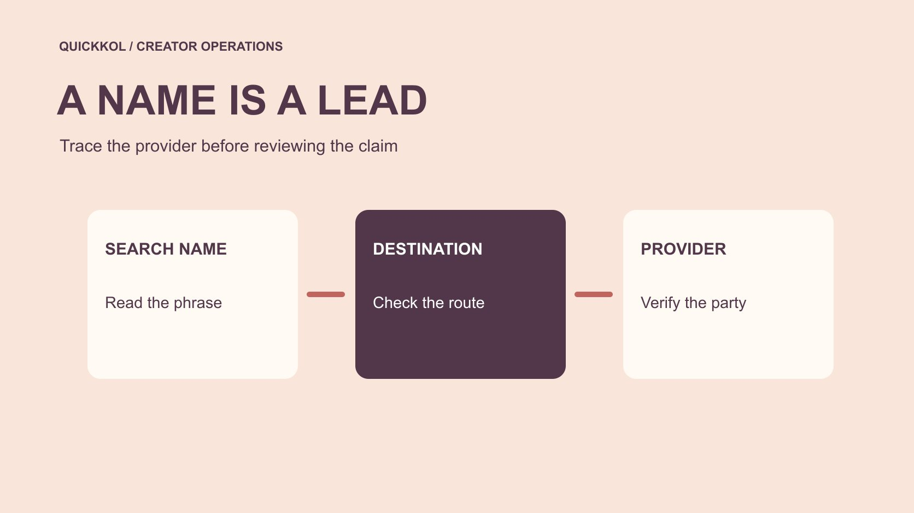

# Insta Follower.com: Verify the Offer Before Access

Status: local review draft; confirm the publication date before release.

Verify the search phrase, website, contracting party and account scope before involving an outside service.

QuickKOL editorial graphic; not actual account metrics or a platform interface.

Insta follower.com is an ambiguous search expression in the keyword brief, not a verified identification of a provider. The displayed name, actual destination, party making an offer and contracting entity need separate checks. A name referring to Instagram does not establish official status or a particular service mechanism. Before involving such an offer in a creator campaign, identify who would do what, which account access they need and what evidence could support their growth claim. The outcome should be a scoped approval, an evidence request or a declined connection. It should not be an unsupported allegation about a website or creator.

## Recover the four names hidden in a proposal

Separate four identifiers in the agency’s proposal: the displayed name, actual web destination, person initiating contact and entity responsible for the service. An email may use one familiar-looking phrase while its button redirects elsewhere. Do not assemble those fragments into a supplier identity without checking their relationship. Ask the proposer to explain each and show their authority to represent the service. A traceable legal entity can support an identity check without validating the service mechanism or its results.

Tie the offer to the purchasing task. If an agency says the site will improve a creator’s influence, ask whether that means public research, advertising, content production or operations on an account. Each requires different access and evidence. Work involving a creator’s account also needs that owner’s specific approval. If the provider remains unclear, continue the existing partnership conversation while keeping the additional service pending. Similar branding should not silently extend the original commercial assignment.

## Check the destination without enrolling in the offer

Start with public material rather than enrollment, uploading a creator roster or connecting a client account. Record the supplied link, destination domain that can be established, review date and source of the explanation. If a redirect cannot be checked safely, leave it unknown and request a clear official entry point. The reviewer does not need to submit real credentials, verification codes or payment information to decide that an access request lacks sufficient explanation.

A useful reply is to ask the proposer to confirm the displayed name, service destination, contracting entity, relationship between them and required operation. Keep the answer together rather than treating fragments from several chats as identity evidence. If the destination differs from the proposal, ask for the reason before inferring intent. Likewise, do not transfer a third-party review of one domain to another service with a similar name. The decision at this stage concerns whether the chain of identity evidence is complete enough to continue.

## Identify who receives authentication information

[Meta’s clone site security explanation](https://about.fb.com/news/2022/07/how-meta-safeguards-people-against-clone-sites/) discusses account risks when people supply credentials in response to free like or follower offers. Identify the actual recipient and action rather than judging the page by its appearance. Whatever the service is called, do not hand over secrets that substitute for sign-in. If a connection is necessary, have the owner inspect the recipient, scopes and revocation route. Permission for an agency to publish is not automatic approval for an unidentified service to operate following activity.

Create an access table naming the account, owner, task, necessary scope and end condition. Public research, reporting, publication and message management should not collapse into one marketing access label. If a supplier cannot explain a permission, leave it unapproved. A useful research service may not be suitable for account administration. Conversely, a proper authorization mechanism does not establish that the audience activity produced by the service is genuine or relevant to the brand.

## Ask what the growth promise actually describes

Terms such as real followers, organic growth and official channel need definitions and evidence. Ask where the count comes from, the observation dates, included activity and whether losses are reflected. A website screenshot is a provider assertion, not a substitute for an appropriate owner-held report. A follow occurring on the platform does not establish platform endorsement of the provider or a customer in the target region.

The [FTC’s fake indicator FAQ](https://www.ftc.gov/business-guidance/resources/consumer-reviews-testimonials-rule-questions-answers) distinguishes real people choosing to follow from manufactured indicators. Apply that distinction to behavior and origin rather than the professionalism of a name. If the mechanism cannot be verified, do not mark it confirmed genuine. When the creator can identify advertising or a public recommendation during the period, add the events for review. The brand’s job is to bound its commercial statements. It does not need to infer every follower’s identity or motive from an incomplete sample to make that decision.

## Align the vendor’s report with owner-held evidence

Match the account first, then dates, time zone and fields. The proposer may be showing gained follows while the buyer observes net change. A public snapshot can also differ from a cumulative report. Mark unavailable fields as missing instead of zero, and do not demand complete account control to verify one figure. Use the [creator metric definitions](https://www.quickkol.com/blog/creator-metric-definitions/#answer) to keep the terminology stable. A difference becomes interpretable only after the quantities are comparable.

Suppose a provider reports 800 follows during a week while the public snapshot rises by 620. The difference of 180 does not automatically demonstrate deception. Ask about losses, cutoffs and display rounding, then inspect available original records. If the supplier attributes the gap to platform removal, request evidence for that explanation too. Unexplained is often more accurate than selecting a convenient story. Finish by naming the figure usable for the budget recap and the one retained only as a provider’s claim.

## Give discrepancies a fair review process

Send the agency an evidence request tied to the specific account, period, field and source. Do not demand proof that every person is genuine, an assertion the review cannot reasonably establish. Set an owner and response date, and retain both the original proposal and revisions. A naming error needs a corrected handoff. An unidentified provider may require pausing access. A changed metric definition requires a revised conclusion. These are different issues and should not share one blacklist label.

Consider whether the creator chose the service at all. A connection added by a brand or agency should not automatically become the creator’s responsibility. Trace the approval and use record before applying a commercial remedy. Avoid unsupported attribution in a public report, and limit internal access to people with a review task. The buyer can decline a proposal that fails its evidence requirements while separately accepting completed content that can be verified independently. A fair process makes those decisions traceable.

## Protect information if the review reveals an incident

The [FTC’s business information protection guide](https://www.ftc.gov/system/files/documents/plain-language/pdf-0136_proteting-personal-information.pdf) recommends understanding held information, limiting retention and planning an incident response. If the review finds that a roster or account data already went to an unknown recipient, involve the people responsible for security and privacy. Provide the timeline, information categories and known recipient scope without copying raw customer data into another group. Restrict investigation material and establish what evidence should be retained.

For exposed authentication secrets, the account owner should use native security routes rather than an improvised recovery supplier found in search. The marketing coordinator pauses publication or reporting that depends on the service and identifies a fallback owner. Record access restoration, permission removal and validation of historical growth as separate work. A disconnected service does not restore the accuracy of earlier metrics. Equally, a risk signal does not establish actual misuse. Keep the incident conclusion within the facts that can be confirmed.

## Hand over a decision the next owner can execute

Record the four identifiers and their relationship, the exact service, approved scope, evidence status and decision owner. The result might allow public research only, require more information or decline any account connection. Name the accounts, duration and conditions that trigger another review. A new domain, broader permission request or changed mechanism should not inherit an old approval without inspection.

For example, the brand may establish that the agency only needs manual public-content research. That work can proceed while a follower service remains outside the scope. If the next task is to approach suitable creators, use the [creator shortlist workflow](https://www.quickkol.com/blog/creator-shortlist-workflow/#answer) to preserve work samples, relevance and public contact routes. Purchasing follows the task and evidence rather than a search phrase’s apparent popularity. The handoff should tell the next colleague what identity checks were completed, what work is allowed and which conditions still need actual confirmation.

## Trace responsibility through an agency referral

Suppose a brand receives a website screenshot forwarded by an agency. The agency treats the displayed name as the provider, while the creator receives only a shortened link. Ask the agency to establish the entity and scope, then let the account owner decide about authorization. Do not request the creator’s credentials to help the agency complete an identity check. If the agency was authorized to buy content only, account operations need their own scope decision.

Now suppose the evidence shows a public research service and the guaranteed growth claim came from an inaccurate summary. Correct both the proposal and any external statement instead of retaining the claim merely because identity is resolved. Conversely, a confirmed entity with an unexplained mechanism can pass one column while performance remains pending. Each column needs its own material and approver so the conclusion does not expand through successive handoffs. Preserve the original and revised versions and explain the correction to anyone relying on the earlier summary. This provides a fair record of the change and makes the next purchase decision easier to trace.

## Review identity, access and performance separately

| Question | Material needed | Decision |
| --- | --- | --- |
| Who provides it | Relationship between name, domain and entity | Whether procurement can continue |
| What access is needed | Account, task and minimum scope | Whether to allow that operation |
| What a number means | Source, field, window and limits | Whether it can be reported |
| What remains unresolved | Gap, owner and date | When to reassess |

A search expression or hyperlink cannot establish provider identity, performance or misconduct.

## External service identity review

Complete this before sending rosters, connecting accounts or relying on commercial claims.

- [ ] Identify the displayed name, destination, contact and entity.
- [ ] Review permissions against the actual task.
- [ ] Request comparable owner-held fields and windows.
- [ ] Hand over the approval scope and unresolved questions.

## Research date and limitations

Sources reviewed November 11, 2026. Methods, tables and decision rules are editorial recommendations. Hypothetical examples are not actual client results or industry benchmarks. Source geography and periods are specified where relevant. This draft is in independent local review; confirm its publication date before release.

## Start creator research with a clear task

Use QuickKOL to interpret a brief, discover relevant creators and research their work and contact routes. Verify data, commercial terms and outcomes at their source.

[Explore QuickKOL](https://www.quickkol.com/#capabilities)

## Sources

- [Meta’s clone site security explanation](https://about.fb.com/news/2022/07/how-meta-safeguards-people-against-clone-sites/)
- [the FTC’s fake indicator FAQ](https://www.ftc.gov/business-guidance/resources/consumer-reviews-testimonials-rule-questions-answers)
- [the FTC’s business information protection guide](https://www.ftc.gov/system/files/documents/plain-language/pdf-0136_proteting-personal-information.pdf)
