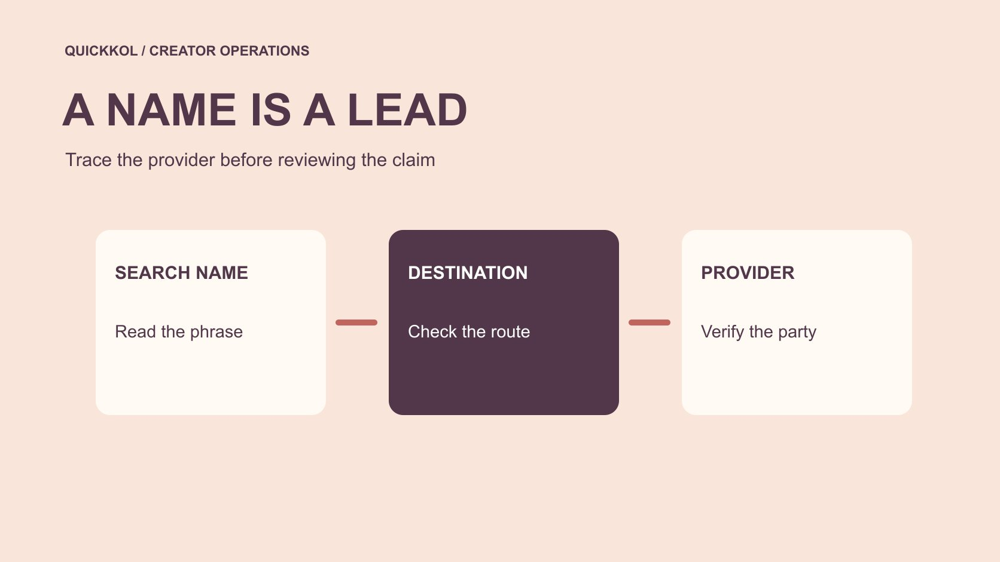

# Insta follower.com 搜索结果该核验什么

状态：本地审阅稿；正式发布日期待确认。

把搜索词、网站身份、合同主体和账号权限分别核对，再决定是否让外部服务参与达人活动。

QuickKOL 编辑图形；不呈现真实账号指标或平台界面。

Insta follower.com 在这份关键词清单中是一个带链接的搜索表达，不能据此认定服务主体、授权状态或任何违规行为。品牌应把文字名称、实际目标地址、提案主体和合同服务分别核对。尤其不能因为它提到 Instagram 就推断为官方服务。先确认谁提供什么，再检查访问权限与增长证据。教育向复核的结论应是准许某项任务、补充证据或拒绝接入，而不是给未经核实的网站或创作者贴上欺诈标签。

## 先还原提案里的四个不同名称

从代理提供的资料中分出四项，展示名称、实际网址、发起联系的人，以及承担服务的公司或个人。一封邮件可能只写一个相似名字，按钮却经过另一个域名跳转。不要把这些信息拼成一个看起来完整的供应商身份。先让提案人说明彼此关系，并提供其有权代表服务方的依据。公司注册资料即便可查，也只能支持主体相关信息，不能证明操作合规或效果。

把请求与采购任务绑定。若代理说用该网站「提高达人账号的影响力」，要求说明是公开研究、广告、内容服务还是账号操作。每一类需要不同权限和证据。对涉及创作者账号的操作，还要取得账号所有者的具体同意。没有清晰主体时，品牌可以继续沟通已知的合作人，但把新增服务留作待核验。一个相似名称不应悄悄扩大原合同的服务范围。

## 核对地址不等于试用服务

核验从公开资料开始，而不是创建账号、上传创作者名单或连接客户后台。记录提供给你的原始链接、可确认的目标域名、核验日期和说明来源。若无法安全确认跳转，保留未知并要求对方给出清楚的正式入口。不要为了证明网站是否有风险，输入真实密码、验证码或付款资料。品牌不需要实际暴露账号，才能拒绝一个信息不足的访问请求。

对名称歧义，可以这样回复：「请确认提案中的展示名称、实际服务网址、合同主体及其关系，并说明本项目需要的操作。」让对方在同一文件中给出答案，避免使用多个聊天片段作身份依据。若发现链接与提案不同，先要求解释，不能直接断言恶意。也不要把某一个域名上的第三方评价扩展到名字相似的另一个服务。此处判断的是证据链是否完整。

## 判断谁收到了登录资料

[Meta 的仿冒网站风险说明](https://about.fb.com/news/2022/07/how-meta-safeguards-people-against-clone-sites/)涉及用户向免费赞或粉丝邀约交出凭证后产生的账号风险。检查人员应识别具体接收方与动作，不凭页面外观判断。无论网站如何命名，都不交出可代替登录的秘密。若需要第三方连接，让账号所有者查看实际授权接收方、权限和撤销入口。商家允许代理发布，不能自动解释成允许未知服务批量关注。

建立一张访问表，分别写账号、所有者、任务、必要权限和结束方式。公开资料检索、报表读取、发布与消息管理不能混成一个「营销访问」。供应商如果不能解释为何需要某项能力，就保留该权限未批准。一个合适的研究工具，也未必适合管理账号。反过来，使用正常的授权机制也不会自动证明服务提供的关注者是真实且相关的。

## 让对方解释增长承诺的对象

提案中的「真实粉丝」「自然增长」和「官方渠道」都需要对应定义与证据。要求说明计数来自哪里、按什么窗口观察、哪些活动参与、是否包含流失。网站截图可以是一项自述材料，不能替代账号所有者的适用报表。关注者来自平台，并不代表平台认可服务商，也不代表品牌获得某一地区的目标客户。

[FTC 的社媒虚假指标问答](https://www.ftc.gov/business-guidance/resources/consumer-reviews-testimonials-rule-questions-answers)区分真实个人选择关注与虚假指标。应用到这里，应问实际行为与来源，而不是把名称看起来专业当成保证。没有可验证机制时，不填写「已证实真人」。如果创作者能解释同期广告或公开推荐，把这些作为待核验事件加入记录。品牌的任务是限定可以使用哪些商业陈述，不需要从不完整样本推断每位关注者的身份和动机。

## 把第三方报表与原生证据对齐

先核对账号是否一致，再对齐日期、时区和字段。提案人可能展示新增关注，品牌看到的却是净变化；一个公开快照也可能与某段累计报表不同。把无法取得的字段标为缺失，不补成零，也不要求创作者交出整个账号来证明一项数据。使用[达人指标口径说明](https://www.quickkol.com/zh/blog/creator-metric-definitions/#answer)保持术语稳定。只有口径可比，差额才值得继续解释。

假设服务商说一周获得 800 次关注，品牌公开快照增加 620。两项数值可能包含不同对象，差额 180 不能直接当成欺诈证据。先问是否存在退出、时间边界或展示取整，再核对可用原始记录。若服务商把差额解释为平台清理，也要求适当来源。记录「无法解释」通常比强行选一个故事更准确。最后明确哪项数字能用于预算复盘，哪项只保留为供应商陈述。

## 给不一致留一个公平的核验过程

向代理发出针对具体对象的补件请求。写清需要核对的账号、窗口、字段与来源，不要求对方证明「所有人都是真人」这种无法合理完成的命题。规定答复负责人和时间，保留原始提案与修订版本。若问题只是名称错误，修正交接；如果主体仍不清楚，暂停该服务访问；若数据定义变了，重写对应的结论。不同缺口不应共用一个黑名单标签。

复核也要考虑创作者并未选择服务商的情形。品牌或代理增加的工具，不应让创作者承担不明责任。把实际批准人和使用记录查清，再处理合作安排。公开报告中避免写未经证实的归责。内部材料也应只让有任务的人看到。可以拒绝一个不能满足证据标准的提案，同时继续验收已完成、能够独立确认的内容资产。

## 发生接入事故时保护信息

[FTC 的企业信息保护指南](https://www.ftc.gov/system/files/documents/plain-language/pdf-0136_proteting-personal-information.pdf)建议了解持有的信息、限制保留并计划应对安全事件。若核验发现名单或账号资料已经被发送给未知接收方，先交给负责安全与隐私的人判断处置。活动团队提供必要时间线、数据类别和接收范围，避免把原始客户资料再次复制进群。调查资料的访问应有限定，处理人也要知道哪些证据需要保留。

如果问题涉及登录秘密，由账号所有者通过原生安全渠道处理，不从搜索结果临时找恢复商。营销协调人负责暂停依赖该服务的发布或报告流程，并说明替代负责人。恢复账号、撤销权限和验证增长结果分别记录。不要把「服务已断开」当成历史数据已恢复准确，也不要把一项风险提示写成已经发生数据滥用。事件结论继续遵循可证实的范围。

## 给下一位负责人一份可执行的决定

最终记录四组名称及相互关系、具体服务、授权范围、证据状态与批准人。决定可以是仅允许公开研究、补充资料后再评估，或拒绝任何账号接入。把适用账号、期限与重新审查触发条件写上。后续供应商换域名、增加权限或更改服务机制时，不能自动继承旧结论。

例如品牌确认代理只需人工查公开作品，就可以先让研究继续，把涨粉服务排除在范围之外。若下一步需要邀请合适达人，用[候选名单工作流](https://www.quickkol.com/zh/blog/creator-shortlist-workflow/#answer)记录作品、相关性与公开联系路径。采购结果由任务与证据决定，不由搜索词的流量决定。这样的交接既能保留可用的研究，也能让未来同事看懂身份核验做到了哪一层，以及尚有什么条件需要实际确认。

## 用代理转述案例核对责任链

假设品牌收到代理转发的一张网站截图，代理把展示名当成服务商，创作者却只收到一个短链接。先请代理补齐实际主体与范围，再由账号所有者判断是否授权。不要向创作者索取登录资料来帮助代理完成身份检查。如果代理原来只获准采购作品，增加账号操作也应单独确认。

假设补件后发现网站只提供公开数据查询，原来的「保证涨粉」来自转述错误。把提案和对外说法一起更正，而不是因为身份已查明就继续保留错误效果承诺。相反，如果主体已明确但操作机制仍未知，身份这一列可以完成，效果这一列继续待核验。每列有自己的材料和批准人，结论才不会在多人交接中被不断扩大。保留原始与修订版本，也给后续审阅人公平地解释发生了什么。

## 身份、权限与表现分别核对

| 问题 | 需要材料 | 决定 |
| --- | --- | --- |
| 谁提供服务 | 名称、域名与合同主体关系 | 是否继续采购核验 |
| 需要什么访问 | 账号、任务和最小权限 | 是否准许该项操作 |
| 数字表示什么 | 来源、字段、窗口和限制 | 能否用于报告 |
| 有什么未解决 | 缺口、负责人和时限 | 何时重新评估 |

搜索词与超链接不能独立证明服务身份、真实效果或违规事实。

## 外部服务身份核验清单

在名单、账号或商业陈述进入服务前完成。

- [ ] 分别确认展示名称、网址、联系人和主体。
- [ ] 按任务逐项审查权限。
- [ ] 要求可对齐的原生字段与窗口。
- [ ] 把批准范围和未解问题交给下一位负责人。

## 研究日期与使用边界

资料核验于 2026 年 11 月 11 日。文中方法、表格和决策规则为编辑建议，标为假设的示例不是实际客户结果或行业基准。外部资料的适用地区与时期按各段说明；本稿处于独立本地审阅阶段，正式发布日期待确认。

## 用清楚的任务开始达人研究

用 QuickKOL 理解 Brief、发现相关达人并研究作品与联系路径；数据、合作条件和结果仍需核验。

[了解 QuickKOL](https://www.quickkol.com/#capabilities)

## 来源

- [Meta 的仿冒网站风险说明](https://about.fb.com/news/2022/07/how-meta-safeguards-people-against-clone-sites/)
- [FTC 的社媒虚假指标问答](https://www.ftc.gov/business-guidance/resources/consumer-reviews-testimonials-rule-questions-answers)
- [FTC 的企业信息保护指南](https://www.ftc.gov/system/files/documents/plain-language/pdf-0136_proteting-personal-information.pdf)
