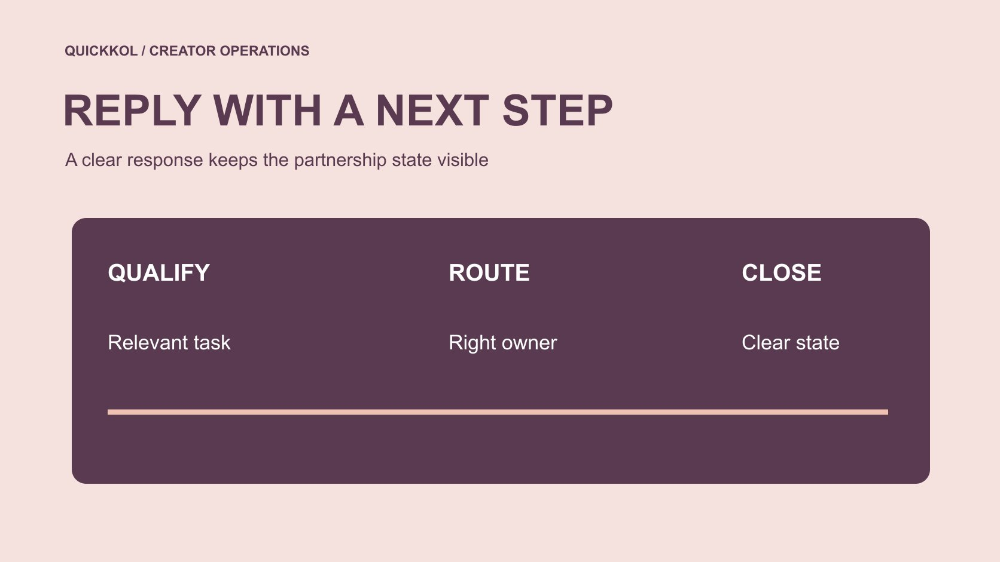

# How to Reply to an Instagram DM About a Partnership

Status: local review draft; confirm the publication date before release.

Route partnership DMs with concise replies that clarify the task, scope and next step without implying permission.

QuickKOL editorial graphic; not actual account metrics or a platform interface.

To reply to an Instagram partnership DM, open the correct account and conversation, verify the sender and context, then choose whether to qualify, clarify, route to support or decline. For a message-specific response, inspect the current app’s long-press Reply control, confirm the quoted message and send your text. Availability depends on the actual account interface. A commercial reply should identify the task and next step without requesting passwords or treating a read receipt, friendly answer or supplied asset as agreement to price and usage rights. The templates below are editable examples for brand teams, not messages already sent.

## Check the account and original message first

When several people manage a brand account, check the active identity, sender and full context before replying. Customer support, employment, creator proposals and existing partnerships should not receive one interchangeable template. If a person represents a creator, record the public identity and role and cross-check through a known official route where appropriate rather than relying on a portrait and display name.

[Meta’s account security guidance](https://about.fb.com/news/2021/07/keeping-instagram-safe-and-secure/) provides context for caution around requests for sensitive credentials. Partnership qualification does not require passwords, verification codes or recovery codes. Check an unfamiliar login invitation through a known route rather than opening it to appear responsive. The first value of the brand’s reply is routing a real question correctly, not promising cooperation quickly to every message. This also protects the creator when an impersonator uses a familiar brand name. A legitimate conversation should become clearer as identity and task are established, without either side having to surrender account access.

## Use native reply for a particular message

Open the DM conversation and locate the message you need to answer. In the current app, press and hold that message and inspect whether Reply is available. After selecting it, check the quoted context in the composer, write the response and send. [Meta’s Instagram DM update](https://about.fb.com/news/2024/03/instagram-dm-updates/) documented the long-press and Reply method. It is an official historical feature description; today’s controls still depend on the actual account and version.

If the option is absent, inspect the app’s currently available features rather than entering credentials on a third-party site that promises to unlock them. An ordinary text reply can explicitly identify the question being answered. Quoting a price message helps preserve context but is not acceptance of that price. Before sending, recheck the active account, recipient, attachment and any commitment outside your authority. The practical goal is an unambiguous response to the right message, not a particular gesture performed regardless of what the current interface shows.

## Route before asking for more information

Separate relevant proposals, insufficient information, support questions, unsuitable pitches and possible security issues. Give each a next step and owner. Insufficient information does not mean unsuitable. A customer should not need to submit a media kit to reach support, and not every sender needs to provide the same analytics screenshot.

Use the [creator shortlist workflow](https://www.quickkol.com/blog/creator-shortlist-workflow/#answer) for task-relevant creator leads. An established partner belongs in the execution record rather than being qualified again from zero. A product question belongs with appropriate support. Record the routing decision instead of repeatedly copying the entire conversation. A colleague taking over should understand the sender’s need, what the brand already said and who acts next. This reduces conflicting responses from shared-account staff. It also makes a small inquiry manageable without converting the inbox into an indiscriminate collection of private reporting that nobody has a defined purpose to review.

## Give a relevant proposal a specific next step

An example reply is: Thanks for sharing that demonstration. We are researching a product-use explanation. Could you confirm whether you consider original-account publication, the proposed timing and an appropriate business contact route? We can share the brief before discussing scope and fees. Replace the product and time with actual details; a template’s placeholder is not an approved campaign.

This expresses interest and a next step without committing to purchase, exclusivity or permission. If an authorized budget range exists, communicate it within your role. Otherwise clarify the task rather than inventing a number to encourage a reply. Move a supplied contact route into the appropriate handoff. Use the [creator brief](https://www.quickkol.com/blog/write-a-useful-campaign-brief/#answer) for detailed conditions instead of scattering requirements across short messages. The recipient should know what to respond to and what remains undecided. That is more respectful of both parties’ time than a friendly but undefined let’s collaborate followed by several rounds of preventable qualification questions.

## Ask only what the current stage needs

An example reply is: Thanks for reaching out. To assess this product task, please send one relevant original work link and clarify whether you propose production, original-account publication or both. If reporting is needed later, we will identify the field and period. Do not begin by requesting identity documents, a home address or full analytics access.

[FTC’s business information protection guide](https://www.ftc.gov/system/files/documents/plain-language/pdf-0136_proteting-personal-information.pdf) provides context for proportionate business information handling. Start with public work and increase requests only as the actual decision requires. Record purpose, permitted reviewers and appropriate retention rather than treating a DM as permission to collect anything. Insufficient information should remain pending clarification. Silence, response speed or a personal characteristic cannot replace task assessment. A focused question also makes the reply easier for the creator: they can supply the one fact needed now instead of guessing which part of a broad request is necessary to be considered.

## Provide a real support route

An example reply is: This concerns an order, and the partnership team cannot inspect those records. Please use the brand’s confirmed support route with the necessary order information; you do not need to send payment details in this DM. Verify that the route belongs to the brand and has a receiving owner instead of directing someone to a broken form.

If the sender is both a creator and a customer, handle the two matters separately. Partnership qualification should not become a condition for support, and needing support does not automatically end a commercial discussion. Keep only a necessary routing summary rather than copying private order details into the candidate list. Appropriate routing protects information and gives someone with authority a chance to resolve the issue. It also prevents the creator-facing marketer from making refunds, delivery or product assurances that sit outside the role and may conflict with the brand’s actual support process.

## Decline clearly without inventing a future promise

An example decline is: Thank you for sharing your work. The format needed for the current assignment differs from this proposal, so we will not continue this time. Thank you for understanding. If there is a genuine reason to retain future contact, seek appropriate agreement rather than automatically adding every declined sender to a database.

There is no need to criticize appearance or introduce unverified data judgments. Do not soften the reply by saying the person is shortlisted, funding is imminent or contact is guaranteed next month unless that is true. The sender should be able to tell that this round has ended. If one missing fact could change the outcome, use a clarification reply instead. Accurate status is more useful than vague politeness because it reduces misunderstanding and repeated follow-up. It also gives the next colleague a clear record, avoiding a later message that accidentally reopens an inquiry the team already declined.

## Escalate substantive changes for approval

When a price, permission or schedule changes, check whether you have authority to accept it. An example response is: Received. I will take this change to the responsible owner; it is not approved until confirmed. Give an update time only where there is a basis for it. Hand over the particular item rather than forwarding a context-free screenshot.

[Meta’s Instagram DM update](https://about.fb.com/news/2024/03/instagram-dm-updates/) describes controls including read receipts. A read indication is not acceptance, and its absence does not establish deliberate disregard. Substantive commitments need clear confirmation and appropriate contract records. Receiving an asset should not automatically move it into advertising; permission needs its own check. Messages support communication rather than silently extending rights. For the owner, the escalation should identify the earlier term, proposed change, affected deliverable and decision required. That makes it possible to approve or decline a concrete request without reconstructing the whole inbox conversation.

## Close with a state and receiving owner

For a relevant inquiry, retain a necessary summary: person, task, response, missing information, owner and next step. Do not endlessly duplicate private messages or label every inbound contact a prospective partnership. Handle irrelevant or suspicious material through current platform and internal processes without unnecessary commercial engagement.

Replying to an Instagram DM combines a native interface action with commercial judgment. Correctly quoting the original message, providing a defined next step and protecting information can make a short reply useful for an actual creator partnership. Before closing, confirm that a colleague could take over from the record and that the sender understands the current state. That is more useful than making every answer sound more enthusiastic. A small, accurate record also prevents a shared inbox from creating inconsistent promises as staffing changes, while leaving detailed terms in the appropriate brief and agreement rather than expecting the chat alone to carry the whole relationship.

## Repair ambiguity in an asset request

For example, one colleague writes that the team likes the idea and asks for an asset. Another later finds that price and permissions remain undecided. Receiving the file is not permission to use it. Clarify whether the exchange concerns evaluation or purchase and send the actual scope to an authorized owner. The reply should repair ambiguity rather than treating friendly tone as evidence of agreement.

## Partnership DM routing

| Inquiry | Reply focus | Next step |
| --- | --- | --- |
| Relevant proposal | State task and unconfirmed scope | Share the brief |
| Insufficient information | Ask only current necessities | Obtain decision-relevant evidence |
| Order issue | Provide a real support route | Authorized support |
| Unsuitable | Close clearly without invented promises | Record the state |

Adapt templates to actual facts; no messages were sent for this article.

## Five checks before sending

Each reply should clarify the state.

- [ ] Correct account and original message.
- [ ] Route before requesting more.
- [ ] No credentials or unrelated information.
- [ ] Commitments within authority.
- [ ] Defined next step and owner.

## Research date and limitations

Sources reviewed November 11, 2026. Methods, tables and decision rules are editorial recommendations. Hypothetical examples are not actual client results or industry benchmarks. Source geography and periods are specified where relevant. This draft is in independent local review; confirm its publication date before release.

## Start creator research with a clear task

Use QuickKOL to interpret a brief, discover relevant creators and research their work and contact routes. Verify data, commercial terms and outcomes at their source.

[Explore QuickKOL](https://www.quickkol.com/#capabilities)

## Sources

- [Meta’s account security guidance](https://about.fb.com/news/2021/07/keeping-instagram-safe-and-secure/)
- [Meta: Instagram DM updates](https://about.fb.com/news/2024/03/instagram-dm-updates/)
- [the FTC’s business information protection guide](https://www.ftc.gov/system/files/documents/plain-language/pdf-0136_proteting-personal-information.pdf)
