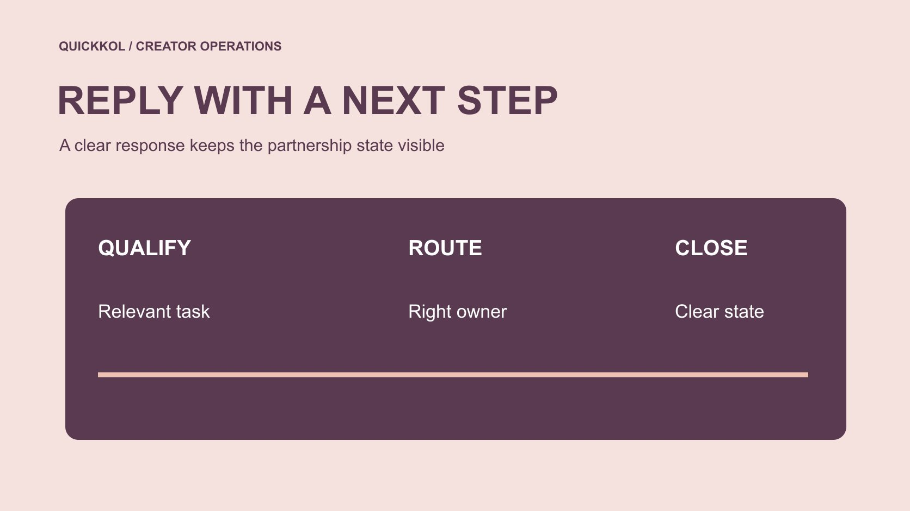

# 如何回复 Instagram 上的达人合作私信

状态：本地审阅稿；正式发布日期待确认。

把合作私信分到合适路径，用简短回复确认任务、范围与下一步，不在聊天中默认授权。

QuickKOL 编辑图形；不呈现真实账号指标或平台界面。

回复 Instagram 合作私信，先进入正确账号与对话，确认发件人和消息上下文，再决定是继续合作、补问、转客服还是婉拒。要针对某条消息，可在当前应用中查找长按后的“回复”选项，核对引用对象后输入发送。功能以账号实际界面为准。商业回复应给出任务和下一步，不索要密码，也不把已读、友好回应或收到素材当成已同意价格与使用权。

## 先确认正确账号与原消息

多人管理品牌账号时，先看当前身份、发件人和完整上下文，再回复。不要把客服、求职、创作者提案和已有合作混在同一模板。若对方代表某位创作者，记录公开身份与角色，适当时从已知官方入口交叉核对，不仅凭头像和显示名判断。

[Meta 的账号安全说明](https://about.fb.com/news/2021/07/keeping-instagram-safe-and-secure/)提供对敏感凭证请求保持警惕的背景。合作资格核对不需要对方发送密码、验证码或恢复码。遇到不明登录链接时，先用已知官方渠道确认，不为显得回复快而直接进入。品牌回复的第一项价值是让真实问题进入正确路径，而不是尽快向任何消息许诺合作。

## 针对一条消息使用原生回复

打开私信对话，找到需要回答的原消息。在当前应用中长按该条消息，查看是否提供“回复”；选择后核对输入区引用的对象，再写内容并发送。[Meta 的 Instagram 私信更新说明](https://about.fb.com/news/2024/03/instagram-dm-updates/)记录了长按并选择回复的方式。此为官方历史功能说明，今天的控件仍以实际账号和版本为准。

如果没有看到对应选项，先确认应用与账号当前可用功能，不要在陌生网站输入凭证以“解锁”。普通输入框也可以写明你在回答哪个问题，避免误解。针对一条报价消息回复，引用上下文有帮助，但引用本身不是同意报价。发送前再检查账号、对象、附件和有无超出自己权限的承诺。

## 先分流，再决定要补问什么

把来信分为相关合作、信息不足、客服问题、不适合和疑似安全问题。每类指定下一步与负责人。信息不足并不等于不适合，客服也不应为了进入合作流程而被要求提交媒体包。不要为所有来信索取相同后台截图。

用[候选名单工作流](https://www.quickkol.com/zh/blog/creator-shortlist-workflow/#answer)保存与任务有关的创作者线索。已有明确合作的人进入执行记录，不需要重新从零资格审查；纯产品问题交给适当客服。记录路由而不是反复复制完整聊天。一个同事接手时，应能知道对方想要什么、品牌已经说过什么、下一步由谁处理。

## 给相关提案一个具体的下一步

可用回复：谢谢分享这条演示。我们正在研究某产品的使用解释，请告知你是否接受原账号发布、拟议时间与适当商业联系入口；我们会提供 Brief，再讨论范围和报价。把实际产品与时间填入，不能将模板里的假设当成已批准活动。

这条回复说明兴趣与下一步，没有承诺采购、排他或授权。若预算有已确认区间，可以按内部权限说明；若没有，就先澄清任务，不虚构数字以引导回复。对方提供联系方式后，按适当渠道交接。用[达人 Brief](https://www.quickkol.com/zh/blog/write-a-useful-campaign-brief/#answer) 承接详细条件，比在多条短消息间散落关键要求更方便核对。

## 对信息不足只问当前必要项

可用回复：谢谢联系。为判断这次产品任务是否适合，请先发一个相关原作品链接，并说明你希望提供制作、原账号发布还是两者。后续需要数据时我们会说明字段与窗口。不要一开始要求身份证、家庭住址或完整后台访问。

[FTC 的企业信息保护指南](https://www.ftc.gov/system/files/documents/plain-language/pdf-0136_proteting-personal-information.pdf)提供与业务需要相称的信息处理原则。品牌可先看公开作品，再按实际决定增加请求。记录用途、访问人员和适当保留方式，不把私信当成任意收集资料的许可。资料不足时，状态保持待澄清，不用沉默、回复速度或某个个人特征替代专业判断。

## 转客服时给真正可用的路径

可用回复：这个问题涉及订单处理，合作团队无法查看相关记录。请通过品牌已确认的客服入口提交必要订单信息；无需在这条私信发送付款资料。发送前核对该入口确实属于品牌，并确认谁负责接收，不能把读者推向失效表单。

若对方既是创作者又有售后问题，两个事项分别处理。不要用合作资格作为获得客服的条件，也不因需要客服就默认终止商业沟通。转接记录只保留必要摘要，避免将私人订单细节复制到候选名单。适当分流能够保护隐私，同时让有权限的人真正解决问题。

## 婉拒要清楚，不制造未来承诺

可用回复：谢谢你分享作品。当前任务需要的形式与这份提案不同，我们这次不会继续。感谢理解。若确实希望保留后续联系，先按适当方式征求同意，不在每条拒绝里默认加入资料库。

不需要批评个人外貌或给出未经核实的数据判断。也不要为了显得温和而说已经进入候选、很快有预算或下个月一定联系。对方应能判断这轮已结束。若其实缺一项资料，就用补问而非拒绝模板。状态准确比空泛礼貌更能减少误解与重复跟进。

## 把实质变更送到有权人确认

收到价格、授权或排期变化，先确认自己能否接受。可回复：已收到这项调整，我会交给对应负责人确认，确认前不视为已批准。注明何时预计更新，但不能承诺没有依据的回复期限。把具体条目交接，不只转发一张没有上下文的截图。

[Meta 的 Instagram 私信更新说明](https://about.fb.com/news/2024/03/instagram-dm-updates/)提到已读控制等功能。已读不代表接受，未显示已读也不能证明故意忽略。实际承诺依靠明确确认与适当合同记录。尤其是素材收到后，不要自动转入广告使用；许可需要单独确认。消息记录帮助沟通，不应被当成默认扩大权利的工具。

## 收尾保留状态与接手人

每条有效询问保留必要摘要：对象、任务、已回复内容、待补资料、负责人和下一步。不要无限复制私信，也不把所有来信都称作潜在合作。对无关或可疑内容按当前平台和内部规则处理，不需要额外商业交流。

如何回复 Instagram 私信，关键是让原生操作与商业判断配合。正确引用原消息、提供明确下一步并保护隐私，可以让一条短回复服务真实达人合作。结束前确认同事能从记录接手，对方也知道当前状态；这比把每次回复写得更热情更有用。

## 修正素材请求中的歧义

例如一位同事回复“我们很喜欢，先发素材”，另一位后来发现价格与许可未定。不要把收到文件当成授权。澄清当前是评估还是采购，并把具体范围送有权人确认。回复应修正歧义，而不是靠聊天语气解释双方已经同意。

## 合作私信回复分流

| 来信 | 回复重点 | 下一步 |
| --- | --- | --- |
| 相关提案 | 说明任务与未确认范围 | 提供 Brief |
| 信息不足 | 只问当前必要资料 | 补一项可判断证据 |
| 订单问题 | 给真实客服路径 | 由有权人处理 |
| 不适合 | 清楚结束，不虚构承诺 | 记录状态 |

回复模板需按真实情况改写；本文没有发送任何消息。

## 发送前五项检查

每条回复都应让状态更清楚。

- [ ] 账号与原消息正确。
- [ ] 先分流再补问。
- [ ] 不索取凭证或无关资料。
- [ ] 承诺在自己权限内。
- [ ] 下一步与负责人明确。

## 研究日期与使用边界

资料核验于 2026 年 11 月 11 日。文中方法、表格和决策规则为编辑建议，标为假设的示例不是实际客户结果或行业基准。外部资料的适用地区与时期按各段说明；本稿处于独立本地审阅阶段，正式发布日期待确认。

## 用清楚的任务开始达人研究

用 QuickKOL 理解 Brief、发现相关达人并研究作品与联系路径；数据、合作条件和结果仍需核验。

[了解 QuickKOL](https://www.quickkol.com/#capabilities)

## 来源

- [Meta 的账号安全说明](https://about.fb.com/news/2021/07/keeping-instagram-safe-and-secure/)
- [Meta：Instagram 私信更新](https://about.fb.com/news/2024/03/instagram-dm-updates/)
- [FTC 的企业信息保护指南](https://www.ftc.gov/system/files/documents/plain-language/pdf-0136_proteting-personal-information.pdf)
