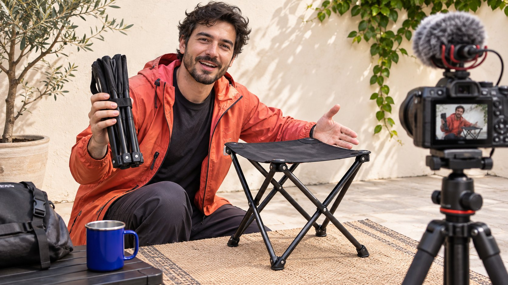
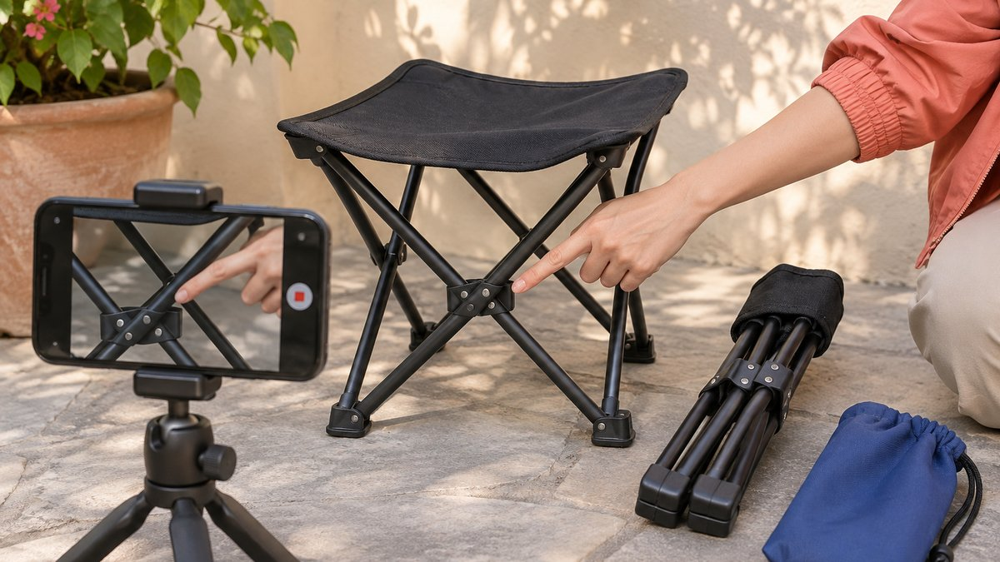

# Instagram Reel: Brief a Product Demonstration

Status: local review draft; confirm the publication date before release.

Start with the audience’s decision, then build a Reel from actual operation, creator experience and verified product facts.

An Instagram Reel for a brand partnership should help a defined audience understand one product question. Specify the observable action and applicable conditions, then choose a creator who can demonstrate them honestly. Align the opening promise, footage and final invitation. Keep personal experience within its subjective scope and substantiate technical claims separately. Accept the asset, commercial disclosure and agreed publication against their own requirements before evaluating performance. A polished edit or a large view count cannot establish a product benefit the footage never shows. The useful brief tells the creator what needs to be understood while leaving room for a credible explanation.

## Choose the creator role from the audience question

The audience question might concern opening, installation or suitability for a specific situation. That is more actionable than a request for an attractive short video. Put action, object and limits into the [creator brief](https://www.quickkol.com/blog/write-a-useful-campaign-brief/#answer), then inspect whether candidates have demonstrated similar work. A situational storyteller may explain why someone uses the product, while an instructional creator can show how. Those roles may require different footage and quotes.

Review complete pieces for prerequisites, process and result. A highlight edit does not establish operational competence, and a category label does not prove experience with the item. Ask whether the creator can perform the task under their actual conditions. Confirm samples or additional equipment in the scope before production. The brand can require factual accuracy without choosing a personal reaction in advance and hiring someone to portray it as experience. Casting should connect a real capability with the question the sponsor wants answered.

## Pair the opening promise with visible proof

If the opening promises convenient storage, show a relevant folding, carrying or placement situation. If it promises straightforward setup, explain the conditions and make the essential steps visible. Atmospheric footage cannot stand in for evidence unrelated to the benefit. Have the brand and creator identify the frame that helps someone understand and the frames serving mood alone. A key sentence needs actual footage or an appropriate product source behind it.

Consider a folding stool. The viewer may need to understand opening, folded size and which model is shown. A short can compare open and folded states of the same item, but a static image cannot establish certified load capacity. Write a storyboard with conditions, action and permitted language. If recording does not support the original plan, revise the statement or obtain the missing shot. A fast transition should not conceal a missing operation and then be treated as evidence that the promised action occurred.

## Separate personal experience from general claims

A creator can describe something as comfortable to carry or convenient in their own use. Turning that observation into suitability for everyone needs different evidence. Performance, duration, durability and comparative statements should have a checkable method and conditions supplied by the brand. If that support is absent, narrow the wording rather than using an experience as a substitute for testing. Review implications in captions and images alongside speech.

Give reviewers a claim sheet with the sentence, source, conditions and approver. If the creator places the folded stool into a particular bag, describe that observed situation rather than compatibility with every backpack. A quantitative promise requires verification of unit, model and testing scope. If actual use differs, preserve the experience and discuss an alternative approach. The creator’s experience is material to the partnership, not an empty space waiting for a brand’s preferred answer. This distinction should survive editing and later reuse.

## Record the action and its relevant conditions

Rehearse the camera angle before recording. Hands should leave the relevant operation visible, light should reveal the part, and the camera should capture the result. Record the complete action before optional details, preserving its actual sequence in the edit. Do not combine different conditions into an apparent single operation. Keep context that affects understanding, such as the surface or equipment used, rather than changing a prerequisite invisibly between shots.

For opening and folding, make the item’s before and after states identifiable. The photograph illustrates planning a position from which the action can be observed. It does not demonstrate safety or performance of a product. Professional-looking equipment is not the acceptance criterion. The question is whether the footage supports the agreed explanation. Ask another colleague to describe what happened from the images alone. An unclear step is a practical reshoot cue before adding decoration, music or extra narration.

Check that the before-and-after states and relevant mechanism are visible before recording the action.

## Review the relationship in the final presentation

For U.S.-relevant recommendations, use the [FTC’s influencer disclosure guide](https://www.ftc.gov/system/files/documents/plain-language/1001a-influencer-guide-508_1.pdf) to review the material connection. Inspect the actual video’s text, speech and platform treatment rather than only an advertising checkbox in the project record. The explanation should be understandable and connected to the endorsement. Check discounts, samples or other benefits against the real arrangement. A day-in-the-life style does not remove the commercial context.

Tell the creator what the brand provided and who can approve facts. The brand can require accurate disclosure without asking for an invented trial. Place text for the actual interface and viewing conditions, leaving the action visible and the wording readable. If an editor changes the opening or removes a segment, check whether the relationship remains clear. Approval belongs to the final version. An earlier approved script should not release a cut whose meaning changed during production.

## Define reuse before production

Agree original publication, brand reposting, paid distribution, editing and duration separately. Public visibility does not permit unrestricted recutting. Music or other outside material also needs review for its source and intended use. Use the [creator rates and usage rights framework](https://www.quickkol.com/blog/creator-rates-usage-rights/#answer) to connect fees with scope before purchase, rather than assuming that good performance expands permission later.

Recheck claims and context when making an advertisement. A statement that the item fit into a particular bag changes meaning if extracted as suitability for every situation. The advertising owner needs to know which images, sounds and sentences are permitted for which use. Supply asset IDs, approved versions and expiry conditions so separate teams do not download copies detached from their context. Both parties should be able to identify the reach of the commercial arrangement and the person who must approve an additional use. A useful rights record supports actual decisions rather than merely storing the file.

## Observe viewing and response within their definitions

[Meta’s Reels watch time explanation](https://about.fb.com/news/2023/04/instagram-reels-trending-audio-and-gifts-updates/) introduces total and average viewing time and notes the contribution of replays. Check the actual field and period in the current report. Longer viewing may justify examining a piece, but cannot independently establish product understanding. Keep relevant questions, destination activity and any applicable commercial records under their own sources rather than adding them into a customer total.

[Instagram’s creator education announcement](https://about.fb.com/news/2024/10/best-practices-education-hub-creators-instagram/) provides official context for content learning. The project still needs observations related to its task. Repeated questions about folding suggest checking whether the action is visible. Questions about dimensions may call for earlier prerequisites. Leave unavailable fields unknown instead of deriving a complete dashboard from public counts. Assess delivery, topic suitability and measurable response separately, then give the next brief a specific improvement. This makes the report useful to the creator and buyer without turning an aggregate metric into a claim about every viewer’s comprehension.

## Close the recap with a specific revision

Suppose the published piece is accurate, but viewers appear to remember the scenery rather than the folding action. Compare the brief and footage. Was the task never specified, or is an agreed shot missing? The former calls for a better next brief, while the latter needs a discussion under the actual delivery terms. A disappointing result does not automatically create unlimited free filming. A mistaken claim should not be attributed to an algorithm problem.

The next test might show the action earlier or commission someone better suited to instruction. Retain the original version, reason and comparable observation period. Changing creator, script and advertising together cannot isolate the effect of one change. The recap should name what someone will do, why it may answer the audience question and how it can be checked. A Reel then becomes a creator production with evidence and responsibility, rather than a format assumed to generate attention regardless of its explanation.

## Trace a rough-cut comment to the required evidence

Suppose a rough cut shows attractive close-ups of a folding stool but never the complete transition from packed to open. A comment such as the pacing is wrong gives the creator little way to distinguish a taste preference from missing commissioned evidence. Rewrite it as an observable action: preserve the unfolding sequence, keep the hand and relevant mechanism visible together, and check comprehension at normal viewing speed. Do not ask the same shot to establish durability or load capacity when the rehearsal has tested neither claim.

If the creator believes a continuous sequence disrupts the edit, discuss preserving the essential action in the main version or adding a clearly scoped explanatory segment. Removing the evidence while retaining the same implied claim does not resolve the issue. Record whether the additional filming, version and revision round fall within the agreed scope. A new requirement outside the original brief needs a discussion about time and cost. Acceptance checks the agreed assignment; it does not convert every late internal preference into unpaid rework.

The final comment record identifies the shot, reason, requested change and approver. The creator can propose a practical alternative, and the brand can assess whether it answers the same audience question. This gives both parties a concrete route from criticism to approval. The resulting production supports product understanding rather than an undefined request to make the piece feel more like advertising.

## Evidence and acceptance for a product Reel

| Part | Evidence | Owner |
| --- | --- | --- |
| Question | Audience and actual task | Partnership lead |
| Demonstration | Conditions, action and result | Creator and product team |
| Commercial relationship | Disclosure and permitted use | Brand and rights holder |
| Response | Definitions, sources and window | Analyst |

The demonstration examples and editorial method do not guarantee product performance or campaign outcomes.

## Product demonstration Reel review

Begin acceptance with the action the audience needs to understand.

- [ ] Pair the opening promise with visible evidence.
- [ ] Confirm model, conditions and the creator’s actual experience.
- [ ] Check final disclosure and reuse scope.
- [ ] Separate delivery acceptance from performance learning.

## Research date and limitations

Sources reviewed November 11, 2026. Methods, tables and decision rules are editorial recommendations. Hypothetical examples are not actual client results or industry benchmarks. Source geography and periods are specified where relevant. This draft is in independent local review; confirm its publication date before release.

## Start creator research with a clear task

Use QuickKOL to interpret a brief, discover relevant creators and research their work and contact routes. Verify data, commercial terms and outcomes at their source.

[Explore QuickKOL](https://www.quickkol.com/#capabilities)

## Sources

- [the FTC’s influencer disclosure guide](https://www.ftc.gov/system/files/documents/plain-language/1001a-influencer-guide-508_1.pdf)
- [Meta’s Reels watch time explanation](https://about.fb.com/news/2023/04/instagram-reels-trending-audio-and-gifts-updates/)
- [Instagram’s creator education announcement](https://about.fb.com/news/2024/10/best-practices-education-hub-creators-instagram/)
