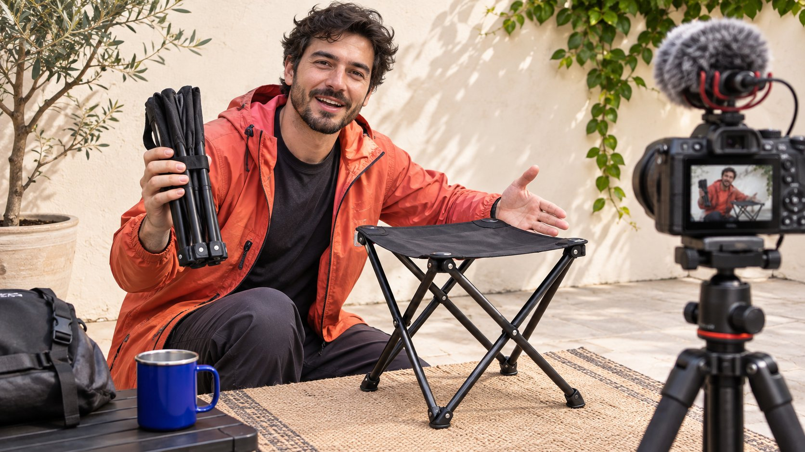
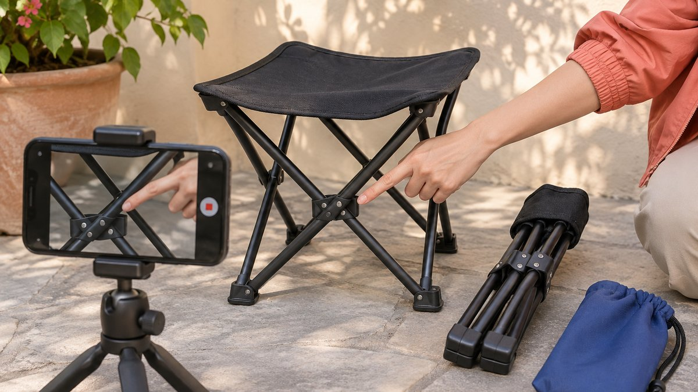

# Instagram Reel 如何讲清一次产品试用

状态：本地审阅稿；正式发布日期待确认。

先明确观众要判断什么，再让真实操作、创作者体验和品牌事实共同构成一条 Reel。

一条服务品牌合作的 Instagram Reel，应让目标观众看懂一个具体产品问题。先写需要证明的动作与适用条件，再选择能真实演示的创作者。开头承诺、操作画面与结尾邀请要一致，个人体验保留主观范围，技术结论另核对依据。品牌分别验收素材、关系披露和约定发布，再按适用报表观察表现。成片精致、播放量高，都不能代替产品主张所需的证据。

## 从观众问题确定创作者角色

品牌想回答的问题可以是怎样打开、怎样安装、是否适合某种场景，而不是笼统要求一条好看的短视频。把动作、对象和限制写进[达人 Brief](https://www.quickkol.com/zh/blog/write-a-useful-campaign-brief/#answer)，再看候选作品是否展示过类似能力。一个擅长生活情境的人，可以解释为什么会用；一个擅长步骤教学的人，可以展示怎样做。两种角色可能需要不同镜头与报价，不按同一印象分数选择。

看完整作品，观察前提、过程与结果是否都能找到。不要只从剪辑高光判断实际操作能力，也不要因为账号标签与产品同类就推断有使用经验。询问创作者是否能在其真实条件下完成演示。如果需要寄样或额外设备，先在范围里确认。品牌可以要求准确事实，却不能先指定个人感受，再找人演出来作为体验。

## 给开头承诺配一段能看见的证明

如果开头说便于收纳，后面就需要展示合理的收起、拿取或放置情境。如果说几步装好，就应说明适用条件并把主要步骤拍清。不要用和卖点没有关系的情绪镜头替代证据。品牌与创作者一起判断哪一帧让读者理解，哪些只是氛围。每个关键句应能对应真实画面或适当的产品来源。

假设合作对象是一张折叠凳。观众需要知道怎么展开、收起后占什么空间，以及本次演示的型号。短片可以比较同一物品展开与折叠的状态，但不能从静态画面推断承重认证。把编辑建议写成分镜，记录条件、动作和允许说法。拍摄结果不支持原计划时，修订主张或补足实际镜头，而不是通过快速转场隐藏问题。

## 把个人体验与通用结论分开

创作者可以说明在自己的条件下觉得好拿、方便或适合某次使用。把这种观察改成人人都适用，需要另一层依据。具体性能、时长、耐用度和比较结论，应由品牌提供可核对的方法与条件。没有资料时，缩小表达，不用主观体验替代测试。字幕和画面中的暗示也要一起查看，不能只审核口播。

给审核人一份主张表，写句子、来源、条件与确认人。比如创作者实际把收起的凳子放入一个包，可描述本次放入的情境，不能扩大成适合所有背包。如果产品团队希望保留量化承诺，核对单位、型号和测试范围。创作者实际结果不同，应保留真实情况并沟通替代拍法。真实体验是合作的材料，不是品牌脚本尚未填写的空位。

## 让拍摄覆盖关键动作与条件

开拍前先试机位，确认手部不会挡住动作，光线能看清部件，相机能记录关键结果。可以先拍完整动作，再拍细节，后期仍应保留实际顺序，不把不同条件拼成同一次操作。记录适用地面、设备或其他与理解有关的条件，避免在观众看不出的地方改变重要前提。

若演示涉及展开和收起，同一物品的前后状态应能辨认。配图展示了为观察动作安排拍摄位置的思路，并不提供产品安全或性能证明。品牌要验证的不是设备摆得专业，而是镜头能否支持已经约定的说明。拍完请另一位同事只看画面解释发生了什么。他看不清的步骤就是补拍线索，不必先增加更多装饰、音乐或旁白。

先确认前后状态和操作部位能被看清，再录制连续动作。

## 在最终画面中审核合作关系

涉及美国消费者的推荐，可以用 [FTC 的达人披露指南](https://www.ftc.gov/system/files/documents/plain-language/1001a-influencer-guide-508_1.pdf)核对利益关系表达。核验实际成片中的文字、声音和平台标记，而不只确认项目表有一项广告勾选。必要说明应容易理解，并与推荐保持清楚联系。折扣、赠样或其他利益按实际安排核对，不能因为片子像日常生活就忽略商业背景。

让创作者知道品牌提供了什么，谁有权批准事实。品牌可以要求准确披露，不应让创作者编造没有发生的试用。字幕放置要兼顾实际界面与观看条件，别遮住动作，也别缩成无法读的小字。若后期改了开头或删了某一段，再检查关系背景是否仍然完整。审核结论对应最终版本，避免用早期获批脚本放行已经改变含义的成片。

## 在制作前明确后续使用范围

把创作者账号发布、品牌转载、付费投放、剪辑和使用期限分别谈清。公开看得到原片，不代表品牌可以买来任意重剪。背景音乐、游戏或其他外部素材也需要按具体来源和用途核对。使用[达人报价与使用权框架](https://www.quickkol.com/zh/blog/creator-rates-usage-rights/#answer)，让费用与范围一同进入采购记录，而不是等视频表现好后默认扩大。

剪成广告时，再看产品主张与体验语境。原片里的「这次放进我的包」被截成「适合任何场景」，已经是另一个意思。广告负责人需要知道哪些画面、声音与句子获准怎样使用。给素材编号、批准版本和到期条件，避免不同团队各自下载一份失去上下文。创作者与品牌都能从这份记录知道商业关系延伸到哪里，以及新增使用需要谁确认。

## 按字段定义观察观看与回应

[Meta 的 Reels 观看时长说明](https://about.fb.com/news/2023/04/instagram-reels-trending-audio-and-gifts-updates/)介绍了总观看时间与平均观看时间，并说明总量包含重复观看。读当前报表时仍要核对实际字段与窗口。较长观看可能提示作品值得进一步研究，不能独立证明观众理解了产品。把相关问题、入口访问或适用的商业记录另列来源，不将它们相加为总客户。

[Instagram 的创作者学习说明](https://about.fb.com/news/2024/10/best-practices-education-hub-creators-instagram/)提供了官方的内容学习背景，项目应使用与任务相关的具体观察。比如观众反复问怎样收起，可以检查片中是否真的拍清动作；若大家问适用尺寸，就核对前提出现得是否够早。未知字段保留未知，不用公开计数估算全部后台。评价创作者时，区分实际交付、主题契合和可测结果，给下一份 Brief 一个能够执行的改进。

## 用一项具体修订完成复盘

假设成片已准确上线，但观众主要记住风景，没有理解收纳动作。先对照原 Brief 与镜头，判断是任务没有被写清，还是已约定的镜头缺失。前者需要下轮改 Brief，后者按实际约定讨论修正。不要仅凭一条表现不佳就要求额外免费拍摄，也不把主张错误归为算法问题。

下一次可以让动作更早出现，或用更适合解释的创作者角色。保留原版本、选择理由和相近窗口的观察，避免同时改变选人、脚本、投放而声称证明其中一项有效。复盘的产物是某人应做什么、它为什么可能解决观众问题，以及怎样检查。Instagram Reel 因而成为一次有明确证据与责任的达人制作，而不只是一种流量格式。

## 从粗剪意见追溯到需要的证据

假设粗剪用漂亮特写展示折叠凳，但没有完整拍到从收起到展开。品牌若只回复节奏不对，创作者无法知道是审美偏好还是缺少承诺镜头。把意见改成明确动作：保留连续展开过程，让手部与关键部件同时可见，再用正常观看速度检查读者能否理解。不要要求凭同一个镜头证明耐久或承重，因为当前试拍没有验证这些结论。

如果创作者认为连续镜头影响节奏，可以讨论在主要版本保留关键动作、另配解释段落，而不是删去证据后仍保留相同效果暗示。记录增加的拍摄、版本与修改次数是否属于已约范围。新要求如果超出原 Brief，应重新讨论时间与费用。作品验收是核对双方同意的任务，不是将品牌内部迟来的想法全部转为免费返工。

最终意见单写明镜头、原因、修正方式和确认人。创作者能够提出真实可行的替代，品牌也能看到替代是否回答同一观众问题。这样拍摄服务清楚的产品理解，而不仅是让画面更像广告。

## 产品 Reel 的证据与验收

| 部分 | 证据 | 确认人 |
| --- | --- | --- |
| 问题 | 目标观众与实际任务 | 合作负责人 |
| 演示 | 条件、动作和结果 | 创作者与产品团队 |
| 商业关系 | 披露与获准用途 | 品牌及权利人 |
| 表现 | 定义、来源和观察窗口 | 分析人员 |

演示示例与编辑建议不构成产品性能或增长保证。

## 产品演示 Reel 核对

从观众需要理解的动作开始验收。

- [ ] 为开头承诺准备实际可见证据。
- [ ] 确认型号、条件和创作者真实体验。
- [ ] 核对最终披露与后续使用范围。
- [ ] 将交付验收与表现学习分开。

## 研究日期与使用边界

资料核验于 2026 年 11 月 11 日。文中方法、表格和决策规则为编辑建议，标为假设的示例不是实际客户结果或行业基准。外部资料的适用地区与时期按各段说明；本稿处于独立本地审阅阶段，正式发布日期待确认。

## 用清楚的任务开始达人研究

用 QuickKOL 理解 Brief、发现相关达人并研究作品与联系路径；数据、合作条件和结果仍需核验。

[了解 QuickKOL](https://www.quickkol.com/#capabilities)

## 来源

- [FTC 的达人披露指南](https://www.ftc.gov/system/files/documents/plain-language/1001a-influencer-guide-508_1.pdf)
- [Meta 的 Reels 观看时长说明](https://about.fb.com/news/2023/04/instagram-reels-trending-audio-and-gifts-updates/)
- [Instagram 的创作者学习说明](https://about.fb.com/news/2024/10/best-practices-education-hub-creators-instagram/)
