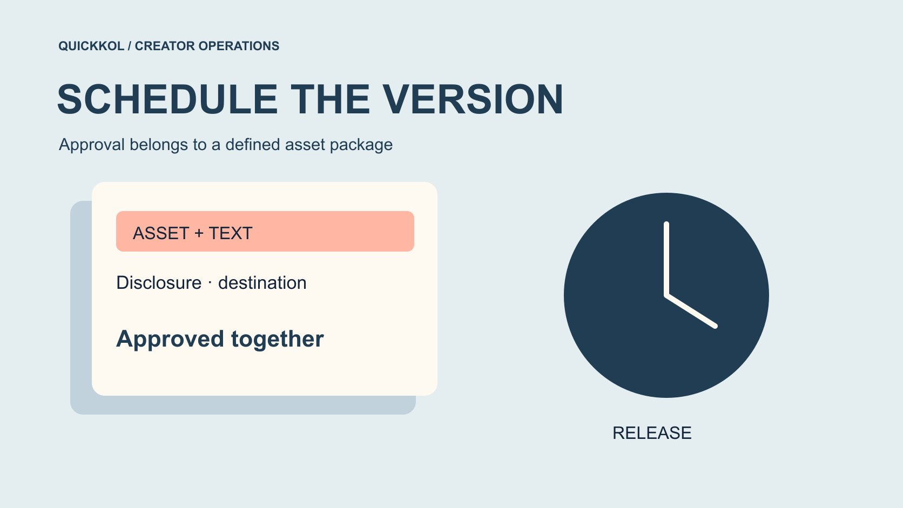

# Schedule Instagram Posts With an Approved Asset Version

Status: local review draft; confirm the publication date before release.

Schedule a creator post against one approved version of the asset, caption, disclosure and destination.

QuickKOL editorial graphic; not actual account metrics or a platform interface.

When you schedule Instagram posts for a creator partnership, schedule an identifiable approved version rather than a file name and time alone. Keep the asset, caption, disclosure and destination together. Choose a publishing method available to the actual account, and reconfirm material changes before release. Automatic publication and a reminder requiring native completion are different workflows. A delivered notification does not establish a live post. Define what the creator, brand and agency each approve so the publishing operator can distinguish a permitted adjustment from a change that invalidates the earlier approval.

## Identify the approval object before its release time

A sponsored post includes an asset, caption, relationship disclosure, publishing account and destination. Approval of the footage does not automatically approve a discount added later. Agreement to publish on the creator’s account does not establish advertising permission. Identify the package with an asset ID, final text and destination URL, plus the approvers and date. The identifier need not be complex. It needs to point to the actual files.

Use the [creator brief](https://www.quickkol.com/blog/write-a-useful-campaign-brief/#answer) to distinguish facts the brand confirms from experiences the creator controls. An agency can coordinate timing without approving claims the parties have not discussed. Place the final package in an appropriate shared location and retain older versions separately so an operator does not retrieve the wrong attachment from a private chat. Include covers, thumbnails and subtitle tracks where relevant. The schedule then concerns a defined object rather than a vague promise that the latest version will somehow be found.

## Check the publishing method on the actual account

[Buffer’s Instagram publishing guide](https://support.buffer.com/articles/using-instagram-with-buffer-YSjg2dXFV8) distinguishes automatic publishing from workflows needing further action within its product. That documentation supports the vendor’s behavior, not an assumption that all Instagram accounts and tools behave identically. Check the actual connection, format and required features, then run an appropriate rehearsal. A scheduling graphic on a vendor page does not establish support for every tag, music choice or collaboration feature.

Write the method into the handoff: publication by the tool, or a notification followed by completion by the account owner. Use approved test content and suitable permissions rather than password sharing. Success on a demonstration account does not prove the target creator has the same connection. Include someone familiar with that account and record the necessary conditions. The tool handles part of publication. Content approval and operational response still have their own owners. A changed publishing route needs another check of staffing and the time required for completion.

## Name the final operator for notification publishing

[Buffer’s notification publishing guide](https://support.buffer.com/articles/scheduling-instagram-posts-reels-stories-and-notifications-on-the-buffer-mobile-app-op2PiwJYMm) explains that some features unsupported by automatic publishing require completion inside Instagram. Check the actual tool and account before deciding which features to retain. If the brief requires a product tag or another creative element, do not assume the original automatic route still applies. A reminder hands work to someone. It cannot verify the final asset, caption or selected account on that person’s behalf.

Name a primary operator and an executable backup. Both need to know where the approved version lives, the reminder’s time and who has publication authority. If neither can complete the task, change the schedule or scope before the release minute. Rehearse the path from notification through text, media selection, disclosure review and publication. Use the real configuration to verify each step. The handoff must preserve a state for human completion rather than treating notification delivered as the commissioned asset being live.

## Separate approval of facts, experience and disclosure

The brand reviews product facts, prices and offer conditions. The creator confirms their experience and expression. For U.S.-relevant content, the [FTC’s influencer disclosure guide](https://www.ftc.gov/system/files/documents/plain-language/1001a-influencer-guide-508_1.pdf) helps review the material connection, alongside platform requirements and other applicable rules. Do not remove a clear disclosure to save caption space. Approval of a disclosure does not exempt the rest of a product claim from review.

Record each approver’s scope. A product manager confirming compatibility has not granted account publication rights. An agency confirming timing has not obtained authority to rewrite the creator’s opinion. When there is a disagreement, identify the sentence and decision needed, then ask the authorized person. Adding a benefit, changing a discount or replacing the audience invitation after the freeze needs a material-change check. Specific text-level approval reduces broad last-minute rework and gives the operator a usable rule for determining whether a requested adjustment can proceed.

## Define which changes reopen approval

Agree how to handle spelling, layout and substantive edits before the freeze. Correcting an extra space differs from changing a personal experience into a universal performance statement. A different product, price, destination, date or usage scope can invalidate earlier approval. Have the appropriate owner assess the impact rather than asking an operator to decide that two versions look close enough.

Suppose the creator approved a full-price demonstration and the agency adds a discount that starts the following day. Reconfirm the item, date, territory and wording. Unchanged video does not resolve those conditions. If the model changes, the demonstration itself may require new production rather than an overlay covering every factual difference. Keep old and new versions with the reason. Remove an obsolete version from the release queue while preserving the archive. Otherwise someone may later treat it as an approved fallback. The aim is an approval trail that survives ordinary edits and handoffs.

## Handle permission changes and disconnected accounts

[Buffer’s account connection guide](https://support.buffer.com/articles/connecting-your-instagram-account-to-buffer-n9Ad6veXsu) describes limitations that can depend on the connection method. Check the current account and route rather than assuming last week’s success survives role or connection changes. Name the account owner, tool administrator and contact path. If an agency operator leaves, someone needs authority to update access and establish the state of queued posts.

Pause dependent actions when a connection fails and inspect pending or duplicate items. Repeatedly submitting a schedule to see whether it works can create duplicate publications after recovery. Have the owner reconnect through the appropriate process, then compare the restored queue with the approved version. Restored permission only establishes that operations can continue. It does not approve the asset or commercial conditions. Record the correction time and affected entries so the recap can distinguish a system problem from a creative problem. The fallback should preserve both account control and a single authoritative release instruction.

## Test the freeze rule with a price-change exercise

Suppose a home-product Reel is scheduled for Wednesday. The brand changes the price on Tuesday, while the spoken video still gives the old figure. First establish whether that price forms part of the promise and the new conditions. Product staff, creator and publishing owner then decide on a new recording, revision or postponement. Changing only the destination may leave an inaccurate spoken statement. Deleting an old source file may also leave the old asset in the queue.

Use the exercise to test whether each participant can find the approval record. Have the backup operator identify the queued version and the approval that is no longer applicable. After replacement, recheck the cover, subtitles and caption together. Preserve the decision and any added work, with costs handled through the actual agreement. A freeze does not prohibit a justified change. It makes the consequence visible and identifies when the revised package is approved to publish. That is the operational question the schedule needs answered.

## Pass the freeze record to the release reviewer

Hand over the asset ID, final text, account, release time and time zone, destination, method and operator. Keep approvers and outstanding conditions visible. Another colleague should be able to decide what may publish after the scheduler leaves. A green calendar cell alone cannot answer that question. Actual acceptance then checks the original live work rather than treating a scheduled state as release evidence.

Connect the old queue, final publication and change reason at closeout. If price or inventory repeatedly blocks release, move that check earlier next time. If reminders repeatedly lack an available recipient, revise staffing or the publishing route. Use the [creator campaign status system](https://www.quickkol.com/blog/creator-campaign-status-system/#answer) to distinguish review pending, frozen, scheduled and verified publication. Preserve the difference between a connection failure and creative rework. This lets delay discussions address their actual cause and gives the creator a more specific delivery decision than a complaint that the schedule slipped.

## Include the handoff after a notification

Suppose the creator is on a flight and the agency receives a notification without authority to operate the creator’s account. A backup who can only forward the alert is not an executable backup. Before scheduling, identify someone who can complete the approved route or move release to a staffed period. Do not repair an unplanned staffing gap with temporary password sharing. A new time also calls for another check of offer conditions and the destination.

Now suppose the primary operator publishes but does not return the result to the project record. Someone seeing pending publication may submit the same work again. The rehearsal should identify who reports completion, which original URL supports that report and how remaining queue tasks are handled. Preserve a distinction between operation completed and publication verified. Connecting those states tests the entire release path instead of a reminder alone. Include verification time in the schedule rather than treating the instant of upload as the end of every responsibility. The final owner should also know whom to contact when a successful action returns no usable URL or the destination cannot yet be opened. Keep that condition pending until evidence arrives, with one person responsible for avoiding a second submission.

## Version record before scheduling

| Part | Approval basis | Recheck trigger |
| --- | --- | --- |
| Asset | Actual file and model | Footage or product change |
| Text | Facts, conditions and experience | Claim, price or offer change |
| Release | Account, method and operator | Permission or schedule change |
| Destination | Correct product and usable route | Link, territory or stock change |

Actual approvals and fees follow the agreement. This table supports operational handoff.

## Scheduling version freeze checklist

Keep these items in one handoff record.

- [ ] Match the asset, text, disclosure and destination to one version.
- [ ] Verify automatic or notification publishing on the actual account.
- [ ] Name material-change approvers and a backup operator.
- [ ] Verify the original live work after release.

## Research date and limitations

Sources reviewed November 11, 2026. Methods, tables and decision rules are editorial recommendations. Hypothetical examples are not actual client results or industry benchmarks. Source geography and periods are specified where relevant. This draft is in independent local review; confirm its publication date before release.

## Start creator research with a clear task

Use QuickKOL to interpret a brief, discover relevant creators and research their work and contact routes. Verify data, commercial terms and outcomes at their source.

[Explore QuickKOL](https://www.quickkol.com/#capabilities)

## Sources

- [Buffer’s Instagram publishing guide](https://support.buffer.com/articles/using-instagram-with-buffer-YSjg2dXFV8)
- [Buffer’s notification publishing guide](https://support.buffer.com/articles/scheduling-instagram-posts-reels-stories-and-notifications-on-the-buffer-mobile-app-op2PiwJYMm)
- [the FTC’s influencer disclosure guide](https://www.ftc.gov/system/files/documents/plain-language/1001a-influencer-guide-508_1.pdf)
- [Buffer’s account connection guide](https://support.buffer.com/articles/connecting-your-instagram-account-to-buffer-n9Ad6veXsu)
