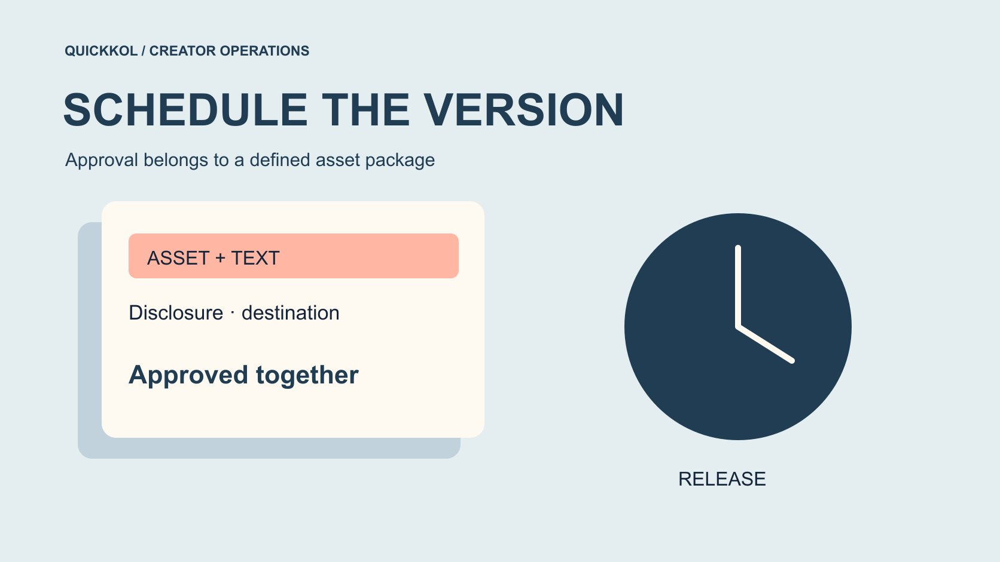

# Instagram 达人合作如何锁定待发布版本

状态：本地审阅稿；正式发布日期待确认。

把获批素材、字幕、披露和商品入口锁成同一版本，再安排定时发布。

QuickKOL 编辑图形；不呈现真实账号指标或平台界面。

安排 Instagram 达人合作帖时，先确定批准的是哪一组素材、文字、利益披露和购买入口，再选择当前账号可用的发布方式。排期记录要对应这一版本，修改关键条件后重新确认。自动发布和提醒后手动完成是不同流程，不能把提醒送达写成已上线。创作者、品牌和代理分别批准自己负责的内容，让发布人员知道哪些修改可以操作，哪些会使旧批准失效。

## 先记录批准对象，再记录发布时间

一条合作帖至少包含视频或照片、字幕或说明、关系披露、账号与目标入口。品牌只批了画面，不能认为也批了后面新增的折扣。创作者只同意自己的账号发布，也不能推断允许广告使用。把批准对象写成可识别的一组，例如一个资产编号、最终文案和目标 URL，附上确认日期与负责人员。编号不必复杂，重要的是能对应实际文件。

在[达人 Brief](https://www.quickkol.com/zh/blog/write-a-useful-campaign-brief/#answer) 中写清哪些事实由品牌确认，哪些体验由创作者决定。代理可以协调排期，但不能替代双方批准尚未讨论的主张。最终素材放到适当共享位置，旧版单独留档，避免执行者从私人聊天下载到错误文件。若用了封面、缩略图或字幕轨，也标明它属于哪一版。先建立这个对象，时间表才有明确要发布的内容。

## 在实际账号检查发布方式

[Buffer 的 Instagram 发布说明](https://support.buffer.com/articles/using-instagram-with-buffer-YSjg2dXFV8)区分其产品中的自动发布与需要进一步操作的方式。这里的工具文档支持特定工具的能力，不能扩写为所有 Instagram 账号和所有工具都一样。项目负责人应在实际账号里检查连接、内容形式和需要的功能，并用一条适当的试验确认。不要从供应商首页的排期图推断所有标签、音乐或协作功能都受支持。

把方法写进交接，比如由工具直接发布，或到时提醒账号所有者完成。测试时使用获准内容和合理权限，不共享密码。一个演示账号成功，也不证明目标创作者的连接相同。安排熟悉账号的人参加核对，并记录必要条件。采购工具只解决发布的一部分，批准内容与现场接单仍由相应的人负责。发布方式改变时，重新检查执行者和所需时间。

## 给提醒式发布指定最后操作人

[Buffer 的提醒式发布说明](https://support.buffer.com/articles/scheduling-instagram-posts-reels-stories-and-notifications-on-the-buffer-mobile-app-op2PiwJYMm)指出，其部分不受自动发布支持的功能需要在 Instagram 内完成。按实际工具和当前账号核对条件，再决定是否保留这些功能。品牌必须使用产品标签或某种创意功能时，不应假定原定自动方式仍然适用。提醒只能将工作交给人，不能替人确认最终画面、说明或账号选择。

指定一名主要操作人和可执行的备份。让两人都知道批准版本在哪里、提醒对应什么时间、谁有权实际发布。若没有人能按时完成，就调整排期或创作范围，不把未完成的动作留到发布分钟才解决。演练覆盖从收到提醒到复制文案、选择素材、核对关系披露和完成发布的路径。每一步都用实际配置确认，避免在交接表里把已提醒直接归类为已交付。

## 划清事实、体验与关系披露的审批

品牌审核商品事实、价格和活动条件，创作者确认自己的实际体验与表达。涉及美国消费者的内容，可用 [FTC 的达人披露指南](https://www.ftc.gov/system/files/documents/plain-language/1001a-influencer-guide-508_1.pdf)核对利益关系。平台工具及适用规则仍需分别考虑。不要为节省字幕空间，把清楚的关系说明删掉；也不要因一句披露已批准，就让其他产品主张免审。

把每位确认人的范围记录下来。产品经理确认兼容型号，不代表他批准账号发布许可；代理确认时间，不代表它可以替创作者重写观点。遇到冲突时，列出具体句子和要解决的问题，再请有权的人处理。素材冻结之后增加新卖点、改折扣或换受众邀请，都应判断是否触发重新批准。让审核对应具体文本，能减少上线前最后几分钟的笼统返工。

## 规定什么变更需要重新批准

可以提前约定拼写、排版与实质变更的处理。无意义的空格修正，和把「本次体验」改成「所有用户都能做到」显然涉及不同判断。更换产品、价格、目标链接、发布日期或使用范围，都可能使旧批准失效。由相应负责人判断具体影响，不让执行者凭觉得差不多直接放行。

假设创作者已经批准原价演示，代理在排期时加入次日才生效的折扣。此时要重新确认商品、日期、地区和文案，不能只说视频没改。若品牌临时更换型号，原演示可能需要重拍，不能用字幕覆盖解决全部事实问题。保留变更前后的版本与原因。过时版本不从档案删除，只从待发布队列移开，避免后面把它误认为仍获准的备选。

## 处理权限变化与断开的连接

[Buffer 的账号连接说明](https://support.buffer.com/articles/connecting-your-instagram-account-to-buffer-n9Ad6veXsu)列出不同连接方式可能产生的功能限制。实际使用时要核对当前账号和方法，不因前一周成功就忽略角色或连接变化。项目表指定账号所有者、工具管理员和联系渠道。若某位代理成员离职，谁能更新人员、谁能确认已经排入的帖子状态，需要提前写明。

连接异常时先暂停依赖它的动作，检查是否存在待完成或重复条目。不要多次点排期来试探结果，造成恢复后同一作品重复发布。账号所有者使用适当流程重新连接，发布负责人确认恢复后的队列与批准版本相符。权限修复只证明可以继续操作，不能替代对素材和条件的批准。把修复时间与受影响条目对应，方便后续复盘区分系统问题和内容问题。

## 用一次改价演练检查冻结规则

假设一条家居产品 Reel 计划周三上线。周二品牌调价，但视频中的口播仍是旧价。第一步是核对价格是否属于作品承诺的一部分，以及新价适用条件。若事实已变，由产品、创作者和排期负责人共同决定补录、修订或延期。不能只改目标页面而让口播继续误导，也不能只删旧文件却留下已排入的版本。

演练检查每个人能否找到正确的批准记录。让备份操作人确认队列里是哪一版，并指出哪项旧批准已失效。素材替换后，再核对封面、字幕与说明同步。保存最终决定和新增工作范围，费用按真实合同处理。这个假设过程显示版本冻结不是禁止修改，而是让修改后仍有人知道何时可以安全发布。

## 把冻结记录交给发布验收人

交接至少包含资产编号、最终文案、账号、发布时间及时区、目标 URL、发布方式与操作人。批准人和未完成条件也要可见。排期人员离开后，另一位同事应能根据这些信息判断什么可以发布，而不是只看到一个绿色日历格。实际验收再到正式作品核对，不能把排期成功的记录当作最终上线证据。

收尾时将旧队列、最终作品和变更原因关联，减少下次重复审核。下轮若总是卡在价格或库存，就提前增加相应确认；若常卡在提醒无人接收，就调整人员或方式。用[达人活动状态管理方法](https://www.quickkol.com/zh/blog/creator-campaign-status-system/#answer)区分待审、已冻结、已排期和已核实发布，保留系统故障与内容返工的区别。这样可以让延期讨论落到真实原因，也给创作者一个明确的交付判断。

## 把提醒送达后的交接也列入演练

假设创作者在航班途中，代理收到提醒，但没有权限操作创作者账号。备份人员如果只能转发通知，不能算可执行的备份。项目负责人应在排期前确认谁能按批准方式完成，或把上线改到有操作人的时段。不能用临时共享密码补上未设计的人员安排。时间改变后，活动条件与目标页也要复核。

再假设主要操作人完成了发布，却没有把结果发回项目表。另一位人员看到仍待发布，再次提交同一作品，可能制造重复。演练应包括谁报告完成、用什么正式链接作为依据，以及如何处理原队列的剩余任务。交接状态需要能区分已操作待核验与确认上线。把这些点连起来，才算测试完整发布路径。额外几分钟的核验时间应进入排期，而不是把素材上线的那一分钟当成整个任务结束。

## 排期前的版本记录

| 部分 | 批准依据 | 重新核对触发 |
| --- | --- | --- |
| 素材 | 实际文件与型号 | 镜头或产品变更 |
| 文案 | 事实、条件与体验 | 卖点、价格或优惠变更 |
| 发布 | 账号、方式、操作人 | 权限或排期变更 |
| 目标 | 对应商品与可用入口 | 链接、地区或库存变更 |

具体批准和费用以双方约定为准，表格用于操作交接。

## 排期版本冻结清单

将这些项目保存在同一条交接记录中。

- [ ] 确认素材、字幕、关系披露与入口属于同一版。
- [ ] 在实际账号核对自动或提醒式发布。
- [ ] 指定关键变更的批准人与备份操作人。
- [ ] 发布后另行核对正式作品。

## 研究日期与使用边界

资料核验于 2026 年 11 月 11 日。文中方法、表格和决策规则为编辑建议，标为假设的示例不是实际客户结果或行业基准。外部资料的适用地区与时期按各段说明；本稿处于独立本地审阅阶段，正式发布日期待确认。

## 用清楚的任务开始达人研究

用 QuickKOL 理解 Brief、发现相关达人并研究作品与联系路径；数据、合作条件和结果仍需核验。

[了解 QuickKOL](https://www.quickkol.com/#capabilities)

## 来源

- [Buffer 的 Instagram 发布说明](https://support.buffer.com/articles/using-instagram-with-buffer-YSjg2dXFV8)
- [Buffer 的提醒式发布说明](https://support.buffer.com/articles/scheduling-instagram-posts-reels-stories-and-notifications-on-the-buffer-mobile-app-op2PiwJYMm)
- [FTC 的达人披露指南](https://www.ftc.gov/system/files/documents/plain-language/1001a-influencer-guide-508_1.pdf)
- [Buffer 的账号连接说明](https://support.buffer.com/articles/connecting-your-instagram-account-to-buffer-n9Ad6veXsu)
