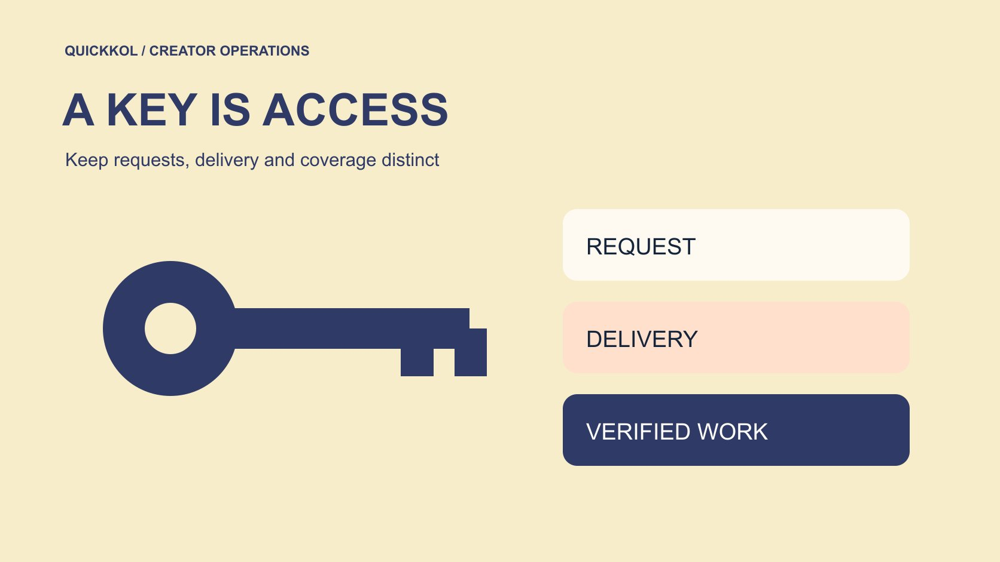

# Keymailer: Game Keys, Coverage and Paid Creator Briefs

Status: local review draft; confirm the publication date before release.

Handle game-key requests, verify channels and separate sampling from commissioned publication.

QuickKOL editorial graphic; not actual account metrics or a platform interface.

Keymailer provides a workflow in which game publishers can receive creator requests, decide about access codes and follow coverage. Keep request, approval, delivery, actual access and published work as separate states. Receiving a game key should not automatically become a promise of a publication date, a positive opinion or advertising rights. If the publisher commissions content, confirm the fee, deliverable, disclosure and license separately. Start with a bounded creator pilot that checks channel relevance, access conditions and traceable work. Codes distributed are an operational quantity, not a measure of campaign exposure or proof that the intended audience watched a game.

## Decide whether the task is sampling or commissioned work

Before configuring a tool, decide what the publisher is trying to do. Offering relevant creators access so they can judge whether a game suits their work differs from buying a sponsored video with specified delivery. Sampling may have applicable access or confidentiality conditions, but an unagreed publication obligation should not appear after the key is sent. Commissioned work needs a platform, asset, date, review scope, fee and disclosure. Both arrangements can coexist when the records distinguish them.

Put the task into the [gaming creator brief](https://www.quickkol.com/blog/write-a-useful-campaign-brief/#answer). Teaching, first impressions, commentary and hosting require different evidence of fit. Choose the game category, language and audience question accordingly. Do not distribute broadly simply because the tool can surface many accounts. Establish which version can be demonstrated and which features are available. The pilot should cover a game experience the publisher can supply and the creator can actually assess, without presenting a preview build as a promise of final product quality.

## Verify applicants through their actual work

[Keymailer’s publisher FAQ](https://account.keymailer.co/allfaq) describes requests, publisher review and key distribution. Treat a request as a lead, then verify the actual channel, recent original work and contact route. A similar name, copied portrait or email signature cannot independently establish account control. Where needed, confirm the request through an already verified public business route rather than letting a link in the request define the identity again.

Look for work related to the game’s mechanics, platform and intended language. A creator regularly explaining comparable independent games may be more relevant than a larger general-entertainment account. Requesting many titles does not by itself establish bad intent. Check the work and particular request, documenting what remains unknown. Assess identity, content fit and distribution separately instead of letting one accreditation label settle all three. A second buyer should be able to retrace the access decision from the original channel and request record.

## Specify build, platform and access conditions

Before distribution, check the title, build, platform, regional conditions, equipment and availability dates. The same game name can refer to a preview build, test server or released version. Provide enough information for the creator to assess whether the access is usable. Keep complete activation codes out of broadly shared tracking sheets. An internal ID, receiving account and status can usually support coordination while secrets remain in a properly restricted delivery route.

Run a small delivery check before expanding. If activation fails, inspect the platform and access conditions before interpreting the problem as an identity issue. Revisit recorded material after a build changes. If a feature cannot yet be shown, explain what can be said and when the scope will be reviewed. Acceptance of access means the intended recipient can use the agreed material. It does not establish that recording, publication or a particular level of viewing has occurred.

## Keep requests and accreditation distinct from coverage

[Keymailer’s creator FAQ](https://embed.keymailer.co/allfaq) explains that publishers, developers or PR representatives decide about distribution. Requests and accreditation can help screening, but they do not replace the actual arrangement. Requesting a game is not agreement to every later requirement. Supplying access is not purchasing a review. For independent coverage, explain available material and applicable conditions while preserving the creator’s editorial decision.

If the buyer needs a committed publication, negotiate commissioned work. Name the platform, asset, date, factual review and handling of unmet conditions. A positive opinion should not become the test of whether an experience is genuine. Buying delivery does not automatically confer permission to rewrite the creator’s assessment or prohibit honest criticism. Document access and content tasks separately. That makes it possible to explain whether an absent publication was never purchased, remains unfinished or reflects a change that the agreement needs to address. Operational labels should follow the actual obligation.

## Write an embargo as an unambiguous time

If an embargo applies, state the date, time, time zone and exact material covered. Downloading, playing, recording and publishing are distinct permissions and moments. Friday release can mean different things to creators in different locations. The agreement establishes the obligation. The campaign coordinator translates it into an executable schedule and names a contact for build or launch changes.

Give the creator a concrete edge case, such as whether an unrevealed character can be recorded in advance or receipt of the game can be mentioned before release. The answer needs an authorized decision, not an operator’s assumption about industry custom. Update the final instruction when a release moves and confirm that affected people receive it. A late group message should not silently override earlier terms. Include the advertising team if licensed material is scheduled for paid use. Accurate timing and scope support both the publisher’s release plan and the creator’s ability to organize production.

## Review disclosure for the actual relationship

The [FTC’s influencer disclosure guide](https://www.ftc.gov/system/files/documents/plain-language/1001a-influencer-guide-508_1.pdf) explains that material connections relevant to U.S. consumers can include free products. Review the particular game-access arrangement and applicable rules rather than assuming the absence of cash removes disclosure questions. The creator should know who supplied access. Commissioned work also needs the appropriate explanation of that relationship. Use platform tools as required by the actual service, alongside a clear disclosure suitable for the content.

The brand’s review should address facts, the relationship and permitted material. The creator’s assessment should still reflect their experience. If production support, travel or other benefits are involved, have the responsible person check their effect on disclosure. Keep sampling and commissioned rosters distinct so the agency does not apply the wrong review template. Record the disclosure actually used and its placement. Later editors or republishers then have the conditions needed to avoid presenting an extracted segment as an unrelated organic recommendation.

## Trace coverage leads back to actual work

Treat tool-recovered content as a coverage lead. Open the original to confirm the creator, game, date and actual treatment. A title mention, syndicated announcement and hands-on experience are different objects. If one part of a long stream concerns the game, preserve the timecode. Without appropriate segment data, the full stream’s audience cannot establish how many people watched that section.

Maintain distinct states for request, approval, delivery and verified publication. Codes distributed help manage access resources. Verified works describe actual coverage. Viewing and commercial outcomes require separate evidence. For missed coverage, ask for the live URL rather than treating one tool’s empty result as proof of no publication. Conversely, a discovered piece does not establish recut permission. Identification, performance and rights each need their own review. This record keeps an apparently complete campaign dashboard from overstating what the publisher has actually confirmed.

## Use a bounded pilot to decide the next distribution

Suppose a publisher prepares 12 access opportunities for a puzzle-game pilot. Select applicants with relevant work, then record delivery and usability problems separately. Later, five relevant pieces can be verified, one of which only mentions the title. Report the five observed pieces and distinguish actual experience within them. Twelve deliveries do not become twelve publications. Missing coverage also does not establish that the other recipients sold their codes.

Review which creator roles explained the game, which access conditions caused failures and whether committed content should be commissioned separately. The next wave may remove platform mismatches, supply clearer onboarding or target people who explain puzzle logic well. Apply the same eligibility rule to each applicant and retain unresolved states. Return the findings to sourcing and the brief. Distribution becomes a manageable access and learning process instead of a list of exposures that nobody has actually established. Use the [creator shortlist workflow](https://www.quickkol.com/blog/creator-shortlist-workflow/#answer) to keep the request, work and basis for the next contact together.

## Have a colleague review an unpublished request

Suppose an applicant confirms receiving access, but no public work can be found two weeks later. The coordinator should first inspect the arrangement. If this was an invitation to experience the game, record no verified coverage and, where appropriate, ask about the experience. If a paid video was separately agreed, check production status, product problems and the actual deadline. The same delivered label cannot decide between those cases. Later coverage should be archived according to its real publication time and treatment.

Give a second colleague a handoff sheet without activation secrets and ask which requests need follow-up. If they cannot tell who promised what, restore the agreement or confirmation record. If they can see only a tool status, add the original work or the absence of evidence. Distinguish inability to reach someone from an expressed decision not to publish. Silence does not identify a motive. Check whether any access or embargo condition remains active before closing the record. The appropriate next step could close a sampling invitation, await contracted work or discuss a scope change. Each needs an owner and a reason. This review makes the coordination record usable without inventing an obligation or accusation from an absent link.

## Game access and content states

| State | Established | Not yet established |
| --- | --- | --- |
| Request | Someone requested access | Identity, fit and obligations |
| Delivery | Access was delivered through the agreed route | Usability or publication |
| Coverage lead | A tool returned a relevant lead | Actual treatment and usage rights |
| Verified work | Original work and scope reviewed | Incremental business results |

The 12 access opportunities and five pieces are hypothetical and illustrate different counting objects.

## Game-key pilot checklist

Record access, work and commercial obligations separately.

- [ ] Specify sampling or commissioned content.
- [ ] Verify the actual channel, game category and platform.
- [ ] Name the build, territory, embargo time and contact.
- [ ] Trace each coverage lead to a verifiable original.

## Research date and limitations

Sources reviewed November 11, 2026. Methods, tables and decision rules are editorial recommendations. Hypothetical examples are not actual client results or industry benchmarks. Source geography and periods are specified where relevant. This draft is in independent local review; confirm its publication date before release.

## Start creator research with a clear task

Use QuickKOL to interpret a brief, discover relevant creators and research their work and contact routes. Verify data, commercial terms and outcomes at their source.

[Explore QuickKOL](https://www.quickkol.com/#capabilities)

## Sources

- [Keymailer’s publisher FAQ](https://account.keymailer.co/allfaq)
- [Keymailer’s creator FAQ](https://embed.keymailer.co/allfaq)
- [the FTC’s influencer disclosure guide](https://www.ftc.gov/system/files/documents/plain-language/1001a-influencer-guide-508_1.pdf)
