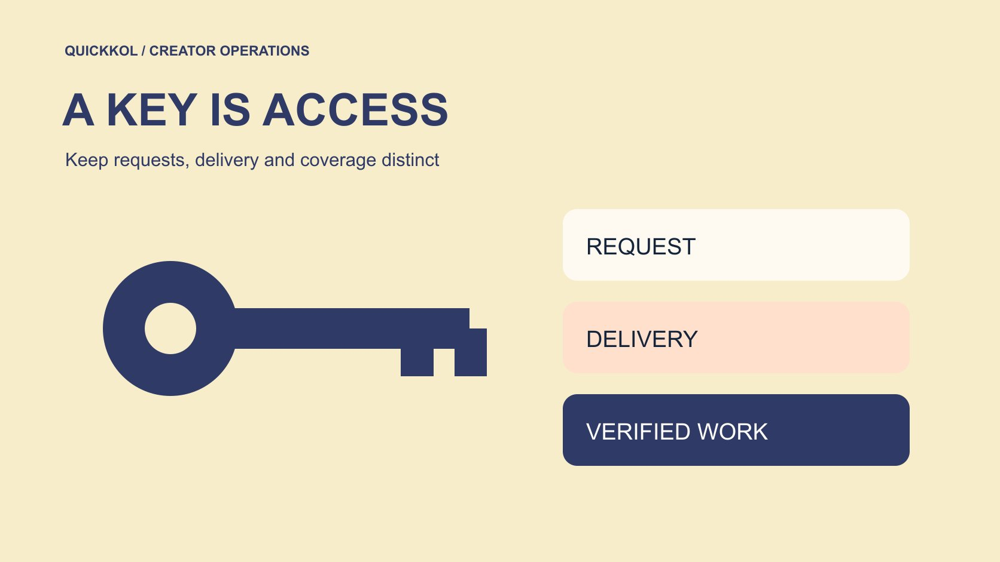

# Keymailer 游戏赠码怎样与付费合作分开

状态：本地审阅稿；正式发布日期待确认。

发行商如何处理游戏码申请、核实频道，并把赠码与保证发布的付费工作分开。

QuickKOL 编辑图形；不呈现真实账号指标或平台界面。

Keymailer 是帮助游戏发行商与创作者管理申请、送码和报道线索的服务。品牌应把申请、核准、送达、实际体验和已发布作品分开记录。收到游戏码不应自动被当成对固定发布日期、正面评价或广告使用权的承诺。如果购买具体内容，另行确认费用、交付、披露与许可。用一个有限的游戏达人试点检验作品契合、码的适用条件和报道核验，而不是把送出的码数当成活动曝光。

## 先决定是寻找编辑体验还是采购内容

发行商在使用工具前，先确认要完成什么。希望相关创作者自主体验游戏、判断是否适合自己的节目，与购买一条明确交付的赞助视频，是不同安排。前者可以有适用的访问或保密条件，但不能事后凭已送码要求原先未约定的发布。后者需要把作品、平台、日期、审阅、费用和披露谈清。两种工作可以并存，状态记录要能区分。

把任务写进[游戏达人合作 Brief](https://www.quickkol.com/zh/blog/write-a-useful-campaign-brief/#answer)。角色可以是教学、初体验、评论或主持，选择对应的游戏类型、语言与观众问题。不要因为工具能搜到很多创作者，就先大量送码再寻找活动目的。发行商还要确认当前版本适合哪种展示，是否存在尚未开放的功能。试点只覆盖品牌能够提供且创作者可以实际体验的范围，避免把演示版本说成最终品质承诺。

## 按申请者的实际作品核实身份与契合

[Keymailer 发行商问答](https://account.keymailer.co/allfaq)描述了创作者申请游戏、发行商审核与决定送码的流程。把申请记录作为线索，再确认实际频道、近期原创作品和联系路径。相似名字、复制头像或邮件签名不能独立证明账号所有权。必要时通过已确认的公开业务联系渠道核对申请，避免只按来信里的链接重新确定身份。

审核内容时，找与当前游戏机制、平台和目标语言相关的作品。某位创作者经常展示同类独立游戏，可能比只有泛娱乐流量的人更适合一次教学体验。申请很多游戏也不自动证明恶意，先核对作品与具体请求是否相符。把能确认和不能确认的部分写清。身份、内容契合与预计分发分别评估，不能让一个认证标记覆盖其余问题。采购人员应能从原帖和申请记录还原为什么提供访问。

## 写清码的版本、平台和可用条件

送出前核对游戏、版本、适用平台、地区条件、所需设备和可用日期。游戏名相同，评测版本、测试服与正式版也可能不同。品牌提供的说明应足够让对方知道是否能使用。不要把完整激活码贴进所有人可读的活动表，内部记录使用能关联的编号、接收账号和状态即可。具体秘密通过适当权限的交付路径管理。

安排一次小规模检查，确认申请者能收到并理解说明，再决定是否扩大分发。遇到激活失败，先检查平台与码的条件，不立刻把问题归为账号不可信。版本更新后，评估原录制是否仍准确。若某个功能尚不能展示，让创作者知道可以说什么、什么时候再确认。访问交付的验收，是合适的人能够使用约定内容；它还不能证明已经录制、发布或达到某种观看表现。

## 不要把申请或认证改写成报道保证

[Keymailer 创作者问答](https://embed.keymailer.co/allfaq)说明，送码决定由发行商、开发者或公关方作出。申请与平台内的认证可以帮助筛选，不能代替双方实际合作条款。创作者申请了游戏，不等于同意所有新增要求；发行商发送访问，也不等于买下评价。对希望自主报道的人，先说明可用内容及适用限制，再尊重实际编辑决定。

如果品牌需要一个可保证的上线对象，就进入付费工作范围谈判。明确什么平台、什么作品、何时发布、谁审核事实，以及未满足条件时怎么处理。正面结论不应成为体验真实与否的验收条件。采购交付不代表可以编辑对方观点或禁止真实批评。把内容任务和访问任务分别签明，便于以后解释某位创作者没有发布究竟是未采购、尚未完成，还是出现了约定内需要处理的变更。

## 把保密时点写成双方都看得懂的时间

如果安排保密期，写出日期、时刻、时区及禁止公开的具体内容。可下载、可体验、可录制和可公开，是不同权限与时点。只写「周五上线」容易让跨地区创作者产生不同理解。实际约束以双方确认的条款为准，项目协调人把它转成可执行排期，并为版本或发行时间变更指定联系人。

给创作者一个核对例子，例如能否预录一段未公开角色的画面、能否在禁发前提及收到游戏。答案需要来自有权决定的人，不能让执行者凭惯例推断。发生延期时更新最终版本，确认所有受影响人员收到。不要靠临时群发覆盖早期要求，也不要在素材已授权投放后忽略广告团队的时间安排。准确的时间与范围保护发行计划，也让创作者能合理安排制作。

## 按赞助与赠样关系检查披露

[FTC 的达人披露指南](https://www.ftc.gov/system/files/documents/plain-language/1001a-influencer-guide-508_1.pdf)提醒，涉及美国消费者的重大关系可能包括免费产品。游戏码的具体处理要结合实际安排和适用规则核对，不能仅因为没有现金就认为无需说明。让创作者知道由谁提供访问，付费内容还要说明相应关系。平台的标记工具也需要按实际平台要求使用，不能让一句含糊的致谢替代必要披露。

品牌审核重点是事实、关系和批准使用的素材范围。创作者仍应依据真实体验表达。若提供了制作帮助、交通或其他利益，交给适当负责人核对是否影响披露。不要让代理把赠码名单与付费名单混在一起，导致审核使用错误模板。收尾记录实际使用了什么表达及发布位置，方便后续剪辑或转载人员延续原本条件，而不是把脱离上下文的片段当成独立自然推荐。

## 从报道线索回到真实作品

工具找回的内容先当作报道线索，打开原作品确认作者、游戏、发布日期与实际内容。不要把标题提到游戏、新闻转载和真正体验混成同一种交付。长直播中只有一段涉及游戏时，记录相应时点。若没有足够数据判断片段观看，说明限制，不能拿全场总观看当成每人都看过这一段。

活动表至少保存申请、核准、送达与已核实作品的状态。统计送码数时，用于管理资源；统计作品时，用于判断实际覆盖；观看与商业结果再分开。发现漏抓可请创作者提供正式 URL，不用依赖一个工具的零结果认定没有发布。也不要因为工具发现一条作品，就宣称已取得重剪许可。识别、表现与权利三项证据需要各自完成。

## 用有限试点决定下一批送给谁

假设发行商为一款解谜游戏准备 12 份试点访问。先选择作品与机制相关的申请者，再分别记录送达与使用问题。试点后核实到 5 条作品，其中一条只提到游戏名字。可以报告 5 条已核实相关内容，并进一步分类实际体验，不能把 12 次送达写成 12 次报道。也不能从没有作品推断其余人出售游戏码。

复盘重点是哪些角色解释了游戏、哪些访问条件造成失败，以及是否值得另行采购可保证的内容。下一批可以减少不适合平台、补充更清楚的上手资料，或找擅长解释谜题逻辑的人。用同一规则处理每位申请者，保持未解决状态。把试点发现交给下一轮筛选与 Brief，送码就成为可管理的研究与体验路径，而非一张无法确认实际交付的曝光表。用[候选名单工作流](https://www.quickkol.com/zh/blog/creator-shortlist-workflow/#answer)保留申请、作品与下一步的联系依据。

## 让同事从交接表复核一次未发作品

假设申请者确认收到访问，但两周后没有公开作品。协调人先看原安排。若只有体验邀请，就记录无已核实报道，并可按适当方式询问体验情况。若另有已约定的付费视频，则检查制作状态、产品问题和实际截止日期。两种处理不能只由相同的「已送达」标签决定。即使对方以后发布，也按实际上线时间和内容范围归档。

给第二位同事一份不含激活秘密的交接表，让他独立判断哪些申请需要跟进。若看不出谁答应了什么，就补回合同或确认材料；若只能看到工具状态，就补上原作品或说明尚无证据。把无法联系与拒绝发布分开，避免把沉默解释成某种动机。结案前还要核对是否仍有访问或保密条件需要处理。最终下一步可以是关闭一次体验邀请、继续等待已约定工作，或就范围变化进行沟通。每项都需要明确负责人。

## 游戏码与内容的不同状态

| 状态 | 已经确认 | 还没确认 |
| --- | --- | --- |
| 申请 | 有人提出访问请求 | 身份、适合度与义务 |
| 送达 | 访问按约定路径交付 | 可使用及会发布 |
| 发现作品 | 工具返回了相关线索 | 具体内容与授权 |
| 核实作品 | 已核对原始作品和范围 | 增量商业结果 |

12 份访问与 5 条作品为假设，用于说明统计对象不同。

## 赠码试点验收清单

按访问、作品和商业承诺分别记录。

- [ ] 确定赠码体验或付费内容的具体安排。
- [ ] 核实实际频道、游戏类型和平台。
- [ ] 写清版本、地区、保密时点和联系人。
- [ ] 从每条报道线索回到可核验的原作品。

## 研究日期与使用边界

资料核验于 2026 年 11 月 11 日。文中方法、表格和决策规则为编辑建议，标为假设的示例不是实际客户结果或行业基准。外部资料的适用地区与时期按各段说明；本稿处于独立本地审阅阶段，正式发布日期待确认。

## 用清楚的任务开始达人研究

用 QuickKOL 理解 Brief、发现相关达人并研究作品与联系路径；数据、合作条件和结果仍需核验。

[了解 QuickKOL](https://www.quickkol.com/#capabilities)

## 来源

- [Keymailer 发行商问答](https://account.keymailer.co/allfaq)
- [Keymailer 创作者问答](https://embed.keymailer.co/allfaq)
- [FTC 的达人披露指南](https://www.ftc.gov/system/files/documents/plain-language/1001a-influencer-guide-508_1.pdf)
