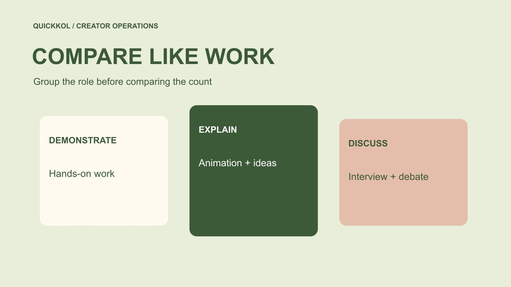

# Popular YouTube Channels: Compare Within a Category

Status: local review draft; confirm the publication date before release.

Build matched channel groups by subject, format and window so popularity research supports a real purchase.

QuickKOL editorial graphic; not actual account metrics or a platform interface.

To compare popular YouTube channels for a brand partnership, first build groups relevant to the assignment. Match subject, format, language, observation window and distribution conditions before interpreting performance. Keep work evidence and unconfirmed commercial scope visible for each channel. Subscriptions can aid discovery without proving relevant audience, production quality or what the brand can purchase. Named channels below are research entry points rather than a live ranking, endorsement or confirmed available partners. The result should explain why a comparison is meaningful and where it stops, instead of turning every popular channel into one interchangeable advertising placement.

## Define comparable before looking for largest

Begin with the action the brand needs: physical demonstration, complex explanation, interview or entertainment integration. Comparability serves that task and need not follow a third-party platform’s broad category. A technology topic may include animation, podcasts and operation tutorials. Mixing them makes viewing differences hard to interpret.

Use the [creator brief](https://www.quickkol.com/blog/write-a-useful-campaign-brief/#answer) to specify necessary conditions and permitted variation. Language, service territory and core format may be mandatory while visual style can vary. Set the grouping rule before inspecting numbers so that a strong result does not become a reason to redefine the group retrospectively. A colleague should be able to find the same work and explain why it addresses a similar question. This is a research design choice rather than a universal taxonomy. Record it so that a later campaign with a different task can legitimately use another group without suggesting that the previous creators were incorrectly classified or lower quality.

## Verify the particular program through official routes

[MKBHD’s official website](https://mkbhd.com/) links distinct programs and channel destinations. That is a reminder not to combine a main channel, podcast and other forms under one purchase object. Identify the particular account, then inspect its work. The public name, contact route and piece should be consistent.

[Veritasium’s official website](https://www.veritasium.com/) supports verification of its science and engineering positioning. A thematic overlap with another technology channel does not make their production forms directly comparable. The named examples demonstrate traceable entry points, not acceptance of a product, price or date. Identity continuity and format consistency are more useful to a brand than neighboring positions in a popularity list. If a report supplies statistics for one program while an offer concerns another, resolve that mismatch before discussing normalized costs. A shared team can be relevant context, but it cannot move performance or permissions between accounts without evidence and commercial confirmation.

## Align windows and the meaning of public counts

[YouTube’s subscriber count guide](https://support.google.com/youtube/answer/6051134?hl=en) explains abbreviated public displays. Retain the observation date and source instead of presenting a ranking figure as permanently exact. For viewing counts, state how long each piece has been available. A year of cumulative viewing is not directly comparable with seven days. If a historical window cannot be recovered, record that limitation.

Subscriptions, cumulative channel views and equal-age viewing for individual pieces are different dimensions. A table can retain all three under distinct names. Do not turn missing values into zeros or insert a channel total into a video field merely to complete a row. Matching definitions may reduce the sample. That is often more useful than manufacturing confidence through many observations made under different conditions. If the team needs a broader group, explain the compromise and test whether it changes the decision instead of quietly weakening the rule after seeing the available results.

## Include ordinary work and boundary cases

Select relevant work using the stated rule, keeping URLs, format, sponsorship state and special events. Do not collect only viral hits or automatically discard low observations. A piece affected by major news or extra promotion can be marked separately rather than hidden. Boundary cases reveal where the grouping rule is unstable.

Invite the creator to clarify promotional conditions not visible publicly without demanding all income or private messages. Admit when the sample is insufficient. Accompany the comparison with work evidence rather than a single average row. The brand is commissioning a specific task. Ordinary production consistency and explanatory choices may resemble that need more closely than one unusually large release. A researcher should be able to show what was learned by watching the work, not merely by sorting counts. That makes the comparison useful to creative reviewers as well as to the person holding the budget.

## Treat audience fit as a separate question

[YouTube’s audience reporting guide](https://support.google.com/youtube/answer/9314416?hl=en) defines recent-audience and geography fields with limitations. A publicly popular channel does not establish that the relevant territory will watch this assignment. At commercial confirmation, request proportionate native evidence retaining the account, period and filters. Creator location is not a substitute for viewer location.

A related topic does not mean every viewer has a purchasing need. Record content fit and audience evidence separately, allowing one to be established while the other remains unknown. If the campaign has no strict territory requirement, the team may give a field lower priority. If it is mandatory, retain pending confirmation instead of exempting a large channel from review. This separation avoids creating one combined fit score whose precision hides missing evidence. It also gives the creator a focused request that can be answered without exposing unrelated reporting or pretending that a platform field reveals a buyer’s intent.

## Compare proposals rather than channels alone

Two apparently similar channels may offer different work. One proposes a dedicated demonstration, another a short integration. One includes advertising permission, another only original-account publication. Use the [creator rates and usage rights framework](https://www.quickkol.com/blog/creator-rates-usage-rights/#answer) to separate production, revisions, distribution, term and exclusivity before comparing numbers.

Where performance evidence is limited, a longer license does not automatically cancel uncertainty, and views alone cannot value every production asset. Explain which proposal fits which task and which terms await a reply. A missing quote is not a zero price. A public partnership route does not establish immediate availability. The team can prioritize the next discussion without declaring one permanently best channel. This approach also avoids penalizing a proposal for a higher total when the brand has not yet checked whether it contains substantial work absent from the lower-priced alternative. Comparable research should lead into comparable purchasing scope.

## Test the ordering with a hypothetical grouping

Suppose six channels discuss technology: three make long-form hands-on work, two use animation and one focuses on interviews. An installation brief should first investigate whether the three hands-on channels can demonstrate the required action. Retain the other roles for different assignments. They are not necessarily weaker; they are outside this purchase group.

If the objective later becomes explaining an industry change, redefine the group rather than carrying over the installation ranking. Date and explain the change. These numbers illustrate a method, not an actual list or an industry distribution. Useful ordering can respond to a new task without rewriting the original evidence. A handoff should show both the earlier role and the current decision so that another researcher does not confuse a scope change with a negative finding. The comparison becomes a working record rather than a static popularity league whose meaning is detached from what the brand needs.

## Keep room to explain an exception

A creator may lack perfectly matched work yet have enough relevant capability to propose an appropriate pilot. List that as an exploratory option instead of changing every rule to include it. Identify the evidence gap, pilot scope and next approval. Exploration is neither established equivalence nor a reason for permanent exclusion.

Another exception may be strong task fit with incompatible timing. Preserve the fit reason and schedule limit so the next team does not repeat the research. A comparison need not compress everyone into one score. It should show what might be purchased and what still needs verification. Honest boundaries make the record consistent and usable. If an exception advances, retain why an owner accepted that uncertainty rather than presenting it as though the original standard had already been met. This preserves accountability without making a research rule so rigid that it prevents a sensible, explicitly scoped new test.

## Hand over a next action

Deliver the group definition, work links, windows, exceptions, commercial unknowns and recommended action. The owner should be able to find the original account, understand the reason and know whom to ask for which missing condition. Every ordering needs a route back to the current assignment rather than ending in a number.

Popular YouTube channels are most useful when they help a brand discover and compare creator roles. The purchase decision comes from relevant work under comparable conditions and an explicit scope. Keeping those records lets a later team reuse research when the task changes instead of treating a popularity list as a completed procurement decision. Before closing the handoff, have another colleague explain one inclusion, one exclusion and one unresolved item from the evidence. If that requires guessing, improve the explanation while the research context is still available rather than expecting the next owner to infer it from the ranking.

## Test the group with a boundary candidate

A boundary candidate can test the group. If a channel publishes both interviews and demonstrations, averaging all its work does not establish demonstration performance. Select the task-relevant pieces and state how many comparable observations are missing. Where a sufficient sample cannot be built, a pilot may remain a separate exploratory option rather than turning unknown into unsuitable. The grouping rule should be repeatable, and exceptions should have reasons. When the next task changes, retain the earlier rationale and build a new group without erasing the original research. This preserves useful evidence while allowing the purchase to evolve.

## What to match in a channel comparison

| Dimension | Match | Retain difference |
| --- | --- | --- |
| Task | Audience question and action | Explanatory role |
| Work | Format and observation age | Special events and promotion |
| Audience | Account, period and territory need | Unavailable fields |
| Proposal | Production and release scope | Rights, timing and fee |

Named channels illustrate verification routes, not live rankings or purchase recommendations.

## Matched-channel comparison checklist

Establish comparability before ordering.

- [ ] Set the rule before seeing counts.
- [ ] Verify the program and original work.
- [ ] Align windows and retain exceptions.
- [ ] Connect research with the next commercial check.

## Research date and limitations

Sources reviewed November 11, 2026. Methods, tables and decision rules are editorial recommendations. Hypothetical examples are not actual client results or industry benchmarks. Source geography and periods are specified where relevant. This draft is in independent local review; confirm its publication date before release.

## Start creator research with a clear task

Use QuickKOL to interpret a brief, discover relevant creators and research their work and contact routes. Verify data, commercial terms and outcomes at their source.

[Explore QuickKOL](https://www.quickkol.com/#capabilities)

## Sources

- [MKBHD’s official website](https://mkbhd.com/)
- [Veritasium’s official website](https://www.veritasium.com/)
- [YouTube’s subscriber count guide](https://support.google.com/youtube/answer/6051134?hl=en)
- [YouTube’s audience reporting guide](https://support.google.com/youtube/answer/9314416?hl=en)
