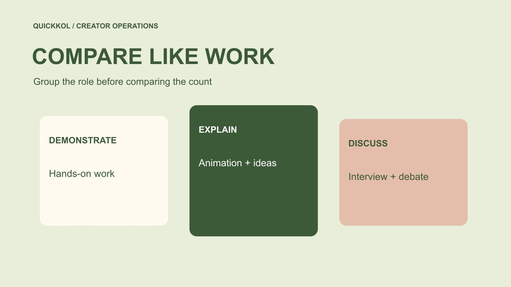

# 热门 YouTube 频道怎样建立同类比较

状态：本地审阅稿；正式发布日期待确认。

建立同题材、同形式与同窗口的频道比较组，让热门线索服务实际采购。

QuickKOL 编辑图形；不呈现真实账号指标或平台界面。

比较 popular YouTube channels，先建立与本次合作有关的同类组，而不是把所有热门频道按一个总数排序。统一题材、作品形式、语言、观察窗口和分发条件，再记录各频道的任务证据与商业未知。订阅数可以帮助发现，不能单独证明相关受众、作品质量或可购买范围。具名频道仅作研究入口，不是实时榜单、背书或已确认可合作名单。

## 先定义同类，而不是先找最大

从品牌需要的动作开始：实物演示、复杂概念解释、访谈还是娱乐植入。同类的定义服务这项任务，不必与第三方平台的粗分类相同。一个科技话题可以包含动画、播客与操作教程，若全部混在一起，观看差异很难解释。

在[达人 Brief](https://www.quickkol.com/zh/blog/write-a-useful-campaign-brief/#answer) 中列本次必要条件和允许差异。必要条件可能是语言、产品可用地区与核心形式；视觉风格可以保留变化。选择规则先于数字，避免看到谁表现高就临时改变组别。最终比较组应让同事能够找到相同作品，并解释为什么它们回答相近问题。

## 用官方入口核对具体节目

[MKBHD 的官方网站](https://mkbhd.com/)连接不同节目与频道入口，提醒研究者不要把同一团队的主频道、播客和其他形式合为一个购买对象。先确认记录的是哪一个账号，再检查对应作品。公开名称、联系人和作品链接应能相互对应。

[Veritasium 的官方网站](https://www.veritasium.com/)可用来核对其科学与工程内容定位。它与另一科技频道有主题交集，也不意味着制作方式可直接比较。选择具名例子只是展示核验入口，不推断对方接受任何产品、价格或档期。对品牌而言，身份连续与作品形式一致，比榜单上的相邻位置更有研究价值。

## 统一作品窗口与公开数字含义

[YouTube 的订阅计数说明](https://support.google.com/youtube/answer/6051134?hl=en)解释公开数字会简化展示。保留观察日期和来源，不把榜单数值说成永久精确排名。作品观看则要注明发布后经过多久，不能拿一年累计与七天结果直接比较。历史窗口不可得时，标成限制，不假装能够还原。

订阅、累计观看与每条作品的同期观看不是同一维度。比较表可以同时记录，但应分别命名。不要为了得到更整齐的表格，把缺失值改成零，或用频道总数补入单条作品。建立统一口径可能让可比样本变少，这通常比用大量不同条件的数字制造确定性更有帮助。

## 让样本包含普通作品与边界情况

按预先规则选择相关作品，保留网址、内容形式、赞助状态和特殊事件。不要只收集爆款，也不将低值自动排除。若某条涉及重大新闻或额外推广，可以单独标注，而不是隐去它。边界案例帮助说明规则在哪些地方不稳定。

可请创作者核对是否存在公开页面看不到的推广条件，但不要求其公开全部收入或私信。样本不足时承认不足。比较结果应附带作品证据，而不只是一行平均数。品牌采购的是具体任务，普通作品的制作稳定性和解释方式可能比一次异常高播放更接近本次需求。

## 把受众适合度作为独立问题

[YouTube 的受众报表说明](https://support.google.com/youtube/answer/9314416?hl=en)提供近期受众与地区等字段的定义和限制。公开频道受欢迎，并不证明本次相关地区的人会观看。商业确认阶段可请求与决定相称的原生资料，保留账号、窗口与筛选条件。不要用创作者所在地代替观众所在地。

内容题材与品牌相关，也不能自动说明每位观看者有购买需要。把内容适合和受众证据分别写，允许一项确定、另一项未知。若品牌没有严格地区限制，可以降低某项资料的优先级；若这是必要条件，就保留待确认，而不是用高订阅数免除核验。

## 比较的是任务方案，不只是频道

两个频道看起来相近，报价范围仍可能不同。一个提供独立演示，一个只有短植入；一个包括广告许可，另一个仅原账号发布。用[达人报价与使用权框架](https://www.quickkol.com/zh/blog/creator-rates-usage-rights/#answer)列制作、修改、分发、使用期与排他，先看本次买什么，再看数字。

如果渠道表现证据有限，不能用更长许可自动抵消不确定，也不能假装只按播放就能衡量创作资产。比较表应说明哪个方案适合哪个任务，哪些条件待回复。缺报价不代表免费，公开合作入口也不代表可随时采购。团队可以形成下一步优先级，而无需宣布一个永远最好的频道。

## 用假设分组检查排序是否合理

假设六个频道都谈技术，其中三个做长篇实物操作，两个做动画，一个做访谈。如果任务是安装演示，先研究前三个是否能完成必要动作，其余保留为其他角色。不能说后三个表现差，只能说目前不属于同一采购组。

如果后来目标变成解释行业变化，应重新定义组别，而不是沿用安装任务的排名。每次变化保留原因与日期。假设数字演示比较方法，不是真实名单或行业比例。一个有用的排序能够随着任务改变更新，同时保持原研究证据不被改写。

## 为例外保留解释空间

某位创作者可能没有完全同类作品，却有足够能力提出合适试拍。品牌可以将其作为探索方案单列，不必为了纳入而修改所有规则。说明证据缺口、试拍范围和下一步批准。探索不是已验证等价，也不应被永久排除。

另一种例外是非常相关但档期不合。保留适合理由与时间限制，避免下次重新研究。比较不需要把每个人压进相同分数，而要帮助团队知道可以购买什么、还应核验什么。对边界诚实，能让名单同时具有一致性与实际使用价值。

## 把比较结果交成下一步

最后交付比较组定义、作品链接、窗口、例外、商业未知与建议行动。负责人能找到原对象，理解理由，并知道联系谁补哪项资料。每个排名都应能追溯到当前任务，而不是只剩一个数字。

Popular YouTube channels 对品牌最有用的方式，是帮助发现和比较不同创作者角色。真正的决定来自相近条件下的作品证据与明确范围。保留这些记录，下一次团队换任务时就可以重用研究，而不必将热门名单当成已经完成的采购判断。

## 用边界候选验证组别

还可以用一个边界候选检查组别：若某频道同时发布访谈与演示，不要把全频道所有作品平均后当成演示表现。先取与任务相关的作品，再说明缺少多少可比观察。无法形成充分样本时，可以把试拍作为单独探索方案，而不是把未知改成不合适。比较规则应能被复述，例外也应有理由。下次任务改变，保留旧选择依据，再建立新组别，不需要抹去原研究。

## 频道比较应匹配什么

| 维度 | 匹配条件 | 保留差异 |
| --- | --- | --- |
| 任务 | 观众问题与动作 | 解释角色 |
| 作品 | 形式与观察年龄 | 特殊事件与推广 |
| 受众 | 账号、窗口及地区需求 | 缺失字段 |
| 方案 | 制作与发布范围 | 许可、时间和价格 |

具名频道用于说明核验入口，不是实时排名或采购建议。

## 同类频道比较清单

排序前先确认可比条件。

- [ ] 规则先于观察数字。
- [ ] 核对具体节目与原作品。
- [ ] 统一窗口并保留例外。
- [ ] 将研究结果接到下一步商业核验。

## 研究日期与使用边界

资料核验于 2026 年 11 月 11 日。文中方法、表格和决策规则为编辑建议，标为假设的示例不是实际客户结果或行业基准。外部资料的适用地区与时期按各段说明；本稿处于独立本地审阅阶段，正式发布日期待确认。

## 用清楚的任务开始达人研究

用 QuickKOL 理解 Brief、发现相关达人并研究作品与联系路径；数据、合作条件和结果仍需核验。

[了解 QuickKOL](https://www.quickkol.com/#capabilities)

## 来源

- [MKBHD 的官方网站](https://mkbhd.com/)
- [Veritasium 的官方网站](https://www.veritasium.com/)
- [YouTube 的订阅计数说明](https://support.google.com/youtube/answer/6051134?hl=en)
- [YouTube 的受众报表说明](https://support.google.com/youtube/answer/9314416?hl=en)
