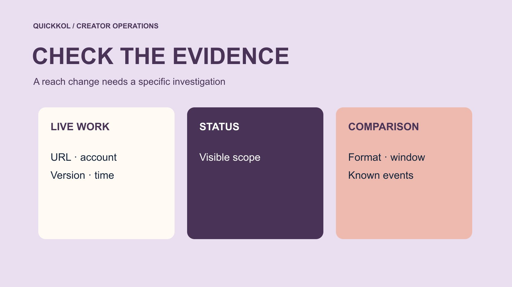

# Shadowbanned? Investigate a Sponsored Post’s Reach

Status: local review draft; confirm the publication date before release.

Turn a shadowban allegation into checks of account status, live publication, distribution and the next partnership decision.

QuickKOL editorial graphic; not actual account metrics or a platform interface.

Shadowbanned is often used to explain lower reach, but the label is not evidence of a particular platform action. A sponsor should first verify the original post, publishing account, reporting object and observation period, then ask the owner to inspect applicable native status information. Recommendation eligibility and actual distribution are different questions. Separate visible restrictions, observed changes, possible explanations and unknowns. A low count alone cannot establish misconduct, a contract breach or the use of fake engagement. Decisions about a revision, delay or other commercial remedy need specific evidence and the actual partnership terms. Start by identifying what has changed and which person can verify it.

## Replace the label with a specific question

Ask what the person using shadowbanned actually observed. Is the original unavailable, invisible to a particular viewer, receiving less recommendation traffic or simply below a viewing target? Record the account, URL, observation time, source and comparison. These questions require different checks. A shared label cannot choose a recovery procedure. Ask something answerable, such as whether the Reel is publicly live or which reporting field declined.

State what is established so far. The creator may have a restriction, an ordinary performance change, a publication mistake or a reporting delay. Keep these as explanations to test rather than selecting a story before collecting evidence. Use the [creator metric definitions](https://www.quickkol.com/blog/creator-metric-definitions/#answer) to distinguish views, reach and interactions. A difference between those fields should not become a claim of suppressed distribution. A precise observation tells the next owner which material is needed, instead of handing over an unexplained statement that the account has a problem.

## Inspect the original and its release conditions first

Open the actual URL and check creator, time, format, visibility and final asset. A draft, wrong account or different piece requires a publication correction before a distribution explanation. One observer’s inability to open a post may involve sign-in, territory or visibility conditions. Investigate those actual conditions rather than concluding from one device that nobody can see it.

Have the owner confirm status through appropriate access without supplying passwords or verification codes. If a screenshot is necessary, retain relevant fields and the observation time while excluding private messages and other projects. Confirming publication does not establish every intended feature. Native links or partnership labels need their own checks. Publication verification defines the object for later comparison. A screenshot showing a successful scheduled entry cannot replace evidence of the original live work. This first step often separates an operational mistake from the performance question the team thought it was investigating.

## Distinguish permission to remain from recommendation

[Meta’s recommendation guidelines explanation](https://about.fb.com/news/2020/08/recommendation-guidelines/) distinguishes content allowed on a platform from content eligible for recommendation. That supports separate availability and eligibility checks. It does not show that the current piece is restricted. Have the creator inspect status information actually available to the account and preserve what is displayed. If an explanation or review route exists, use it within its scope. Do not supply a definite cause on the platform’s behalf when none is shown.

Eligibility is also not a promise of recommendation. Distribution depends on audience interest, the piece and viewing context, while a public total cannot reveal the complete mechanism. Match any status field to its object: a piece, account or another capability. If only a general notice can be established, keep that limitation. The report should distinguish what the platform displayed from what the team still cannot explain. A policy article supports a definition, not a finding that an unobserved enforcement action occurred.

## Choose comparisons with matched format and time

Compare recent work with a similar format and elapsed publication time, not a new post’s first day with years of accumulated viewing. Record advertising, length and topic. A creator’s live game stream, personal Story and product Reel may serve different audiences. Do not compress them into one average. Inspect exceptional successes separately so one outlier does not become the promise for every sponsored piece.

[Instagram’s creator education announcement](https://about.fb.com/news/2024/10/best-practices-education-hub-creators-instagram/) provides official context for learning about content and performance. A diagnosis still needs applicable reporting. Ask for comparable observations the owner can actually access instead of demanding unavailable fine-grained segments. Suppose first-day viewing is lower than the previous piece but moves toward a comparable range by day three. Report that under the agreed window rather than changing the judgment hourly. A review period supports comparison. It is not a guarantee that distribution will recover after a fixed number of days.

## Inspect the content through actual viewing evidence

[Meta’s Reels watch time explanation](https://about.fb.com/news/2023/04/instagram-reels-trending-audio-and-gifts-updates/) distinguishes total and average viewing time and describes the contribution of replays. Use the current report definition for the actual field rather than treating total plays as unique people. If viewers leave before the product appears, an earlier demonstration may be worth testing. A viewing curve still cannot establish every person’s reason for leaving. Match timecodes to footage before proposing a change.

Have the creator review the opening promise, demonstration and sponsor integration together. The brand owns product wording and should not interpret every retention issue as deficient creator ability. If a quick-setup promise leads into a long brand introduction, the next brief can test showing the step sooner. Keep the original version and conditions, changing one main factor where feasible. Ordinary creative improvement should not be presented as proof that an alleged shadowban was identified and removed. The test answers a narrower question about the explanation the audience actually received.

## Keep paid and external activity in a separate timeline

Log advertising, press links, partner reposts, events and publication times. Lower total viewing after advertising stops is not evidence of a penalty on organic recommendation. A large account mentioning one piece can also make a later ordinary result appear unusual. Establish whether the report mixes sources. Separate them when possible. Otherwise describe known events and unknown allocation.

A brand may see public performance while the creator has more native fields. Share the minimum evidence needed for the question rather than opening the entire account. Align dates and known events, then choose the next check. If an unknown growth service was previously connected, record actual access and changes for the responsible reviewer. Present low reach cannot prove earlier fake engagement. Security review and performance analysis can proceed alongside one another, but each conclusion still requires its own evidence. Keeping the timelines separate prevents an unexplained total from becoming a finding about an unrelated activity.

## Discuss remedies through verified facts

The agreement may define publication, licensing, a review period or other conditions. The parties need to interpret the actual terms. A low count should not automatically create a demand for free new production. A creator’s explanation of suppression should not automatically establish completed delivery either. First check whether the promised object is live, accurate and properly permitted, then determine whether a performance commitment exists and how it was defined.

Suppose work was published on time with the correct product and disclosure but receives limited viewing. Production can be assessed against those terms while the team discusses another test from the evidence. If the link is unavailable, investigate its cause and the applicable remedy. If the brand supplied incorrect product information, explain that responsibility too. The investigation should support fair negotiation. An unverified label should not remove one party’s obligation or create a new one for the other. This keeps commercial decisions linked to the work actually purchased.

## Set a defined condition for the next observation

Close the review with verified observations, possible explanations, missing information and the next owner. Each next action should answer one specific question. The owner checks account status, the brand corrects product facts, the creator proposes a pacing test, and the analyst aligns definitions. Missing data should remain visible. Do not invent a recovery date or risk score to fill a table.

If the team tests an earlier product demonstration, retain the original, reason, version and new observation window. Record any concurrent advertising change as well. Keep the next conclusion within the observed result. Use the [creator campaign status system](https://www.quickkol.com/blog/creator-campaign-status-system/#answer) to track the work and distinguish evidence pending from resolved. A practical closeout establishes what can be concluded now, what remains to check and who reviews it next. It does not promise stable reach forever. The resulting brief gives the creator a specific task and gives the sponsor a defensible basis for the next decision.

## Close the review with three evidence states

Close with three possible evidence states: a specific restriction confirmed, another explanatory factor established, or evidence still insufficient. For the first, record the object and scope actually displayed without expanding the cause. For the second, record the publishing error, definition mismatch or known advertising change and whether it explains the observation. For the third, keep the gap and next review condition. The team does not need to select a cause merely to end the discussion.

Suppose the original is live, native information provides no confirmed restriction, and the report cannot separate paid from organic traffic. State that the difference cannot yet be explained from available material. The brand can assess verified delivery while planning a more comparable test. Failure to find a cause cannot prove the platform has no issue, and it cannot prove that enforcement occurred either. A record preserving unknowns can accommodate new evidence without unfair attribution to the creator or operators. Assign one person to update the conclusion when the missing report arrives, retaining the earlier version and the reason for the change. That keeps the project moving while protecting the distinction between an operational decision and a factual finding.

## Layers of a reach-anomaly review

| Layer | Check | Supported conclusion |
| --- | --- | --- |
| Publication | Original URL, account and asset | Actual publication state |
| Eligibility | Applicable native information | Scope of displayed conditions |
| Performance | Matched period, format and source | Observed difference |
| Commercial review | Actual agreement and gap | Specific next action |

Low viewing, one search or one anomaly cannot independently establish enforcement or misconduct.

## Sponsored post reach review

Verify objects and definitions before discussing explanations and commercial treatment.

- [ ] Check original work, account and observation conditions.
- [ ] Have the owner check applicable status information.
- [ ] Separate native performance, advertising and known external events.
- [ ] Hand over verified facts with the next action owner.

## Research date and limitations

Sources reviewed November 11, 2026. Methods, tables and decision rules are editorial recommendations. Hypothetical examples are not actual client results or industry benchmarks. Source geography and periods are specified where relevant. This draft is in independent local review; confirm its publication date before release.

## Start creator research with a clear task

Use QuickKOL to interpret a brief, discover relevant creators and research their work and contact routes. Verify data, commercial terms and outcomes at their source.

[Explore QuickKOL](https://www.quickkol.com/#capabilities)

## Sources

- [Meta’s recommendation guidelines explanation](https://about.fb.com/news/2020/08/recommendation-guidelines/)
- [Instagram’s creator education announcement](https://about.fb.com/news/2024/10/best-practices-education-hub-creators-instagram/)
- [Meta’s Reels watch time explanation](https://about.fb.com/news/2023/04/instagram-reels-trending-audio-and-gifts-updates/)
