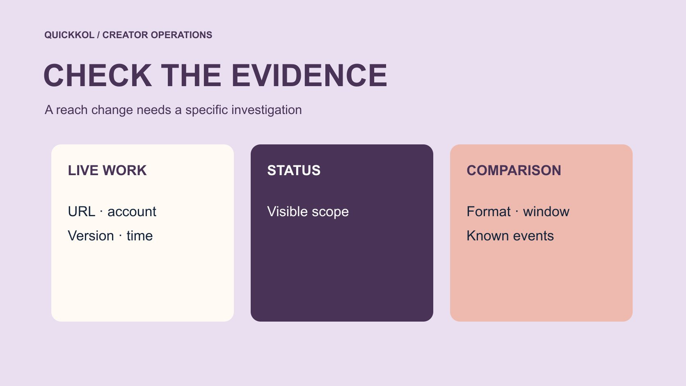

# 合作帖触达下降就叫 Shadowbanned 吗

状态：本地审阅稿；正式发布日期待确认。

把 Shadowbanned 的猜测拆成账号状态、实际发布、分发变化和下一步合作决定。

QuickKOL 编辑图形；不呈现真实账号指标或平台界面。

Shadowbanned 常被用来解释触达下降，但它本身不是一份已确认的平台处置证据。品牌应先核对原作品能否访问、发在什么账号、报告对象与窗口，再由创作者查看适用的原生状态信息。推荐资格与实际触达也不相同。把已显示的限制、数据变化、可能解释和未知分开记录。只有具体证据与合作约定能够支持补发、延期或其他商业处理，不能从一次低观看就认定达人违约或使用刷量服务。

## 把一个笼统标签改成具体问题

问提出 Shadowbanned 的人究竟观察到了什么。是原帖打不开、某类用户看不到、推荐触达下降，还是只是总观看低于预期？记录账号、作品 URL、观察时间、数据来源与对照对象。不同问题需要不同检查，不能从同一个词直接跳到恢复方案。品牌应提出可以回答的问题，例如本次 Reel 是否公开上线、某个报告字段是否减少。

先承认目前能证实的内容。创作者可能真遇到限制，也可能遇到正常表现变化、发布错误或报表延迟。把这些保留为待检验解释，避免在收集资料前选定一个故事。使用[达人指标口径说明](https://www.quickkol.com/zh/blog/creator-metric-definitions/#answer)核对观看、触达和互动，防止把不同字段的差异叫成限流。一个精确的观察句，能让下一位负责人知道需要什么材料，而不是只收到一句账号有问题。

## 先检查原作品和发布条件

打开正式 URL，核对创作者、时间、内容形式、可见范围与最终素材。若作品仍是草稿、发在错误账号，或与 Brief 约定不同，先处理发布问题。某个观察账号打不开作品，也可能涉及登录、地区或可见性条件，需要按实际情况确认。不要在一次设备测试后声称全平台都无法看到。

请账号所有者使用适当方式确认实际状态，不索取密码或验证码。若需要截图，只保留相关字段和观察时点，避免把私人消息或其他项目内容一并收集。确认已发布，也不证明所有预期功能存在。例如原生链接或合作标记应按各自条件检查。发布核验给出了分析对象，后面才能比较它的表现。不能用一张排期成功截图替代正式作品证据。

## 区分允许发布与可能推荐

[Meta 的推荐资格说明](https://about.fb.com/news/2020/08/recommendation-guidelines/)解释，有些允许留在平台上的内容可能不符合推荐条件。这支持把可访问与推荐资格分开检查，但不能据此断定本次作品被限制。由创作者查看当前账号能用的状态信息，保存实际显示内容。若系统给出说明或复核路径，按其适用范围处理；没有显示原因时，不替平台补一个确定结论。

品牌也不要把符合推荐资格写成保证推荐。分发还与受众兴趣、内容和观看情境有关，公开总量不能显示完整机制。把状态字段对应到具体对象，看看是某条内容、账号还是另一项功能。若只能确认存在一般提示，就保留该限制。调查报告应让读者看到平台已经显示了什么，以及团队还不能说明什么，而不是用政策文章证明一个未观察到的处置。

## 选择同样窗口与形式的对照

比较近期同类作品，不拿多年累计观看与新稿首日对照。说明发布后经过多久、是否有广告、内容长度和主题。一个创作者的游戏直播、日常 Story 与产品 Reel 可能服务不同受众，不应压成同一平均。把近期爆款与普通系列分开查看，避免一个异常高值成为所有赞助作品的承诺。

[Instagram 的创作者学习说明](https://about.fb.com/news/2024/10/best-practices-education-hub-creators-instagram/)提供有关内容与表现学习的官方背景，实际诊断仍需要适用报表。让创作者提供能读到的同类观察，不要求无法获得的精细分组。假设新稿首日观看低于前一条，但第三天逐步接近同类范围，这种变化应按预设窗口报告。不要每隔几小时改一次判断，也不要宣称固定等待多少天就会恢复。观察期服务比较，不是平台恢复保证。

## 从实际观看检查内容问题

[Meta 的 Reels 观看时长说明](https://about.fb.com/news/2023/04/instagram-reels-trending-audio-and-gifts-updates/)区分总观看时间和平均观看时间，并说明重复观看会影响总量。使用具体报表时按当前定义核对，不能把观看总量直接当成独立人数。如果观众在产品出现前就离开，内容可能需要更早展示任务；但一条观看曲线仍不能证明每个人离开的原因。先把时间点与画面对应，再提出可检验改动。

让创作者检查开头承诺、演示与品牌插入是否连贯。品牌负责核对产品措辞，不能把所有留存问题解释为创作者能力不足。假设开头讲快速设置，却先播放很长的品牌介绍，可以在下一份 Brief 中试更早展示步骤。保留原版本和观察条件，一次只改一个主要因素更便于学习。正常内容优化不应被包装成已经找到并解除影子封禁。

## 单独记录付费与外部活动

同时记录广告、媒体链接、合作账号转发、活动与发布时间。某周停止投放后总观看下降，不等于自然推荐被处罚。某条作品被大号提及后上涨，也不能证明下一条低观看异常。分析时先确认报表是否把不同来源混在一起，能分开就按来源报告，不能分开就写已知事件与未知分配。

品牌有时只能看到公开表现，创作者能看更多原生字段。双方应交换完成任务所需的最小证据，而不是开放全部账号。对齐日期和已知事件，再选择下一项核查。如果此前使用过不明增长服务，记录实际访问与变化，交给相应负责人复核；不能从现在触达低反推过去发生刷量。安全审查与内容表现分析可以并行，但各自结论仍需要自己的证据。

## 用可核验事实讨论补发与延期

合同可能约定发布、许可、观察期或其他条件，具体处理由双方依据实际条款确认。品牌不能因为观看低就直接要求免费补拍，也不能因为创作者说被限流就自动视为交付完成。先看约定对象是否上线、内容是否准确、必要许可是否有效，再讨论表现承诺是否存在及怎样定义。制作、发布和结果不应混成一个不透明的验收条件。

假设作品按期发布、产品与披露正确，但观看低。可以正常完成相应制作验收，并根据证据讨论下一次试验。若链接实际打不开，则由负责人核对原因和适用补救。若品牌提供错误商品信息，修正责任也需按实际情况说明。调查记录服务公平协商，不能用没有平台依据的影子封禁词汇替一方免除或增加义务。

## 为下一次观察制定明确条件

复盘用四列，已证实观察、可能解释、缺失资料、下一步负责人。每项下一步要回答一个具体问题。账号状态由所有者核对，产品事实由品牌修正，素材节奏由创作者提出试验，指标口径由分析人员对齐。没有可用数据时明确说明，不能为了填完表而编一个恢复日期或风险分。

假设团队选择更早展示产品操作，保留原帖、修改原因、版本和新观察窗口。若发布中还有广告变化，也在时间线上说明。下一次结论仍要按实际结果限制范围。用[达人活动状态管理方法](https://www.quickkol.com/zh/blog/creator-campaign-status-system/#answer)追踪这些任务，让等待资料与已解决分开。可执行的收尾是知道目前能下什么结论、还有哪项核查、何时由谁复看，不是承诺从此再无触达波动。

## 用三种结案状态表达未知

可以把结案分成已确认具体限制、找到其他可解释因素、证据仍不足三类。第一类记录平台实际显示的对象与范围，不扩写原因。第二类记录排期错误、口径差异或已知投放变化，并确认是否足以解释观察。第三类保留缺口和下次复看条件，不用必须选一个原因来结束讨论。每类都能有实际下一步。

假设原帖正常、原生状态没有可确认的限制，但报告也不能分开广告与自然流量。结论应说明目前没有足够资料解释差异。品牌可以按已经确认的交付验收，同时另行设计一次可比测试。不能从找不到原因推出平台一定没有问题，也不能反向认定一定被处罚。一个能够保留未知的记录，能让后续证据更新结论，并减少对创作者和项目人员的无依据归责。

## 触达异常的核验层次

| 层次 | 核对 | 可支持的结论 |
| --- | --- | --- |
| 发布 | 正式 URL、账号和素材 | 实际发布状态 |
| 资格 | 原生界面显示的适用信息 | 已显示条件的范围 |
| 表现 | 同窗口、形式与来源 | 观察到的差异 |
| 协商 | 实际约定与缺口 | 具体下一步 |

低观看、单次搜索或一个异常指标都不能独立证明处罚或个人违规。

## 合作帖触达复核清单

先完成对象和口径核对，再讨论解释与商业处理。

- [ ] 检查正式作品、账号和观察条件。
- [ ] 由账号所有者核对适用状态信息。
- [ ] 分开原生表现、广告和已知外部事件。
- [ ] 把已证实事实与下一步负责人一起交接。

## 研究日期与使用边界

资料核验于 2026 年 11 月 11 日。文中方法、表格和决策规则为编辑建议，标为假设的示例不是实际客户结果或行业基准。外部资料的适用地区与时期按各段说明；本稿处于独立本地审阅阶段，正式发布日期待确认。

## 用清楚的任务开始达人研究

用 QuickKOL 理解 Brief、发现相关达人并研究作品与联系路径；数据、合作条件和结果仍需核验。

[了解 QuickKOL](https://www.quickkol.com/#capabilities)

## 来源

- [Meta 的推荐资格说明](https://about.fb.com/news/2020/08/recommendation-guidelines/)
- [Instagram 的创作者学习说明](https://about.fb.com/news/2024/10/best-practices-education-hub-creators-instagram/)
- [Meta 的 Reels 观看时长说明](https://about.fb.com/news/2023/04/instagram-reels-trending-audio-and-gifts-updates/)
