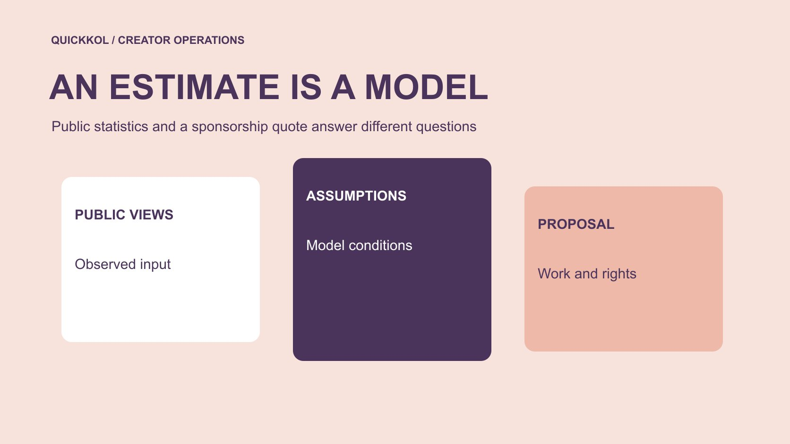

# Social Blade YouTube Stats in a Sponsorship Discussion

Status: local review draft; confirm the publication date before release.

Use public channel statistics as research context and negotiate sponsorship around actual production, publication and usage.

QuickKOL editorial graphic; not actual account metrics or a platform interface.

Social Blade YouTube statistics can help frame research questions, but an earnings estimate cannot establish a creator’s actual income or the appropriate price of a sponsorship. Match channel and date, then separate public counts, tool estimates and relevant reporting supplied by the owner. Compare quotes against the requested production, publication, license and operating conditions. Use comparable work for a bounded planning scenario rather than treating estimated advertising income as a price ceiling. A change in a public chart should trigger source and event checks. It should not automatically become an allegation of fake engagement or concealed earnings.

## Confirm that the research concerns the same channel

Match the original channel, tool page and account in the proposal, recording the observation date and object. Similar names, several programs or different accounts run by one team should not become one purchasing object. The brand may be buying a main-channel video or a short on another account. The public total needs to correspond to the actual assignment. Open recent work to establish topic, format and publication destination before a larger-looking number anchors the discussion.

Keep the original URL, observation time and question in the research record. Public performance can support screening without proving willingness to collaborate or permission for advertising. Use the [creator shortlist workflow](https://www.quickkol.com/blog/creator-shortlist-workflow/#answer) to separate verified material, supplier assertions and conditions still needing contact. Put a source and date beside each number so another buyer can assess its relevance to the current conversation. An older screenshot should not become a permanent fact merely because it has been copied into a proposal.

## Unpack the assumptions in estimated earnings

[Social Blade’s earnings estimate explanation](https://socialblade.com/help/how-are-estimated-earnings-calculated) describes a model using views and a range of assumed revenue per thousand views, while noting that not every view is monetized. That is a disclosed estimation method, not documentation of the advertising or sponsorship money a particular creator received. Keep the vendor’s model separate from the brand’s purchase decision.

For a hypothetical reproduction using 100,000 views and the stated default assumptions of $0.25 and $4 per thousand, the result is $25 to $400. This reproduces the model rather than estimating a named creator or establishing a market price. It does not verify actual monetization conditions, viewing formats or other income. The endpoints cannot determine the price of a video requiring production, editing and a usage license. Obtain a proposal from someone authorized to quote the requested scope. The estimate can prompt a question about assumptions without becoming a substitute for the quote or a finding about a person’s finances.

## Keep public subscriber counts within their scope

[YouTube’s subscriber count guide](https://support.google.com/youtube/answer/6051134?hl=en) explains shortened public display and platform verification of accounts and metrics. A small difference between public snapshots is therefore not necessarily a precise count of people added, and one change cannot establish its cause. If a tool and original page differ, align observation times, fields and display precision before considering other explanations.

Public subscriptions describe one channel relationship, not verified exposure to the proposed sponsorship. A large count may help identify a candidate while recent relevant work still needs review. Do not attribute every change to one advertisement or interpret a decline as proof of bought followers. Record what can be observed and its limits, then make a specific evidence request. If public snapshots are all that is available, use them for a bounded decision rather than decorating a report with unverified precision. That makes the number useful without granting it more meaning than its source supports.

## Supplement charts with appropriate audience evidence

[YouTube’s audience reporting guide](https://support.google.com/youtube/answer/9314416?hl=en) defines monthly audience as an estimate of unique viewers over a rolling 28-day period and notes that some data is limited. It is a different object from cumulative subscribers. For recent relevant audience evidence, request the applicable window and field rather than renaming public subscriptions active audience. Geographic fields also need their definition and cannot automatically represent purchasers.

Request only material needed for the commercial decision. A series sponsorship may need comparable work and periods without requiring the entire dashboard. Keep a missing field missing instead of inserting a tool estimate into a native-report column. Ask the provider to identify source and limits, then decide what the evidence supports. Public trends, owner-held reporting and a quote can coexist in the research file when each object is labeled. One attractive chart should not replace separate questions about audience relevance, likely delivery and the work being purchased.

## Compare quotes by production, distribution and rights

List the asset, format, review rounds, publishing account, timing, usage and other work. Quotes become meaningfully comparable only when those conditions are aligned. A production-only purchase should not be priced as though it includes the channel’s full distribution. Original-account sponsorship, custom production and advertising permission also require a scope that reflects each part.

Use the [creator rates and usage rights framework](https://www.quickkol.com/blog/creator-rates-usage-rights/#answer) to retain itemized fees and boundaries. An advertising-income model cannot establish production time, team cost or the opportunity cost a creator accepts. A low estimate is not a verified reason to reduce a fee, and a high estimate is not a reason to assume payment is unnecessary. Adjust a real negotiation by changing asset count, territory, duration or review requirements where appropriate. Put the revised scope into the new quote rather than letting an unchanged total silently purchase different work. A scoped comparison gives procurement a more defensible budget explanation.

## Separate a viewing scenario from a price prediction

Choose comparable series, format and elapsed publication time, explaining the sample’s relevance. A median and range may help describe it when the inclusion and exclusion rules are retained. One exceptional success does not guarantee every new piece, and lifetime viewing is not a first-week forecast. Public videos may also have mixed traffic sources that cannot be labeled purely organic without evidence.

Suppose a quote is $2,000 and the team uses 40,000 views as a planning scenario. Dividing the fee by views and multiplying by 1,000 gives $50. That is a scenario cost for the included scope, not an achieved CPM, and it is not the same quantity as Social Blade’s modeled advertising revenue per thousand. Recalculate after delivery with the actual scope and observation, stating included costs and fields. Budget discussion should expose uncertainty rather than converting one arithmetic step into a performance promise. A scenario helps compare feasible assignments, not predict the creator’s price from advertising income.

## Ask specific questions about discrepancies

When a trend, proposal screenshot and supplied report disagree, list the account, period, field and source first. Ask for records explaining the difference, such as another format or date range, rather than alleging fabricated data. Corrections, display precision and timing may be relevant, but each explanation still needs appropriate support. A possibility is not a finding.

Classify the result as confirmed, evidence pending or unsuitable for the task. A figure that cannot support this budget does not establish misconduct by its provider. If information remains absent, narrow the purchase, postpone the dependent conclusion or select another adequately supported option. Keep external statements within verified scope and retain open questions internally. A specific and fair request is more likely to produce relevant evidence than demanding a sweeping proof of authenticity. The decision should concern what the brand can responsibly buy and claim, without assigning intent from an unexplained public difference.

## Hand over a purchase recommendation that explains the budget

The purchasing memo should contain the original channel, public observations, estimate assumptions, scope of owner-held material, actual quote and unresolved terms. Explain the recommendation through the task, such as suitable explanatory work with advertising permission still pending. A tool grade or earnings range cannot replace the whole decision. Preserve samples that did not support the expected conclusion as well.

After delivery, update asset acceptance and observed response separately while retaining the original scenario. The next round can adjust scope and comparisons instead of reopening negotiation with the same public earnings graphic. Social Blade can supply public clues worth asking about. The purchase still depends on suitable work, evidence and explicit operating conditions. Another owner should be able to explain why one number was used, why another remained contextual and who needs to supply missing material. That is a more durable handoff than a price justified by an estimate of someone else’s income.

## When a quote appears higher than estimated earnings

Suppose procurement places a displayed monthly Social Blade estimate beside a two-thousand-dollar proposal and concludes that the creator is overcharging. First ask whether the figures describe the same thing. The estimate concerns public viewing inputs and advertising-income assumptions. The proposal may include filming, editing, an original-account release and a limited paid-use license. Even if both calculations are internally correct, subtracting one from the other cannot establish a reasonable profit margin.

Ask for a scope breakdown or a version without advertising permission. If the brand can afford only organic publication, negotiate a smaller purchase rather than treating a tool’s earnings range as the creator’s income ceiling. Do not assume the proposal equals net creator income either. Team costs, equipment, tax and other expenses have not been established by the public chart.

Keep the public research number and the confirmed commercial offer in the negotiation record, but label their purposes separately. A budget decision should concern the task, comparable scope, permissions and uncertainty. If the necessary evidence remains unavailable, leave the proposal pending or select another option. The discrepancy does not need to be explained as fraud. This approach lets the brand challenge an unsuitable price without assigning a financial meaning to a public estimate that it was never able to support.

## Different uses of statistics and quotes

| Material | Question it supports | Additional evidence |
| --- | --- | --- |
| Public channel count | Research object and trend | Date, field and original work |
| Tool earnings estimate | Understand model assumptions | Cannot replace actual income records |
| Owner-held audience report | Relevant audience in a scoped period | Definitions and availability limits |
| Current quote | Purchased work and usage | Actual proposal and approvals |

Viewing and fee calculations are hypothetical scenarios, not market rates or a creator’s actual income.

## Before public statistics enter negotiation

Place the numeric object and actual purchase scope in the research record.

- [ ] Match channel, source, date and field.
- [ ] Separate earnings models, actual income and the quote.
- [ ] Build a bounded viewing scenario from comparable work.
- [ ] Explain the purchase through work, rights and evidence.

## Research date and limitations

Sources reviewed November 11, 2026. Methods, tables and decision rules are editorial recommendations. Hypothetical examples are not actual client results or industry benchmarks. Source geography and periods are specified where relevant. This draft is in independent local review; confirm its publication date before release.

## Start creator research with a clear task

Use QuickKOL to interpret a brief, discover relevant creators and research their work and contact routes. Verify data, commercial terms and outcomes at their source.

[Explore QuickKOL](https://www.quickkol.com/#capabilities)

## Sources

- [Social Blade’s earnings estimate explanation](https://socialblade.com/help/how-are-estimated-earnings-calculated)
- [YouTube’s subscriber count guide](https://support.google.com/youtube/answer/6051134?hl=en)
- [YouTube’s audience reporting guide](https://support.google.com/youtube/answer/9314416?hl=en)
