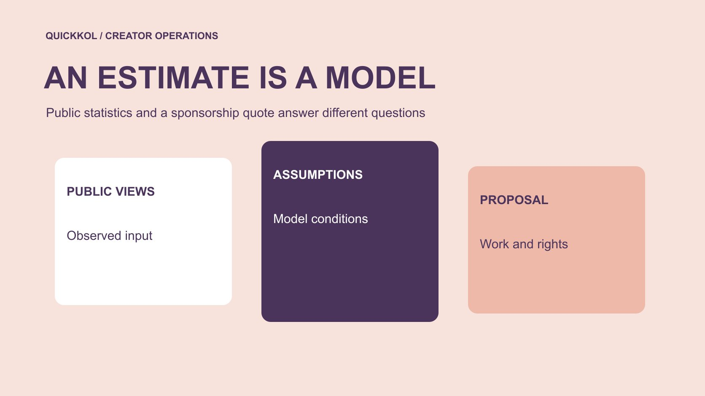

# Social Blade 的 YouTube 数字怎样用于合作谈判

状态：本地审阅稿；正式发布日期待确认。

把公开频道统计当成研究线索，按实际制作、发布和使用范围讨论赞助价格。

QuickKOL 编辑图形；不呈现真实账号指标或平台界面。

Social Blade 的 YouTube 数据可以帮助形成研究问题，但其收益估算不能直接证明创作者的实际收入或合理赞助价格。先核对频道与日期，再区分公开计数、工具估算和账号所有者提供的适用报表。品牌应按本次制作、发布、许可与工作条件比较报价，使用相近作品观察规划情景。公开图表出现变化时先复核来源与事件，不把一项差额自动写成刷量或隐瞒收入的证据。

## 先确认研究的是同一个频道

把原频道、工具页面与提案中的账号对应，记录观察日期和对象。相似名字、多个节目或同一团队的不同账号，不应合成一个合作对象。品牌可能采购主频道视频，也可能采购另一账号的短内容，公开总量应对应实际购买范围。先打开近期作品，确认主题、形式与发布对象，避免在报价讨论中拿错一个看起来更大的数字。

研究记录保留原 URL、截图时点和提出的问题。公开表现适合做初筛线索，不能独立证明对方已经接受合作或可以提供某项广告权利。用[候选名单工作流](https://www.quickkol.com/zh/blog/creator-shortlist-workflow/#answer)区分已核实信息、供应商陈述和仍需联系确认的条件。每个数字旁边写明来源与时间，下一位采购人就能检查它是否仍然适合当前讨论，而不把旧截图当成永久事实。

## 拆开收益估算的输入与假设

[Social Blade 的收益估算说明](https://socialblade.com/help/how-are-estimated-earnings-calculated)介绍其模型用观看与一组每千次观看收益假设计算区间，并说明并非所有观看都变现。它展示的是估算方法，不能作为某位创作者实际收到的广告款或赞助收入凭证。品牌复盘时要把工具自述的计算方式，与自己的采购决定分开。

按其说明中的默认区间作一个假设演算，若用于计算的观看数为 100,000，使用每千次 0.25 与 4 美元，结果为 25 至 400 美元。这里复算模型，不是在估计某位真实创作者，也不是市场价格。实际货币化条件、观看形式与其他收入并未因此得到核实。更不能用这两个端点判断一条需拍摄、剪辑和授权的视频应该卖多少。需要价格时，向有权报价的人取得本次范围的提案。

## 把公开订阅计数放在适当范围

[YouTube 的订阅计数说明](https://support.google.com/youtube/answer/6051134?hl=en)解释，观众看到的数值会按账号规模简化展示，平台也会对账号与指标作核验。品牌因此不能把两个公开快照之间的细小差别当成精确新增人数，更不能凭一次变化确定原因。工具与原页面不同步时，先核对时点、字段和显示精度，再问是否有其他能够确认的解释。

公开订阅是频道关系的一个指标，不是已确认看过这条赞助的人。数量较大可能帮助识别研究对象，仍需要看近期相关作品。不要把订阅变化全部归因于某个广告活动，也不要把下降自动写成买粉证据。记录能确认的观察以及限制，向创作者提出具体资料请求。如果只能看到公开快照，就按这一层证据作有限决定，不用无法验证的精度装饰报告。

## 用适用受众信息补充公开图表

[YouTube 的受众报表说明](https://support.google.com/youtube/answer/9314416?hl=en)把月度受众定义为滚动 28 天的独立观众估计，并提示部分数据可能受限。这与累计订阅数不是同一个对象。品牌若要了解近期相关观众，应请求适用窗口和字段，而不是把公开订阅直接改名为活跃受众。地域字段也要看定义，不能自动当作购买者地区。

请求与当前商业决定相关的最小材料。一个特定系列赞助，可能需要相近内容与窗口的观察，而不需要创作者全部后台。缺失保留缺失；不把工具估算填进原生报表一列。让提供资料的人说明来源和适用限制，再决定它能支持什么。公开趋势、原生受众和合作报价可以放在同一研究文件中，但应各自标明对象，避免一张漂亮图表取代多个不同问题。

## 按制作、分发与许可比较报价

列出本次需要的作品、长度或形式、审阅轮次、发布账号、时间、使用范围和其他工作。只有这些条件足够一致，才适合比较创作者报价。品牌如果只买素材制作，就不要按整个频道的分发承诺估价。若要原账号赞助、专属制作与付费广告许可，报价结构也应反映这些范围。

用[达人报价与使用权框架](https://www.quickkol.com/zh/blog/creator-rates-usage-rights/#answer)保留单项费用和允许使用的边界。广告收益模型不能说明制作时间、团队成本或创作者愿意承担的机会成本。也不要把估算低当成压价事实，或把估算高当成对方不需要付款的理由。真实谈判可以通过缩小资产数量、地区、期限或审阅范围调整预算。每一项改变写入新报价，而不是让同一个总价悄悄承担不同工作。

## 把观看情景与价格预测分开

选择相近系列、形式与发布后经过时间的作品，说明样本为何适用。必要时用中位数和范围帮助描述，但记录样本选择与排除规则。一个爆款不是全部新稿的保证，累计观看也不能直接变成首周预测。公开视频可能包含不同流量来源，不能无资料地称为纯自然观看。

假设采购报价为 2,000 美元，团队用于规划的观看情景为 40,000，则简单费用除以观看再乘 1,000，为 50 美元。它是整个所含范围的情景费用，不是已实现 CPM，更不能与 Social Blade 的广告收入每千次数值当成同一口径。发布后用实际范围再复算，说明哪些费用和观察被纳入。预算讨论应展示不确定性，而不是通过一个除法承诺结果。

## 对差异提出具体问题而非指控

如果公开趋势、提案截图和提供的报表不一致，先列账号、窗口、字段与来源。向对方询问能解释差异的记录，例如是否包含另一形式的内容或不同时段，而不是直接说数据造假。平台清理、显示精度与时间差都可能需要考虑，但每种解释仍要有适当依据，不能用可能性替代事实。

将核验结果写成确认、待补与不适用。某个数字不适合本次预算，不等于提供人存在违规。缺少资料时可以缩小采购、推迟依赖该数字的结论，或选择另一个证据充分的方案。对外材料只使用已核实范围，内部也保留未解问题。公平且具体的请求，有助于获得真正有用的资料，而不是迫使创作者回答一个无法证明的总问题。

## 交接一份能解释预算的采购建议

采购建议包括原频道、公开观察、估算假设、原生资料范围、具体报价和未确认条件。推荐与否要写对应任务的理由，例如作品能解释产品但广告许可另需确认。不要用一个工具等级或收益区间代替完整判断，也不要在结案时删掉不支持预想结果的样本。

后续实际交付后，分别更新作品验收和观察结果，保留最初规划情景。下一轮可以据此调整范围与样本，而不是重新拿同一张公开收益图开始压价。Social Blade 的价值在于提供可追问的公开线索，最终采购仍依赖作品契合、证据与明确工作条件。下一位负责人应能理解为什么采用某个数字、为什么另一数字只作参考，以及该向谁补齐材料。

## 当报价看起来高于估算收益

假设采购把 Social Blade 显示的月度估算与一份两千美元报价放在一起，认为创作者收费过高。先问两个数字是否衡量同一件事。估算针对某些公开观看与广告收益假设，报价可能包含拍摄、剪辑、一次原账号发布和短期广告许可。即使算术都正确，它们也不能直接相减来推导合理利润。

请对方拆出交付范围，或比较不含广告许可的方案。品牌若预算只够自然发布，可以缩小购买范围，而不是要求对方接受工具估算的收入上限。也不要假定报价等于创作者实际净收入，因为制作团队、设备、税费与其他支出并未在这张表里核实。

谈判记录可以同时保留公开研究数字与对方确认的商业方案，但分别标明用途。预算决定应围绕任务、可比较范围、许可和不确定性。若对方无法提供本次所需的证据，可以保持待确认或选择其他方案；无需把差异解释为数据造假。

## 公开统计与报价的不同用途

| 材料 | 支持问题 | 需要补充 |
| --- | --- | --- |
| 公开频道计数 | 研究对象和趋势 | 日期、字段与实际作品 |
| 工具收益估算 | 了解模型假设 | 不能代替实际收入记录 |
| 原生受众资料 | 适用窗口中的相关观众 | 定义与可用性限制 |
| 本次报价 | 购买工作与使用范围 | 实际提案及批准条件 |

文中的观看、费用和演算均为假设情景，不是市场报价或实际创作者收入。

## 公开统计进入谈判前

先把数字对象和购买范围放到同一张研究表。

- [ ] 核对频道、来源、日期与字段。
- [ ] 把收益模型与实际收入及报价分开。
- [ ] 用相近作品建立有边界的观看情景。
- [ ] 按工作、许可与证据说明采购理由。

## 研究日期与使用边界

资料核验于 2026 年 11 月 11 日。文中方法、表格和决策规则为编辑建议，标为假设的示例不是实际客户结果或行业基准。外部资料的适用地区与时期按各段说明；本稿处于独立本地审阅阶段，正式发布日期待确认。

## 用清楚的任务开始达人研究

用 QuickKOL 理解 Brief、发现相关达人并研究作品与联系路径；数据、合作条件和结果仍需核验。

[了解 QuickKOL](https://www.quickkol.com/#capabilities)

## 来源

- [Social Blade 的收益估算说明](https://socialblade.com/help/how-are-estimated-earnings-calculated)
- [YouTube 的订阅计数说明](https://support.google.com/youtube/answer/6051134?hl=en)
- [YouTube 的受众报表说明](https://support.google.com/youtube/answer/9314416?hl=en)
