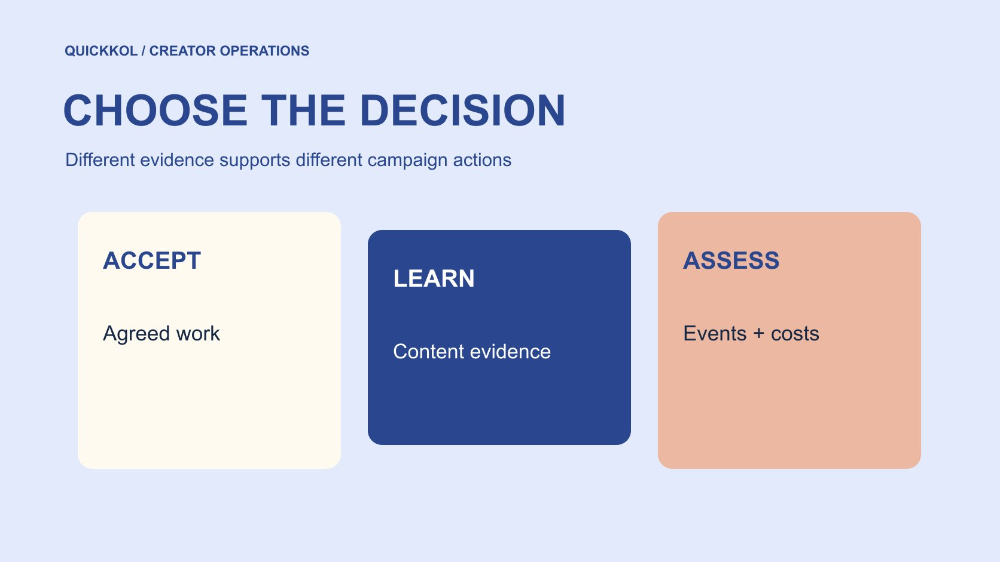

# Social Media Metrics for Creator Campaign Decisions

Status: local review draft; confirm the publication date before release.

Decide whether the task is acceptance, learning or a commercial judgment before choosing appropriately defined metrics.

QuickKOL editorial graphic; not actual account metrics or a platform interface.

Choose social media metrics by working backward from the decision. Acceptance asks whether agreed work was delivered. Content learning asks how people watched and understood it. Commercial judgment concerns observable visits, orders and costs. Give each field a source, object, window, unit and limitation. Do not rename views people, interaction purchase intent or a coincident increase incremental impact. More metrics do not automatically create stronger evidence. A useful report explains what each observation supports, what remains unknown and which next action follows. This guide is a decision framework, not a universal score that can rank every creator across platforms.

## Write the decision before opening the report

Ask what the owner will do with the report: confirm delivery, revise work, renew, increase distribution or explain sales. Those decisions require different evidence. Confirming that an original post exists does not require every analytics field. Judging incremental sales cannot rely on likes alone. Put the decision and responsible person at the top of the record.

Use the [creator campaign measurement framework](https://www.quickkol.com/blog/creator-campaign-measurement/#answer) to separate acceptance, learning and commercial questions. For each row, state what action would follow a particular observation. Give a field lower priority if it cannot change anything. This reduces information collection and stops default template columns from becoming accidental purchasing standards. Measurement should serve the actual partnership rather than requiring a creator to supply more data for a report nobody uses. The decision statement also makes later disagreement easier to locate: the parties can assess whether they dispute the observation, its interpretation or the action proposed from it.

## For acceptance, inspect the agreed work and state

Acceptance concerns the approved version, original publication, required disclosure, destination and permissions. Evidence may be a work link, version record and appropriate confirmation rather than a performance number. Use the [creator campaign status system](https://www.quickkol.com/blog/creator-campaign-status-system/#answer) to distinguish review, scheduling, publication and verification. A successful queue event does not automatically establish a live original post.

If the piece lacks an agreed action, request a specific correction. If the work is completed but viewing is low, move to performance learning instead of retrospectively rewriting acceptance. Both issues can exist, but neither substitutes for the other. The separation supports fair settlement and tells the creator beforehand which requirements are controllable and which audience responses will be observed later. It also prevents procurement from using a disappointing aggregate to avoid inspecting the actual deliverable, or a production reviewer from approving missing work merely because the post attracted a large audience.

## Choose learning fields that match the question

Learning may concern continuation after an opening, clarity of a key operation or relevant questions raised by viewers. State what the observation can support instead of interpreting attention automatically as approval. [Meta’s Reels watch time explanation](https://about.fb.com/news/2023/04/instagram-reels-trending-audio-and-gifts-updates/) notes replay within total time, reminding analysts to preserve the field’s actual unit and scope.

Repeated viewing of one section might reflect value or confusion. Inspect the footage and suitable question themes before interpreting it. An absence of questions cannot establish universal understanding either. Content learning connects observations with the work to produce a testable change for the next piece, rather than declaring a creator incapable from one aggregate. A useful recommendation identifies the particular opening, explanation or camera choice worth testing. It also states what evidence would show improvement, so the next campaign does not merely collect the same fields again without learning whether the proposed change addressed the original audience problem.

## Keep impressions, viewing and people distinct

[YouTube’s impressions and viewing guide](https://support.google.com/youtube/answer/9314486?hl=en) defines qualifying thumbnail impressions and their relation to viewing. That field does not cover every traffic route and should not become the definition of impressions on every platform. [YouTube’s unique viewer guide](https://support.google.com/youtube/answer/7577916?hl=en) instead concerns an estimated audience, distinct from repeated viewing events.

Retain platform-specific fields rather than changing definitions to fit one column name. Before comparison, ask whether the quantities and windows match and whether estimates or missing data are involved. Do not simply add unique viewers across creators into a deduplicated audience because people may overlap. An undeduplicated sum can remain useful if named and limited accordingly. A report should make this distinction visible where the number is used, not only in a separate methods appendix that the budget slide omits. Comparable labeling is a prerequisite for interpretation; it cannot be repaired afterward by attaching a general engagement-rate name to incompatible inputs.

## Commercial judgment needs events, costs and definitions

Site visits, carts, orders, post-refund revenue and commission settlement answer different questions. Record event definitions, attribution windows, duplicate handling, currency and the scope of taxes or fees. Gross sales are not profit, and without an appropriate comparison design the result cannot all be described as incrementally caused by one creator.

Budget discussion can use scenarios, but scenarios are not realized return. Suppose a two-thousand-dollar fee accompanies five thousand dollars of attributed revenue. With clear definitions, that can support a revenue-to-fee discussion; product costs, refunds and causal evidence are still missing. Production assets and distribution may also have different values. The commercial page should identify the decision currently supportable instead of using one ROI label to hide all unresolved conditions. This gives finance something concrete to challenge: a cost scope, an event definition or an attribution assumption, rather than a broad claim whose components cannot be checked separately.

## Give each field a minimum definition

A minimum dictionary records field name, object, unit, period, source, estimated status, paid inclusion and owner. A custom ratio also needs numerator, denominator and formula. Do not write engagement and let each colleague supply a different meaning. If a platform renames or changes a field, retain a version note instead of assuming perfect continuity.

The dictionary need not collect unrelated personal information. Use proportionate aggregates, screenshots or exports with the context the decision needs. Restricted or unavailable fields remain unknown. Definitions prevent misunderstanding more effectively than a final sentence saying all data is for reference. A useful handoff lets another colleague reproduce a calculation or explain why it cannot be reproduced. It should also show whether a number was directly supplied, calculated internally or assumed for planning. Those origins carry different evidentiary weight even when they appear as similar-looking cells in the same worksheet.

## Check sources and conditions when a result is unusual

An unusual result can trigger review without being a conclusion. Check the window, promotion, definition, version and source before considering origin questions. Do not accuse a creator from one ratio or classify interacting people by appearance or language. A clarification request should be specific and answerable.

If a field cannot currently support ranking, hold that comparison while retaining independent evidence. A reporting revision needs a version and recipients, not only an upstream spreadsheet edit. Send security, production and analysis matters to the appropriate authorized owners. A defined scope protects decision quality without exaggerating the ability to identify every false interaction. It also prevents a broad data concern from erasing completed work or becoming an automatic contractual judgment. The report can say what is usable now, what is pending and what evidence would change that state, leaving responsibility questions within what the available facts establish.

## Test one report against three decisions

Suppose a video publishes in the approved form, viewing falls below plan and the website destination fails. Acceptance checks the work and agreed route, assigning the failure for repair. Content learning inspects the piece and suitable viewing evidence. Commercial review should not assign all low orders to the creator. Those findings can coexist; overall performance was poor does not resolve them.

If observation resumes after repair, label the new window and changed conditions instead of silently merging them with the earlier period. This hypothetical case neither describes a real outcome nor guarantees that repair increases orders. It shows how metrics support ownership: someone repairs delivery, someone proposes a creative test and someone updates commercial analysis. A report connected to those actions has less need for an exaggerated total score. It can remain useful even when attribution is incomplete, because the team knows which condition prevented a stronger conclusion and what to arrange before the next launch.

## Close with decision, evidence and limits

End with a concise statement of the decision, supporting evidence, unknowns and next step. Keep the dictionary and sources traceable. Do not put every field on page one or hide a decisive limitation in an unread appendix. When a figure moves into a budget slide, its necessary definition should travel with it.

Social media metrics help a brand and creator make work clearer. Acceptance concerns commitments, learning concerns improvable content and commercial judgment concerns appropriate events and costs. Evidence used in its proper place lets the team act while preserving questions the data cannot answer. Before handing over, ask the receiving owner which action they will take and which source supports it. If the answer is simply that the score is high, revisit the interpretation. A usable report should survive the loss of the original analyst’s verbal explanation because its decision and limits are visible in the record itself.

## Test what the evidence can answer

A reliable field can still be unsuitable for the current decision. Platform viewing data may support learning without establishing incremental orders. An accurate original-post link may establish publication without proving audience understanding. At handover, ask the owner to state the conclusion each source supports and at least one question it cannot answer. This boundary test reduces overinterpretation when a figure moves between reports and should be repeated whenever its intended use changes.

## Three decisions and their evidence

| Decision | Evidence needed | Common overreach |
| --- | --- | --- |
| Acceptance | Approved version, original post and conditions | Low viewing automatically means incomplete |
| Content learning | Appropriate viewing and work review | Viewing automatically means approval |
| Commercial judgment | Defined events, costs and attribution limits | Coincident growth equals incrementality |

This is an editorial decision framework, not a cross-platform scoring standard.

## Metric selection decision checklist

Connect each field to an action.

- [ ] State the current decision.
- [ ] Retain object, unit, period and source.
- [ ] Separate observations, calculations and assumptions.
- [ ] Keep necessary limitations with the number.

## Research date and limitations

Sources reviewed November 11, 2026. Methods, tables and decision rules are editorial recommendations. Hypothetical examples are not actual client results or industry benchmarks. Source geography and periods are specified where relevant. This draft is in independent local review; confirm its publication date before release.

## Start creator research with a clear task

Use QuickKOL to interpret a brief, discover relevant creators and research their work and contact routes. Verify data, commercial terms and outcomes at their source.

[Explore QuickKOL](https://www.quickkol.com/#capabilities)

## Sources

- [Meta’s Reels watch time explanation](https://about.fb.com/news/2023/04/instagram-reels-trending-audio-and-gifts-updates/)
- [YouTube’s impressions and viewing guide](https://support.google.com/youtube/answer/9314486?hl=en)
- [YouTube’s unique viewer guide](https://support.google.com/youtube/answer/7577916?hl=en)
