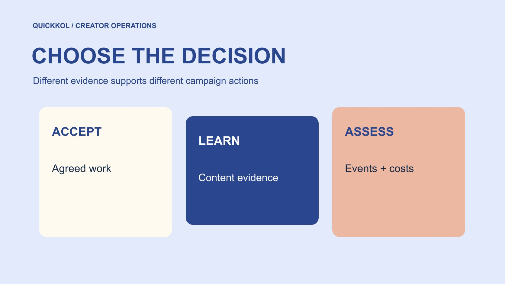

# 社媒指标怎样对应达人营销的三个决策

状态：本地审阅稿；正式发布日期待确认。

先确定要验收、学习还是做商业判断，再选择有适当定义与来源的社媒指标。

QuickKOL 编辑图形；不呈现真实账号指标或平台界面。

社媒指标应从决定倒推选择。验收问约定作品是否完成，内容学习问读者怎样观看与理解，商业判断问可观察的访问、订单和成本。为每个字段保存来源、对象、窗口、单位与限制，避免把观看改名为人数、互动改名为购买意愿，或把同周上涨说成增量效果。指标更多不代表证据更强，关键是每一项能支持清楚的下一步。

## 先写决定，再打开报表

先问负责人准备根据报告做什么：确认交付、修改作品、续约、增加投放，还是解释销售。不同决定需要不同证据。若只是确认原帖发布，根本不需要把所有后台字段导出；若要判断增量销售，只看点赞也不够。把决定与责任人放在表头。

用[达人活动衡量框架](https://www.quickkol.com/zh/blog/creator-campaign-measurement/#answer)将验收、学习和商业问题分开。每一行写如果观察为某种情况，下一步做什么。不能改变任何行动的字段，可以降低优先级。这样减少收集资料，也避免模板中的默认列成为事实上的采购标准。指标设计应服务真实合作，而不是要求创作者为一张无人使用的报表提供更多数据。

## 验收先看约定作品与实际状态

验收对象包括批准版本、原帖、必要披露、目标入口与许可范围。证据可能是作品链接、版本记录和适当确认，不一定是一个表现数字。用[达人活动状态管理方法](https://www.quickkol.com/zh/blog/creator-campaign-status-system/#answer)区分待审、已排期、已发布和已核验。队列成功不能自动等于公开上线。

如果作品缺少约定动作，提出具体修正；如果作品完成但观看低，转入表现学习，不自动重写验收条款。两类问题可以同时存在，但不应互相替代。清楚分离有助于公平结算，也让创作者在制作前知道哪些要求可控制，哪些反应需要在发布后观察。

## 内容学习需要适合问题的字段

学习可以关注开头是否被继续观看、关键动作是否清楚、读者提出什么相关问题。先说明观察能支持什么，不把停留自动解释为喜欢。[Meta 的 Reels 观看时长说明](https://about.fb.com/news/2023/04/instagram-reels-trending-audio-and-gifts-updates/)解释总时长包含重播，提醒分析者保留字段本来的单位与范围。

例如同一段被反复播放，可能是有价值，也可能是看不清。需要结合实际镜头与适当问题主题判断。评论中缺少提问，也不能证明所有人已经理解。内容学习把数字与作品连接起来，给下一次创作一个可测试变化，而不是从一个汇总值直接决定某人没有能力。

## 不要把展示、观看和人数混为一谈

[YouTube 的展示与观看说明](https://support.google.com/youtube/answer/9314486?hl=en)定义了符合条件的缩略图展示及其与观看的关系。这个字段不覆盖每一种流量，也不能直接移植为所有平台的展示定义。[YouTube 的独立观众说明](https://support.google.com/youtube/answer/7577916?hl=en)则描述估计的人群规模，与重复观看事件不同。

跨平台报告应保留各自字段，而不是为了同一列名改写定义。若需要比较，先问数量是否相同、窗口是否匹配、是否存在估计或缺失。不能把多个创作者的独立观众简单相加成去重总人数，因为可能有重叠。总量可作为未去重合计保留，但名称与限制应明确。

## 商业判断要有事件、成本与口径

网站访问、加入购物车、订单、退款后收入与佣金结算回答不同问题。记录事件定义、归因窗口、重复处理、税费与币种范围。不要把毛销售额当利润，也不在没有对照设计时说全部结果由某位创作者增量带来。

预算可以用情景讨论，但情景不是实际回报。假设两千美元费用与五千美元被归因收入，仅能在定义清楚时讨论收入费用比；仍缺商品成本、退款及因果证据。制作资产与分发也可能有不同价值。商业页应说明当前能做哪个决定，而不是用一个 ROI 标签掩盖所有未确认条件。

## 给每个字段一个最小定义

数据字典至少包括字段名、对象、单位、窗口、来源、是否估计、是否含广告以及负责人。自定义比率再加分子、分母与公式。不要只写“互动”，让不同同事各自理解。字段更名或平台更新后，标记版本，不假装前后完全相同。

字典无需收集无关个人信息。使用与决定相称的汇总、截图或导出，保留必要上下文。权限受限或字段不可用，就写未知。通过定义减少误读，比在报告后补一句所有数据仅供参考更有实际帮助。下一位同事能够复算或解释限制，是交接的重要检验。

## 出现异常时先核对来源与条件

异常值可以触发复核，但不是结论。先看窗口、推广、口径、版本与记录是否匹配，再讨论来源问题。不要凭单项比例指控创作者，或按外貌、语言给互动者贴真假标签。需要澄清时提出具体且可回答的问题。

若某项数据暂不能支持排序，就暂缓该比较，保留其他独立证据。报告修正需要版本和通知对象，不能只改上游表。安全问题、制作问题和分析问题交给不同有权人。把范围说清，能让品牌既保护决策质量，又不夸大自己识别所有虚假互动的能力。

## 用三种决定检查同一份报告

假设一条视频按批准版本上线，观看低于计划，网站入口也失效。验收先核对作品与约定入口，失效由相应负责人修复；内容学习观察作品与适当观看；商业判断暂不把低订单全部归因于创作者。三类发现可以并存，不能用一句整体表现差结束。

如果入口修复后重新观察，注明新窗口与条件变化，不与旧段静默合并。假设案例没有说明真实效果，也不保证修复会提升订单。它展示指标怎样支持分工：谁修复交付，谁提出创作测试，谁更新商业分析。报告越能连接行动，越不需要一个夸张总分。

## 以决定、依据与限制结束交接

最终报告用简短结论说明决定、支持证据、未知和下一步。保留数据字典与来源，让负责人可以追溯。不要将所有指标放到第一页，也不要把关键限制藏在没人看的附件里。某项数字被复制到预算页时，必要口径也要跟随。

Social media metrics 的价值是帮助品牌与创作者把工作做得更清楚。验收关注承诺，学习关注可改进内容，商业判断关注适当事件和成本。每项证据在正确位置使用，团队就能继续行动，同时诚实保留现有数据不能回答的问题。

## 检验证据能回答什么

一个字段即使可靠，也可能不适合当前决定。平台观看数据可以帮助学习，却不能单独证明订单是增量；准确的原帖链接可以证明发布，却不能证明受众理解。交接时请负责人说出每项证据支持哪个结论，并说明至少一个它不能回答的问题。这样的边界测试能减少指标从一份报告复制到另一份后被赋予过度含义，并应在每次用途改变时重新进行。

## 三个决定与相应证据

| 决定 | 需要证据 | 常见越界 |
| --- | --- | --- |
| 验收 | 批准版本、原帖和承诺条件 | 低观看自动等于没完成 |
| 内容学习 | 适当观看与作品观察 | 观看自动等于喜欢 |
| 商业判断 | 定义事件、成本与归因限制 | 同周上涨等于增量 |

这是编辑决策框架，不是平台通用评分标准。

## 指标选择决策清单

每个字段都要连接一个行动。

- [ ] 说明当前要做什么决定。
- [ ] 保存对象、单位、窗口与来源。
- [ ] 分开观察、计算与假设。
- [ ] 让必要限制随数字传递。

## 研究日期与使用边界

资料核验于 2026 年 11 月 11 日。文中方法、表格和决策规则为编辑建议，标为假设的示例不是实际客户结果或行业基准。外部资料的适用地区与时期按各段说明；本稿处于独立本地审阅阶段，正式发布日期待确认。

## 用清楚的任务开始达人研究

用 QuickKOL 理解 Brief、发现相关达人并研究作品与联系路径；数据、合作条件和结果仍需核验。

[了解 QuickKOL](https://www.quickkol.com/#capabilities)

## 来源

- [Meta 的 Reels 观看时长说明](https://about.fb.com/news/2023/04/instagram-reels-trending-audio-and-gifts-updates/)
- [YouTube 的展示与观看说明](https://support.google.com/youtube/answer/9314486?hl=en)
- [YouTube 的独立观众说明](https://support.google.com/youtube/answer/7577916?hl=en)
