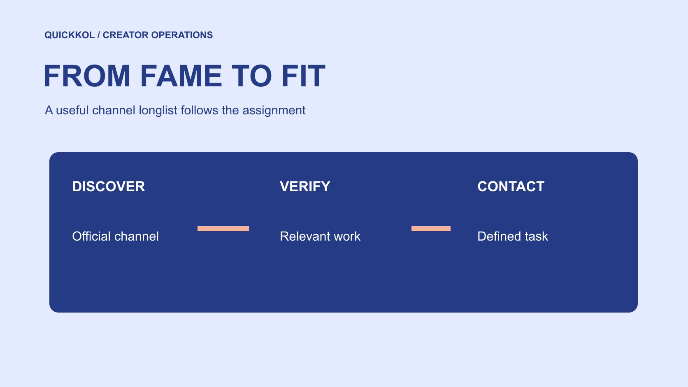

# Top YouTube Channels: Build a Sponsorship Longlist

Status: local review draft; confirm the publication date before release.

Turn popular-channel leads into a verifiable longlist and decide whom to contact through task, work and evidence.

QuickKOL editorial graphic; not actual account metrics or a platform interface.

For a brand, top YouTube channels should become a defined research question rather than a copied ranking by total subscribers. Specify the audience problem, creator role, language, territory and purchase format, then qualify public leads against the same task. MKBHD, Veritasium and Kurzgesagt illustrate different explanatory forms and provide traceable research starting points here. They are not a live ranking or a list of confirmed available partners. A useful longlist gives every candidate an original channel, relevant work, evidence gaps and next action. That makes popularity one discovery input rather than the decision about whom the brand should contact.

## Define what top means for this assignment

Write the product, audience question and creator role before searching. A brand may need demonstration, scientific explanation, industry discussion or broad awareness. Total subscriptions should not automatically measure every task. Establish whether the purchase concerns production, original-account publication or a licensed segment. A prominent animation team and a hands-on equipment reviewer can both be well known while fitting different work.

Use the [creator brief](https://www.quickkol.com/blog/write-a-useful-campaign-brief/#answer) to separate mandatory from negotiable conditions. Language, service territory, core format and actual use conditions may be required. Visual preferences or flexible timing may be negotiable. Do not collect a hundred names and invent the selection reason later. A large channel in search is a discovery entry whose ability to serve the task still needs review. Explicit standards also let agency and brand inspect the same longlist instead of relying on incompatible personal meanings of top. The shortlist should emerge from those standards rather than prestige alone.

## Establish channel identity through official routes

Cross-check the creator’s or team’s official site, original channel and public contact route. A shared name can lead to a main channel, studio program, podcast or language edition. Keep separate account records before identifying a shared team. Do not assign a fan or repost channel’s performance to the original author, or treat an untraceable ranking as the commercial representative.

[MKBHD’s official website](https://mkbhd.com/) links distinct destinations including MKBHD, The Studio, Waveform and AutoFocus. That makes the particular program or account important to the research object. It does not mean the brand can purchase all content under one proposal. Inspect actual work and use appropriate contact for current topic suitability and availability. Save the official route and verification date so another researcher can reach the same account. The purpose is identity continuity across the longlist, not inferring authority or commercial rights from a familiar displayed name.

## Identify different explanatory roles through real work

[Veritasium’s official website](https://www.veritasium.com/) describes science and engineering videos including experiments, interviews and demonstrations. That is a traceable content positioning useful for a research group. Continue to actual pieces to examine how a question is introduced, evidence is used and limits are explained. Whether the product belongs in a similar narrative remains a separate decision. A scientific topic does not establish a technical endorsement.

[Kurzgesagt’s official website](https://kurzgesagt.org/) describes animated explanatory work and provides a public partnership route. A brand can investigate whether a complex question suits animation without treating the entry point as acceptance of a budget or topic. Group these forms alongside hands-on demonstration, stating the audience question and production conditions for each. The comparison concerns roles rather than a claim that this article established superior authority. Named examples show research routes. Actual candidates still need qualification against the specific brief and their current work.

## Keep subscriber ranking in the discovery stage

[YouTube’s subscriber count guide](https://support.google.com/youtube/answer/6051134?hl=en) explains abbreviated public figures. A ranking display therefore needs a date and definition rather than being treated as permanently precise. A larger count also cannot establish a larger relevant audience for this assignment. Keep the ranking source, observation time and candidate link, then move to work review. Do not attach invented decimal precision to an estimate merely to sort the longlist.

[YouTube’s audience reporting guide](https://support.google.com/youtube/answer/9314416?hl=en) provides different definitions for recent audience, including an estimated monthly audience in a rolling window. A later purchase decision may justify requesting applicable native evidence with its limitations. Public subscriptions should not be renamed recent viewers, and creator location cannot establish audience territory. At longlist stage, begin with public work and increase evidence requests as the decision requires. That avoids seeking unnecessary private reporting from people whose work has not yet been matched to the task.

## Keep a selection reason for every candidate

A row needs the original channel, role, relevant work, timecode, connection with the task, unresolved condition and next action. Use a concrete reason, such as a complete demonstration of the required operation, rather than simply good style. Make recency and format visible. One old success does not establish present production or distribution suitability.

Use the [creator shortlist workflow](https://www.quickkol.com/blog/creator-shortlist-workflow/#answer) to separate discovered, identity checked, relevant work found, commercial terms pending and ready for contact. These are different states. If a necessary condition is unknown, identify whom to ask instead of filling the gap with a large subscriber count. A longlist directs the next unit of research effort. A colleague should be able to explain why someone remains, which observation would advance them and what would remove them. Without that reasoning, the list becomes a collection of names whose apparent popularity conceals incomplete qualification.

## Check executable conditions before outreach

A public partnership route can support appropriate contact without establishing availability, price, scope or permission. Decide what to ask before reaching out instead of sending the same undefined message to everyone. Explain the product, audience question, form and proposed timing. List the missing conditions as questions. Do not guess private addresses or pressure a support channel for personal information.

The brand also needs readiness on its own side: samples, technical help and review capacity. If authentic use is required but a suitable product cannot be supplied in the target market, correct that first. Explain animation, location production or additional personnel where needed so the recipient can assess the assignment. Each role needs an outreach reason grounded in work. After a reply, verify representation and terms. Receiving a response does not establish a contract or acceptance of every intended use. Contact is a stage of qualification, not the end of it.

## Test the rules with a hypothetical longlist

Suppose public research yields 20 relevant channels and identity and work review advances six. Three demonstrate operations on the required platform. Three are better suited to explaining an industry question. The second group is not necessarily lower quality. It fits different work. If this brief requires an operation demo, allocate the next effort to the first group while retaining the reason the other group might suit another task.

Suppose one channel lacks current evidence of the required audience territory. Request clarification rather than entering zero or passing it because subscriptions are large. Each screening step should correspond to a condition or observable record. Keep exclusions and reconsider them when the task changes instead of creating a permanent good-and-bad list. The numbers here are hypothetical workflow inputs, not industry response rates, availability percentages or results of this research. The exercise tests whether two colleagues applying the same rules would reach an explainable next action.

## Hand over the longlist as an action record

Sort the handoff by task group, evidence state and next action, retaining the original ranking only as a discovery source. Each row should let another owner find the channel, inspect work, understand the gap and identify an appropriate contact. Keep rates or permissions pending when unconfirmed instead of inserting an estimate to make the sheet appear complete. Date changes and preserve the reason for an update.

The team may later expand or narrow to one needed role. Explain budget and contact priority through selection reasons rather than fame. Suitable work with incompatible timing differs from an unverifiable identity. A clear longlist connects discovery, assessment and outreach through records another person can trace. Top YouTube channels should ultimately help the brand find people with whom a real assignment can be discussed, while preserving room for the commercial confirmation still required. That makes the list usable after the first researcher hands over the project.

## Let a changed task change the contact order

Suppose the original assignment is to explain a complex concept through animation, so a researcher prioritizes teams with relevant visual explanation work. Product staff then change the task to a physical installation demonstration. The earlier channels have not become worse, but the reason for the contact order has changed. Update the required action and filming conditions in the brief before revisiting each candidate’s evidence. Renaming the old list equipment reviewers would not complete that reassessment.

Keeping both roles has value. Animation teams may remain in a research group for a later explanation assignment, while the installation brief advances people whose work demonstrates equipment and operations. Tell existing contacts that the scope changed instead of asking them to prepare detailed proposals for an abandoned task. Where pricing has not been confirmed, do not exclude a production form using an invented budget assumption.

The next owner needs the original assignment, change date, current criteria and affected candidates. If a creator has work in both forms, inspect the particular format and team capacity needed now. The longlist is useful because its reasons can be reconsidered, not because it preserves the same famous names forever. Popularity can help discover people; work and conditions determine whom to approach. Recording the change also makes it possible to explain why someone previously prioritized is now held for a different assignment without implying a negative judgment about their quality.

## Channel research entries and questions to verify

| Research entry | Form to investigate | Still to confirm |
| --- | --- | --- |
| MKBHD and officially linked programs | Specific program and equipment-related explanation | Target account, work and scope |
| Veritasium | Science and engineering demonstration and discussion | Topic fit and current conditions |
| Kurzgesagt | Animated explanation of complex subjects | Production needs and commercial confirmation |

These first-party research examples are not a live ranking, endorsement or list of accepted invitations.

## From ranking to contact-ready candidate

Give every name a work-based reason and next step.

- [ ] Define audience question, role and purchase format first.
- [ ] Verify the particular channel through official routes.
- [ ] Record fit and unknowns through actual work.
- [ ] Prioritize contact by task and evidence state.

## Research date and limitations

Sources reviewed November 11, 2026. Methods, tables and decision rules are editorial recommendations. Hypothetical examples are not actual client results or industry benchmarks. Source geography and periods are specified where relevant. This draft is in independent local review; confirm its publication date before release.

## Start creator research with a clear task

Use QuickKOL to interpret a brief, discover relevant creators and research their work and contact routes. Verify data, commercial terms and outcomes at their source.

[Explore QuickKOL](https://www.quickkol.com/#capabilities)

## Sources

- [MKBHD’s official website](https://mkbhd.com/)
- [Veritasium’s official website](https://www.veritasium.com/)
- [Kurzgesagt’s official website](https://kurzgesagt.org/)
- [YouTube’s subscriber count guide](https://support.google.com/youtube/answer/6051134?hl=en)
- [YouTube’s audience reporting guide](https://support.google.com/youtube/answer/9314416?hl=en)
