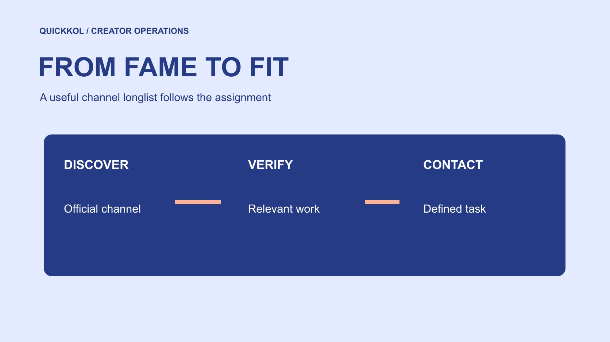

# Top YouTube Channels 怎样变成可用合作长名单

状态：本地审阅稿；正式发布日期待确认。

从热门频道线索走向可核验的合作长名单，用任务、作品和证据决定谁值得联系。

QuickKOL 编辑图形；不呈现真实账号指标或平台界面。

对品牌而言，top YouTube channels 应先定义为最适合当前任务的研究对象，而不是照搬一个总订阅排名。先明确观众问题、内容角色、地区语言和采购形式，再把公开频道线索按同一标准核验。MKBHD、Veritasium 和 Kurzgesagt 可作为不同表达形式的研究入口，本文不将它们列为实时排名或已确认可合作名单。每个候选要有原频道、相关作品、证据缺口和下一步，才值得进入外联。

## 先定义本次所谓的最适合

把产品、读者问题和需要的创作者角色写在搜索前。品牌可能需要演示、科学解释、行业讨论或广泛认知，不应自动用订阅数衡量所有任务。明确本次购买的是制作、原账号发布还是某段许可。一个能做高质量动画的团队，与擅长真实设备上手的人，可能都很出名，适合的工作仍不相同。

在[达人 Brief](https://www.quickkol.com/zh/blog/write-a-useful-campaign-brief/#answer) 中列必要条件与可讨论条件。语言、产品可用地区、核心内容形式与真实使用条件可能是必要；视觉偏好或可调整时间可能有空间。不要先收集一百个名字再临时发明理由。搜索结果里的大频道适合做研究入口，下一步仍是看能否完成本次任务。明确标准也让代理和品牌能够核对同一名单，而不是各自理解谁更顶级。

## 用官方入口建立频道身份

从创作者或团队的正式网站、原频道与公开联系入口交叉核对。相同名称可能对应主频道、幕后节目、播客或不同语言版本。每一个应保持独立账号记录，再说明是否属于同一团队。不要把粉丝站或转载频道的表现归给原作者，也不要仅从一份来历不清的榜单确定商业联系方。

[MKBHD 的官方网站](https://mkbhd.com/)连接了 MKBHD、The Studio、Waveform 和 AutoFocus 等不同入口。它说明研究时应明确具体节目或账号，而不能把同一品牌下的内容全部合成一个购买对象。具体主题与当前合作可能性，仍需逐一查看实际作品和适当沟通。用官方链接保存起点，记录核验日期，能让下一位同事找到相同对象，不至于因显示名相似联系错人。

## 用真实作品识别不同解释角色

[Veritasium 的官方网站](https://www.veritasium.com/)将作品介绍为科学与工程视频，包含实验、访谈和演示。这是一种可追溯的内容定位，可帮助品牌建立研究组。编辑判断应继续到具体作品，例如它怎样提出问题、使用证据、解释限制。品牌的产品是否适合相同叙事，需要独立判断，不能从科学主题推断已经获得技术背书。

[Kurzgesagt 的官方网站](https://kurzgesagt.org/)介绍其动画解释形式，并提供公开合作入口。品牌可以据此研究复杂议题是否适合动画表达，但不能把网站入口当作已接受预算或选题。用这两种形式与实拍演示分组，写明各自能回答什么问题、需要什么制作条件。比较发生在角色层面，而不是声称本文证明谁更权威。具名例子是研究路线，真正候选仍须通过本次 Brief 的条件。

## 把订阅排名留在发现阶段

[YouTube 的订阅计数说明](https://support.google.com/youtube/answer/6051134?hl=en)解释公开数字会简化展示。这意味着榜单中的显示值需要日期与口径，不能当成永久精确排名。即使某频道订阅数更大，也不能由此确定本次相关观众更多。先把排名来源、观察时点与候选链接保留，再进入作品核验。不要为了给长名单排序，给估算值加不存在的小数精度。

[YouTube 的受众报表说明](https://support.google.com/youtube/answer/9314416?hl=en)提供近期受众的另一组定义，包括滚动窗口中的月度受众估计。涉及具体购买决定时，可以请求适用的原生证据，保留数据限制。不能把公开订阅数重命名为近期观看，也不能从创作者所在地推出观众地域。长名单阶段通常先检查公开作品，证据需求随实际决定逐步增加，避免向尚未匹配的人索取不必要后台资料。

## 为每个候选保存一段选择理由

一行记录应包括原频道、内容角色、相关作品、时间点、与任务的关系、未核实条件和下一步。选择理由写成具体证据，例如某段完整演示说明了本次需要的步骤，而不是只写风格不错。作品是否近期、是否同一形式，也要能判断。不能拿一次旧爆款代替当前制作与发布能力。

用[候选名单工作流](https://www.quickkol.com/zh/blog/creator-shortlist-workflow/#answer)把研究状态分开。发现线索、身份已核实、作品适合、商业条件待确认和可以联系，并不互相等同。若某项必要条件未知，写明要向谁询问，而不是用高订阅数填补。长名单的价值是帮助团队决定下一次研究花在哪里。每个人都应该能解释自己为什么还在名单上，以及哪个事实会使他进入或退出下一阶段。

## 在外联前检查可执行条件

公开合作入口可以用于适当联系，但不证明档期、价格、服务范围或授权。需要在联系前确定自己想问什么，避免向每位创作者发送同一段没有任务的信息。说明产品、受众问题、合作形式和拟议时间，缺少的条件作为问题列出。不要猜私人邮箱，也不要用客服电话强行寻找个人资料。

品牌还应确认样品、技术支持和审核能力。如果要求真实使用，却无法提供目标市场可用的产品，先修正自身条件。工作需要动画、现场拍摄或额外人员时，把制作范围说清，便于对方判断。不同角色的外联应有相应作品依据。对方回复后，再核对授权代表与商业条件，而不是把回复本身当成合同成立或已同意所有用途。

## 用一个假设长名单检查筛选规则

假设品牌从公开来源找到 20 个相关频道，按身份与作品核对后，6 个进入进一步研究。其中 3 个能够提供适用平台的演示，另外 3 个更适合解释行业问题。不能把后者简单写成质量较差，它们只是对应另一种工作。若本次目标是操作演示，就将资源先放在前一组，并为后一组保留不同任务的理由。

再假设一个频道缺少当前地区受众证据。可以先补问，不应自动记零，也不能因订阅多直接通过。每一项筛选都对应必要条件或可验证证据。保留排除原因，并定期在任务变化后重新判断，避免形成永久好坏名单。样例数字只是工作流程演练，不是行业回复率、可用性比例或本次真实研究结果。

## 把长名单交成下一步行动表

交接时按任务组、证据状态与下一步排序，原始排名只作为研究来源保留。每一行应让另一位负责人找到频道、查看作品、理解缺口并知道如何联系。报价或授权还未确认时保持待确认，不能为了让名单看起来完整填写估计承诺。更新研究时保留日期与变化原因。

下一次团队可能扩大范围，也可能缩小到一个真正需要的角色。用选择理由解释预算与联系优先级，而不诉诸谁看起来最有名。作品适合但时间不合，和身份不能确认，是不同状态。清楚的长名单让品牌在发现、判断与外联之间形成可追溯路径。Top YouTube channels 最终应帮助品牌找到能讨论真实任务的人，并为后续商业确认保留空间。

## 一次任务变更怎样改变联系顺序

假设品牌最初希望用动画解释一个复杂概念，研究员因此优先保留擅长视觉解释的团队。随后产品部门把任务改成真实设备的安装演示。旧名单中的频道并不会因为这次调整变差，但排序理由已经需要改变。先更新 Brief 的必要动作和拍摄条件，再回到每个候选的作品证据。不要只把旧名单的标题换成设备评测，就假装完成了重新筛选。

保存两种角色的记录有实际价值。动画团队可以保留在后续解释任务的研究组，安装演示则寻找能展示设备与操作步骤的人。对已有联系如实说明范围变化，避免让对方为不再需要的方案做详细报价。尚未取得价格时，也不要用猜测预算排除某种制作形式。

交给下一位负责人时，写明原任务、变化日期、当前标准与受影响的候选。若一名创作者同时具备两类作品，再分别核对这次所需的形式和团队能力。长名单的稳定性不在于永远保留同一批名人，而在于理由能够随任务变化接受复核。这样知名度帮助发现人，作品和条件帮助决定联系谁。

## 频道研究入口与需验证的问题

| 研究入口 | 可研究的表达形式 | 仍需确认 |
| --- | --- | --- |
| MKBHD 及官网连接节目 | 具体节目与设备相关解释 | 目标账号、作品与本次范围 |
| Veritasium | 科学与工程的实验及讨论 | 主题适合度与当前条件 |
| Kurzgesagt | 动画解释复杂议题 | 制作需求与商业确认 |

这些是来自一方网站的研究示例，不是实时排名、背书或已接受邀请名单。

## 从榜单到可联系候选

每个名字都要有作品理由和下一步。

- [ ] 先定义观众问题、角色与采购形式。
- [ ] 从官方入口核对具体频道。
- [ ] 用真实作品记录适合与未知条件。
- [ ] 按任务与证据状态决定联系顺序。

## 研究日期与使用边界

资料核验于 2026 年 11 月 11 日。文中方法、表格和决策规则为编辑建议，标为假设的示例不是实际客户结果或行业基准。外部资料的适用地区与时期按各段说明；本稿处于独立本地审阅阶段，正式发布日期待确认。

## 用清楚的任务开始达人研究

用 QuickKOL 理解 Brief、发现相关达人并研究作品与联系路径；数据、合作条件和结果仍需核验。

[了解 QuickKOL](https://www.quickkol.com/#capabilities)

## 来源

- [MKBHD 的官方网站](https://mkbhd.com/)
- [Veritasium 的官方网站](https://www.veritasium.com/)
- [Kurzgesagt 的官方网站](https://kurzgesagt.org/)
- [YouTube 的订阅计数说明](https://support.google.com/youtube/answer/6051134?hl=en)
- [YouTube 的受众报表说明](https://support.google.com/youtube/answer/9314416?hl=en)
