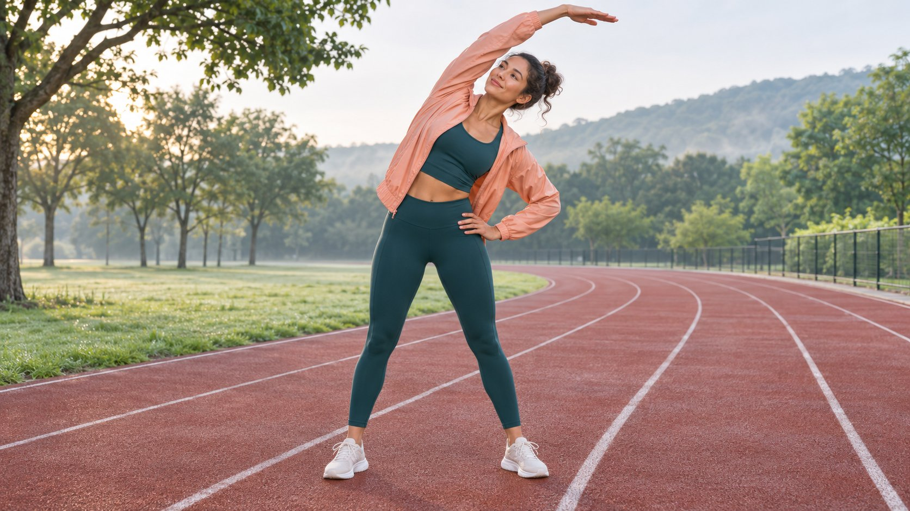

# Activewear Apparel Brands: Match Product to Movement

Status: local review draft; confirm the publication date before release.

Compare activewear apparel brands with a creator brief built around use case, exact product, fit and visible movement.

AI-generated editorial illustration, not an actual creator, client, product or event.

Compare activewear apparel brands around a defined use case such as running, yoga, lifting or commuting. Check fit, construction, intended use and care for the exact style. Ask a creator to demonstrate comparable movements and report layers, camera angle, style and test limits. A manufacturer’s description, one wearer’s experience and independent testing are three different kinds of evidence. Keep those boundaries visible in the edit and avoid extending one fitting to a whole brand.

## Begin with the movement and environment

Start with the viewer’s problem. A commuter may want to reach a pocket while seated. A yoga brief may focus on bending and stretching, while a running demonstration could cover layers, arm movement or how an item moves in a pocket. Choose a movement sequence and give each fitting comparable conditions. Log surface, weather, effort, layers and carried objects. Use familiar, safe movements. The [fitness creator pilot brief](https://www.quickkol.com/blog/fitness-influencer-pilot-brief/#answer) can help scope the level of evidence the project needs. For a phone pocket, a standing view, one insertion and removal, and a short continuous moving shot may answer the question. If the video compares designs, give the same move to each garment and show where the pocket sits relative to the waist. If a fit or model requires a different action, state the difference. Decide whether the viewer should learn about a feature, choose a size or compare use cases. Each purpose changes which detail the camera needs to preserve.

## Check the brand’s chart and exact garment

The [lululemon women’s size guide](https://shop.lululemon.com/help/size-guide/womens) is an example of brand guidance that organizes sizing and measurements by product group. Before filming, record market, style identifier, tagged size, length or cut, and layering. Distinguish the manufacturer’s fit guidance from the wearer’s preference. The same letter across brands need not correspond to the same measurements. If the creator chooses to share measurements relevant to fit, collect only what the assignment needs. Separate accounts of fit are useful across bodies and preferences. No single wearer can answer every sizing question. Suppose two leggings have the same waist measurement at rest, but the rise and pocket placement differ. Record the construction detail and show what happened during the same move. Avoid treating a garment laid flat as equivalent to an on-body fitting. If a sample is unavailable in the preferred size, either delay the sizing claim or explain which sample was actually tested. Keep the official chart’s market and access date in the source record.

## Show the construction during actual movement

Start with a wide take that shows the resting pose, movement and return. Add inserts of fabric, pockets, seams and closures. If the brand needs to show hem position during an overhead reach, keep the wrist, shoulder and waist visible in the relevant take. Record any between-shot adjustment. Give the observable detail and personal preference distinct wording. A hem position after one turn is something a reviewer can see. Preferring a looser cut is the wearer’s judgment. Use the [fashion creator repeat-wear brief](https://www.quickkol.com/blog/fashion-influencers-repeat-wear-brief/#answer) to schedule a second fitting or observation after care. If the creator filmed front and side views on separate takes, label them as such and try to keep lighting, movement and layers comparable. If a long-sleeved top obscures the watch or hand in one frame, decide whether a second angle can show the relevant detail. Keep a reference take with natural movement so later social edits have evidence for claims that depend on the sequence.

## Attribute fabric claims and substantiate performance

The [Nike moisture-wicking fabric guide](https://www.nike.com/ca/a/nike-what-is-moisture-wicking) describes Dri-FIT’s design purpose and explains wicking from the manufacturer’s perspective. Visible sweat, the wearer’s sensation and a measured result under a controlled protocol are different observations. Suppose a creator says a top felt drier after a short run. Describe the duration, conditions, layers and exact style where those details are known. A comparative claim about twice the wicking speed would need relevant measurement. For any performance comparison, decide what to measure, which samples to use, how to repeat the comparison and which conditions to record. Preserve those details before writing the claim. A caption can attribute a feature description to the brand and separately state the creator’s experience. Avoid framing a casual studio experiment as laboratory evidence. If temperature or exercise intensity changes substantially between examples, explain the conditions and decide whether the result still belongs in a comparison. If a client needs stronger evidence, give the reviewer the proposed claim and the product team’s supporting material before filming.

## Report care separately from the first fitting

The [Patagonia product care and repair guide](https://www.patagonia.com/repairs/) illustrates a manufacturer’s care resources and repair route. Check the actual care label and product information for the garment in the assignment. For a before-and-after wash example, record washing and drying conditions, whether the item was dried flat, the measurement method and exact style. One wash may reveal an observation for that sample. It cannot establish long-term durability or the cause of a change. Check the current regional process before making a statement about repair availability. Preserve the label or an authorized reference so editors can check the narration against it. Suppose two pieces follow different instructions. Keep both treatments in the report instead of implying they received identical care. If a creator followed a personal routine that differs from the label, disclose the distinction before drawing any conclusion. A later fit concern can be investigated using the dated observations without blaming a care method the reviewer has not confirmed.

## Walk through a hypothetical comparison

Imagine two lightweight jackets, one sold for commuting and one for running. Use the same layers, light, angle and test phone for reaching a side pocket, raising an arm and a short easy jog. Record each model. Use the commute version to explain access while seated and the run version to show the cuff during an arm swing. If the intended activities differ, name them in the copy instead of giving a universal ranking. The creator removing one phone easily supports an observation about that test. A claim about every phone needs different evidence. If dimensions matter, document the pocket opening and actual test phone before finalizing the caption. The production team might discover that the phone moved on the jog but stayed in the pocket. Keep both observations and show a wide angle so the viewer understands what movement took place. A useful handoff points to the clip, lists conditions and gives the editor the wording they can support.

## Give buyers, editors and reviewers the same evidence

Include style, market, size, movement, timecode, source, approval and any limitation in the handoff. Record whether the brand supplied the garment and how the actual post discloses the relationship. [FTC influencer disclosure guidance](https://www.ftc.gov/business-guidance/resources/disclosures-101-social-media-influencers) discusses material connections including products supplied by a brand. Review post-release questions about the specific use case and choose a movement or detail the next edit should explain. If price, stock or size guidance changes, update the current destination and preserve results for the version that actually ran. A change in clicks or returns needs its own evidence before it is attributed to the fitting. Keep the approved copy next to the exact asset and record whether the brand can reuse it. When an ad uses a shorter cut, check that the edit still contains the shot and disclosure that support the copy. If a reviewer cannot reproduce an observation, mark it open and ask for the appropriate version or conditions.

## Choose a useful retest

If viewers repeatedly ask about layering the running jacket, test the same size with a thicker base layer and keep the original take for comparison. State which condition changed and which conclusions still require evidence. If the question concerns another season or a longer run, plan an observation for those conditions. Keep the comparison practical. The follow-up can show exactly where movement or fit changed and still avoid a broad claim about everyone’s comfort.

## Plan for sample and production tradeoffs

Give the shot list three states. A claim can be visible in an approved take, verifiable with one more angle or dependent on a different sample or condition. Suppose the size is correct but the sample’s cuff differs from the current retail model. Have the product owner confirm the difference and decide whether to wait for a replacement. An edit cannot turn the old garment into evidence about the new version. If light or location changes, keep the observation with the new conditions before comparing it with an earlier run. You can clear a care explanation from unaffected footage and defer a fabric comparison that needs matched light. Tell the approver which line, caption and destination the change affects. Assign a person to receive and return samples. On a reshoot, use the earlier notes to restore the angle and action while recording any remaining differences. Move claims needing product evidence to a follow-up rather than leaving them in the public script. When a brand needs several formats, identify the critical observation in each. A crop showing only the sleeve may be enough for the cuff but cannot show hem movement. Send the editor the wide take and the permitted crop range. If the demonstration has to change because an item is unavailable, document the new item and purpose in the brief. Leave the earlier evidence attached to its own version so a later report does not associate an updated SKU with the original wearer’s observations.

## Activewear movement evidence

| Question | Shot and source | Scope |
| --- | --- | --- |
| Fit | Brand size chart and actual fitting | Style, sample and market |
| Movement | Continuous wide take of the same move | Layers and movement conditions |
| Care | Care label and actual care log | Cycles and verifiable conditions |

The brand examples illustrate different kinds of source material.

## Activewear try-on checklist

Confirm that each statement has traceable evidence.

- [ ] Record style, size, market and layers.
- [ ] Keep comparable continuous movement takes.
- [ ] Distinguish product documentation and personal experience.
- [ ] Mark care conditions and test limits.
- [ ] Review usage and disclosure.

## Research date and limitations

Sources reviewed November 5, 2026. Methods, tables and decision rules are editorial recommendations. Hypothetical examples are not actual client results or industry benchmarks. Source geography and periods are specified where relevant. This draft is in independent local review; confirm its publication date before release.

## Start creator research with a clear task

Use QuickKOL to interpret a brief, discover relevant creators and research their work and contact routes. Verify data, commercial terms and outcomes at their source.

[Explore QuickKOL](https://www.quickkol.com/#capabilities)

## Sources

- [lululemon women’s size guide](https://shop.lululemon.com/help/size-guide/womens)
- [Nike moisture-wicking fabric guide](https://www.nike.com/ca/a/nike-what-is-moisture-wicking)
- [Patagonia product care and repair guide](https://www.patagonia.com/repairs/)
- [FTC influencer disclosure guidance](https://www.ftc.gov/business-guidance/resources/disclosures-101-social-media-influencers)
