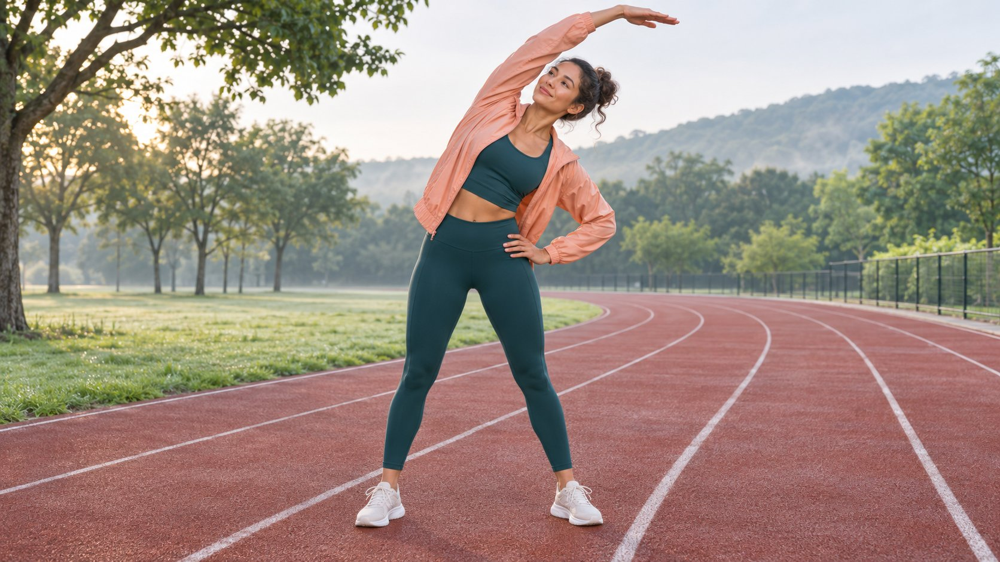

# 运动服饰品牌：按使用场景核对产品

状态：本地审阅稿；正式发布日期待确认。

比较运动服品牌时，把适用场景、款号、尺码和可见动作写进同一份创作者试穿简报。

AI 生成的编辑示意图，不是真实达人、客户、产品或活动。

比较 activewear apparel brands 时，先选跑步、瑜伽、力量训练或通勤等具体场景，再比较实际款号的尺码、结构、用途与护理要求。请创作者在相同条件下完成一组可观察动作，明确叠穿、拍摄角度、款号和测试边界。品牌的面料说明、试穿者的个人感受和独立实验是三种证据。编辑时保留各自范围，不由一次试穿推断整个品牌的表现。

## 从动作和使用环境开始比较

先问观众要解决什么问题。通勤想知道坐下和骑行时口袋物品是否容易取，瑜伽关注弯曲与伸展，跑步可能关心叠穿、摆臂及物品是否晃动。选一个动作组合并按同一条件试拍。记录地面、天气、运动强度、内搭和携带物，不需要让创作者做不熟悉或危险的动作。用[健身创作者试点简报](https://www.quickkol.com/zh/blog/fitness-influencer-pilot-brief/#answer)确定什么证据足以满足项目目标。比如要解释手机袋的位置，只需站姿、插取和低速移动的连续镜头。

## 尺码先看品牌和具体款号

以[lululemon女装尺码指南](https://shop.lululemon.com/help/size-guide/womens)为例，品牌按品类给尺码和身体测量说明。录制前标注市场、款号、尺码、裤长或版型与内搭，区分官方建议与试穿者选择。不要假设不同品牌同一个字母对应相同测量区间。若创作者愿意，可分享与画面理解有关的测量范围；不要求公开私人或无关信息。不同体型由各自试穿回答，不把单个试穿者当作所有人的尺码替代。

## 用原始镜头说明动作中的结构

先保留一个从静止、开始移动到恢复站姿的宽镜头，再补面料、口袋、接缝及闭合处的近景。假设品牌要展示抬臂时下摆位置，保留前后姿势及手腕、肩、腰在画面中的位置。若在镜头间拉平或重调衣物，应标注条件变化。把体验用语拆成可见与主观两部分，例如“这个样衣在这次转身后下摆到了这个位置”与“我更喜欢宽松一点”。用[时尚达人重复试穿简报](https://www.quickkol.com/zh/blog/fashion-influencers-repeat-wear-brief/#answer)安排第二次试穿或清洗后观察。

## 面料技术引用品牌，性能结论要有证据

[Nike吸湿排汗面料说明](https://www.nike.com/ca/a/nike-what-is-moisture-wicking)介绍 Dri-FIT 的设计目的及吸湿排汗的概念，是品牌方资料。衣物汗迹、体验者感觉和标准测试中测量的性能是不同事物。假设创作者跑一段后说自己感觉较干爽，可以交代运动时长、温度、叠穿和测试款，不宜将体验改为“比另一个品牌排汗快一倍”。需要比较性能时先确定测量方法、样本、重复次数和环境，并保存证据。对外文案区分品牌声称、体验观察和可复查测量。

## 把洗护与穿着观察分开

[Patagonia护理与维修指南](https://www.patagonia.com/repairs/)提供护理资源和维修入口，具体产品应核对洗标与官方产品说明。假设项目要比较洗一次前后的状态，记录洗涤和干燥条件、是否晾平、测量方式与实际款号。一次清洗后观察变化，不能证明长期耐用或解释产生变化的原因。若要说某产品在市场有维修服务，先查当前地区的实际流程与条件。保留拍摄的洗标或经批准的引用，避免画面和字幕不一致。

## 用假设案例做一次试穿交接

假设品牌要为两款轻外套做视频，分别是通勤版和跑步版。用相同内搭、光线和角度完成侧向取手机、抬臂和短距离慢跑，记录型号与同一测试物。通勤版拍口袋位置和坐姿，跑步版拍袖口与摆臂。两款产品如果本身适用情境不同，文案分别说明，不给出通用最佳排名。将“观察到手机取出顺利”和“适合所有手机”分开。若有人希望补充适用手机尺寸，实际量口袋开口与所用手机，再确定如何描述。

## 让采购、审片和结案使用同一份记录

交接写清款号、市场、尺码、动作、画面时间点、来源、审批和需保留的限定。注明服装是否由品牌提供以及实际披露怎么放。[美国FTC达人披露说明](https://www.ftc.gov/business-guidance/resources/disclosures-101-social-media-influencers)讨论了品牌提供实物等实质关系。发布后收集与使用问题有关的反馈，计划下一条要解释的动作或场景。价格、库存、尺码表变化时，更新与当前商品有关的信息，同时保留旧版本对应的数据。别把点击或退货变化自动归因于试穿表现。

## 补一次真正有用的复测

假设观众多次问跑步外套能否叠穿，下一期可选同一尺码加厚内搭，保留原版镜头对照。每次明确改变的条件与不能外推的范围。若要支持另一个季节或更长时长，请安排对应观察，不能只改标题。

## 提前处理拍摄取舍与样衣偏差

给拍摄表准备三种状态：镜头已能证明、补拍一个角度即可、需要不同样本或条件。假设尺码正确但样衣袖口与当前量产款不一致，先请商品负责人确认差别，决定是否等待更新样衣。不能靠剪辑让观众以为旧样衣就是新版本。若场地或光照临时变化，保留该次观察但不与上一轮直接对比。可以先用没有受影响的镜头交付护理说明，延后需要可比光线的面料展示。让审批人知道变动影响哪句话、哪条字幕和哪个链接。样衣的签收和归还也要有人负责。再次拍摄时，旧场记能帮团队恢复机位和动作，但实际改变仍应单列。结案时将需要商品团队补证的说法留在待办，不让它进入外部稿件。

## 运动服动作证据表

| 问题 | 镜头与来源 | 范围 |
| --- | --- | --- |
| 适用尺码 | 品牌尺码表与真实试穿 | 款号、样衣与市场 |
| 活动空间 | 同一动作连续宽镜头 | 叠穿和动作条件 |
| 洗护 | 洗标与本次护理记录 | 次数及可核验条件 |

举例品牌用于展示资料类型。

## 运动服创作者试穿清单

交接前确认每个说法都能找到证据。

- [ ] 记录实际款号、尺码、市场和内搭。
- [ ] 保留可比较的完整动作镜头。
- [ ] 区分产品说明和主观体验。
- [ ] 标记护理条件和测试限制。
- [ ] 复核素材使用和商业披露。

## 研究日期与使用边界

资料核验于 2026 年 11 月 5 日。文中方法、表格和决策规则为编辑建议，标为假设的示例不是实际客户结果或行业基准。外部资料的适用地区与时期按各段说明；本稿处于独立本地审阅阶段，正式发布日期待确认。

## 用清楚的任务开始达人研究

用 QuickKOL 理解 Brief、发现相关达人并研究作品与联系路径；数据、合作条件和结果仍需核验。

[了解 QuickKOL](https://www.quickkol.com/#capabilities)

## 来源

- [lululemon女装尺码指南](https://shop.lululemon.com/help/size-guide/womens)
- [Nike吸湿排汗面料说明](https://www.nike.com/ca/a/nike-what-is-moisture-wicking)
- [Patagonia护理与维修指南](https://www.patagonia.com/repairs/)
- [美国FTC达人披露说明](https://www.ftc.gov/business-guidance/resources/disclosures-101-social-media-influencers)
